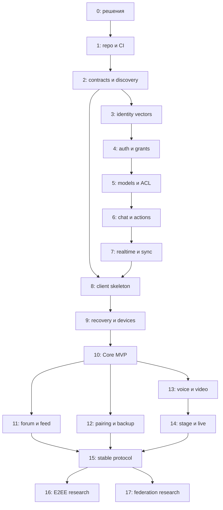

## v0.8.0 — сопряжение и зашифрованные резервные копии

Приложение [v0.8.1+61](https://github.com/space-protocol-project/space-app/releases/tag/v0.8.1) опубликовано с закреплённым runtime v0.8.0, схема 46.
[Релизный CI](https://github.com/space-protocol-project/space-app/actions/runs/40791498361)
успешен. [Сервер/runtime v0.8.0](https://github.com/space-protocol-project/space-server/releases/tag/v0.8.0) опубликован с той же схемой и API;
[его CI](https://github.com/space-protocol-project/space-server/actions/runs/40787489975) успешен. [CI клиента v0.8.1](https://github.com/space-protocol-project/space-app/actions/runs/40791498361) и [проверка публичной пары](https://github.com/space-protocol-project/space-app/actions/runs/40870483924) также успешны: четыре установщика, подпись Android, versionCode 61 и точное совпадение встроенного каталога с runtime v0.8.0. Обновление установленного сервера подтверждается владельцем.
[Обзор реализации и границ](https://github.com/space-protocol-project/space-app/blob/main/docs/PAIRING-BACKUPS-080.md).

- [x] Сопряжение: срок временного ключа, очистка, Cubit/Freezed, полный и ограниченный режимы, серверные проверки и отзыв.
- [x] Snow 0.10.0 / Noise XX, непрозрачный relay, сверка SAS на двух устройствах и явное применение выбранного каталога.
- [x] Версионный каталог с отдельным DEK и парольной обёрткой, trust pins, подписками, причинными ревизиями настроек и защитой от известного отката.
- [x] Хранение на одном сервере пространства, подтверждение точной головы, безопасная очистка, квоты и зашифрованная история отпечатков; схема 46, манифесты v3/v5.
- [x] Переносимый профиль обработки голоса с отдельной ревизией, явным разрешением конфликтов и защищённым журналом; манифесты v4/v5.
- [x] Android SAF для больших `.spacedevice`: поток, отмена копирования, проверка результата, сохранение незавершённых переносов; тесты на эмуляторе CI.
- [x] Полный перенос сохраняет возможность пустого пароля по решению пользователя. Новый экспорт не вводит дополнительного ограничения; пустой пароль не обеспечивает секретность архива.
- [x] Сквозное восстановление полного устройства на чистой установке Windows: [CI](https://github.com/space-protocol-project/space-app/actions/runs/40785025482), пять отдельных процессов, настоящий DPAPI, удалённые исходный профиль и база, пустой пароль, настройки, черновик, обычная история и очередь, MLS и вложение, переписка после перезапуска и повтор без отката.
- [x] Аварийное восстановление Linux с настоящим PlatformKeyStorage/libsecret/GNOME Keyring: [CI](https://github.com/space-protocol-project/space-app/actions/runs/40873149607), 17 проверок, 13 SIGKILL, 57 независимых чтений Secret Service, холодные запуски приложения и хранилища, сохранность каталога/настроек/личности и повтор без отката. Анализ без замечаний, COG ≤15, 1224 теста / 44 штатных пропуска. [Границы](https://github.com/space-protocol-project/space-app/blob/main/docs/DIRECTORY-CRASH-RECOVERY.md).
- [x] Аварийное восстановление macOS с настоящим системным login Keychain для сборок без Apple-подписи: [CI](https://github.com/space-protocol-project/space-app/actions/runs/40882808496), анализ без замечаний, COG ≤15, 132 целевых теста / 1 штатный пропуск, 17 проверок, 13 SIGKILL, 57 независимых чтений с разными PID и 28 очисток собственных профилей. Данные, настройки и прежняя личность сохраняются, повтор без отката. Исправление в main ещё не выпущено; записи Data Protection Keychain не удаляются, перенос из них требует явного экспорта/восстановления. [Правила и границы](https://github.com/space-protocol-project/space-app/blob/main/docs/MACOS-DIRECTORY-CRASH.md).
- [ ] Отдельно проверить завершение Android-процесса во время передачи/применения и продолжение после холодного запуска в эмуляторе GitHub CI.

Независимая экспертиза интеграции и физическая приёмка исключены из обязательного
объёма 0.8.0 по решению пользователя; выполненными они не считаются. GenUI и
публичные расширения не входят в этот выпуск. Сборки и проверки — только GitHub CI.

## Система расширений Space — спецификация и план перехода

План от 27 октября 2026 года: [подробная спецификация](docs/SPACE-PLUGINS.md). Система ещё не реализована. Пакет WASM добавляет прикладную логику, страницы и элементы «Обзора»; ядро сохраняет идентичность, ACL, хранение, доставку событий, криптографические и медиаслужбы. Пустое пространство допускает ноль прикладных расширений.

Рекомендуемый порядок: **0.8.0 — сопряжение и зашифрованные резервные копии; 0.9.0 — основа расширений; 0.10.0 — Обсуждения и Лента; 0.11.0 — Чаты и Комнаты; 1.0 — стабильное ядро и API**. Это план версий приложения, а не опубликованные выпуски; runtime сохраняет независимую нумерацию. Подготовка 0.8.0 открыта новым указанием пользователя от 27 октября. До её приёмки расширения остаются на уровне спецификации, прототипов и совместимых внутренних адаптеров без публичной установки плагинов и переноса данных.

### P0 — инвентаризация и границы

- [x] Подготовить спецификацию, последовательность переноса четырёх функций, релизные границы и сценарии A01–A26.
- [ ] Составить полную карту RPC, таблиц, индексов, событий, заданий, клиентских очередей и UI для каждой функции; сверить с реально выпущенными возможностями.
- [ ] Зафиксировать отображение channel/view → instance, сохранение старых ID, ссылок и capability `core.*`.
- [ ] Зафиксировать исходные сценарии и измерения производительности до рефакторинга.

### P1 — контракты и прототипы

- [ ] Определить protobuf API реестра, команд, queries, contributions и lifecycle; добавить совместимую генерацию Go/Dart/OpenAPI.
- [ ] Подготовить проверяемые схемы манифеста, UI, ошибок, команд и событий; определить точный ABI и владение памятью.
- [ ] Проверить wazero на целевых платформах: память, бесконечный цикл, отмена host calls, компиляция и суммарные квоты; закрепить версию и решение по runtime.
- [ ] Определить доверие издателю, подпись пакета, ротацию ключа и проверку архива.
- [ ] Проверить ограниченный декларативный рендерер Flutter, версии компонентов, локализацию и доступность. Это отдельная задача от отложенного GenUI.

### P2 — встроенные адаптеры без переноса данных

- [ ] Ввести установки, экземпляры и реестр разделов; подключить существующие Чаты, Комнаты, Обсуждения и Ленту через внутренние адаптеры.
- [ ] Перевести навигацию и «Обзор» на contributions с независимыми ошибками, ACL и кешем на пользователя; сохранить старый overview API.
- [ ] Сохранить один путь записи для старого RPC и нового dispatcher; проверить старый/новый клиент и сервер.
- [ ] Подтвердить паритет поведения без смены формата пользовательских данных и без удаления существующих API.

### P3 — основа расширений и внешний пакет, цель 0.9.0

- [ ] Реализовать проверяемую установку пакета владельцем, выдачу разрешений, отключение и карантин.
- [ ] Реализовать изолированное хранилище, ревизии, идемпотентность, транзакции, outbox, replay и ограниченные задания.
- [ ] Реализовать обновление с миграциями/checkpoint, согласованную резервную копию и восстановление без магазина.
- [ ] Выпустить первый SDK и пакет «Опросы»: новый раздел и элемент обзора без пересборки клиента и сервера.
- [ ] Пройти A01–A16 и A22–A25; доказать работоспособность пустого пространства и управления при ошибке плагина.
- [ ] Зафиксировать совместимую пару выпусков, схемы/ABI/UI, CI, опубликованные файлы и SHA-256. Не объявлять экспериментальный API стабильным.

### P4 — Обсуждения и Лента, цель 0.10.0

- [ ] Перенести Обсуждения: темы/ответы, модерация, жалобы с приватностью заявителя, чтение, реакции, избранное, вложения и упоминания.
- [ ] Перенести Ленту: публикации/комментарии, социальные связи, репосты/цитаты, подписки и персональная хронология без расширения ACL.
- [ ] Проверить поиск, уведомления, общий обзор и экспорт по действующим ограничениям ADR-060.
- [ ] Выполнить повторяемый перенос тестовой копии, сверку содержимого и ссылок, переключение единственного writer и восстановление после сбоя.
- [ ] Пройти A17–A18, A26 и общую регрессию; сохранить legacy API до объявленного окончания поддержки.

### P5 — Чаты и Комнаты, цель 0.11.0

- [ ] Перенести обычные Чаты с сохранением sequence, клиентских ID отправки, черновиков, offline-очередей и всех выпущенных действий.
- [ ] Подключить MLS-каналы через реестр без передачи открытого текста/ключей серверному WASM и без изменения эпох/групп.
- [ ] Перенести сущности и политику Комнат; WebRTC/TURN/native audio остаются специализированными службами.
- [ ] Сохранить вместимость 2–32, исходное значение 8, совместимость старых клиентов и безопасное завершение комнат при отключении пакета.
- [ ] Пройти A19–A21 и общую регрессию; подтвердить реальные два клиента и внешний TURN, отдельно сохранить открытые аппаратные ограничения.

### P6 — стабилизация, цель 1.0

- [ ] Завершить аудит границ доверия, нагрузку нескольких расширений, восстановление и всю матрицу A01–A26.
- [ ] Зафиксировать политику совместимости SDK/API/UI, поддержку версий и порядок прекращения legacy API.
- [ ] Удалить временные привилегированные адаптеры только после паритета публичных контрактов и миграционной приёмки.
- [ ] Опубликовать руководство разработчика, администратора и диагностику; магазин, клиентский WASM и произвольные веб-интерфейсы оставить отдельными будущими этапами.

Ни один из этих пунктов не закрывает прежние незавершённые критерии «Сообществ», сопряжения, MLS, восстановления или физической приёмки. Полные критерии и ответственность трёх репозиториев — в разделах 18–21 спецификации.

## Markdown, экспорт и подписки — выпущено v0.7.29 / v0.7.23

- [x] Ограниченный CommonMark в чатах, форуме и ленте: проверка рендерера, безопасные ссылки, отсутствие внешних загрузок и пределы разбора. [Границы проверки](https://github.com/space-protocol-project/space-app/blob/main/docs/SAFE-MARKDOWN.md).
- [x] Экспорт собственного доступного содержимого: ADR-060, JSON с версией, выбор раздела/периода, метаданные вложений; без MLS и секретов. Сервер, клиент и системное сохранение JSON на Android выпущены; финальная CI-проверка успешна.
- [x] CI: [генерация, анализ и 67 целевых тестов](https://github.com/space-protocol-project/space-app/actions/runs/40404981786); [полный серверный прогон](https://github.com/space-protocol-project/space-server/actions/runs/40404971152): Go с гонками, 1036 Flutter-тестов / 42 штатных пропуска, реальные Connect/PostgreSQL и перезапуск. [COG ≤15, нативный экспорт Linux и сборки Windows/macOS/Linux/Android](https://github.com/space-protocol-project/space-app/actions/runs/40404342802) прошли. Локальные сборки и тесты не запускались.
- [x] Опубликована совместимая пара v0.7.29+59 / runtime v0.7.23, схема 41 и голосовой профиль 3. [Релизный CI приложения](https://github.com/space-protocol-project/space-app/actions/runs/40409891076), [runtime](https://github.com/space-protocol-project/space-server/actions/runs/40406370390), [установка на трёх ОС](https://github.com/space-protocol-project/space-app/actions/runs/40409852513) и [публичные файлы](https://github.com/space-protocol-project/space-app/actions/runs/40414458922) проверены. SHA-256, CRC, схема, каталог APK и подпись обновления Android совпали. [Отчёт и передача следующей сессии](https://github.com/space-protocol-project/space-app/blob/main/docs/MARKDOWN-EXPORT-RELEASE.md).
- [x] После нового указания пользователя от 27 октября открыта подготовка v0.8.0: сначала надёжное сопряжение и восстановление, затем публичные расширения. Незакрытые критерии «Сообществ» сохранены отдельно.

GenUI отложен пользователем. Физический Android и эмулятор не используются;
сборки, генерация и тесты выполняются только в GitHub CI.

## Подписки и персональная лента — выпущено v0.7.29 / v0.7.23

- [x] Зафиксировать область и приватность: ADR-059, публикации подписанных авторов внутри пространства, без расширения доступа.
- [x] Контракт, схема 41 и сервер: личный список, безопасные повторы, страницы с повторной проверкой read ACL, блокировок и скрытия.
- [x] Клиент: подписка у автора, список подписок, персональная хронология, переход к исходной публикации, Cubit/Freezed и сброс устаревшего контекста.
- [x] Генерация, COG, анализ, Go с `-race`, 1022 Flutter-теста / 42 штатных пропуска, настоящий Connect/PostgreSQL с перезапуском — [серверный CI](https://github.com/space-protocol-project/space-server/actions/runs/40392031417). [Сборки Windows/macOS/Linux/Android и нативный интерфейс Linux с горячим перезапуском](https://github.com/space-protocol-project/space-app/actions/runs/40389570858) прошли. [COG ≤ 15](https://github.com/space-protocol-project/space-app/actions/runs/40393081757), максимум 14 без исключений. Локальные сборки и тесты не запускались; Android без устройства и эмулятора.

Срез опубликован вместе с ограниченным Markdown и экспортом собственного
содержимого: v0.7.29+59 / runtime v0.7.23, схема 41. Нижеследующие записи
сохраняют историю предыдущих срезов; актуальный статус выпуска указан выше.

## Социальная лента — выпущено v0.7.28 / v0.7.22

- [x] Согласовать ответы на комментарии, компактную ленту, репосты и цитирование; подписки отдельно. ADR-058.
- [x] Контракт и схема 40: ссылки внутри раздела и публикации, без копирования оригинала.
- [x] Сервер: права, скрытие оригинала, защита от циклов и повторы запросов.
- [x] Клиент: адресат ответа, репост/цитирование, переход к оригиналу и компактная хронологическая лента.
- [x] Генерация, анализ и [53 целевых теста](https://github.com/space-protocol-project/space-app/actions/runs/40364312357); [полный серверный прогон](https://github.com/space-protocol-project/space-server/actions/runs/40362736839): Go с `-race`, 1006 Flutter-тестов прошли / 42 пропущены, настоящий Dart/Connect → Go → PostgreSQL со скрытием, правами и перезапуском. [Сборки Windows/macOS/Linux/Android и нативный Linux с горячим перезапуском](https://github.com/space-protocol-project/space-app/actions/runs/40362798109) прошли. [COG ≤ 15](https://github.com/space-protocol-project/space-app/actions/runs/40364722059), без исключений. Локальные сборки и тесты не запускались.
- [x] Опубликована совместимая пара v0.7.28+58 / runtime v0.7.22 со схемой 40 и голосовым профилем 3. [Релизный CI приложения](https://github.com/space-protocol-project/space-app/actions/runs/40375158499), [runtime](https://github.com/space-protocol-project/space-server/actions/runs/40371335438), [установка на трёх ОС](https://github.com/space-protocol-project/space-app/actions/runs/40375088511) и [публичные файлы](https://github.com/space-protocol-project/space-app/actions/runs/40381975116) прошли. SHA-256, CRC, каталог APK и подпись Android проверены. [Отчёт](https://github.com/space-protocol-project/space-app/blob/main/docs/SEARCH-FEED-RELEASE.md).

## Общий поиск пространства — выпущено v0.7.28 / v0.7.22

Область: обычные чаты, темы и ответы форума, публикации и комментарии ленты.
Зашифрованные MLS-сообщения остаются в существующем локальном поиске.
Релиз реакций и избранного отделён неизменяемыми тегами v0.7.27 / v0.7.21;
общий поиск опубликован в паре v0.7.28 / v0.7.22 вместе с социальной лентой.

- [x] Зафиксировать область, единый контракт, порядок страниц и границы приватности.
- [x] Сервер: единый поиск только по доступным открытым разделам, повторная проверка сессии/grant/scope/ACL, скрытия и родителей; ограниченное время и размер.
- [x] Клиент: название раздела и тип результата, страницы и переход к точному сообщению/ответу/комментарию; Cubit/Freezed и сброс при смене контекста.
- [x] Генерация Go/Dart/OpenAPI и Freezed, анализ без замечаний, 26 целевых тестов и нативный Linux с горячим перезапуском прошли в [CI](https://github.com/space-protocol-project/space-app/actions/runs/40352378187). Новые функции COG ≤ 9, общий максимум 14. Локальные сборки и тесты не запускаются.
- [x] Полный [серверный прогон](https://github.com/space-protocol-project/space-server/actions/runs/40352711596): Go с `-race`, анализ Flutter без замечаний, 996 тестов прошли / 42 пропущены, настоящий Dart/Connect → Go → отдельная PostgreSQL с перезапуском. [Сборки Windows/macOS/Linux/Android](https://github.com/space-protocol-project/space-app/actions/runs/40353603073) и нативный Linux-сценарий общего поиска с горячим перезапуском прошли в GitHub CI.
- [x] Совместимый выпуск v0.7.28 / v0.7.22 опубликован и проверен; серверный поиск требует core.space.search.v1, MLS остаётся локальным. [Результаты выпуска](https://github.com/space-protocol-project/space-app/blob/main/docs/SEARCH-FEED-RELEASE.md).

## Личное избранное форума и ленты — выпущено v0.7.27 / v0.7.21

Реакции и избранное опубликованы: приложение v0.7.27+57 / runtime v0.7.21, схема 39.
Полный релизный CI и публичные файлы проверены. Избранное синхронизируется между
устройствами одного участника пространства; настройки по разделам не добавляются.

- [x] Контракт и capability: личные отметки четырёх типов содержимого, состояния пачками и постраничный список выбранного раздела.
- [x] Хранение, ревизии, атомарные изменения и безопасные повторы; без изменения содержимого, непрочитанного и уведомлений.
- [x] Сервер проверяет сессию/grant/scope/ACL и видимость родителя. Сохранение требует чтения; закрытие темы и архивирование не требуют права записи.
- [x] Кнопки сохранения и список избранного с переходом к исходному объекту; Cubit/Freezed, смена личности/раздела и отсечение поздних ответов.
- [x] Серверный CI: приватность, несколько устройств, повторы, перезапуск, скрытие, отзыв доступа, миграция и актуальное имя автора; Go, `-race`, анализ и Flutter. [Прогон](https://github.com/space-protocol-project/space-server/actions/runs/40329535628).
- [x] Финальные сборки приложения и нативное избранное Linux с горячим перезапуском прошли в [релизном CI](https://github.com/space-protocol-project/space-app/actions/runs/40340976945). Локальные сборки остановлены после сбоя E:. Android без устройства и эмулятора.
- [x] Опубликована совместимая пара v0.7.27+57 / v0.7.21. [Проверены публичные файлы](https://github.com/space-protocol-project/space-app/actions/runs/40347995528): полное скачивание, размеры, SHA-256, CRC, схема 39, подпись APK и встроенный каталог runtime. [Отчёт](https://github.com/space-protocol-project/space-app/blob/main/docs/COMMUNITY-ACTIONS-RELEASE.md).

## Реакции форума и ленты — выпущено v0.7.27 / v0.7.21

Реакции и личное избранное опубликованы: приложение v0.7.27+57 / runtime v0.7.21,
схема 39. Старый API и адаптеры не добавляются.

- [x] Контракт и capability: реакции к теме/ответу форума и публикации/комментарию ленты, счётчики и собственный выбор без списка чужих principal ID.
- [x] Хранение, атомарные изменения, ревизии, безопасные повторы; реакции не меняют текст, порядок, непрочитанное или уведомления.
- [x] Серверные сессия/grant/scope/ACL, видимость объекта и родителя; форум требует read/write, лента — read/comment. Закрытая тема и архивный раздел доступны только для чтения.
- [x] Общий интерфейс реакций, состояние в Cubit/Freezed, сброс при смене раздела/личности/доступа и отсечение поздних ответов.
- [x] PostgreSQL/Connect: права, скрытые родители, конкурентные изменения, повторы и перезапуск. Flutter: интерфейс, ошибки и смена контекста; анализ и COG.
- [x] Настоящий Dart/Connect-клиент ↔ сервер ↔ отдельная PostgreSQL: четыре типа, два устройства, повторы, ревизии, перезапуск и отзыв прав. Windows release и Android debug собраны на E:; CRC и 34 ELF трёх ABI проверены. Android без физического устройства и эмулятора.
- [x] Совместимый выпуск v0.7.27+57 / v0.7.21 опубликован; полный релизный CI и публичные установщики проверены. [Отчёт](https://github.com/space-protocol-project/space-app/blob/main/docs/COMMUNITY-ACTIONS-RELEASE.md).

## Профиль участника пространства — выпущено v0.7.26 / v0.7.20

Согласовано: имя и аватар в пределах пространства. Имена уникальны в пределах пространства без учёта регистра, с Unicode-нормализацией. Переопределений по разделам в этом срезе нет. Прежний API изменения ника удалён; используется единый контракт профиля. principal ID, ключи, grant, права, блокировки и адресаты упоминаний не меняются.

- [x] Сверить фактические выпуски с разделами milestone: поиск, сводка, чтение ленты, упоминания, персональные уведомления и MLS-упоминания уже опубликованы.
- [x] Зафиксировать контракт профиля, ограничения аватара, права чтения, проверку текущей сессии и удаление прежнего API изменения ника.
- [x] Хранение профиля и миграция с сохранением идентичности, истории, ACL и существующих имён; имя и аватар изменяет только владелец профиля.
- [x] Редактирование имени, выбор/удаление аватара, предпросмотр и повтор после ошибки в Cubit/Freezed; защита от запоздалых ответов при смене пространства или личности.
- [x] Отображение актуального профиля у участников и авторов доступного содержимого; безопасная заглушка без аватара, устойчивое авторство по ID и серверная уникальность имён.
- [x] Серверные и клиентские проверки, настоящий клиент ↔ сервер ↔ отдельная PostgreSQL, миграция/перезапуск/несколько устройств. Android без устройства и эмулятора.
- [x] Опубликована совместимая пара [приложение v0.7.26+56 / runtime v0.7.20](https://github.com/space-protocol-project/space-app/blob/main/docs/PARTICIPANT-PROFILES-RELEASE.md), схема 37 и голосовой профиль 3. Релизный CI, публичные установщики, подпись APK и SHA-256 проверены; прежний API профиля удалён. Android без устройства и эмулятора.

Проверено локально: Flutter 938 / 40 пропусков, COG ≤14; полный Go и -race с отдельной PostgreSQL, vet/mod verify/govulncheck, настоящий Connect с двумя device grant и перезапуском; Windows release и Android debug без запуска Android. [Результаты профиля](../space-app/docs/PARTICIPANT-PROFILES.md).

## Структурированные MLS-упоминания — выпущено v0.7.25 / v0.7.19

- [x] Версионированные ID адресатов и UTF-16 диапазоны внутри MLS ciphertext, без раскрытия серверу. [ADR-053](docs/adr/053-mls-mentions.md).
- [x] Проверка поддержки всеми устройствами группы по подписанным capabilities листьев и совместимый текстовый вариант для прежних клиентов; строгий разбор, без новой миграции БД.
- [x] Выбор участника, защищённые черновики по профилю и группе, отображение и проверка смены личности/состава. Явная отмена остановившихся повторов после исключения адресата.
- [x] Проверены новый и прежний форматы, очередь, восстановление и настоящий шифротекст. Flutter: 928 успешных / 35 пропусков; анализатор и COG без нарушений, максимум 14. Rust: 37 тестов, fmt/clippy, OpenMLS ↔ mls-rs; два сквозных сценария Dart/Connect ↔ Go ↔ PostgreSQL. Windows release и Android debug собраны, CRC APK и 34 ELF для трёх ABI проверены. Windows hot reload без ошибок; Android без устройства и эмулятора. [Результаты](../space-app/docs/MLS-MENTIONS.md).
- [x] Опубликовано приложение [v0.7.25+55](https://github.com/space-protocol-project/space-app/releases/tag/v0.7.25), совместимое с runtime v0.7.19. Полный релизный CI успешен; установщики и SHA-256 скачаны и проверены, подпись APK совпала с v0.7.24, versionCode 55. [Отчёт](https://github.com/space-protocol-project/space-app/blob/main/docs/MLS-MENTIONS-RELEASE.md).

## Уведомления об упоминаниях и ответах — выпущено v0.7.24 / v0.7.19

- [x] Совместимая база опубликована: приложение v0.7.23 / runtime v0.7.18, схема 35.
- [x] Подготовлен [план среза и проверок](https://github.com/space-protocol-project/space-app/blob/main/docs/COMMUNITY-NOTIFICATIONS.md): отдельный серверный список, страницы без потери поздних транзакций, режимы приватности, точные переходы и границы Android/MLS. Срез опубликован в v0.7.24 / v0.7.19; ручная приёмка новых карточек остаётся открытой.
- [x] Реализовано локально: персональные непросмотренные упоминания обычных чатов и общий постраничный контракт, серверные ACL, повторы, бюджет и отдельный просмотр. Миграция 35→36, `core.personal.notifications.v1`, [ADR-052](docs/adr/052-personal-notifications.md). Включено в v0.7.24 / v0.7.19.
- [x] Локально прошли полный Go с отдельной PostgreSQL, целевые PostgreSQL/Connect с `-race`, vet, проверка модулей и достижимых уязвимостей, Buf lint/breaking, 23 Flutter-теста и настоящий Dart/Connect-сценарий. Анализ и COG чистые, максимум 14. [Проверки и границы](../space-app/docs/COMMUNITY-NOTIFICATIONS.md).
- [x] Локально добавлены Cubit наблюдения, ограниченные пачки с повтором, список непросмотренных записей по разделу, системные карточки работающего приложения и переход с повторной проверкой доступа. Фактическая видимость выбранного обращения обычного чата подтверждает отдельный просмотр. Старые серверы сохраняют прежнюю доставку.
- [x] Клиентские проверки смены личности, отзыва доступа, запоздалых страниц, повтора, границ страниц и холодного запуска прошли локально. Проверены список на узком экране и отмена карточки во время сохранения цели. Серверные PostgreSQL/Connect повторно прошли с `-race`, включая подтверждение по ID сообщений.
- [x] Полный Flutter: 916 прошли / 35 пропущены; 67 целевых проверок и настоящий Dart/Connect ↔ Go ↔ PostgreSQL прошли отдельно. Анализ чистый, COG максимум 14, Windows release и Android debug собраны; CRC и 34 ELF-библиотеки трёх ABI проверены. Устройство и эмулятор не использовались.
- [x] Выпущена совместимая пара v0.7.24+54 / v0.7.19. Полный релизный CI и проверка публичного Linux-установщика прошли. Все четыре установщика, три runtime-архива и дескрипторы скачаны и проверены по SHA-256; подпись APK совпала с v0.7.23, versionCode 54, схема 36, голосовой профиль 3. [Отчёт выпуска](https://github.com/space-protocol-project/space-app/blob/main/docs/NOTIFICATIONS-RELEASE.md).
- [ ] Ручная приёмка настоящих системных карточек и отдельный новый сквозной CI-сценарий уведомлений остаются отложенными по выбранному порядку работ.
- [ ] Доставка нового источника при закрытом процессе Android. Физическое устройство и эмулятор Android пока не используются.

## Чаты, темы и навигация — выпущено v0.7.23 / v0.7.18

- [x] Выбор участника через `@` в обычных чатах: ID и UTF-16, проверка read/write и адресата, история, поиск, события, идемпотентность и атомарные правки/удаление. Схема 35, `core.chat.mentions.v1`, ADR-051.
- [x] Черновики и очередь сохраняют адресата, правки и подтверждения учитывают аннотации. В MLS выбранное имя отправляется в совместимом зашифрованном тексте; расширение native-формата не заявляется.
- [x] Кнопка пространства открывает обзор с именем пространства; пункт «Обзор» удалён. Выбор чата слева открывает чат, выбранный канал и черновики сохраняются.
- [x] Автоматическая/светлая/тёмная тема; автоматическая следует системе при работе. Светлая рамка Windows и внешний shell — `#DEDACE`, тёмные цвета сохранены; рамка меняется вместе с темой.
- [x] Общие проверки: Flutter 883 passed / 34 skipped, анализ и COG без нарушений (275 файлов, 2696 функций, максимум 14). Полный Go с отдельной PostgreSQL, целевой `-race`, vet/mod verify/govulncheck; настоящий Dart/Connect ↔ Go ↔ PostgreSQL. Windows release и Android debug собраны, CRC и три ABI APK проверены. Устройство и эмулятор Android не использовались.
- [x] GHSA-frr6-h895-5pxp проверен: уже установлены и закреплены в CI исправленные Flutter 3.47.8 / Dart 3.13.7; Flutter совпадает с текущим stable. Новые сборки выполнены этим SDK.
- [x] Совместимая пара опубликована: приложение v0.7.23+53 / runtime v0.7.18, схема 35 и голосовой профиль 3. Полный релизный CI обоих тегов прошёл. Установщики и runtime скачаны полностью, размеры/SHA-256/CRC проверены; подпись APK совпала с v0.7.21, versionCode 53, minSdk 24, три ABI и встроенный каталог runtime проверены. [Отчёт выпуска](https://github.com/space-protocol-project/space-app/blob/main/docs/MENTIONS-RELEASE.md). Кандидат v0.7.22 не опубликован после найденного сбоя тестовой подмены MLS-сессии; исправленный сквозной тест прошёл локально и в CI v0.7.23.

## Упоминания и персональное внимание — выпущено v0.7.23 / v0.7.18

- [x] Структурированные диапазоны `@имя` с ID principal в темах, ответах, публикациях и комментариях. Обычный текст с `@` не создаёт упоминание. Редактирование выбранного фрагмента снимает его связь; одинаковые имена различаются ID.
- [x] Подбор только участников, имеющих read/visible ACL раздела. Сессия, grant, scope и права отправителя проверяются сервером, получатель проверяется по членству и ACL; скрытые объекты, удалённые/заблокированные участники и недоступные разделы не раскрываются.
- [x] «Требует внимания»: непросмотренные упоминания и ответы на свои публикации ленты, с переходом к точной теме/ответу/комментарию. Просмотр упоминания независим от общего курсора чтения: поиск не прочитывает ранние комментарии.
- [x] Идемпотентность, лимиты, отзыв прав, скрытие родителей, Unicode/диапазоны, два устройства одной личности, сохранение отметок после открытия БД и поздние ответы. Полный Go с отдельной PostgreSQL и целевой `-race`, vet/mod verify/govulncheck; настоящий Dart-клиент ↔ Go/Connect ↔ PostgreSQL. Flutter: 874 passed / 34 skipped, ещё две проверки экрана 360×600 и обновления capabilities прошли отдельно; 33 целевые проверки после последних изменений. Анализ чистый, COG ≤15, Windows release и Android debug собраны, CRC и ELF трёх ABI APK проверены. Устройство и эмулятор не использовались. [Поведение и проверки](../space-app/docs/COMMUNITY-MENTIONS.md).
- [x] Выпущено в совместимой паре v0.7.23 / v0.7.18, итоговая схема 35. Три runtime-архива и все четыре установщика приложения проверены после публикации. [CI приложения](https://github.com/space-protocol-project/space-app/actions/runs/40196986234), [CI runtime](https://github.com/space-protocol-project/space-server/actions/runs/40193682784), [проверка публичного Linux-установщика](https://github.com/space-protocol-project/space-server/actions/runs/40198486264). Персональные уведомления опубликованы в v0.7.24 / v0.7.19; профиль пространства — следующий срез.

## Отметки чтения ленты — выпущено v0.7.21 / v0.7.17

- [x] Контракт `core.feed.read.v1`, миграция 33: персональная отметка публикации и монотонный курсор комментариев, общий для устройств principal.
- [x] Серверные read ACL, scope, сессия и членство на чтении и записи отметок. Скрытые родители и комментарии исключены из счётчиков; поздний курсор не отмечает будущие сообщения.
- [x] Лента и сводка показывают непрочитанное. Автоматическая отметка только видимой записи в открытом приложении; поиск с пропуском ранних комментариев не прочитывает их автоматически. Старый сервер сохраняет прежнее поведение.
- [x] PostgreSQL/Connect/gRPC, гонки отметок, отзыв прав, разные устройства, сохранение после перезапуска; полный Go с отдельной PostgreSQL, целевые `-race`, vet, проверка модулей и достижимых уязвимостей. Flutter — 863 успешных теста, 34 пропуска; ещё две проверки перекрытия прошли отдельно. Анализатор и COG без нарушений, Windows release и Android debug собраны; APK проверен для трёх ABI. Android на устройстве и эмуляторе не проверялся.
- [x] Опубликованы приложение v0.7.21+51 и runtime v0.7.17; каталог клиента закрепляет опубликованный runtime, серверный CI — выпущенный клиент. Схема 33, голосовой профиль 3. Оба релизных CI успешны. [Поведение и результаты](../space-app/docs/FEED-READ.md).
- [x] Четыре установщика клиента, три runtime-архива, три JSON и оба SHA256SUMS.txt полностью скачаны; размеры, SHA-256 и CRC ZIP/APK проверены. Android сохраняет подпись, package ID, minSdk 24 и три ABI; versionCode 51. Каталог в APK совпадает с опубликованными дескрипторами. Оба выпуска Latest. Устройство и эмулятор Android не использовались.

## Сводка: «Требует внимания» и «Новое в сообществах» — выпущено v0.7.20 / v0.7.16

- [x] Два адаптивных блока: проблемы подключения, непрочитанные чаты, ответы в собственных темах, жалобы модератора, свежие темы и публикации. Прямые переходы к содержимому и очередям.
- [x] Серверная персональная сводка `core.community.overview.v1`: сессия, grant, scope, членство и ACL проверяются при каждом запросе. Скрытые темы/публикации и ответы исключены; счётчик жалоб только для управляющего. Используется схема 32, новой миграции нет.
- [x] Cubit/Freezed: обновление только на открытой сводке, частичные сбои, старые серверы, отмена и отсечение поздних ответов при смене прав/источника. Отметки чтения форума серверные; у ленты показываются последние публикации без ложного счётчика непрочитанного.
- [x] Проверки: Flutter — 856 успешных тестов, 34 пропуска; восемь целевых проверок сводки; анализатор и COG без нарушений. Go — тесты, vet, проверка модулей, PostgreSQL и целевые тесты прав с `-race`; перенос пространства на Windows проверен отдельно. Windows debug запущен, Android debug APK собран для трёх ABI. Физическая приёмка Android остаётся отложенной.
- [x] Подготовка выпуска: новые клиентские проверки включены в desktop CI. Сквозной тест настоящего клиента и сервера проверяет поиск/сводку до и после скрытия, восстановления и отзыва read ACL; отдельная PostgreSQL штатно остановлена. Обновлены оба Unreleased и [порядок выпуска](../space-app/docs/COMMUNITIES-RELEASE.md).
- [x] Опубликованы приложение v0.7.20+50 и runtime v0.7.16; каталог клиента закрепляет опубликованный runtime. Схема 32, голосовой профиль 3. [Отчёт выпуска](../space-app/docs/COMMUNITIES-RELEASE.md).
- [x] Оба релизных CI полностью успешны. Четыре установщика клиента, три runtime-архива, три JSON и оба SHA256SUMS.txt полностью скачаны; размеры и SHA-256 совпали. Android сохраняет подпись, package ID, minSdk 24 и три ABI; versionCode 50, каталог внутри APK совпадает с опубликованным runtime. Оба выпуска Latest; физическая приёмка Android отложена.
- [x] Структурированные упоминания реализованы локально; отдельные отметки просмотра и оставшиеся проверки описаны выше. Выпуск пока не опубликован.

## Поиск внутри раздела «Сообществ» — выпущено v0.7.20 / v0.7.16

Объём: серверный поиск по заголовкам и тексту тем/ответов форума и публикаций/комментариев ленты только внутри выбранного раздела. Обычный текст, без поиска по MLS, файлам, всем пространствам или семантического поиска. Выпущенная пара — клиент v0.7.20 / runtime v0.7.16, схема 32.

- [x] Контракт, capability и ограниченные запросы/страницы; старый сервер скрывает поиск.
- [x] PostgreSQL: read ACL, scope устройства, членство и действительность сессии проверяются при каждом запросе и странице. Скрытые объекты, комментарии скрытых родителей и архивные разделы исключаются; нет обхода через счётчики или фрагменты текста.
- [x] Flutter: общий поиск внутри форума/ленты, загрузка/ошибка/пустой результат, страницы и переход к конкретному ответу или комментарию. Состояние в Cubit/Freezed; смена раздела, обнаруженный отзыв доступа и закрытие сбрасывают результаты и отбрасывают запоздавшие ответы.
- [x] Интеграционные тесты PostgreSQL и Connect/gRPC: права и отзыв между страницами, блокировка/удаление участника, ограниченный grant, скрытие родителя/комментария, изоляция разделов, Unicode, буквальные спецсимволы и курсоры.
- [x] Проверки клиента: старый сервер, навигация, узкая компоновка, клавиатура, запоздавшие ответы и отмена; анализ, COG и подходящие тесты.
- [x] Автоматизированная приёмка: участник находит публикацию и комментарий → модератор скрывает их или отзывает доступ → новый запрос не выдаёт содержимое, обнаруженный отзыв очищает результаты. Физическая приёмка Android остаётся отложенной.

- [ ] Физическая приёмка Android отложена по решению пользователя; выпуск не закрывает весь milestone «Сообщества».

## Совместимый выпуск ленты и завершения процессов — 24 октября 2026

- [x] Опубликованы клиент v0.7.19+49 и runtime v0.7.15; схема 31, голосовой профиль 3. Лента, раздельные права, жалобы и модерация входят в первый срез.
- [x] [Релизный CI клиента](https://github.com/space-protocol-project/space-app/actions/runs/40125104828) и [runtime](https://github.com/space-protocol-project/space-server/actions/runs/40122672289) полностью успешны. Четыре установщика, три runtime-архива, три JSON и оба SHA256SUMS.txt полностью скачаны; размеры и SHA-256 проверены. Каталог клиента закрепляет опубликованный v0.7.15.
- [x] Штатное завершение HTTP/gRPC и runner ограничено таймаутами; повторные проверки конкурентной остановки и смены фазы RTP под -race прошли. Android APK сохраняет подпись, package ID, три ABI и минимальную версию Android; versionCode увеличен до 49.
- [ ] Физическая приёмка Android и аппаратные/сетевые проверки голоса отложены; выпуск не закрывает весь milestone «Сообщества».

## Форум: жалобы и очередь модерации — 23 октября 2026 (выпущено v0.7.16 / v0.7.13)

- [x] Схема 30 и core.forum.reports.v1: жалобы на темы и ответы через gRPC и Connect, причина до 1024 байт, проверка read, сессии, членства, архива и видимости объекта.
- [x] Защита повторов: одна жалоба от principal на объект; не более 30 новых жалоб в час во всех разделах и устройствах. Идентификатор заявителя не возвращается модераторам.
- [x] Очередь ожидающих жалоб и история решений с пагинацией и серверными read/manage + space.manage. Отклонение либо скрытие с причиной; expected_revision, атомарность решения/скрытия/аудита, конфликт одновременных решений. Журнал связывает решение с report_id.
- [x] Flutter: жалобы из меню темы и ответа, очередь из меню раздела, переход в обсуждение, причина и решения. Старый runtime скрывает неподдерживаемые действия; общий ввод чата не менялся.
- [x] Защита вложений сохранена: жалоба не копирует текст или файлы, заголовок скрытой темы не выдаётся; скрытие по решению блокирует скачивание по ID и прежние пути доступа.
- [x] Полный Flutter-прогон: **795 passed / 21 skipped**; после финальных правок — **7 passed** целевых тестов жалоб и модерации, включая экран 360 px. Анализ чистый, COG ≤15 (244 файла, 2340 функций), порог не менялся.
- [x] Полный `go test ./... -count=1` с настоящей PostgreSQL прошёл (postgres — 186,338 с); четыре новых интеграционных теста жалоб прошли отдельно. Покрыты gRPC/Connect, читатель без write, scope/ACL и отзыв видимости, повтор/лимит, пагинация, конфликт revision и решений, откат аудита, файлы и миграция 29→30. `go vet ./...`, `buf lint` и проверки пробелов трёх репозиториев прошли.
- [x] Windows Debug пересобран и запущен с настоящими сервером, PostgreSQL, двумя участниками и вложением. Подготовлены [15 снимков всей оболочки и навигации](../space-app/docs/screenshots/forum-reports-app/README.md) на широком и узком экранах; после скрытия файла реальное скачивание вернуло NotFound. Горячая перезагрузка инструментального запуска завершилась ошибкой, поэтому выполнены обычная пересборка и перезапуск.
- [ ] Ручная приёмка на физических устройствах: отзыв разрешения при открытой очереди/диалоге, обрыв и повтор отправки, экранная клавиатура и скрытие во время скачивания.
- [x] Оба выпуска v0.7.16 / v0.7.13 опубликованы как Latest. [CI клиента](https://github.com/space-protocol-project/space-app/actions/runs/40002385514) и [CI runtime](https://github.com/space-protocol-project/space-server/actions/runs/39997805449) успешны. Четыре установщика, три runtime-архива, три JSON-дескриптора и SHA256SUMS.txt полностью скачаны: размеры и SHA-256 совпали с GitHub API и контрольными суммами. [Установка опубликованного runtime](https://github.com/space-protocol-project/space-app/actions/runs/40002391668) прошла на трёх ОС. Клиент закрепляет проверенный runtime v0.7.13 для Windows x64, Linux x64 и macOS arm64; схема 30, голосовой профиль 3.
- [x] Сайт опубликован на трёх языках: [Pages CI](https://github.com/space-protocol-project/space-protocol/actions/runs/40006692879) успешен. Живые HTML, CSS, модули переводов и 15 новых PNG сверены с исходниками и SHA-256. Chrome: 320/390/1280, русский/английский/китайский, увеличение галереи — без переполнений. README трёх репозиториев, Changelog и руководство форума обновлены.
- [x] В первом релизном CI тест 32 программных голосовых участников получил задержанный пакет после mute/deafen; повтор той же задачи на том же коммите прошёл. Отдельный полный CI того же коммита также успешен. Проверки не отключались, код голоса не менялся.
- [x] Проверка mute/deafen с 32 программными участниками различает старые RTP-пакеты и пакеты новой фазы после подтверждения команд. В релизном CI сохранён строгий запрет новых пакетов; пять повторов под -race прошли. Конкурентное завершение отдельно повторяется 20 раз.

Первый срез ленты выпущен в паре v0.7.19 / v0.7.15. Поиск и персональные уведомления уже выпущены. Редактирование, профили пространства и расширенная синхронизация остаются отдельными задачами.

## Релиз модерации, навигации и анимаций — 23 октября 2026

- [x] Сайт опубликован на трёх языках: [Pages CI](https://github.com/space-protocol-project/space-protocol/actions/runs/39991346092) успешен. Живые HTML, CSS, модули переводов и 15 PNG сверены с исходниками и SHA-256. Браузер: 320/390/1280, русский/английский/китайский, галерея — без горизонтального переполнения.

- [x] Оба выпуска опубликованы как Latest. [CI клиента](https://github.com/space-protocol-project/space-app/actions/runs/39987080393) и [CI runtime](https://github.com/space-protocol-project/space-server/actions/runs/39983388046) успешны. Четыре установщика, три runtime-архива, три JSON-дескриптора и SHA256SUMS.txt полностью скачаны: размеры и SHA-256 совпали с GitHub API и контрольными суммами.
- [x] Клиент закрепляет runtime v0.7.12 для Windows x64, Linux x64 и macOS arm64. Обновлены README трёх репозиториев, Changelog, руководство форума и галерея полного приложения.
- [x] Финальный полный Flutter-прогон: **791 passed / 21 skipped**; анализ чистый, COG ≤15. Проверки упаковки клиента и сервера, buf lint и контракт OpenAPI прошли.
- [ ] Ручная приёмка физических устройств, экранной клавиатуры, сетевых обрывов и отзыва доступа остаётся открытой.

- [x] До публикации клиента исправлена RUSTSEC-2026-0385: ctutils 0.4.4 во всех трёх Cargo.lock MLS, лицензии пересобраны. Проверка 154 зависимостей не нашла уязвимостей; тесты MLS и совместимости OpenMLS/mls-rs прошли.

## Форум: повторное открытие и скрытие — 23 октября 2026 (выпущено v0.7.15 / v0.7.12)

- [x] Схема 29 и `core.forum.moderation.v1`: повторное открытие темы, скрытие/восстановление тем и ответов через gRPC и Connect. Обязательная причина, read/manage, scope, revision, проверка архивирования и отзыва доступа.
- [x] Транзакционный журнал новых операций: автор, время, причина, объект и revision; страницы доступны только модератору. Ошибка аудита откатывает изменение; параллельные изменения с одной revision дают один успех и один конфликт.
- [x] Серверные заглушки скрытого содержимого, включая идемпотентные повторы. Файлы скрытых тем/ответов исключены из каталогов, списка авторов и скачивания по ID. Восстановление темы сохраняет отдельно скрытые ответы; уже скачанные копии не отзываются.
- [x] Flutter: причины, повторное открытие/скрытие/восстановление, журнал и замена ранее загруженных ответов после модерации другим устройством. Старый runtime не показывает неподдерживаемые действия. Подсказка «Что у вас нового?» удалена из общего ввода и MLS на всех языках.
- [x] Полный Flutter-прогон: **787 passed / 21 skipped**. Эталоны чата обновлены из-за удаления подсказки. Анализ чистый; COG ≤15, превышений нет.
- [x] Финальный целевой прогон форума, навигации, модерации, локализации и экспорта снимков: **24 passed**. Повторный анализ после подготовки полной оболочки чистый; проверены 241 Dart-файл и 2313 функций.
- [x] Навигация: отдельная область «Обсуждения» рядом с чатами и комнатами, прямое открытие раздела; заголовок помещается целиком. Управление пространством, избранное и файловые списки перенесены в «Обзор» на широком и узком экране. [Новые снимки полного приложения](../space-app/docs/screenshots/forum-navigation-app/README.md).
- [x] После переноса навигации: полный Flutter-прогон **788 passed / 21 skipped**, анализ без замечаний, COG ≤15; Windows Debug пересобран и запущен, получены 15 новых снимков. Эталоны оболочки обновлены и повторно проверены.
- [x] Заголовки чатов, комнат и обсуждений: одинаковое начало текста с уменьшенным отступом, прежние позиции значков, обновление справа; AutoSizeText из pub.dev для длинного текста. Целевые проверки навигации — 18 passed; финальный тест геометрии и 8 эталонов — 9 passed. Анализ чистый, COG ≤15; галерея полного приложения обновлена.
- [x] Между областями боковой панели единый отступ 16 px. Переходы между страницами и темами — появление со сдвигом 180 мс; высота списков меняется плавно. Сохранены черновики, скрытое содержимое удаляется сразу, учтено системное отключение анимаций. Целевые проверки и эталоны: 39 passed; анализ чистый, COG ≤15.
- [x] Полный `go test ./... -count=1` с PostgreSQL прошёл; пакет postgres — 266,849 с. Покрыты права, scope, файлы/повторы, причина/аудит, гонка revision, Connect и миграция 28→29. `go vet ./...` и `buf lint` прошли.
- [x] Запущено полное Windows Debug-приложение с настоящим сервером, отдельной PostgreSQL, двумя участниками и реальным вложением. Получены [13 снимков всей оболочки и навигации](../space-app/docs/screenshots/forum-moderation-app/README.md) на двух размерах окна. Скачивание скрытого файла проверено реальным RPC. Горячая перезагрузка прошла; отдельные виджеты сохранены в дополнительной галерее.
- [ ] Ручная приёмка физических устройств: скрытие при скачивании, отзыв прав при открытом журнале/диалоге, обрывы сети, клавиатура телефона и длинные темы. Windows-снимки не закрывают Android/macOS/Linux.
- [x] Выпущены клиент v0.7.15 и runtime v0.7.12 со схемой 29; каталог клиента закрепляет три проверенных дескриптора runtime. Предыдущая пара v0.7.14 / v0.7.11 относится к схеме 28.

Жалобы и очередь выпущены в схеме 30 (см. начало файла); затем — лента с отдельными правами публикации. Поиск и уведомления уже выпущены; редактирование и профили пространства остаются отдельными задачами.

## Форум: закрепления, чтение и устройство модератора — 22 октября 2026 (выпущено)

- [x] Сайт опубликован с новыми версиями на русском, английском и китайском; восемь снимков форума обновлены. [Pages CI](https://github.com/space-protocol-project/space-protocol/actions/runs/39855338487) успешен. Живые HTML, переводы, скрипты и все восемь PNG сверены с исходниками, SHA-256 изображений совпали. Локальный Chrome: ширины 320/390/1280, три языка, галерея — без переполнения.
- [x] Схема 28 и core.forum.navigation.v1; SetForumThreadPinned / MarkForumThreadRead через gRPC и Connect. Опубликована пара [v0.7.14](https://github.com/space-protocol-project/space-app/releases/tag/v0.7.14) / [v0.7.11](https://github.com/space-protocol-project/space-server/releases/tag/v0.7.11) со схемой 28.
- [x] Закреплённые темы первыми с отдельным компонентом курсора; read/manage, scope, revision и аудит на сервере. Старая последовательная пагинация совместима.
- [x] Курсор чтения на principal, общий для устройств, монотонный при гонках; проверка диапазона/read, изоляция чужих отметок и каскадное удаление.
- [x] Индикаторы непрочитанного и закрепления; открытие от первого непрочитанного ответа. Авточтение реально видимых сообщений и ручная отметка загруженной части; опрос активного окна каждые 10 секунд, синхронизация после возвращения, без потери черновиков.
- [x] Подтверждение разрешения устройству модератора с собственной корневой карточкой. Используется подписанный device.register; ACL/роль не расширяются, recovery и чужая личность не подходят.
- [x] Итоговый полный Flutter-прогон: **784 passed, 19 skipped**; flutter analyze без замечаний. COG максимум 15, превышений нет (240 файлов, 2287 функций). Отдельно форум и экспорт снимков: **17 passed**.
- [x] Полный пакет PostgreSQL прошёл за 181 с, отдельный итоговый прогон **10 форумных тестов** — 12 с: устройства, ACL/scope, закрепления/курсор/аудит, монотонные конкурентные отметки, изоляция principal, удаление и миграция 27 → 28. go vet, buf lint и git diff --check прошли. Общий go test ./... столкнулся с известной ошибкой Windows TempDir cleanup в TestScheduledRetentionOptInAndMinimumThree; повтор всего internal/home прошёл за 3 с, остальные пакеты прошли исходный прогон.
- [x] Подготовлены и визуально проверены [8 снимков настоящих Flutter-виджетов](../space-app/docs/screenshots/forum-navigation/README.md): список, открытая/закрытая тема и разрешение устройства на двух ширинах. Демонстрационные данные, без оболочки и физических устройств.
- [x] Windows Debug собран за 70 с и запущен; горячая перезагрузка прошла (4 из 3178 библиотек), приложение корректно завершено.
- [ ] Ручная приёмка двух физических устройств и модератора: часть длинной темы, повтор/обрыв сети, клавиатура, фон/диалог, чужая и recovery-карточка, отзыв доступа.
- [x] Клиент v0.7.14 и runtime v0.7.11 выпущены; каталог клиента закрепляет опубликованные архивы и дескрипторы трёх ОС. Оба выпуска опубликованы как Latest. [CI клиента](https://github.com/space-protocol-project/space-app/actions/runs/39851750939) и [CI runtime](https://github.com/space-protocol-project/space-server/actions/runs/39848601552) полностью успешны. Четыре установщика, три runtime-архива, три JSON-дескриптора и SHA256SUMS.txt полностью скачаны: размеры и SHA-256 совпали с GitHub API и контрольными суммами.

## Релизы форума — 22 октября 2026

- [x] Опубликованы [клиент v0.7.13](https://github.com/space-protocol-project/space-app/releases/tag/v0.7.13) и [runtime v0.7.10](https://github.com/space-protocol-project/space-server/releases/tag/v0.7.10), схема 27. Плотный адаптивный форум, темы/ответы/закрытие с серверными правами, вложения до пяти файлов по 20 МиБ; общее с чатом поле ввода.
- [x] Клиент закрепляет опубликованные дескрипторы runtime v0.7.10 для трёх ОС. [CI клиента](https://github.com/space-protocol-project/space-app/actions/runs/39836847306) и [CI runtime](https://github.com/space-protocol-project/space-server/actions/runs/39833473874) полностью успешны. Все установщики, runtime-архивы, JSON и SHA256SUMS.txt полностью скачаны; размеры и SHA-256 совпадают с GitHub API и контрольными суммами. Оба выпуска Latest, не draft и не prerelease.
- [x] Обновлены README и сайт на русском, английском и китайском, добавлены шесть настоящих снимков Flutter-виджетов с демонстрационными данными. Все 12 проверок сайта прошли; браузерная проверка при ширине 320/390/1280 без горизонтального переполнения, увеличение снимков и три языка работают.
- [ ] Сохраняется ручная приёмка форума несколькими физическими клиентами: файлы, отзыв прав, закрытие во время загрузки, клавиатура телефона и сетевые обрывы. Поиск, уведомления, повторное открытие и очередь модерации уже выпущены; открыты оставшаяся ручная приёмка и последующие задачи этапа 11. Закрепления и непрочитанное выпущены в v0.7.14 / v0.7.11.

## Форум: плотный UI и поле чата — 22 октября 2026 (выпущено)

- [x] Реализованы список тем, открытая и закрытая тема для широкого и узкого окна. Тонкие разделители, счётчик ответов, автор/дата, выделенное первое сообщение, панель «О теме» в широком окне; меню модератора и подтверждение закрытия.
- [x] Поле ответа общее с чатом: MessageDraftField / MessageComposerActions / MessageInputSurface, одинаковые эмодзи, добавление файлов, кнопка отправки и сочетание Enter/Shift+Enter из настроек.
- [x] Реальные вложения тем/ответов: схема 27, core.forum.attachments.v1; общие загрузка/скачивание, квоты и файловый каталог. Серверные ACL и блокировка закрытых тем сохранены; файлы привязываются атомарно, чужие и повторно опубликованные вложения запрещены.
- [x] 7 форумных интеграционных тестов прошли на настоящей PostgreSQL, включая файлы, отзыв доступа, закрытие и миграцию из схемы 25 с сохранением данных и голосового лимита 32. Полный пакет postgres прошёл за 173 с. В общем Go-прогоне один тест home столкнулся с ошибкой очистки временного каталога Windows; повтор всего пакета home прошёл.
- [x] Полный Flutter-прогон нового интерфейса: **777 passed, 19 skipped**; анализ клиента без замечаний. COG: максимум 15, превышений нет (238 файлов, 2262 функции). Windows Debug собран и запущен; hot reload прошёл (4 из 3176 библиотек), приложение корректно завершено. `buf lint` и `git diff --check` прошли.
- [x] Обновлены 6 снимков настоящих Flutter-виджетов: [галерея](../space-app/docs/screenshots/forum/README.md). Отдельный прогон форума и экспорта снимков: 10 passed. Данные демонстрационные.
- [ ] Ручная приёмка нескольких клиентов после установки нового runtime: файл и эмодзи в ответе, скачивание другим участником, закрытие во время загрузки, отзыв прав, узкий экран с экранной клавиатурой, отмена и повтор при обрыве сети.

## Текущее состояние и следующий продуктовый этап — 24 октября 2026

Текущая совместимая пара — клиент v0.7.19 / runtime v0.7.15, схема PostgreSQL 31, голосовой профиль 3. Первый срез ленты и штатное завершение процессов опубликованы. Закрепления, чтение, разрешение устройства модератора, обратимая модерация, жалобы и очередь с решениями и аудитом выпущены. Клиент v0.7.17 добавил рефакторинг состояний и обновление SDK/зависимостей; v0.7.18 — сворачиваемую навигацию с сохранением чата и черновиков. Ниже сохранены результаты прежнего голосового и первого форумного срезов; их версии и результаты не обозначают текущее состояние всех компонентов.

- [x] В клиенте v0.7.18 закреплён runtime v0.7.14; схема 30 и голосовой профиль 3 сохранены. По [итогам релиза в README клиента](../space-app/README.md): CI успешен, полный Flutter-прогон — 809 тестов и 35 пропусков; четыре установщика скачаны полностью, размеры и SHA-256 сверены. Это ранее записанные результаты выпуска; при обновлении документации проверки не запускались повторно.

- [x] Выпущены [клиент v0.7.12](https://github.com/space-protocol-project/space-app/releases/tag/v0.7.12) и [сервер v0.7.9](https://github.com/space-protocol-project/space-server/releases/tag/v0.7.9): лимит голосовой комнаты настраивается от 2 до 32, по умолчанию 8; схема БД 25. CI обоих выпусков успешен, опубликованные установщики и runtime проверены по размерам и SHA-256. Клиент закрепляет runtime v0.7.9.
- [x] Программная проверка 32 WebRTC-клиентов и всех 992 направлений передачи прошла. Это не приёмка 32 физических устройств, акустики или публичных сетей.
- [ ] Сохраняется ручная приёмка голоса: разговор людей, публичный TURN/TLS, Android Bluetooth и смена Wi-Fi/LTE, телефонный звонок и фон, реальные гарнитуры macOS/Linux.

**Продолжаем milestone «Сообщества»: поиск, упоминания и личное внимание выпущены; персональные уведомления опубликованы в v0.7.24 / v0.7.19. Структурированные MLS-упоминания опубликованы в приложении v0.7.25; personas остаются отдельной задачей.** Исторические целевые номера v0.3–v0.7 ниже не являются отчётом о завершении этапов: технические выпуски продолжаются независимо. Незакрытые критерии прежних этапов остаются обязательными.

### Первый срез форума (выпущен в клиенте v0.7.13 / runtime v0.7.10)

Сценарий: администратор создаёт форумный раздел и назначает права → участник создаёт тему → другой участник отвечает → модератор закрывает тему → сервер запрещает новые ответы даже при прямом вызове API.

- [x] Контракт `core.forum.v1`, отдельные таблицы тем и ответов, миграция с текущей схемы 25.
- [x] Серверные read/write/manage ACL, пагинация, идемпотентность создания и ответов, атомарное закрытие и журнал модерации.
- [x] Интерфейс разделов, тем и ответов; управление разделами и правами; закрытие темы модератором.
- [x] Интеграционные проверки реальной PostgreSQL и RPC, анализ и тесты Flutter, запуск Windows и горячая перезагрузка.
  - `go test ./... -count=1` прошёл с настоящей PostgreSQL (пакет postgres — 261 с). Все 6 форумных тестов прошли отдельно, включая обновление выпущенной схемы 25 с сохранением идентичности, прежних данных и голосового лимита 32; role reader, block, scope устройства, архив, ACL, конкурентное закрытие/ответ и Connect.
  - Полный Flutter-прогон: **776 passed, 17 skipped**. Анализ клиента и собственного пакета space_admin_ui — без замечаний. Проверка сложности: 236 файлов, 2235 функций, максимум COG 15, превышений нет; порог не менялся.
  - Windows Debug собран и запущен, hot reload прошёл (4 из 3174 библиотек), приложение корректно завершено. `buf lint` и `git diff --check` прошли. Это локальная проверка, без нового релиза/CI и без физической многопользовательской приёмки.
- [ ] Приёмка двумя работающими клиентами и модератором на Windows с текущей парой v0.7.18 / runtime v0.7.14, схема 30: закрепления, чтение, жалобы, решения и скрытие файлов. Физическая проверка Android отложена по решению пользователя от 24 октября и не блокирует ближайший срез. Срез схемы 28 остаётся историческим этапом, а не целевой версией для новой приёмки.

Подробности реализации, границы первого среза и сценарий приёмки: [FORUM.md](../space-app/docs/FORUM.md). Для закрытия нужны эффективные read/manage и scope устройства space.manage; получение этого scope обычным участником из форума выпущено в срезе схемы 28 с подписью собственной корневой карточкой.

После базовой проверки форума выпущена лента с раздельными правами публикации в паре v0.7.19 / v0.7.15. Последующие выпуски добавили поиск по разделу и пространству, профили, подписки, ограниченный Markdown и экспорт. Открыты оставшаяся многопользовательская и сетевая приёмка, развитие аудита блокировок и расширенная синхронизация. Физическая проверка Android отложена и не блокирует эту работу. Эти срезы не закрывают весь этап 11.

### Лента публикаций — следующий срез «Сообществ»

Согласовано 24 октября 2026 года. Статус: первый срез опубликован в паре **клиент v0.7.19 / runtime v0.7.15**; [ADR-046](docs/adr/046-feed.md), [proto-контракт](protocol/proto/space/v1/feed.proto), capability `core.feed.v1`, миграция 31. Каталог «Эфира» закрепляет проверенные опубликованные дескрипторы трёх платформ. [Результаты и ограничения](../space-app/docs/FEED.md).

Перед реализацией:

- [ ] Провести приёмку форума на Windows с двумя участниками и модератором: отзыв разрешения при открытом диалоге, обрыв и повтор отправки, скрытие во время скачивания. Сохранить результаты и незакрытые ограничения отдельно от автоматических тестов.

Проверено 24 октября: 23 Flutter-теста и 18 интеграционных тестов PostgreSQL прошли; Windows Debug выполнил жалобы, решения, аудит и отказ скачивания скрытого файла. Дополнительный инструментальный сценарий с тремя личностями подтвердил отзыв manage при открытом диалоге/очереди и повтор после потерянного ответа без дубля. [Результаты и повторный запуск](../space-app/docs/FORUM-CHECKS.md). Физический обрыв сети и скрытие посередине передачи большого файла остаются открытыми; общий пункт приёмки не отмечен завершённым.

Android входит в текущий срез ленты. По уточнению пользователя от 24 октября отложена только проверка на физическом устройстве, включая настоящую экранную клавиатуру; реализация, автоматические проверки и сборка APK выполняются. Физическая приёмка не является условием выпуска ближайшего среза. Прежние аппаратные пункты Android сохраняются как отложенные и не считаются пройденными.

Объём реализации:

- [x] Зафиксировать контракт публикаций и комментариев, раздельные права и capability: ADR-046 и FeedService. Публикации sequence DESC, комментарии ASC, исключительные курсоры, идемпотентность, файлы, жалобы и модерация; `buf lint`, `buf build` и `buf breaking` относительно HEAD проходят. Это проверка контракта, а не реализации.
- [x] Реализовать миграцию с текущей схемы 30 и серверный FeedService; миграция 31 проверена с прежними данными, идентичностью, голосовым лимитом 32 и повторным запуском.
- [x] Разделить права чтения, публикации, комментирования и модерации. Комментирование читателем разрешается только явной политикой. Сервер заново проверяет ACL, scope устройства, членство, архивирование и видимость объекта при каждом действии, включая прямой API.
- [x] Реализовать список публикаций, просмотр записи и комментариев, создание с общими элементами ввода, эмодзи и вложениями. Состояния ленты, черновиков и управления — Cubit/Freezed; черновики в памяти разделены по разделу и публикации, режим читателя сохранён.
- [x] Сохранить текст, файлы и ключ запроса при ошибке; инструментальная потеря ответа после настоящего commit не создаёт дубль. Устаревшие ответы не возвращают содержимое после отзыва доступа. Старый runtime не показывает неподдерживаемые действия.
- [x] Скрытие/восстановление, жалобы и решения с причиной, revision и атомарным аудитом. Скрытые записи, комментарии и файлы недоступны через каталоги, скачивание по ID и повторные запросы; уже скачанные байты не отзываются.

Критерии готовности:

- [x] Администратор разрешает участнику публикацию → участник создаёт запись с файлом → второй участник читает и комментирует при наличии права → модератор скрывает запись → оба клиента обновляются, а прямой API запрещает скачивание скрытого файла. Проверено локально в двух независимых процессах Windows: автор member, отдельный модератор member с индивидуальным manage; первое окно читает и комментирует от имени владельца.
- [x] Реальная PostgreSQL и RPC проверяют права и их отзыв, конкурентные комментарии, идемпотентность, пагинацию, миграцию, перезапуск и откат аудита. Полный Go-прогон, go vet, go mod verify и govulncheck прошли. Flutter: полный набор 822 passed / 33 skipped, затем 20 целевых тестов ленты/каналов/локализации; анализ чистый, COG максимум 14 без исключений.
- [x] Локальная инструментальная проверка в двух независимых процессах Windows: HTTP-соединение оборвано loopback-посредником после commit, повтор не создал дубль; оба окна обновились после скрытия, следующий фрагмент скачивания запрещён. Физическое отключение адаптера и несколько компьютеров остаются отдельной приёмкой. Узкая компоновка проверена widget-тестами; физическая проверка Android и экранной клавиатуры отложена. Результаты Windows и CI не считаются подтверждением работы на физическом Android.
- [x] Android без физического устройства: системный возврат из обсуждения с сохранением черновиков и приоритетом меню, прокручиваемый диалог прав при открытой клавиатуре. Прошли 29 целевых Flutter-тестов и пять Java-тестов Android/WebRTC; анализ чистый, максимум COG 14. Собраны отладочные APK ARMv7/ARM64/x86_64; подписи, архитектуры, библиотеки Flutter/MLS/голоса и SHA-256 проверены. [Отчёт APK](../space-app/docs/feed-android-acceptance.json). Установка и запуск на Android не выполнялись; настоящая IME и аппаратные сценарии сохраняются как отложенные.

Windows Debug прошёл инструментальную приёмку с настоящими сервером/PostgreSQL и тремя личностями в одном процессе. Отдельный модератор рассмотрел жалобу, оба файла скрытой публикации закрыты для скачивания, восстановление родителя сохранило скрытие комментария, повтор вернул прежний ID. Дополнительный прогон с двумя независимыми окнами/ключами подтвердил публикацию файла участником member, потерю реального HTTP-ответа после commit, повтор без дубля, комментарий из первого окна и обновление обоих окон после скрытия отдельным модератором member. У файла 2 МиБ следующий фрагмент после скрытия получил NotFound; после восстановления передача завершилась с совпадением размера и SHA-256. Прошли 35 Flutter-тестов и 24 интеграционных теста ленты/форума. [Снимки полной оболочки и отчёт двух процессов](../space-app/docs/screenshots/feed-app/README.md). Несколько физических компьютеров и отключение сетевого адаптера не проверялись.

- [x] Локальный полный `go test -race -p 1 -json -count=1 -timeout=15m ./...` с PostgreSQL прошёл после подключения установленного LLVM и включения CGO: 345 успешных тестовых событий и пять пропусков домашних сценариев. Все пять затем отдельно прошли с `-race` и SPACE_HOME_RUNTIME, включая резервные копии, перенос и сохранение идентичности.
- [x] Совместимая пара v0.7.19 / v0.7.15 опубликована; [релизный CI клиента](https://github.com/space-protocol-project/space-app/actions/runs/40125104828) и [runtime](https://github.com/space-protocol-project/space-server/actions/runs/40122672289) полностью успешны. Каталог закреплён после проверки опубликованных файлов. Все четыре установщика клиента, три runtime-архива, три JSON и оба SHA256SUMS.txt полностью скачаны; размеры и SHA-256 совпали. Подпись Android сохранена, аппаратная проверка отложена по решению пользователя.

Границы: первый срез опубликован в v0.7.19 / v0.7.15; MLS/E2EE для него не заявляется. Поиск, персональные уведомления, профили пространства, подписки, ограниченный Markdown и экспорт уже выпущены последующими срезами. Несколько коллекций внутри одного канала и оставшаяся ручная приёмка сохраняются отдельно. Выпуск ленты сам по себе не закрывает весь этап 11 или milestone «Сообщества»; открытые аппаратные и сетевые проверки голоса сохраняются.

## Клиент v0.7.11: runtime v0.7.7 в «Эфире» и сайт — 21 октября 2026

- [x] [Клиент v0.7.11 опубликован](https://github.com/space-protocol-project/space-app/releases/tag/v0.7.11), обычный Latest, не draft и не prerelease. Тег и исходники b50e285 отправлены. Версия Android: 0.7.11+41.
- [x] Каталог runtime Windows x64/Linux x64/macOS arm64 обновлён до v0.7.7: URL, SHA-256, размеры загрузки/распаковки и описание проверены по GitHub API и опубликованным JSON-дескрипторам. Архивы локально не скачивались. Работающий сервер не заменяется автоматически: установить клиент, сохранить копию пространства/ключей MLS и применить обновление в «Эфире».
- [x] [Релизный CI 39603202087](https://github.com/space-protocol-project/space-app/actions/runs/39603202087) полностью успешен. На Windows/macOS/Linux реальная установка по новому каталогу из публичного релиза, создание владельца и повторный запуск без скачивания прошли. Также успешны четыре сборки, голос, MLS, сервер/PostgreSQL, перенос, системное хранилище, обновление Windows и Xcode. Через API проверены четыре установщика и SHA256SUMS.txt: uploaded, ненулевые размеры, SHA-256 digest.
- [x] README клиента и сервера обновлены после успешного CI: каталог v0.7.7 теперь доступен, прежняя пометка об ожидании клиента убрана.
- [x] Сайт обновлён для клиента v0.7.11 и runtime v0.7.7 на трёх языках, схема 24, голос Android и DeepFilterNet3, порядок обновления через «Эфир». 12 тестов сайта прошли; опубликованный сайт проверен в браузере на русском, английском и китайском, увеличение снимка открывает верный заголовок. Коммит gh-pages 2c95b38; исправление неточной подписи снимка — 58def28. Карточка называется «Комната в приложении», обычное окно не называется компактным; версии исходных сборок на скриншотах сохранены.
- [ ] Открытые ручные проверки голоса перечислены ниже; публикация клиента не закрывает аппаратную приёмку других телефонов и публичного TURN.

## Сервер: обновление безопасности Go 1.27.3 — 21 октября 2026

- [x] [Runtime v0.7.7 опубликован](https://github.com/space-protocol-project/space-server/releases/tag/v0.7.7), обычный Latest, не draft и не prerelease. Коммит 9665dfc; клиент для проверки закреплён на c245f348716e2de167fb4eb16ffbb96f98a487b3 (v0.7.10). Схема PostgreSQL 24 и голосовой профиль 3 не изменены.
- [x] [Релизный CI 39599966789](https://github.com/space-protocol-project/space-server/actions/runs/39599966789) полностью успешен: Windows/macOS/Linux, TLS-вход, обновление, перенос, старый архив и MLS с тремя устройствами и зашифрованным файлом; системное хранилище Windows; серверные тесты, анализ и govulncheck. [Внешний TLS в изолированных сетях 39599966768](https://github.com/space-protocol-project/space-server/actions/runs/39599966768) тоже успешен.
- [x] Go 1.27.3 подтверждён чтением версии из каждого собранного бинарника до упаковки. В архивах GO-VERSION.txt. Через API проверены три архива, три JSON-дескриптора и SHA256SUMS.txt: uploaded, ненулевые размеры, SHA-256 digest. Архивы не скачивались.
- [x] Тег v0.7.6 сохранён без публикации: Windows выявила cp1252 в диагностической строке. В v0.7.7 вывод исправлен, добавлен регрессионный тест кодировки. Проверки упаковки: 18 тестов, 7 Linux-проверок штатно пропущены на локальной Windows; полный прогон выполнен CI. Дублирующие main-прогоны отменены в пользу релизного.
- [x] README сервера обновлён после успешного CI и проверки публикации.
- [x] Каталог runtime обновлён до v0.7.7; опубликован клиент v0.7.11, в котором обновление предлагается через «Эфир».
- [x] По запросу пользователя штатными flutter clean, cargo clean и go clean -cache удалены локальные сборки и кэши: освобождено 9,56 ГиБ, свободно 9,65 ГиБ. Пространства, резервные копии, ключи и скриншоты сохранены. Перед следующими локальными Flutter-проверками выполнить flutter pub get; нативные библиотеки будут собраны заново.

## Android: проверка, снимки и выпуск v0.7.10, 21 октября 2026

- [x] На Honor PCT-L29 (Android 10, ARM64) и Windows прошёл настоящий двухклиентный голос через TURN TCP: передача и декодирование в обе стороны, mute/deafen, рация, фон и восстановление после перезапуска сервера. Результаты: space-app/.local/voice-check-f5da41710c5343a8a5856003998843a6/A.json и B.json, success=true, reconnected=true. Служба звонка сохраняется при переподключении; микрофон сам не включается.
- [x] На Android работает DeepFilterNet3: 301 блок, среднее 5,02 мс на 10 мс звука; максимум 13,43 мс. По умолчанию Android использует DeepFilterNet3; доступны WebRTC и отключение обработки. Сохранённый выбор пользователя сохраняется.
- [x] Название комнаты занимает отдельную строку с переносом; между чатами и комнатами отступ 16 px. Повторные 28 тестов Android, восстановления и интерфейса прошли. Настоящий телефон: hot restart успешен, новые снимки 1080×2310 получены из изолированной тестовой сборки.
- [x] Снимки Android добавлены на сайт, коммит gh-pages fc22fa8. Участники демонстрационные. После публикации v0.7.10 пометка о ещё не выпущенной функции убрана.
- [x] Локальная подготовка v0.7.10: 761 тест прошёл, 17 штатных пропусков; два изменённых эталона из-за отступа обновлены, затем все 8 проверок эталонов прошли. Анализ клиента/нативного пакета чистый, COG максимум 15. Проверены модель и 141 зависимость, уязвимостей не найдено.
- [x] Сбой govulncheck GO-2026-6809 устранён переходом исходного кода сервера с Go 1.27.2 на 1.27.3 (95d144d). Отдельный CI сервера 39592868063 и повтор серверного этапа релиза успешны.
- [x] Runtime пересобран на Go 1.27.3 и опубликован как v0.7.7; подробности — в отдельном разделе выпуска сервера.
- [ ] Ручная приёмка: Bluetooth на Android 12+.
- [ ] Ручная приёмка: фоновая служба и разрешения на Android 14+.
- [ ] Ручная приёмка: прерывание телефонным звонком и возврат в комнату.
- [ ] Ручная приёмка: переход Wi-Fi ↔ LTE и публичный TURN/TLS.
- [ ] Ручная приёмка: длительный разговор, нагрев и батарея.
- [ ] Ручная приёмка: оценка звучания двумя людьми. Проверка пакетов и декодированных сэмплов не заменяет прослушивание.
- [x] [Клиент v0.7.10 опубликован](https://github.com/space-protocol-project/space-app/releases/tag/v0.7.10): коммит c245f34, обычный Latest. [Релизный CI](https://github.com/space-protocol-project/space-app/actions/runs/39592062938) полностью успешен, включая ARM/ARM64/x64 Android. Через API проверены четыре установщика и SHA256SUMS.txt: uploaded, ненулевые размеры, SHA-256 digest; файлы не скачивались. Дублирующая main-сборка 39592058030 отменена в пользу полного релизного прогона. Тестовое приложение Space Voice Test использует отдельный профиль. Основные пространства, ключи и резервные копии не используются стендом.

# План реализации Space Protocol

## Следующая сессия — итог голосовых комнат и выпусков, 20 октября

### Проверено после возобновления

- [x] Последние исправления клиента отправлены в main: eb931cbff30cdf92db8341e7cbf48a773a52181b. Windows UUID дорожки сопоставляется с участником через mid/msid из SDP. Микрофон и диагностика ждут применения SDP и connected.
- [x] Полный Flutter после этих изменений: 754 успешно, 17 штатных пропусков (.local/v079-resume-tests.log); flutter analyze без замечаний (.local/v079-resume-analyze.log), COG максимум 15.
- [x] Два настоящих Windows-процесса напрямую и через TURN TCP/UDP: пакеты/декодирование в обе стороны, соответствие нативных дорожек, mute/deafen, F8/Ctrl+F9, потеря фокуса, восстановление после перезапуска с выключенным микрофоном. Логи .local/v079-resume-direct.log, v079-resume-tcp.log и v079-resume-udp.log. Горячие клавиши поданы через Flutter HardwareKeyboard.
- [x] Одноразовые файловые стенды явно включают вложения. Перенос с файлом и восстановление MLS с тремя устройствами прошли на кандидате схемы 24; продукт сохраняет default false только для новых пространств.
- [x] Серверный тег v0.7.5 b411181d6bda2c9d53abc3fd9de0ed490c0072c0 закрепляет клиент b05441e0a50768904dd89d0ed0d06edade1f7564; тег v0.7.5 отправлен. v0.7.4: Linux/Windows и общие тесты прошли, macOS выявила конфликт ревизии стенда с фоновым закрытием первичной регистрации. Исправлены ограниченный повтор ABORTED и повторное чтение настроек; три регрессионных теста и настоящее восстановление MLS прошли (.local/v075-fixture-tests.log, v075-mls-restore.log). Теги v0.7.2/v0.7.3/v0.7.4 не изменялись, выпусков нет.
- [x] Runtime [v0.7.5 опубликован](https://github.com/space-protocol-project/space-server/releases/tag/v0.7.5), Latest, обычный выпуск. [CI 39437492845](https://github.com/space-protocol-project/space-server/actions/runs/39437492845) полностью успешен на трёх ОС, включая реальный MLS с файлом/тремя устройствами. Через API проверены три архива, три JSON и SHA256SUMS: uploaded, ненулевой размер, SHA-256 digest. Архивы не скачивались.
- [x] Runtime v0.7.5 закреплён в client/assets/home/runtime-manifest.json с проверкой метаданных через API; CI клиента закрепляет b411181 сервера. Основной lib/main.dart Windows Release и изолированный hot reload прошли. Клиент main/tag v0.7.9: 428fa82510ab5011a54af3799c66e9f0fe7039f4.
- [x] [Клиент v0.7.9 опубликован](https://github.com/space-protocol-project/space-app/releases/tag/v0.7.9), Latest, не draft и не prerelease. [Релизный CI 39441248529](https://github.com/space-protocol-project/space-app/actions/runs/39441248529) полностью успешен: четыре платформы, MLS, сервер/PostgreSQL, системное хранилище, модель голоса, перенос, обновление Windows и Xcode-тесты. Через API подтверждены четыре установщика + SHA256SUMS: uploaded, ненулевой размер, SHA-256 digest. Файлы не скачивались. Две промежуточные main-сборки 39437459982/39441226002 остановлены, их заменил успешный полный релизный CI.
- [x] README клиента/сервера и docs/VOICE-ROOMS.md обновлены для опубликованной пары v0.7.9 + v0.7.5. Серверная документация отправлена: 1f98ef7; CI main 39441305782 также успешен.

### Отдельная ручная приёмка

- [ ] Разговор двух людей: различимость речи, клавиатура/фон, отсутствие обрезанных слогов и эха; нагрузка DeepFilterNet3 на физических устройствах.
- [ ] Физические F8/изменённое сочетание в Windows, macOS и Linux, фокус/потеря фокуса.
- [ ] Публичный TURN через настоящий интернет и сложный NAT; локальный стенд этого не подтверждает.
- [ ] Физические macOS/Linux: аудиоустройства, отключение/подключение микрофона, качество звука.

Данные пространств, резервные копии и ключи не изменялись. Пять исходно изменённых generated_plugin файлов и packages/space_admin_ui/pubspec.lock не включать в коммиты автоматически. .local не коммитить. Скриншоты галереи содержат демонстрационных участников и не являются записью разговора.

- [x] 14 октября: актуализированы документация и промосайт для v0.2.2, десять снимков текущих Flutter-виджетов с демонстрационными данными; добавлены прямые кнопки скачивания Windows/macOS/Linux через releases/latest/download и ссылка SHA-256. Установщики и сервер опубликованы, runtime закреплён; ручная приёмка остаётся открытой.

## Milestone релизов

20 октября: опубликована обычная совместимая пара **клиент v0.7.9 + runtime v0.7.5**, схема 24, голосовой профиль 3. Все релизные CI успешны, файлы и SHA-256 digest подтверждены через API. Два нативных Windows-клиента проверены напрямую и через TURN TCP/UDP с рацией, mute/deafen и восстановлением после перезапуска. Исправлены сопоставление дорожек Windows через SDP mid и ранний запуск диагностики до применения SDP; настройки устройств и комнаты собраны в приложении. Ручная акустическая приёмка и публичный интернет остаются открытыми.

19 октября: [v0.7.6 опубликован](https://github.com/space-protocol-project/space-app/releases/tag/v0.7.6), отмечен Latest, не draft и не prerelease. Через метаданные GitHub подтверждены четыре установщика и SHA256SUMS: все uploaded, ненулевого размера, с SHA-256 digest. Файлы не скачивались. Тег указывает на `8feb6c2` (изменения `5a13a38`, PR #7). Добавлены настройки существующих голосовых комнат, общая область комнат в меню и отдельная терминология текстовых чатов. Локально прошли 719 тестов, 17 штатно пропущены; анализ клиента/space_admin_ui, COG и 12 тестов упаковки успешны. [Релизный CI](https://github.com/space-protocol-project/space-app/actions/runs/39281440763) завершился успешно: все задания, включая Windows/macOS/Linux/Android, MLS, серверные проверки, нативное хранилище и публикацию, имеют статус success. README обновлён для опубликованного v0.7.6. Runtime остаётся v0.7.1, схема 23, голосовой профиль 3; ручные Р1–Р12 открыты.

Опубликована совместимая пара **приложение v0.7.5 + runtime v0.7.1**, схема 23, голосовой профиль 3. [Стабильный выпуск v0.7.5](https://github.com/space-protocol-project/space-app/releases/tag/v0.7.5) отмечен Latest и содержит четыре установщика и SHA256SUMS. Тег приложения указывает на `5edd434`; [релизный CI](https://github.com/space-protocol-project/space-app/actions/runs/39271534105) полностью успешен. Включены голосовые настройки и восстановление соединения, полный перенос, свободный пароль переноса и единая область горячих клавиш. Голосовая комната создаётся в «Управлении пространством», вход доступен через «Комнаты» в меню. По решению пользователя публикация выполнена по автоматическим проверкам; ручные Р1–Р12 ниже остаются открытыми. Наличие функции в выпуске не закрывает оставшиеся проверки milestone.

19 октября: [приложение v0.7.1](https://github.com/space-protocol-project/space-app/releases/tag/v0.7.1) и [runtime v0.7.1](https://github.com/space-protocol-project/space-server/releases/tag/v0.7.1) опубликованы со схемой 23 и голосовым профилем 3. [CI приложения](https://github.com/space-protocol-project/space-app/actions/runs/39168690761), [релизный CI runtime](https://github.com/space-protocol-project/space-server/actions/runs/39167268236), [установка опубликованного runtime на трёх ОС](https://github.com/space-protocol-project/space-app/actions/runs/39168696085) и [Linux-установщик](https://github.com/space-protocol-project/space-server/actions/runs/39168698337) успешны. Контрольные суммы обоих комплектов сверены с метаданными GitHub. Автоматический стенд восьми WebRTC-клиентов проверяет все 56 направлений, отдельные дорожки, mute/deafen, отказ девятому и замену вышедшего участника напрямую и через TURN UDP/TCP. Ручной разговор восьми людей через настоящий интернет остаётся открытым. Сначала обновите приложение, затем runtime; оба компонента нужны для нового профиля.

18 октября: [приложение v0.7.0](https://github.com/space-protocol-project/space-app/releases/tag/v0.7.0) и [runtime v0.7.0](https://github.com/space-protocol-project/space-server/releases/tag/v0.7.0) опубликованы со схемой 23. [Релизный CI приложения](https://github.com/space-protocol-project/space-app/actions/runs/39147760153), [CI runtime](https://github.com/space-protocol-project/space-server/actions/runs/39146749513), [установка опубликованного runtime на трёх ОС](https://github.com/space-protocol-project/space-app/actions/runs/39147762194) и [Linux-установщик](https://github.com/space-protocol-project/space-server/actions/runs/39147765649) успешны. Контрольные суммы обоих комплектов сверены с метаданными GitHub. Нативно проверены два Windows-клиента с принудительным TURN UDP и TCP в изолированном стенде; приёмка настоящего интернета и публичного TURN остаётся открытой. Голос не является MLS/E2EE; Android-устройства и эмулятор не использовались. Выпуск голосового среза не означает приёмку milestone «Сообщества».

18 октября: [приложение v0.6.0](https://github.com/space-protocol-project/space-app/releases/tag/v0.6.0) и [runtime v0.6.0](https://github.com/space-protocol-project/space-server/releases/tag/v0.6.0) опубликованы со схемой 22. [CI приложения](https://github.com/space-protocol-project/space-app/actions/runs/39136518112), [CI runtime](https://github.com/space-protocol-project/space-server/actions/runs/39135644334), [хранение на трёх ОС](https://github.com/space-protocol-project/space-app/actions/runs/39135626625) и [установка опубликованного runtime](https://github.com/space-protocol-project/space-app/actions/runs/39136518147) успешны. Контрольные суммы всех файлов обоих релизов сверены с метаданными GitHub. Расписание и автоматическая очистка включаются отдельно и по умолчанию выключены. Ручные проверки, отложенные пользователем, остаются открытыми.

18 октября: [CI приложения v0.5.0](https://github.com/space-protocol-project/space-app/actions/runs/39101619715) и [CI runtime v0.5.0](https://github.com/space-protocol-project/space-server/actions/runs/39100927683) успешны. Восстановление MLS на трёх устройствах проверено с настоящими PostgreSQL и Rust на Windows, macOS и Linux. [Установка публичного runtime на трёх ОС](https://github.com/space-protocol-project/space-app/actions/runs/39101620166) и [Linux-установщик](https://github.com/space-protocol-project/space-server/actions/runs/39101622778) также проверены. Контрольные суммы файлов обоих релизов сверены с GitHub. Сначала установите приложение v0.5.0, затем обновите runtime через «Эфир». Android-устройства и эмулятор не использовались.

План принят 15 октября 2026 года. Milestone описывает завершённый пользовательский сценарий; номера ниже — исторические целевые версии приложения, а не текущие номера выпусков. Сервер/runtime выпускается из своего репозитория, а проверенная пара версий фиксируется в описании выпуска. Календарные сроки не назначены. Эти разделы не заменяют подробные архитектурные этапы и их критерии безопасности.

| Milestone | Содержание | Приёмка |
|---|---|---|
| **v0.3 — Вложения и профили** | Файлы, drag&drop, группировка по датам, квоты, необязательные имена | Два настоящих клиента обмениваются файлами; права, лимиты, повтор и удаление работают |
| **v0.4 — Надёжная переписка** | Очередь отправки на диске, восстановление после обрыва, синхронизация устройств | Отключение сети и перезапуск не теряют и не дублируют сообщения |
| **v0.5 — Удобный чат** | Ответы, реакции, уведомления, серверный поиск с ACL | Основные сценарии ежедневного общения проверены на компьютере и Android |
| **v0.6 — Самостоятельное пространство** | Обновление, резервные копии и перенос с файлами; контроль занятого места | Пространство восстановлено на другом компьютере без потери данных |
| **v0.7 — Сообщества** | Форум, лента, закрепления, модерация | Обсуждения и публикации работают с раздельными правами |
| **v0.8 — Сопряжение устройств и зашифрованные резервные копии** | Приложение v0.8.0 выпущено; завершается автоматическая приёмка восстановления | Сопряжение, отзыв и восстановление проверены без утечки ключей и отката MLS; ограничения описаны |
| **v0.9 — Основа расширений** | P1–P3: реестр, встроенные адаптеры, серверный WASM, UI и SDK | «Опросы» устанавливаются без пересборки; A01–A16, A22–A25; API пока экспериментальный |
| **v0.10 — Обсуждения и Лента как расширения** | P4: WASM-обработчики и перенос существующих данных | Паритет функций, A17–A18/A26, старые ссылки и API, восстановление |
| **v0.11 — Чаты и Комнаты как расширения** | P5: чат, очереди, MLS-адаптер и управление комнатами | A19–A21, единый writer, реальная связь и неизменные границы ключей/медиатранспорта |
| **v1.0 — Стабильное ядро и API расширений** | P6: безопасность, нагрузка, SDK, совместимость и миграции | A01–A26 и прежние обязательные критерии; пройдены установка, обновление, сбой и восстановление |

Этапы v0.8–v0.11 добавлены в план 27 октября 2026 года по [спецификации расширений](docs/SPACE-PLUGINS.md). Их номера — целевые версии приложения, не заявление о публикации и не синхронизация номеров runtime. Подготовка P0–P2 не требует переносить публичную WASM-систему в 0.8.0; P3 начинается после её приёмки. Ранее опубликованные теги и незакрытые проверки не переименовываются.

Боты, голос/видео и трансляции получат самостоятельные milestone после проверки базового сценария. E2EE перенесено в активный план 15 октября по решению пользователя; первый сценарий — закрытый MLS-канал с сообщениями и вложениями. Федерация остаётся исследовательской программой.

### Активно: адреса пространства и доступность

План принят 16 октября 2026 года. Идентичность пространства и ключи устройств не зависят от сетевого адреса. Постоянный `identity_origin` существующих пространств сохраняется. Основание: [ADR-035](docs/adr/035-server-endpoints.md).

- [x] Этап 1 — модель адресов: до восьми HTTPS endpoint с IPv4/IPv6/доменом, портом и приоритетом; приглашение с server ID и TLS-отпечатком; подписанный канонический список с сохраняемой версией. Раздельные адрес прослушивания и внешние адреса. Проверка прежнего ключа сервера и TLS до авторизации; запрет отката версии и конфликтующих списков одной версии. Ограниченные параллельные попытки, сохранение рабочего адреса, без параллельной отправки изменяющих RPC.
- [x] Этап 2 — «Эфир»: редактирование нескольких адресов и внешних портов отдельно от порта прослушивания, автоопределение только как подсказка; QR/ссылки содержат запасные адреса. Изменение настроек сохраняет идентичность, устройства и MLS-историю.
Выпущена пара v0.3.2: [приложение и CI четырёх установщиков](https://github.com/space-protocol-project/space-app/actions/runs/38830667064), [runtime и CI трёх ОС](https://github.com/space-protocol-project/space-server/actions/runs/38829677996). [Установка опубликованных архивов](https://github.com/space-protocol-project/space-app/actions/runs/38830667192) также прошла на трёх ОС. Проверены домен и IPv6 через настоящий TLS, разные порты, отказ маршрута, прежнее устройство, очередь MLS и зашифрованный файл; перенос, обновление и восстановление пространства. Внешняя сеть и физические устройства остаются для ручной приёмки. Подробности: `space-app/docs/ENDPOINTS-CHECKS.md`.

- [ ] Приёмка этапов 1–2: домен, IPv6 и нестандартный порт; отказ первого адреса и подключение через следующий; подмена TLS/server ID/подписи и повтор старого объявления не меняют сохранённое доверие; переключение не дублирует сообщения. Проверить миграцию существующего пространства, перезапуск и восстановление конфигурации.
- [ ] Этап 3 — общая диагностика приложения и `space-server doctor`: локальное прослушивание, подтверждённая внешняя доступность, признаки CGNAT. Не считать любой отказ доказательством CGNAT; пробник ограничен и не сканирует произвольные сети.
  - [x] Общий движок runtime и блок диагностики в «Эфире»: локальный TLS, настроенные маршруты, проверка отпечатка/server ID/подписи, ограниченные время и размер ответов; WAN IP роутера без сохранения и осторожные подсказки о CGNAT. Команда для запуска из другой сети. Подробности: `space-app/docs/NETWORK-DOCTOR.md`. Требуется новый runtime; v0.3.2 ещё не поддерживает doctor.
  - [x] Автоматическое подтверждение недавнего внешнего HTTPS по входящему discovery из другой публичной сети (в том числе фоновой проверке Space). Общий результат с временем в «Эфире» и doctor, TTL 90 секунд, сброс при перезапуске/остановке и привязка к сертификату/адресам. Локальные адреса, собственная сеть и заголовки прокси исключены. Это наблюдение входящего соединения, а не независимая аттестация DNS или проброса порта.
  - [ ] Независимый активный внешний пробник DNS/NAT, включая первый запуск без внешнего клиента. Нужен внешний хостинг; сейчас без наблюдения показывается «Извне не проверено». Локальный успех и NAT loopback не считать доказательством внешней доступности.
- [ ] Этап 4 — автоматическая прямая доступность: UPnP/NAT-PMP/PCP с продлением аренды и снятием порта; IPv6 и файрвол Windows; подписанные обновления при смене IP. DDNS DuckDNS/Cloudflare — опционально, секреты отдельно от приглашений.
  - [x] Временные TCP-аренды PCP/NAT-PMP/UPnP, продление и адресное удаление; отдельные настройки в «Эфире» и CLI первого запуска, выключены по умолчанию.
  - [x] Подписанное обновление списка при смене IPv4/порта без смены идентичности; предыдущий маршрут, получение новых адресов клиентами по heartbeat, обновление ссылки. Статус аренды в doctor не считается внешним подтверждением. Требуется новый runtime; описание: `space-app/docs/AUTOMATIC-NETWORK.md`.
  - [ ] Ручная приёмка физических роутеров, смены WAN IP и аварийного истечения аренды; автоматические проверки используют локальные шлюзы.
  - [ ] Удобное управление файрволом Windows и расширенные подсказки прямой IPv6-доступности.
  - [ ] DDNS-обновляторы DuckDNS/Cloudflare (опционально).
- [ ] Этап 5 — самостоятельно разворачиваемый Go-relay: исходящее соединение сервера, подтверждение владения server ID, явная маршрутизация и непрозрачный внутренний TLS; бюджеты соединений/трафика. Сначала рецепты frp/rathole, публичный relay — после защиты от злоупотреблений.
- [x] Запуск Linux x64 с нуля одной командой: SHA-256 runtime, `space-server start`, первый владелец по одноразовой pinned TLS-ссылке с компьютера/Android и несколько администраторов (ADR-036). Сквозная проверка сохраняет роли после перезапуска; физическая приёмка Android отложена.
- [ ] Параллельно — лёгкий запуск: автозапуск, занятые порты, явное правило файрвола и подсказка о сне; VPS: GHCR/compose/systemd и `init` с приглашением. Домен/Let's Encrypt — опция с безопасной сменой TLS-ключа; HTTP-01 требует 80, TLS-ALPN-01 — 443.
  - [x] VPS/systemd: `install.sh --service`, пользовательская служба с linger, приватная одноразовая ссылка, сохранение данных и перезапуск при сбое. [CI Ubuntu 24.04](https://github.com/space-protocol-project/space-server/actions/runs/38856618483): настоящий systemd и опубликованный runtime v0.3.3, повторная установка, crash-restart, запуск после перезапуска user manager без SSH, сохранение server ID/TLS и записи БД, штатная остановка PostgreSQL и отключение автозапуска. Полная перезагрузка реального VPS остаётся ручной приёмкой; это не автозапуск домашнего сервера Windows.
- [ ] CI с Linux netns/NAT: смена IP, DNS, отказ адресов, relay. Проверки Windows-файрвола и сна отдельно. UDP/QUIC hole punching отложен до готовности relay.

Свежий список получают через ещё доступный адрес; если недоступны все адреса, нужны DDNS, relay либо новая ссылка/QR с проверкой прежней идентичности. Подпись не обеспечивает доставку. Полная защита от согласованного отката сервера/клиента требует независимого источника свежести. До автоматизации смены TLS-ключа несовпадение закреплённого сертификата блокирует подключение.

### Активно: E2EE на MLS

Основание: [ADR-034](docs/adr/034-mls-private-channels.md). Начинаем с отдельного закрытого канала; открытые каналы не объявляются зашифрованными. Выпуск E2EE назначается после приёмки, не автоматически по готовности прототипа.

- [x] Выбраны первый сценарий, модель угроз и направление MLS RFC 9420 / OpenMLS.
- [x] Ядро OpenMLS 0.9.1: до 256 устройств, сообщения, шифрование вложений, Add/Remove/Commit. Проверен обмен четырёх устройств.
- [x] Подписанная существующим ключом устройства привязка MLS signing key к server/principal/grant; сервер сверяет действующий grant, клиент требует независимую сверку кода устройства.
- [x] Защищённое локальное сохранение ключей, эпох, входящих сообщений и исходящей очереди; перезапуск до Welcome, с незавершённым Commit и после получения сообщения. При повторе отправляется сохранённый ciphertext.
- [x] Серверный контракт: неизменяемый режим канала, KeyPackage/Welcome/Commit, последовательность эпох, ACL, непрозрачные сообщения и файлы, запрет открытых методов.
- [x] Flutter через Rust FFI и события/BLoC: создание канала, проверка/добавление/исключение устройств, сообщения, вложения, локальная файловая панель с авторами и датами.
- [x] Сквозной тест трёх клиентов через ConnectRPC/PostgreSQL: Welcome, будущая история, файл, перезапуск, исключение. Тесты ядра проверяют четыре устройства.
- [ ] Полная клиентская проверка цепочки root/device/recovery/rotation proofs; сейчас независимое доверие задаётся явной сверкой кода.
- [x] Зашифрованная передача управления другому устройству канала; сервер и клиенты проверяют текущего управляющего. Прежний управляющий сохраняет переписку и файлы как участник.
- [x] Смена root на текущем устройстве сохраняет MLS-идентичность, локальную историю, очередь и доступ к вложениям. Новое разрешение входа связывается с прежним leaf атомарно с ротацией; старое разрешение отзывается. Проверены две последовательные ротации и повтор после сбоя локальной активации.
- [x] Сохранение остальных рабочих устройств этой идентичности при смене root по проверенному и подписанному списку. Они сохраняют MLS-ключи, сообщения и файлы без исключения из каналов.
- [x] Архив истории и ключей файлов без рабочего ratchet: зашифрованный экспорт, импорт только на новый grant/leaf и повторное приглашение. Локальный свидетель блокирует частичный откат и незавершённую запись; полный согласованный откат остаётся отдельным ограничением.
- [x] Автоматический Remove/Commit отозванных устройств в известных каналах при доступном управляющем; пока он недоступен, исключение незавершено и сервер запрещает новые сообщения.
- [x] Self-update раз в сутки при обслуживании, ручное обновление и код группы по epoch authenticator с номером эпохи.
- [x] Бюджеты байтов/кадров/переподключений и локального документа, отдельный CI job с мутациями недоверенного RPC, сохранением outbox и проверками отката.
- [x] Независимая MLS-совместимость: mls-rs 0.56.0, Welcome, двусторонние сообщения, Update обеих реализаций и Remove. Отдельный стенд Linux CI; не внешний криптоаудит.
- [x] Внутренняя проверка E2EE перед экспериментальным выпуском: недоверенные подтверждения/состав/порядок пакетов, лимиты RPC, запись защищённого состояния и обновление уязвимых Go-зависимостей. Отчёт: `space-app/docs/E2EE-SECURITY-REVIEW.md`. Внешний crypto review остаётся отдельным пунктом.
- [ ] Полная приёмка обрывов, конкурентных операций и отмены окончательно отклонённых Commit; возобновление загрузки файла до формирования сообщения. Есть обработка конфликта эпох и точный повтор очереди, но это не закрывает всю матрицу сбоев.
- [ ] Независимая защита от полного отката защищённого хранилища ОС; локальная revision без аппаратного счётчика не даёт такого обещания.
- [x] Поиск MLS в защищённой локальной истории и чтение сохранённого текста без сети выпущены в v0.4.2.
- [ ] Оставшийся паритет закрытых каналов: редактирование/удаление, расширенное форматирование, безопасная передача истории и полноценный офлайн-просмотр вложений.
- [ ] Полная ручная приёмка Windows/macOS/Linux/Android и внешний crypto review. Совместимость с mls-rs проверена отдельно; новые CI jobs требуют прогона после публикации изменений. Запуск на Android отложен пользователем.

Подробности и ограничения: `space-app/docs/MLS-CHECKS.md`. Это экспериментальный режим, без выпуска новой версии и без автоматического перевода открытых каналов в E2EE.

### v0.3 — опубликовано

Статус: 15 октября опубликованы [приложение v0.3.0](https://github.com/space-protocol-project/space-app/releases/tag/v0.3.0) и [runtime v0.3.0](https://github.com/space-protocol-project/space-server/releases/tag/v0.3.0). Ручная Android-приёмка отложена пользователем и остаётся отдельным открытым пунктом.

- [x] Загрузка частей с проверками размера/SHA256, отменой и повтором; до пяти файлов по 20 МиБ.
- [x] Вложения внутри сообщений, скачивание, история и удаление вместе с сообщением.
- [x] Выбор файлов и desktop drag&drop; список «Мои файлы» по датам.
- [x] Правая панель вложений на широком экране и диалог на узком: все участники, фильтр автора, даты, скачивание.
- [x] Логические группы хранения principal_id/YYYY/MM/DD по UTC в PostgreSQL.
- [x] Общая квота сервера, стандартная личная и индивидуальная квоты участников; серверная проверка незавершённых загрузок.
- [x] Необязательное имя при подключении и его смена в «Обзоре» пространства; сервер проверяет уникальность, карточки участников показывают имя.
- [x] Администратор разрешает или запрещает вложения для своего сервера. Политика доставляется участникам и независимо управляет файловыми функциями каждого выбранного пространства.
- [x] Локальные анализ/тесты, Windows и Android Release; рабочие функции приложения/сервера не выше COG 15.
- [x] Сквозной сценарий настоящих Dart-клиентов с Go-сервером и PostgreSQL: файл, подписка, переподключение, скачивание, удаление и имя. Проверен 15 октября; воспроизводимый запуск — `space-app/tools/check_attachments.ps1`, тест — `client/test/live/attachments_server_test.dart`. Исправлен лимит внутреннего gRPC-моста; для остальных методов сохранён предел 16 КиБ.
- [ ] Ручная приёмка выбора/сохранения файла на Android; системное перетаскивание на Windows. Проверка Android отложена по просьбе пользователя 15 октября.
- [x] Обновление существующего пространства: схема 12 → 14 сохраняет идентичность, участников, ACL, настройки, правки/удаления и курсоры. Проверен настоящий архив runtime v0.2.5 → кандидат: TLS, владелец, сообщения, новые файлы/имя, повреждённая копия и восстановление после прерывания. Исторический архив закреплён отдельной fixture с SHA256.
- [x] Зелёный CI целевой пары: [приложение 38677816246](https://github.com/space-protocol-project/space-app/actions/runs/38677816246), [runtime 38677044812](https://github.com/space-protocol-project/space-server/actions/runs/38677044812). Windows/macOS/Linux, подписанный Android APK, PostgreSQL/ConnectRPC и защищённое хранилище Windows прошли проверки.
- [x] Версии/changelog v0.3.0 опубликованы; runtime закреплён в приложении для трёх ОС. Доступны четыре установщика и три runtime-архива, контрольные суммы сверены. После обновления приложения существующий сервер обновляется через «Эфир → Обновить сервер».

Подробности реализации и локальных проверок: [space-app/docs/ATTACHMENTS-CHECKS.md](https://github.com/space-protocol-project/space-app/blob/main/docs/ATTACHMENTS-CHECKS.md), [ADR-033](docs/adr/033-chat-attachments.md). До v1.0 допустимы изменения API; сохранение данных при миграциях обязательно.

### v0.4 — постоянная очередь обычных сообщений

Выпущена в [приложении v0.4.0](https://github.com/space-protocol-project/space-app/releases/tag/v0.4.0) 16 октября. [Релизный CI](https://github.com/space-protocol-project/space-app/actions/runs/38886832405) и [проверка совместимой пары](https://github.com/space-protocol-project/space-server/actions/runs/38885347962) прошли; четыре установщика опубликованы, контрольные суммы сверены. Контракт CreateContent и схема runtime 18 не меняются, подходит runtime v0.3.6. Полное описание: `space-app/docs/OUTBOX.md`.

- [x] Защищённая постоянная очередь до первого RPC, прежний ключ запроса при повторе, границы server/principal/grant и ограничение 100 записей / 1 МиБ без вытеснения.
- [x] Восстановление после обрыва/перезапуска, порядок внутри канала, отправка независимо от выбранного экрана, проверка ответа и сохранение истории до очистки запроса.
- [x] Офлайн-ввод по сохранённым правам; список ожидающих сообщений, повтор и удаление с предупреждением; русский, китайский, английский.
- [x] Ошибки диска/прав/данных не стирают очередь; новый grant не получает автоматическую отправку старой очереди. Поздний результат старого пространства не меняет новое.
- [x] Сквозная проверка настоящих клиентов, ConnectRPC/PostgreSQL и потерянного ответа с вложением; повтор возвращает одно сообщение и прежний файл.
- [x] Проверка очереди в настоящем Windows secure storage в разных процессах, вместе с сохранностью ключей и избранного.
- [x] Автоматическая приёмка двух сопряжённых устройств одной личности с разными grant: одновременные одинаковые тексты остаются отдельными сообщениями; совпадают ID, порядок, текст и версии. Проверены потерянное подтверждение, правка со второго устройства, пропущенные события (105 сообщений, больше страницы истории), перезапуск при всё ещё отключённой сети и автоматическое восстановление. Явное отключение отменяет повторы. Выпущено в v0.4.1 и включено в v0.4.2; описание — `space-app/docs/OUTBOX.md`.
- [x] Двое суток обрыва с ускоренным временем и штатной задержкой повторов; более 5000 неудачных попыток не теряют очередь, после перезапуска три сообщения уходят с прежними ключами. Отдельно настоящее RPC/БД проверяет записи очереди с искусственным возрастом 45 дней. Исправлены повторный вход при отказе сессии, автоподключение после запуска без сети и ошибочная блокировка при оборванном HTTP-ответе.
- [ ] Приёмка физического Android и принудительного завершения мобильного процесса; по просьбе пользователя текущая проверка выполнялась без физического Android.
- [x] Рабочий срез после v0.4.0: зашифрованные копии локальных вложений до загрузки, возобновление ключа/смещения после перезапуска без исходника, сохранение ID до CreateContent и отсутствие дублей. Поддержаны офлайн-выбор по сохранённой политике, отмена и очистка аварийных копий под блокировкой между процессами; бюджет 200 МиБ на пространство и выдачу устройства. Описание — `space-app/docs/QUEUED-FILES.md`; выпущено в v0.4.1 и включено в v0.4.2.
- [x] Локальный рабочий срез: перенос ожидающих сообщений на новый grant той же личности с просмотром и отдельным подтверждением доверия. Перешифрование файлов, прежние ключи запросов, сохранение источника при сбоях. Настоящий сервер проверил сопряжение нового устройства и отзыв прежнего после потерянного ответа: одно сообщение и прежние байты вложения. Описание — `space-app/docs/OUTBOX-RECOVERY.md`; реализовано в приложении 39f9f5b, выпущено в v0.4.1 и включено в v0.4.2.
- [x] Рабочий локальный срез 17 октября: постоянная очередь правок, удалений и реакций обычных каналов, офлайн-проекция, зависимости и идемпотентные квитанции runtime. Конфликты версий сохраняют чужие изменения и локальный запрос. [ADR-038](docs/adr/038-durable-content-mutations.md); описание — `space-app/docs/OUTBOX-ACTIONS.md`. Выпущено в совместимой паре v0.4.1 со схемой 19; включено в v0.4.2 со схемой 22.

### v0.5 — ответы, уведомления и поиск

Функциональность этого этапа выпущена досрочно в совместимой паре **v0.4.2**, схема PostgreSQL **22**: [приложение](https://github.com/space-protocol-project/space-app/releases/tag/v0.4.2), [runtime](https://github.com/space-protocol-project/space-server/releases/tag/v0.4.2). [CI приложения 39017978687](https://github.com/space-protocol-project/space-app/actions/runs/39017978687) и [CI runtime 39017249253](https://github.com/space-protocol-project/space-server/actions/runs/39017249253) успешны; контрольные суммы опубликованных файлов сверены. Milestone v0.5 остаётся открытым до завершения платформенной приёмки. Сначала обновляйте runtime; откат схемы требует резервной копии до обновления.

- [x] Ответы обычных каналов: меню «Ответить», предпросмотр и переход к исходнику, отмена без потери черновика, очередь с файлами и сохранением цели при перезапуске/смене grant. Сервер проверяет ACL и идемпотентность; схема 20. [ADR-039](docs/adr/039-message-replies.md), `space-app/docs/MESSAGE-REPLIES.md`.
- [x] MLS-ответы внутри шифротекста: меню, предпросмотр, очередь и защищённый архив. Ссылка сохраняется при повторе и смене эпохи; сервер не получает открытой цели ответа. Всем получателям нужен обновлённый клиент.
- [x] Реакции обычных и MLS-каналов, участники реакций, время в общей нижней строке; единое оформление поля ввода. Реакции выпущены с v0.3.6, улучшения интерфейса — в v0.4.2.
- [x] Уведомления обычных и присоединённых MLS-каналов: три режима приватности, исключение повторов, ограниченная очередь, проверка личности/ACL/MLS перед показом и переходом. Описание: `space-app/docs/NOTIFICATIONS.md`.
- [x] Windows: защищённая одноразовая цель и запуск по ранее показанной карточке; ожидание готовности приложения и точечная загрузка старого сообщения.
- [x] macOS: UserNotifications и сохранённая цель. Linux: GNotification/GApplication, desktop/service и холодный запуск в совместимом окружении. В релизном CI выполнены нативные XCTest macOS и настоящий D-Bus запуск установленного приложения Linux.
- [x] Android без Firebase: встроенная в runtime очередь, capability только для push, AES-GCM, ack/TTL и повторная проверка доступа; схема 22. Автоматическая регистрация пространств, foreground service и переход к обычному/MLS-сообщению; в фоне только общий текст. [ADR-043](docs/adr/043-private-runtime-push.md), `space-app/docs/ANDROID-PUSH.md`. Сборка и общий Go/Kotlin конверт проверены CI, это не приёмка службы на Android.
- [x] Поиск выбранного канала и доступных каналов пространства, подписи и переход к результату. Обычные каналы — серверный поиск с ACL; MLS — только защищённая локальная история без отправки запроса серверу. Защищены смена сеанса, прав и устаревшие ответы. [ADR-040](docs/adr/040-message-search.md), `space-app/docs/MESSAGE-SEARCH.md`.
- [x] Офлайн-каталог сохранённых присоединённых MLS-каналов: поиск и чтение текста без сессии, без изменения ratchet; проверки устройства и отката. Новые серверные отзывы узнаются при подключении.
- [x] MLS-поиск выбирает максимум 51 совпадение без полной сортировки; устойчивый курсор проверен на 10 000 записях.
- [x] Обычная история свыше 1100 сообщений: GetHistoryPage, страницы по 100, согласованный курсор событий, восстановление и сохранение прокрутки.
- [x] Индекс SQL-поиска GIN биграмм/триграмм без расширений, Unicode, ACL и точная подстрока; схема 21. Проверены 100 000 записей, 1000 страниц RPC, миграция готовой истории и изменение индекса после правок/удалений. `space-server/docs/SEARCH-SCALE.md`.
- [x] Автоматическая сквозная проверка Windows после v0.4.2: настоящий runtime/PostgreSQL, обычные и MLS-клиенты, очереди/ответы/вложения/история, обрывы и восстановление. Три live-теста, 100 последовательных тестов интерфейса/контроллеров и восемь переходов по уведомлению прошли. В настоящем окне подтверждены отправка обычного сообщения пользователем и сохранение переписки при перезапуске. [Отчёт и границы](https://github.com/space-protocol-project/space-app/blob/main/docs/DESKTOP-CHAT-CHECKS.md).
- [x] Найдено и исправлено в исходниках после v0.4.2: MLS показывал Markdown-маркеры и время слева под реакциями. Подключены общие безопасный Markdown и нижняя строка; 25 профильных тестов прошли, включая ширины 390/1500. Исправление выпущено в v0.4.3.
- [x] Объединённый срез v0.5: единый тест ChatView/MlsChannelView → настоящий runtime/PostgreSQL → второй клиент. Ввод, меню по правой кнопке, ответ, реакция и восстановление MLS-сеанса; `space-app/client/test/live/desktop_chat_server_test.dart`, запуск `tools/check_attachments.ps1 -Scenario desktop`. Один объединённый сценарий прошёл на Windows; ключи/очередь тестовые в памяти, это не ручная приёмка установленного приложения. Реализация приложения: 90319f6.
- [x] Объединённый тест подключён к workflow установщиков отдельным обязательным заданием Windows с собственной PostgreSQL. Runtime закреплён на v0.4.2/c87ac2a, схема 22; комплект PostgreSQL сверяется с manifest по SHA-256 и размеру. Отсутствие адреса сервера в обязательном режиме вызывает ошибку вместо пропуска. Публикация ждёт успеха задания; сервер/БД останавливаются в finally, журналы сохраняются на семь дней. Задание успешно прошло в [CI 39022619530](https://github.com/space-protocol-project/space-app/actions/runs/39022619530/job/117367445650) для 90319f6; это автоматизированная проверка виджетов с настоящим сервером, без Android-устройства и эмулятора.
- [ ] Полная ручная приёмка установленного Windows-приложения: мышь/клавиатура, меню и реальные системные карточки. Автоматизация окна получала отказ активации; это не считается успешной ручной проверкой.
- [ ] Ручная приёмка системных карточек macOS/GNOME/KDE и установленного приложения на физических системах; успешная сборка не заменяет её.
- [ ] Android: foreground service, Doze, загрузка системы и реальное нажатие уведомления. Эмулятор и физическое устройство отложены пользователем и в текущей работе не используются.

### Голосовые комнаты — развитие выпущенного среза

По решению пользователя от 18 октября после выпуска v0.6.0 основной приоритет — голосовые комнаты по привычному сценарию Discord. [Первый срез и порядок реализации](docs/adr/044-voice-rooms.md). В совместимой паре v0.7.1 выпущены голосовые каналы схемы 23, авторизованная пересылка WebRTC/Opus для восьми настольных клиентов, список участников, микрофон, отключение входящего звука и выход. Выпуск v0.6.0 остаётся на схеме 22. Настраиваемые STUN/TURN и relay-only включены в v0.7.0; в v0.7.1 добавлены отдельные дорожки и групповой стенд. Проверка реального внешнего подключения, нагрузочная приёмка и ручная оценка разговора остаются следующими задачами; подробные границы — в ADR-044.

- [x] Клиентский срез автоматического восстановления голоса (выпущен в v0.7.2): новое WebRTC-соединение и настройки TURN, микрофон выключен, выбранное отключение входящего звука сохраняется. Повторы 1/2/4/8/15 секунд, отмена при выходе и закрытии пространства, остановка при отзыве допуска и ошибках доверия. Совместим с runtime v0.7.1, профиль 3 и схема 23 без изменений. Тесты с управляемым временем проверяют длительный обрыв, lease, тайм-ауты, запоздалые ответы и отмену; тест интерфейса — статус и доступный выход. Реальный обрыв между настольными клиентами и публичный TURN требуют отдельной приёмки. Подробности: `space-app/docs/VOICE-ROOMS.md`.

- [x] Клиентский срез выбора аудиоустройств (выпущен в v0.7.2): настройки «Голос» до входа и во время звонка, локальное сохранение входа/выхода, восстановление без захвата микрофона. Опрос устройств вместе с heartbeat выключает микрофон при потере входа и звук при потере выхода; после возвращения включение ручное. Исправлен сброс входа нативным WebRTC при повторном захвате. Автотесты проверяют сохранение, отключение и ошибки; физические гарнитуры требуют отдельной приёмки.  Runtime и схема 23 не меняются.

- [x] Клиентский срез расширенных настроек голоса (выпущен в v0.7.2): громкость входа/вывода 0–200%, профили обработки, шумоподавление, эхоподавление и AGC. Локальная проверка с воспроизведением и реальным RMS останавливается по команде, закрытию окна, потере устройства, неактивности приложения и через 60 секунд; перед запуском выключается звук комнаты. Общий нативный обработчик усиления проверен на сэмплах; нативные изменённые C++-исходники скомпилированы для Windows. Физический микрофон и акустическая проверка ещё требуют приёмки. Серверные API и схема 23 не меняются.

- [x] Клиентский срез чувствительности и рации (выпущен в v0.7.2): автоматическая оценка тихого фона и ручной порог −60…−10 dBFS; опрос RMS каждые 50 мс и задержка закрытия около 300 мс. В режиме рации после ручного включения микрофона нужно удерживать F8 в активном окне. Отпускание клавиши, потеря фокуса и уход в фон закрывают передачу, возврат требует нового нажатия. Настройки сохраняются локально; проверка микрофона воспроизводит звук непрерывно. Автотесты проверяют порог, ошибку измерения, поздний результат, потерю фокуса и сохранение настроек. Нативные Windows-стенды подтвердили двусторонние RTP и декодирование; прослушивание между людьми остаётся открытым.

#### Выпуск v0.7.8 — опубликован, CI успешен

19 октября: коммит `2c6c34c` с голосовыми настройками отправлен в main space-app. Первый тег v0.7.7 не опубликован: нативные тесты модели Windows прошли, затем скрипт проверки зависимостей не смог вывести русский текст в консоль CP1252. Исправлено в `90a0028`: явный UTF-8 в CLI, UTF-8 в desktop CI и регрессионная проверка с PYTHONIOENCODING=cp1252. Тег v0.7.7 не перемещался. Первый запуск также подтвердил Linux/macOS-сборки и Android; v0.7.7 не публиковался из-за указанной ошибки Windows CI.

Создан стабильный тег **v0.7.8**, CI: https://github.com/space-protocol-project/space-app/actions/runs/39307637264. Включены DeepFilterNet3 по умолчанию, выбор WebRTC/выключено, настройки активации/рации и диагностика маршрута/RTT. Локально: 740 тестов, 17 штатно пропущены; Release/Debug и hot reload прошли. Релизный CI полностью успешен, включая публикацию. Через API подтверждены четыре установщика и SHA256SUMS: uploaded, ненулевой размер и SHA-256 digest; Latest=v0.7.8, draft=false, prerelease=false. Установщики локально не скачивались. Открытая физическая и акустическая приёмка ниже сохраняется.

#### Развитие голоса в v0.7.8 — история подготовки

19 октября: самостоятельно выбран и реализован первый срез диагностики соединения (пункт этапа 13 ниже): маршрут WebRTC напрямую/через TURN и RTT до runtime в панели звонка. Данные берутся из выбранной пары ICE, без сохранения адресов и секретов. Неизвестная статистика не выдаётся за нулевой RTT; запрос ограничен двумя секундами, не блокирует heartbeat, не накапливается при зависании. Выход и новое соединение отбрасывают поздние показания прежнего. Изменения пока локальные, не входят в опубликованный v0.7.6; runtime и схема не менялись. Анализ чистый, COG максимум 15 (223 файла, 2109 функций); 45 профильных тестов прошли, в том числе тайм-ауты/ошибки, смена соединения и узкий интерфейс RU/EN/ZH.

По дополнительному запросу пользователя настройки ввода переработаны по образцу Discord: явный выбор активации по голосу/рации; три выбираемых профиля, включая сохраняемый пользовательский; WebRTC-шумоподавление/выключено; эхоподавление; раскрываемые AGC, фильтр низкочастотного гула, устойчивое срабатывание и задержка закрытия 50–1000 мс. Студийный профиль отключает все четыре обработки; изменение обработки выключает микрофон до ручного включения. Гистерезис 4 dB удерживает передачу около порога; это обработка уровня, не нейросетевой VAD. Проверены старые настройки, сохранение, задержки, шумовой порог, три языка и узкая ширина. Изолированное Windows-окно запущено без пользовательских данных и захвата микрофона, hot restart без runtime-ошибок. На момент этого среза нейросетевые альтернативы ещё не были встроены; DeepFilterNet3 добавлен отдельным следующим изменением (ниже). Krisp не встроен; системное приглушение/обход эффектов ОС не предлагаются как работающие функции. Итоговый полный Windows-прогон: 733 теста прошли, 17 штатно пропущены; flutter analyze чистый, COG максимум 15 (223 файла, 2119 функций), diff без замечаний. Код и TODO пока локальные, коммит и выпуск нового релиза не выполнялись.

Дополнение 19 октября — DeepFilterNet3:
- [x] Три режима шумоподавления: **DeepFilterNet3 по умолчанию / WebRTC / выключено**. Старое выключенное значение сохраняется; старое включённое переходит на DeepFilterNet3. Выбор сохраняется и переносится вместе с настройками устройства. «Разговор» включает DeepFilterNet3, «Студия» выключает все четыре обработки.
- [x] Встроена закреплённая модель DeepFilterNet 0.5.6 без внешнего процесса и скачивания при запуске. Tract обновлён до 0.22.3, версии зависимостей закреплены. Создание, обработка и освобождение модели происходят на одном нативном потоке: состояние Tract не передаётся между потоками. Для аудиоблоков используются ограниченные каналы в памяти.
- [x] Фильтр применяется перед усилением Space, RMS и затвором передачи; WebRTC NS при DeepFilterNet3 выключен. Поддержаны моно блоки 10 мс на 8/16/32/48 кГц. Локальная проверка использует ту же цепочку. Ошибка модели обнуляет звук и завершает сеанс без автоматической отправки необработанного звука; callback отсоединяется до освобождения контекста.
- [x] Полный Flutter-прогон: **740 прошли, 17 штатно пропущены**. Проверены все три режима на RU/EN/ZH, сохранение, миграция старых настроек, отмена загрузки, порядок освобождения, отказ обработки без переподключения. Нативные тесты частот/ошибок и общий C++-тест прошли; COG максимум 15, превышений нет. Отдельный FFI-тест использует настоящую встроенную модель и проверяет подавление шума.
- [x] SHA-256 исходников/модели и OSV-проверка 140 зависимостей: известных уязвимостей не найдено; информационное предупреждение anymap2 0.13.0 RUSTSEC-2026-0319 о сопровождении сохранено в документации. Лицензии встроены в приложение. Проверки добавлены в desktop CI, сам CI для этих локальных изменений ещё не запускался.
- Прямой FFI-прогон новой библиотеки на пользовательской записи 11,28 с (без WebRTC AEC/AGC): автоматическая оценка шума в паузах 43,5 dB, DNSMOS SIG 3,26, выравнивание 30 мс. Это оценка без чистого эталона и не акустическая приёмка. Медиана CPU трёх прогонов около 16,5% одного логического ядра с копированием блоков/округлением Python; замер во время сборки, не сравнение всей голосовой цепочки. Личные WAV и отчёты оставлены только в игнорируемой `.local/audio-comparison/results/`.
- [x] Windows Release и Debug собраны. В изолированном окне без пользовательских данных и захвата микрофона подтверждено реальное подключение/отсоединение всех трёх режимов через MethodChannel и встроенный FFI; hot reload без ошибок выполнения. Повторный анализ клиента и собственного пакета чистый; после изменения нативной схемы повторно прошли 6 тестов жизненного цикла/настоящего callback и 2 Rust-теста. Изменения опубликованы в v0.7.8; итог релизного CI приведён выше.
- Место в установленной Windows-сборке: DeepFilterNet3 добавляет 25,7 МиБ (модель внутри); WebRTC уже входит в libwebrtc.dll 19,6 МиБ. RNNoise не встроен (тестовая DLL 14,1 МиБ). Два дублирующих Rust-кэша 761,9 и 762,9 МиБ оставлены: автоматическая проверка отклонила очистку с `blocked by policy`, включая повтор с точными путями. Рабочий общий кэш `.local/voice-native` используется для последующих сборок.
- [ ] Открытая акустическая приёмка: реальный микрофон и два клиента — сравнить DeepFilterNet3/WebRTC/выключено, голос с клавиатурой, начало/окончание фраз, рацию, смену фильтра во время звонка и локальной проверки. Проверить отсутствие захвата после закрытия/ошибки.
- [x] Нативные macOS/Linux: сборка установщиков, настоящая модель через FFI, тесты частот/ошибок и проверки уведомлений прошли в релизном CI.
- [ ] Акустическая проверка macOS/Linux на оборудовании остаётся открытой. Android пока не получает голосовой интерфейс.


Следующий самостоятельный срез: интервальные потери пакетов и джиттер с аккуратной индикацией отсутствующих данных. Адаптация качества и ручные Р1–Р12 остаются открытыми; текущий RTT не является измерением задержки речи или акустического качества.

#### История: сопровождение выпущенного v0.7.5

Опубликована версия **0.7.5+35**, коммит приложения `af9a26c`; [PR №5](https://github.com/space-protocol-project/space-app/pull/5) слит в main (`5edd434`), содержимое деревьев совпадает. Тег `v0.7.5` отправлен; [релизный CI](https://github.com/space-protocol-project/space-app/actions/runs/39271534105) полностью успешен, включая `verify-release`, `verify-mls`, чат/PostgreSQL и все четыре установщика. Выпуск опубликован 19 октября 2026 года, Latest, без Draft/Pre-release. Новый runtime не требуется: v0.7.1, схема 23, голосовой профиль 3.

- Пароль полного переноса устройства и пространства принимается без ограничений длины и состава, включая пустой. Подтверждение при экспорте сохранено; формат архива и шифрование прежние.
- Клавиша отправки и клавиши рации находятся в одной области настроек; оформление клавиш и адаптивных строк общее.
- Исправлена недоступность голосовых комнат: пункт «Комнаты» добавлен в меню пространства на широком и узком экранах. Создание комнаты перенесено в «Управление пространством», рядом с чат-каналами; для runtime без голосового профиля 3 показывается предложение обновить сервер. Доступ к разделу по-прежнему требует успешной административной авторизации, сервер проверяет права.
- Локально прошли анализ клиента и space_admin_ui, COG (максимум 15, превышений нет), 12 тестов упаковки, 8 тестов создания/оболочки/управления и 2 теста навигации/черновиков на узком и широком экранах. Для предыдущего среза также прошли 11 тестов переноса/клавиш и повторно 5 после объединения области, Windows Debug, запуск и hot reload. После переноса создания комнаты hot reload прошёл без ошибок выполнения. Пространства, резервные копии и ключи не менялись.
- Публикация v0.7.3 остановлена до создания GitHub Release, чтобы включить найденную проблему навигации в ближайший выпуск. Тег `v0.7.3` сохранён без изменений (`980b193`), CI `39268708321` отменён. Ранее слитый PR №3 и его изменения входят в v0.7.5.
- Публикация v0.7.4 также остановлена до создания GitHub Release: полный локальный Windows-прогон выявил два устаревших визуальных эталона бокового меню. После визуального сравнения обновлены четыре эталона (обычный экран и сведения, светлая/тёмная темы); изменения пикселей только в боковом меню. Итоговый полный Windows-прогон v0.7.5: **714 прошли, 17 штатно пропущены**, ошибок нет. Тег v0.7.4 (`086abd3`) не менялся, CI `39270368907` отменён. Основной срез создан PR №4, изменения входят в v0.7.5.
- GitHub API подтвердил публикацию `Space-Setup-windows-x64.exe`, `Space-macos-arm64.dmg`, `Space-linux-x64.run`, `Space-android.apk` и `SHA256SUMS.txt`: все имеют состояние `uploaded`, ненулевой размер и SHA-256 digest. Latest указывает на v0.7.5. Файлы релиза не скачивались; независимое сравнение локальных контрольных сумм пользователем не требуется.
- README приложения обновлён отдельным документационным изменением после публикации; содержимое тега и установщиков не меняется. Новый runtime не публиковался: серверный main `6bfd9a4` совпадает с runtime v0.7.1.
- Ручные Р1–Р12 ниже остаются открытыми. Публикация по автоматическим проверкам разрешена пользователем; ограничения включены в Changelog. Проверять публикацию установщиков через GitHub API, без скачивания файлов релиза.

#### История: сопровождение выпущенного v0.7.2

Выпущено приложение **`0.7.2+32`**: проверенный `512c20c` слит PR №1 в main (`9b3dae1`), содержимое деревьев совпадает; тег `v0.7.2` указывает на merge-коммит. [Релизный CI](https://github.com/space-protocol-project/space-app/actions/runs/39260379635) успешно завершён, включая `verify-release` и `verify-mls`. GitHub Release опубликован 19 октября 2026 года, Latest, без Draft/Pre-release. Дублирующий процесс сборок main `39260310893` отменён после запуска тегового прогона. Ручные Р1–Р12 ниже остаются открытыми; по решению пользователя они не блокируют этот выпуск. Ограничения добавлены в публичное описание выпуска. Runtime остаётся v0.7.1, схема 23, голосовой профиль 3. После выпуска слит только документационный PR №2 (`777a3c4`): README и руководства по голосу/переносу приведены к v0.7.2; содержимое тега не менялось. Старые записи после чек-листов — история.

##### Автоматическая подготовка v0.7.2

- [x] Подготовлены версия `0.7.2+32` и отдельный раздел `v0.7.2` в Changelog: голосовые настройки, переподключение, полный перенос устройства, исправления выбора микрофона и AXTree. Исправлен отказ `packaging/check-release.py v0.7.2` из-за отсутствующего раздела.
- [x] 12 тестов упаковки/публикации прошли. Новый тест сверяет стабильную версию pubspec с непустым разделом Changelog и лимитом описания 8 КиБ. Публикация проверяется подставным исполнителем без запросов на создание релиза.
- [x] Анализ клиента без замечаний; максимум COG 15, превышений нет. Свежий полный Linux CI кандидата: 711 тестов прошли, 19 штатно пропущены. Предыдущий полный Windows-прогон того же Dart-кода: 713 тестов, 17 пропусков; различия условий платформ не подменяют друг друга.
- [x] После нативных стендов восстановлена обычная Windows Release `lib/main.dart`, `0.7.2+32`. Кандидат для ручной приёмки: `space-app/.local/Space-windows-x64-0.7.2-build32-candidate.zip`, 28132909 байт, SHA-256 `8113627af731bb9ebd227280f083fbb400a2c46373e30c1fc920fd0e044bb581`. Проверены версия EXE, отсутствие дополнительных probe EXE, AOT, хеш libwebrtc `.04` и CRC всех файлов ZIP. Памятка в комплекте относится к полному переносу устройства и явно помечает сборку неопубликованным кандидатом. Предыдущий ZIP 31 сохранён отдельно.
- [x] [CI приложения 512c20c](https://github.com/space-protocol-project/space-app/actions/runs/39257286345) полностью успешен: установщики Windows/macOS/Linux, нативные уведомления, Android и чат с PostgreSQL. [MLS](https://github.com/space-protocol-project/space-app/actions/runs/39257285943) и [диски/резервные копии](https://github.com/space-protocol-project/space-app/actions/runs/39257285818) того же коммита также прошли. Все проверки точного HEAD успешны, предназначенные только для тега шаги штатно пропущены. Скачанный отчёт Windows update подтверждает `write=true`, `launched=true`, `preserved=true` после обновления поверх v0.2.1 (`space-app/.local/release072-ci-update`).
- [x] [Дополнительный CI совместимой пары](https://github.com/space-protocol-project/space-server/actions/runs/39257316119) полностью успешен. Журнал подтверждает checkout точного `app_ref=512c20c2ff25e1773b49fa11251a1a2e77ad758c`; сервер `6bfd9a4` совпадает с тегом runtime v0.7.1. Go `-race ./...` выполнен, голосовой пакет — свежий прогон 17,454 с, а не кеш; vet и govulncheck успешны, уязвимых вызовов не найдено. Полный Flutter, сквозные вход/события/отзыв, вложения двух клиентов, MLS с файлом/ротацией root и нативное хранилище Windows прошли. Локальная попытка Windows `-race` не исполняла тесты из-за отсутствующего CGO/C-компилятора; результат обеспечен Linux CI. Журнал сохранён в `space-app/.local/release072-pair-server.log`.
- [x] Два нативных Windows-клиента с Mic In прошли разрыв только TCP к тестовому TURN при работающем HTTP/RPC-сервере. Повтор с трассировкой подтвердил закрытие четырёх передававших данные соединений (82 104 байта до разрыва); PID сервера не менялся, healthz до/после — 204. Оба клиента восстановились с выключенными микрофонами, затем проверены ручное включение, новое нажатие и двустороннее декодирование (A 13 920 / B 39 840 сэмплов). Отчёты: `space-app/.local/voice-check-72c4c133259c4e84a20f3a805d42c1c1`, сводка `space-app/.local/release072-media-outage-proof.json`; первый успешный прогон — `voice-check-77dc62812808407581a60358c8491add`. Использован изолированный временный TCP-прокси без изменения брандмауэра/системной сети; это не публичный TURN, физические клавиши или прослушивание.

##### Ручная приёмка v0.7.2 — открытые проверки, отложенные пользователем

Отмечать только после проверки обычного приложения на указанной сборке. Для каждого пункта записать ОС/устройства/сеть и результат; при ошибке оставить пункт открытым и приложить шаги воспроизведения. Автоматизация Windows уже проверила короткие нажатия F8/F9, но не заменяет физическое удержание и оценку слышимости.

- [ ] **Р1. Разговор двух людей.** На двух настольных компьютерах поговорить 10–15 минут, в том числе одновременно. Проверить обычный системный вход и явный Mic In, громкость входа/выхода, mute/deafen, выход и повторный вход. Ожидается разборчивая двусторонняя речь без зависаний, самопроизвольного включения микрофона и нарастающего эха.
- [ ] **Р2. Чувствительность и обработка.** Сравнить автоматическую чувствительность и ручной порог на тихой речи, паузах и обычном фоне. Проверить профили разговора/студии и переключатели обработки; для студии использовать наушники. Ожидается подходящий порог без заметного обрезания слов; смена обработки выключает микрофон и применяется после ручного включения.
- [ ] **Р3. Физические клавиши рации.** Удерживать F8 несколько секунд; отпустить, свернуть окно и вернуть фокус. Назначить Ctrl+F9, отпускать сначала Ctrl, затем F9; проверить запись нового сочетания и сохранение после перезапуска. Ожидается передача только при удержании в активном окне, закрытие при отпускании/потере фокуса, отсутствие передачи при записи сочетания и по старому назначению.
- [ ] **Р4. Гарнитура и сохранённый выбор.** В разговоре отключить выбранный физический вход, затем выход; подключить обратно, обновить список и повторно открыть настройки/приложение. После обнаружения потери устройство помечается недоступным, соответствующий тракт выключается; возврат не включает микрофон/звук без действия пользователя. Сохраняется подтверждённый выбор, а не системное устройство.
- [ ] **Р5. Проверка микрофона.** Явно запустить локальную проверку, оценить воспроизведение и шкалу уровня. Повторить из активной комнаты, закрыть окно, переключиться в другое приложение, дождаться лимита 60 секунд и отключить гарнитуру. Ожидается освобождение захвата; голос не уходит в комнату, её микрофон и звук после проверки остаются выключенными до ручного действия.
- [ ] **Р6. Настоящий обрыв сети.** Во время разговора и удержания рации отключить сеть одного компьютера, затем восстановить. Отдельно перезапустить домашний runtime. Ожидается видимый статус восстановления и доступная кнопка выхода; после восстановления микрофон выключен, для передачи нужны ручное включение и новое нажатие. Прослушать обе стороны после возвращения.
- [ ] **Р7. Публичный TURN/TLS.** Два компьютера в разных внешних сетях: проверить прямой режим и принудительную ретрансляцию UDP/TCP, затем TURN/TLS с действительным сертификатом. Записать фактически выбранный маршрут. Проверить речь и восстановление после обрыва. Локальный TURN-стенд этого пункта не закрывает; нужны реальные сервер/домен и сети.
- [ ] **Р8. Полный перенос на чистую ОС.** Сохранить `.spacedevice` и пароль вне переустанавливаемого диска. Восстановить на одном чистом устройстве, перезапустить и проверить все пространства/адреса, настройки и клавишу рации, каналы, историю, зашифрованный файл, черновик и очередь, домашний Эфир и управляемые резервные копии. Продолжить двустороннюю MLS-переписку с другим участником. Старые рабочие ключи должны оставаться остановленными; не создавать вторую активную копию устройства из архива. Для следующего переноса после переписки создать новый архив.
- [ ] **Р9. Реальная macOS.** Установить кандидат на поддерживаемом Mac: проверить разрешения, голос между двумя людьми, выбор устройств, физическую рацию, переподключение и полный пользовательский сценарий настроек. CI сборки и нативных уведомлений не заменяет эту проверку оборудования.
- [ ] **Р10. Реальная Linux.** Установить кандидат на поддерживаемом дистрибутиве: повторить голос, разрешения/аудиосистему, выбор устройств, физическую рацию, переподключение и настройки. Записать дистрибутив, аудиосистему и тип сеанса.
- [ ] **Р11. Обновление пользовательской установки Windows.** После резервного копирования обновить используемую установку, открыть прежние пространства, сообщения и файлы, проверить уведомление с переходом и настройки. Ожидается сохранение доступа, истории и предпочтений. Изолированное обновление CI поверх v0.2.1 уже проверено, но не использует реальные пользовательские данные.
- [ ] **Р12. Два QR восстановления доступа.** Создать карточки с включённым «И пространства», импортировать обе в предусмотренном интерфейсе, повторить импорт и проверить реальный снимок QR через галерею/поддерживаемый сканер. Ожидается распознавание типа карточки, восстановление доступа и списка пространств без дубликатов и замены уже существующих ключей. Рабочие MLS и история из QR не восстанавливаются: для полного переноса использовать `.spacedevice`. Отдельно проверить выключенный флажок: лишние пространства не должны добавляться.

Android на физическом устройстве/эмуляторе отложен пользователем: сборка и автоматические тесты CI не считаются ручной Android-приёмкой. Разговор восьми людей, расширенная межплатформенная матрица и внешний crypto review остаются отдельными ранее открытыми пунктами проекта; не объявлять их завершёнными по результатам этой сессии.

##### Публикация по автоматическим проверкам

- [x] По прямому указанию пользователя продолжить выпуск без его ручной приёмки. Р1–Р12 сохранены открытыми как ограничения проверки; в описании выпуска явно указать непроверенные акустику, физические клавиши/гарнитуры, публичный TURN/TLS и перенос на новую ОС/оборудование.
- [x] Проверенный `512c20c` полностью прошёл CI; PR №1 слит merge-коммитом `9b3dae1`. Сравнение деревьев Git подтвердило отсутствие изменений содержимого при слиянии. Итоговый тег указывает на этот merge-коммит.
- [x] Опубликован тег `v0.7.2` из проверенного состояния. Релизный CI прошёл `verify-release` и `verify-mls`; GitHub Release — без Pre-release, с четырьмя установщиками и SHA256SUMS.
- [x] По указанию пользователя достаточно проверки публикации через GitHub API: Latest — v0.7.2, все четыре установщика и SHA256SUMS имеют состояние `uploaded`, ненулевой размер и серверный SHA-256 digest. Независимое сравнение контрольных сумм локальных файлов не выполнялось и пользователем не требуется; дополнительные скачивания не нужны. Само наличие метки Stable не закрывает экспериментальные ограничения MLS.

##### История приёмки сборки 31

Текущая точка приложения — `7bbd25e`, отправлена в `codex/voice-rooms`, версия `0.7.2-rc.2+31`. Локально прошли 713 Flutter-тестов, 17 штатно пропущены; `flutter analyze` без замечаний, максимум COG 15 (219 файлов/2081 функция). Повторная проверка через интерфейс Windows завершена: F8 и F9 открывают передачу при нажатии и закрывают при отпускании с подтверждением нативного обработчика; Mic In и F9 сохраняются после холодного запуска. Проверка не захватывала микрофон, прослушивание разговора и физическое удержание/сочетания остаются открытыми.

В ходе проверки исправлена ошибка AXTree стандартного Material Slider в диалоге: локальный Overlay вокруг ползунков громкости и чувствительности удерживает индикаторы в дереве доступности. Регрессионный тест с тремя ползунками и изменением громкости проходит, повторный Windows UI Automation — без ошибок AXTree в нативном журнале. Hot reload через DTD успешен, Dart runtime-ошибок нет. Предыдущий ZIP сборки 30 этого исправления не содержит. Основная Windows Release 31 собрана и упакована в `space-app/.local/Space-voice-windows-x64-0.7.2-rc.2-build31.zip`: 28 916 444 байт, SHA-256 `7470208ebd2e3ba626058dd3216d437575f823edc233533c0d9636ca9d168f7b`. Проверены CRC всех файлов ZIP, метаданные версии, AOT и хеш DLL `.04`; памятка в комплекте обновлена для полного переноса `.spacedevice` вместо прежнего описания отдельного пространства. Старые ZIP не заменены.

Два live-сценария полного переноса с настоящими PostgreSQL/MLS/runtime v0.7.1 прошли одновременно за 45 секунд. Исправлен конфликт портов самих стендов: отдельные loopback-адреса и немедленное обнаружение выхода сервера до готовности. CI коммита `9576276` весь успешен, включая Windows update поверх v0.2.1 с сохранением данных; SHA-256 скачанных установщиков Windows/Linux/macOS сверены. [CI сборки 31](https://github.com/space-protocol-project/space-app/actions/runs/39253953082) полностью успешен для `7bbd25e`, включая регрессию AXTree на Windows/macOS/Linux, установщики и Android. [MLS](https://github.com/space-protocol-project/space-app/actions/runs/39253952446) и [диски/резервные копии](https://github.com/space-protocol-project/space-app/actions/runs/39253952615) этого же коммита также полностью успешны. В скачанном отчёте Windows update подтверждены `write`, `launched`, `preserved`; данные сохранены при обновлении поверх v0.2.1. Только шаги публикации/проверки тега штатно пропущены. Незавершённый предыдущий прогон заменён этим, MLS и диски предыдущей точки уже прошли. Код Windows ZIP — `10aeb30`, следующий коммит меняет только список тестов CI. Ручные акустика, отключение гарнитуры, публичный TURN/TLS и перенос на новую ОС ещё не приняты. Тег rc.2 не опубликован.

Ниже сохранена история предыдущих прогонов.

Предыдущая точка сохранения приложения — `9576276`, отправлена в `codex/voice-rooms`. Основная Windows Release `0.7.2-rc.2+30` упакована в `space-app/.local/Space-voice-windows-x64-0.7.2-rc.2-build30.zip`: 28 149 079 байт, SHA-256 `8d5cd1663490e1d8f37c3d082eeece20d5f0ffa8a9307152fe20f48b5452e269`. Проверены целостность ZIP, `app.so`, метаданные версии и хеш новой libwebrtc DLL. Комплект включает полный перенос устройства и настройки рации. Прежние ZIP 28/29 оставлены отдельно; этот ZIP локальный, в Git не включён. PR №1 обновлён и остаётся черновиком для ручной приёмки, тег rc.2 не опубликован.

**Задержка входа Mic In / TURN TCP исследована и локально устранена, сборка `0.7.2-rc.2+30`.** Найдена блокировка проверяемого процесса при заполнении stderr: `CopyToAsync` зависел от общего ThreadPool, а libwebrtc `.03` писала INFO даже в Release с `logSeverity: error`. Чтение обоих каналов вынесено на выделенные потоки; регрессия двух процессов при занятом пуле воспроизводит блокировку старого варианта и проходит с исправлением. Windows/Linux используют libwebrtc `m150.7871.04` с исправлением Release-логов; CMake-кеш теперь учитывает версию и архитектуру, не оставляет старую DLL после смены ini и не принимает незавершённую загрузку за готовый ZIP. Контрольная сумма Windows-архива сверена с upstream.

После исправления прошли четыре сценария двух настоящих Windows/WebRTC-клиентов: Mic In напрямую, через TURN UDP/TCP и системный вход через TCP. Везде проверены рация F8/Ctrl+F9 и восстановление после остановки/перезапуска runtime; микрофоны включаются вручную, для передачи требуется новое нажатие. После восстановления получены двусторонние RTP/декодированные сэмплы, последний ответ WebRTC — 73–181 мс. Тайм-ауты не увеличивались, обработка не выключалась. 712 Flutter-тестов прошли, 17 штатно пропущены; анализ чистый, COG ≤15 (219 файлов/2081 функция). Обе новые регрессии и нативный обработчик прошли. Отдельный Windows debug/hot reload на обновлённой DLL — без runtime-ошибок. Прежние записи о незавершённом Mic In/TCP ниже исторические; подробные журналы и матрица — `space-app/docs/VOICE-ROOMS.md`. Дальше остаются ручная акустика, физические клавиши, отключение гарнитуры, публичный TURN/интернет, другие ОС и итоговая приёмка перед выпуском. Новый тег не опубликован.

Точка сохранения приложения: `f914fdf`, отправлен в `codex/voice-rooms`; PR №1 остаётся черновиком. Основная Windows Release собрана как `0.7.2-rc.2+29`. Локальный проверенный ZIP: `space-app/.local/Space-voice-windows-x64-0.7.2-rc.2-build29.zip`, 28 145 557 байт, SHA-256 `5060ff463df066392b70fb12e25a719a51cf1fa3ea40a0d1fab9cf5829391cae`. Содержит и полный перенос устройства, и новые настройки рации; старый ZIP сборки 28 не заменён. Новый тег не опубликован. Отдельный блок горячих клавиш запущен в Windows debug с настройками в памяти; hot reload через DTD успешен, runtime-ошибок нет.

Проверки текущего продолжения: 712 Flutter-тестов прошли, 17 штатно пропущены; 34 целевых проверки голоса/клавиш прошли отдельно, анализ чистый. COG ≤15: 219 файлов/2081 функция. Контрольный прямой прогон с тем же физическим Mic In тоже не завершил вход (`voice-check-95e71de3b2c94db099bb3786a09a6555`): нестабильность не ограничивается TCP. Следующий шаг — диагностика нативного входа с системным и явно выбранным устройством на свежем запуске; затем повтор полной матрицы двух клиентов и ручная акустическая приёмка.

**Продолжение проверки двух клиентов — сборка `0.7.2-rc.2+29`.** Добавлена настройка клавиши/сочетания рации в общих настройках и разделе «Голос»; F8 остаётся по умолчанию. Сочетание хранится в настройках и переносится с устройством. Исправлены пропуск изменения режима во время обновления списка устройств и выбор старого объекта микрофона после перечитывания. Два отдельных Windows/WebRTC-клиента прошли прямое соединение и принудительный TURN UDP с остановкой/перезапуском runtime; в UDP удерживаемая через обрыв F8 не открывает микрофон без ручного включения и нового нажатия. Проверены Ctrl+F9, отпускание модификатора, потеря фокуса и запись нового сочетания. Клавиатурные события поданы через Flutter; физические клавиши, слышимость, публичный TURN и отключение гарнитуры ещё требуют приёмки. TURN TCP повторно не завершил нативную инициализацию аудио; последовательный запуск и явный `Mic In` не помогли, причина не установлена. Подробные журналы и границы — `space-app/docs/VOICE-ROOMS.md`. Не считать весь голос готовым к выпуску и не путать сборку 29 с прежним переносимым ZIP сборки 28.

**Возвращение к голосовым комнатам:** исправлен подтверждённый ложный выбор микрофона в интерфейсе при отказе переключения: внутреннее значение `DropdownButtonFormField` опережало состояние контроллера и сбрасывалось после открытия. Теперь поле управляется `VoiceDevices` и имеет постоянный ключ; добавлены регрессии отказа и успешного повторного открытия с новым контроллером. 70 целевых голосовых тестов прошли, анализ чистый, 217 файлов/2062 функции/COG ≤15. Реальный `Mic In (Elgato Wave:3)` в изолированном Windows debug сохранился после обновления и двух открытий диалога; холодный запуск с принудительным деревом семантики не дал AXTree-ошибок. Это не акустическая проверка: ручной разговор, рация F8 в реальном звонке, отключение гарнитуры и полный пользовательский сценарий AXTree остаются открытыми. Детали и журналы — `space-app/docs/VOICE-ROOMS.md`. Переносимый ZIP полного переноса `90bf370` остаётся прежним и этой новой правки интерфейса голоса не содержит.

**Готовая точка сохранения полного устройства: приложение `90bf370`.** Windows Release основного `lib/main.dart` собрана и проверена как `0.7.2-rc.2+28`; переносимый комплект `space-app/.local/Space-device-transfer-windows-x64-0.7.2-rc.2.zip` (28 119 686 байт, SHA-256 `1f05e3b9712561f7f585b835e998e6647697307636cf7db85ff1fc9ff721af52`) содержит программу, все DLL и русскую инструкцию. ZIP проверен на целостность, `app.so` и версию; его нужно сохранить вне диска ОС вместе с собственным `.spacedevice` и паролем. Код отправлен в `codex/voice-rooms`, PR №1 обновлён; тег rc.2 не публиковался, для нового коммита CI запущен. Анализ чистый, 217 файлов/2062 функции/COG ≤15. После добавления блокировок очередей прошли 12 целевых проверок и повторный настоящий PostgreSQL/MLS перенос всего устройства. Готовый ZIP локальный, в Git не включён.

**Полный перенос всего приложения из настроек (следующий клиент `0.7.2-rc.2+28`).** Добавлены две большие области «Полный перенос» и «Полное восстановление» с drag&drop. Новый `.spacedevice` включает все сохранённые идентичности/MLS, обычную историю и её ключи, очереди сообщений и файлов (в том числе прежних grants), защищённые черновики, настройки и домашний Эфир с политикой и прежними резервными копиями. Очереди и MLS удерживаются под блокировками; прежние ключи останавливаются только после полной записи и повторной проверки архива. Импорт — в новую установку; повтор завершённого импорта не откатывает ratchet и пользовательские настройки. После восстановления нужен перезапуск. Руководство: `space-app/docs/DEVICE-TRANSFER.md`. Общий локальный прогон: 705 тестов прошли, 17 штатно пропущены; стенд Windows с настоящими PostgreSQL/runtime v0.7.1 и Rust MLS отдельно прошёл перенос всего устройства после ротации root, историю, зашифрованный файл и двусторонние сообщения. Установщики теперь проверяют новый формат на трёх ОС. Физическая переустановка, новая ОС/оборудование и акустическая приёмка голоса остаются открытыми. Опубликованный `v0.7.2-rc.1` поддерживает только прежний `.spacebackup`, новых кнопок и `.spacedevice` в нём нет; не путать его с подготовленной следующей версией.

**Поддерживаемый формат переноса:** подготовлен клиент `v0.7.2-rc.1+27` с импортом и экспортом `.spacebackup`; сборка установщиков теперь отдельно проверяет полный архив, MLS и оба типа восстановления доступа на Windows/macOS/Linux. Выпуск предварительный: голосовые ограничения ниже остаются открытыми. Runtime v0.7.1 менять не нужно. Для переноса устанавливать клиент не ниже `v0.7.2-rc.1` на исходной и новой ОС; опубликованный v0.7.1 этот формат не читает. Состояние публикации проверять в GitHub Releases, не принимать запуск workflow за готовый установщик.

**Окончательная точка сохранения переноса: приложение `0b3de84` (исправления кода `c078078`).** Учтены оборванная финальная отметка архива, сохранение уже восстановленных ключей при импорте второго QR, набор из одного пространства и сохранение окна восстановления после добавления первого сервера. Последний полный прогон — 695 тестов и 16 штатных пропусков; дополнительно прошёл widget-тест пакетного импорта. Реальный перенос повторён после смены root/device с прежней MLS-привязкой; сохранены история, файл и двусторонние сообщения. Анализ чистый; 207 файлов, 1982 функции, максимум COG 15. Windows Release `0.7.2-dev+27` пересобрана из основного приложения, переносимый ZIP по указанному ниже пути обновлён. Архив рабочего MLS используется для одного переноса: после возобновления переписки для следующей переустановки требуется новый экспорт. Текущий QR остальных пространств не заменяет устройство, уже восстановленное полным архивом. Установочного релиза пока нет.

Полный перенос и два QR реализованы в коммите приложения **`4ac88f5`**. Обычная Windows Release-сборка `0.7.2-dev+27` собрана из `lib/main.dart`; изолированное окно диалога прошло запуск/hot reload без runtime-ошибок. Локальный переносимый комплект: `space-app/.local/Space-migration-windows-x64-0.7.2-dev.zip` — его нужно сохранить вне диска ОС вместе с собственным `.spacebackup` и паролем, если новый установочный релиз ещё не опубликован. ZIP сборки не входит в Git; сам код и руководство `docs/FULL-MIGRATION.md` сохранены в коммите. Официальный v0.7.1 новый полный формат не импортирует. Рабочие ключи MLS остальных пространств второй QR не переносит; для них нужна отдельная история/миграция, а старые точки резервных копий сохраняются отдельно.

Проверки полного переноса от 19 октября: **694 Flutter-теста прошли, 16 штатно пропущены**. Отдельный полный стенд с опубликованным runtime v0.7.1, PostgreSQL и актуальным Rust MLS также прошёл. Зафиксированы проверки повреждения архива, повторного импорта без отката и возобновления после сбоев записи/остановки источника. `python tools/check_complexity.py`: 207 файлов, 1977 функций, максимум COG 15, нарушений нет. Рабочие исходные ключи после проверки архива заменяются отметкой переноса; это предотвращает их использование и старой версией клиента.

**Дополнение перед переустановкой: полный перенос и два QR.** По запросу пользователя экспорт «Эфир» расширен до зашифрованного `.spacebackup`: серверный ZIP, собственная идентичность/ключ устройства и рабочий документ MLS. Согласован режим переноса с остановкой прежнего клиента и сервера после сохранения; это не фоновая резервная копия. Второй QR с ключами доступа сохранённых пространств включён флажком «И пространства» по умолчанию; тип импорта определяется автоматически. QR не содержит рабочего MLS. Старые серверные ZIP по-прежнему требуют отдельного восстановления доступа. Реализация ещё не выпущена: установленный v0.7.1 не создаёт полный архив. Руководство и границы проверки — `space-app/docs/FULL-MIGRATION.md`; перед переустановкой использовать клиент с новой реализацией и сохранить архив/пароль вне диска ОС. Полный стенд Windows с настоящими сервером/PostgreSQL и Rust MLS проверил историю, зашифрованный файл и двусторонние сообщения после переноса; физическая переустановка и проверка других ОС остаются открытыми. Продолжить после переустановки также с приёмки этого формата, не снимать блокировку ratchet ручным удалением свидетеля.

**Продолжить после переустановки ОС — решение пользователя от 19 октября 2026 года.** До переустановки работа остановлена на диагностике выбора физического микрофона. Исправление ещё не внесено: после выбора `Mic In (Elgato Wave:3)` и повторного открытия диалога снова показывается системное устройство. Не считать эту проблему исправленной по прежним зелёным тестам/CI.

Порядок восстановления и продолжения:

1. Восстановить три репозитория. Для `space-app` и `space-protocol` использовать отправленную ветку `codex/voice-rooms`. Для `space-server` использовать **`main` с коммитом `6bfd9a4`**: серверная ветка `codex/voice-rooms` устарела; проверено, что текущий локальный серверный коммит уже сохранён в `origin/main`. Голосовой код приложения находится в коммите `a864525`, документы проверки дополнительно сохранены в `985e86d`; [PR приложения #1](https://github.com/space-protocol-project/space-app/pull/1) остаётся черновиком. Предыдущий итог проверки протокола — `8b2fd27`; актуальная точка продолжения — этот раздел из последней версии ветки. Runtime не менялся; новый релиз не опубликован.
2. Установить Flutter **3.47.7**, инструменты сборки Windows C++/Windows SDK, Python, Git и Rust согласно закреплённым версиям проекта/CI. Выполнить `flutter pub get` из `space-app/client`; локальный `client/vendor/flutter_webrtc` уже находится в Git и должен использоваться вместо чистой upstream-копии. Кэши `build`, `.dart_tool`, `.local/analysis-sdk`, `.local/mls` и прежние абсолютные пути не считать переносимым SDK. Восстановить Rust-окружение перед использованием `tools/mls_environment.ps1`; скрипт задаёт пути, но сам не устанавливает инструменты. Подготовка анализатора сложности описана в `space-app/docs/READABILITY.md`.
3. Сначала воспроизвести потерю выбора микрофона в обычном холодном приложении и проследить состояние `VoiceDevices.select`, вызов нативного `Helper.selectAudioInput`, ошибку переключения, сохранённый `VoiceDeviceChoice.input` и повторный `refresh`. Проверить также устаревшие объекты списка устройств после обновления: сейчас выбор отбрасывается через `state.devices.contains(device)`, то есть сравнение по идентичности. Это **гипотеза для проверки**, а не установленная причина. Краткое отображение пункта в `DropdownButtonFormField` не доказывает применение и сохранение выбора.
4. Добавить регрессионный тест на установленную причину и цикл выбор → закрытие/открытие → новый контроллер. После исправления выполнить `python tools/check_complexity.py`, `flutter analyze`, целевые тесты `voice_devices_test.dart`, `voice_device_call_test.dart`, `voice_audio_test.dart`, затем подходящую нативную проверку на физическом входе. Для проверки использовать отдельные настройки/пространство, не изменять пользовательскую идентичность.
5. Отдельно устранить или локализовать ошибки AXTree при холодном запуске; не объявлять их последствием hot reload. Завершить акустическую матрицу, F8 в реальном звонке, потерю/возврат гарнитуры и сетевой обрыв, перечисленные ниже. Только после приёмки снимать статус черновика и готовить выпуск/обновление сайта.

**Перед переустановкой:** Git сохраняет код и документацию, но не данные пространств, установленные runtime, резервные копии и защищённое состояние устройств/MLS. Их нужно сохранить отдельно штатными средствами приложения и проверить доступность копии вне переустанавливаемого диска. Секреты, PostgreSQL и весь профиль пользователя в репозитории не добавлять. Прежние диагностические журналы и временная оболочка настроек находились в игнорируемой `space-app/.local`; после переустановки их может не быть. Существенные результаты и ограничения сохранены текстом ниже. На последней проверке после очистки кэшей на C: было около **4,6 ГБ** свободно; это историческое измерение, перед сборкой перепроверить место.

Точка продолжения на 19 октября 2026 года: **79 целевых Flutter-тестов прошли**, `python tools/check_complexity.py` — 202 файла, 1917 функций, максимум COG 15, нарушений нет; нативный тест RMS/усиления/закрытия передачи успешен. Коммит приложения `a864525` отправлен в `codex/voice-rooms`; [PR #1](https://github.com/space-protocol-project/space-app/pull/1) оставлен черновиком до приёмки. [CI установщиков трёх ОС](https://github.com/space-protocol-project/space-app/actions/runs/39210775414) полностью успешен: Windows/macOS/Linux, упаковка и нативные проверки; отдельно пройден сценарий интерфейс → RPC → PostgreSQL → второй клиент. [CI сложности](https://github.com/space-protocol-project/space-app/actions/runs/39210774841) и [диска/резервных копий](https://github.com/space-protocol-project/space-app/actions/runs/39210774833) также успешны. Исходная копия `flutter_webrtc` включена в коммит; скачанные архивы и библиотеки исключены. Подробности и ограничения: `space-app/docs/VOICE-ROOMS.md`.

Нативный стенд сначала воспроизвёл блокирующую ошибку: отключение дорожки фильтром останавливало аудиотракт, оба клиента оставались с нулевыми счётчиками. Теперь RMS измеряется до обнуления сэмплов закрытой передачи, а дорожка остаётся включённой. После исправления два Windows-процесса передают и декодируют звук: A получил 6 пакетов/4800 сэмплов, B — 18/12480; mute/deafen и выход прошли. Отчёты: `space-app/.local/voice-check-c6e3c3b59597415a8861f3c8da860b33/{A,B}.json`. Проверка C++ отдельно подтверждает ненулевой RMS при нулевых выходных сэмплах и возвращение сигнала после открытия. Это не прослушивание речи и не проверка физической гарнитуры.

Общий локальный прогон приложения с `--concurrency=2`: **681 тест прошёл, 15 штатно пропущены**; `flutter analyze --no-pub` без замечаний. Первый общий прогон остановлен после зависания компилятора тестов и успешным не считается. Windows debug с отдельной точкой входа настроек и настройками только в памяти запущен, hot reload выполнен; обычная Windows Release-сборка после стендов восстановлена (`FLUTTER_TARGET=lib/main.dart`). Диалог визуально открыт, но полная ручная проверка регуляторов не завершена: после hot reload зарегистрирован сбой нативного дерева доступности AXTree, автоматизация теряла актуальность элементов и сообщала о постороннем вводе. Причина в обычном холодном запуске приложения не установлена; повторная проверка доступности интерфейса остаётся открытой.

По просьбе пользователя повторён холодный debug-запуск без hot reload. До управления окном пользователь остановил Computer Use физической клавишей Escape; повторная проверка регуляторов и AXTree не выполнена. Проверка остановлена, тестовый процесс завершён. Релизный тег не создан, PR остаётся черновиком. Временная очистка результатов debug-сборки отклонена автоматической проверкой, пользовательские данные не удалялись.

Последующая повторная проверка 19 октября по новой просьбе пользователя выполнена без hot reload и без прерывания. В изолированном окне с настройками только в памяти проверены регуляторы входа/вывода 0/100/200%, ручной порог −60 и −10 dBFS, включение рации со скрытием чувствительности, профиль «Студия» с выключением трёх обработок и переход к пользовательскому профилю при отдельном включении шумоподавления. Диалог закрывается и повторно открывается, значения громкости/режима/обработки сохраняются в памяти. Список реальных микрофонов получен; сохранение выбора физического входа не принято: после повторного открытия снова показано системное устройство. Требуется отдельно установить причину, а не считать краткое отображение выбранного пункта успешным применением.

AXTree воспроизводится также при холодном запуске: нативный журнал содержит 63 ошибки `Failed to update ui::AXTree`. Это подтверждённый дефект доступности, а не только последствие hot reload; управление по индексам элементов неустойчиво, проверка выполнена по снимкам окна. Локальная проверка микрофона запустила настоящий захват и затем остановила его (36 мс по нативному журналу); устойчивый измеритель и акустическая приёмка этим не подтверждены. Журналы: `space-app/.local/voice-preview-repeat.{stdout,stderr}.log`. Тестовый процесс завершён, сохранённые пользовательские настройки не изменялись, обычная Release-сборка не пересобиралась и не подменялась. Перед выпуском остаются исправление/приёмка AXTree, проверка применения выбранного физического входа и ранее перечисленная акустическая матрица.

1. [x] Проверен голосовой diff, исходники локального плагина сохранены в отдельном коммите приложения. Независимые правки README и `Space Economy.md` протокола, материалы проверки чата и диагностики политики runtime приложения не включены.
2. [ ] Завершить ручную проверку двух настольных клиентов: выбранные устройства, громкость 0/100/200%, обработка, проверка микрофона, тихий фон/речь и ручной порог. Полная Windows-сборка и нативный стенд двух процессов уже прошли. Повторить холодный запуск с проверкой AXTree. На C: осталось около 0,2–0,3 ГБ после сборок; перед следующей большой сборкой проверить место, не создавать лишние копии и не удалять пользовательские данные.
3. [ ] Проверить рацию в реальном звонке: удержание/отпускание F8, потерю фокуса с зажатой клавишей, возврат в окно, выключение микрофона, deafen, выход, отзыв права говорить и переподключение. Подтвердить, что измерение уровня продолжает работать при закрытой передаче и голос снова открывает её. F8 пока фиксированная клавиша только активного окна, системная горячая клавиша не реализована.
4. [ ] Проверить потерю/возврат гарнитуры и настоящий сетевой обрыв: повторное подключение не включает микрофон самостоятельно; закрытие настроек и остановка проверки освобождают захват. Не считать модельные тесты акустической приёмкой.
5. [x] Голосовой срез приложения закоммичен и отправлен отдельно; TODO протокола подготовлен отдельным коммитом без README и `Space Economy.md`. CI Windows/macOS/Linux успешен. Для анализа приложения предусмотрен SDK из `space-app/.local/analysis-sdk`; перед Flutter-тестами загружать `space-app/tools/mls_environment.ps1`. Релиз пока не опубликован.
6. [ ] Подготовить следующий выпуск приложения с фактическими границами проверки и обновить инструкцию сайта. Для текущего среза новые серверные API, схема БД и выпуск runtime не требуются: сохраняется совместимость с runtime v0.7.1, схема 23, голосовой профиль 3. Номер следующего выпуска ещё не назначен.
7. [ ] Когда появится внешний TURN/VPS, провести разговор между разными сетями и ручную групповую проверку. Пользователь сообщил, что VPS пока нет; локальный TURN-стенд не закрывает этот пункт.

Android, эмулятор и физическое Android-устройство не использовать. Оставшиеся проверки v0.5/v0.6 ниже сохраняются открытыми; выпуск голосового среза их не закрывает.

### v0.6 — резервные копии и самостоятельное пространство

- [x] Локальный срез управления диском в приложении: размеры данных/runtime/копий/восстановлений, свободное место, выбор устаревших каталогов и отдельное подтверждение. Сохраняются текущий и предыдущий runtime, три новые проверенные копии, копии моложе 30 дней и копия текущего восстановления. Проверяются SHA-256 копий, изменения списка и блокировка работающего сервера; ссылки, неизвестные каталоги, recoveries и внешние ZIP не удаляются. Дополнены проверки места перед экспортом и импортом. Документация: `space-app/docs/HOME-DISK.md`. Выпущено в v0.6.0.
- [x] Реализованы резервные копии по расписанию и настройки хранения; выпущено в v0.6.0, CI пройден. Расписание и очистка выключены по умолчанию, минимум три проверенные копии сохраняются, предел объёма мягкий. Документация: `space-app/docs/SCHEDULED-BACKUPS.md`.

По решению пользователя от 18 октября ручная проверка установленного Windows-чата и системных уведомлений временно отложена. Открытые пункты v0.5 остаются открытыми; переход к v0.6 не означает их успешной приёмки.

- [x] Первый локальный срез: `space-server -home-verify-export` проверяет переносимый ZIP без запуска PostgreSQL, распаковки секретов и изменения пространства. Проверяются состав, размеры, схема, CRC и SHA-256; отчёт содержит только метаданные. Добавлены тесты неизменности архива, отсутствия распаковки и отказа при повреждении, несовместимой схеме и конфликтующих операциях. Выпущено в runtime v0.4.3; одна предварительная проверка не подтверждает полноценное восстановление копии.
- [x] Подключить предварительную проверку архива к импорту в приложении и показать пользователю результат до начала восстановления. Выпущено в приложении и runtime v0.4.3: отдельное подтверждение, отказ при отсутствии поддержки runtime и защита от изменения архива; проверено автоматическими тестами.
- [x] Проверить восстановление пространства в отдельное окружение: сообщения, файлы, владелец, участники и прежняя идентичность сервера; отдельно документировать восстановление ключей клиента и ограничения MLS. На Windows 18 октября пройден настоящий цикл экспорт → проверка → импорт с новым IP → вход → повторный запуск: TLS, постоянный адрес, права, файл SHA-256, реакция и её автор, карточка владельца и отсутствие дублей. Непригодный дамп не публикует каталог и не оставляет временную базу. Сценарий расширен в `client/tool/home_transfer_drill.dart`; это проверка обычного чата, не приёмка MLS. Перед выпуском v0.4.3 расширенный сценарий успешно прошёл также в CI на Windows, macOS и Linux.
- [x] Проверить восстановление серверного архива с MLS-каналом и отдельно сохранённым состоянием устройств, включая случай, когда архив старше клиентского состояния. Защиту от отката не отключать.
  - 18.10.2026: локальный тест с настоящими PostgreSQL и Rust MLS подтвердил восстановление трёх устройств, чтение сообщения и зашифрованного файла 300 КБ с побайтовой сверкой, смену эпохи, отправку всеми участниками и повторный запуск без дублей. Runtime отклоняет курсор новее серверного архива без отката клиентского состояния. Сценарий включён в CI runtime трёх ОС для v0.5.0. Перенос защищённых хранилищ между ОС и восстановление потерянных ключей не проверялись.

### Новые направления: боты, языки и домашний сервер

- [x] Общая стартовая сводка Flutter по всем добавленным серверам: доступность, доступные каналы и непрочитанные. Отдельная иконка/сессия каждого сервера, независимые черновики, фоновые подключения только сохранённых профилей. Кнопки левой полосы 48×48 со скруглением 14 px. Статистика остальных ресурсов зависит от реализации их API.
  - Проверено: 102 теста Flutter, анализ, Windows release/hot restart; [CI 38158055938](https://github.com/space-protocol-project/space-app/actions/runs/38158055938) успешен на Windows/macOS/Linux.

- [x] Уведомления внутри работающего Space о переходах доступности сохранённых серверов и значок в списке пространств. Проверка каждые 20 секунд, два отказа перед отключением, сверка доверенных ключей без автоматического входа; первый результат не создаёт уведомление. Закрытое приложение и системные push-уведомления не входят в этот срез.
  - Проверено: 96 тестов Flutter, анализ, Windows release/hot restart; [CI 38106397091](https://github.com/space-protocol-project/space-app/actions/runs/38106397091) успешен на трёх ОС. Отслеживаются все сохранённые адреса, не больше четырёх одновременно.

- [x] Обновлён основной Flutter-интерфейс по согласованному концепту: кнопки пространств без фоновой панели, скругления списка каналов только слева, прямая граница чата, правая карточка и пузырьки сообщений. Существующие палитры, логотип и шрифты сохранены; 89 тестов, анализ, Windows release/hot restart и [CI трёх установщиков 38104455230](https://github.com/space-protocol-project/space-app/actions/runs/38104455230) успешны. Время и подтверждение отправки реализованы отдельным срезом ниже; подтверждения прочтения участниками остаются отдельной задачей.

- [x] Разделение репозиториев: `space-protocol` — контракт, архитектура и сайт; `space-server` — сервер/runtime; `space-app` — Flutter и общие пакеты. История сервера и клиента сохранена.
- [x] Публикация из CI по независимым тегам `vX.Y.Z`; описание из одноимённого раздела `Changelog.md` каждого репозитория, публикация после сборок и проверок.

- [ ] Боты: создание обычными участниками и администраторами, отдельный профиль, ограниченные разрешения, выдача/смена/отзыв токена и журнал действий. Проверки прав обязательны на сервере; токен бота не заменяет сессию владельца.
- [ ] Локализация общего Flutter-приложения: русский, упрощённый китайский (zh-Hans), английский; выбор и сохранение языка, перевод интерфейса и ошибок, проверка длинных строк и китайских символов.
  - [x] ARB и штатная генерация Flutter; выбор языка с сохранением; навигация, обзор, поиск и личные настройки на трёх языках.
  - [x] Основные элементы подключения и чата: доверие/TLS, приглашения, состояния доступа, непрочитанные сообщения и отправка; смена языка сохраняет черновик.
  - [x] Домашний запуск: кнопки, IP, ссылка и этапы загрузки/установки/запуска/остановки; смена языка сохраняет IP, прогресс и ссылку.
  - [x] Настройки пространства, назначение владельца и явная выдача устройству разрешения управления: ARB общего модуля, сохранение черновика при смене языка и подтверждение разрешения на трёх языках.
  - [x] Каналы и ACL: создание, архив, публичный предпросмотр, роли и индивидуальные правила на RU/中文/EN; смена языка сохраняет несохранённое название и разрешения.
    - Проверено: 67 тестов Flutter, анализ, Windows release/hot restart; [CI установщиков 38082375419](https://github.com/space-protocol-project/space-app/actions/runs/38082375419) успешен на Windows/macOS/Linux.
  - [x] Участники, поиск, роли и блокировка на RU/中文/EN; смена языка сохраняет поиск и черновик прав, диалог подтверждения обновляется без автоматического согласия.
    - Проверено: 68 тестов Flutter, анализ, Windows release/hot restart; [CI установщиков 38082958148](https://github.com/space-protocol-project/space-app/actions/runs/38082958148).
  - [x] Приглашения на RU/中文/EN: создание, срок, лимит использований, состояния, копирование и отзыв; смена языка сохраняет параметры и TLS-ссылку.
    - Проверено: 72 теста Flutter, анализ, Windows release/hot restart; [CI установщиков 38084221523](https://github.com/space-protocol-project/space-app/actions/runs/38084221523) успешен на трёх ОС.
  - [x] Устройства, разрешения и отзыв на RU/中文/EN: текущая сессия, recovery-карточка, отмена и повтор после ошибки; смена языка сохраняет цель и пароль открытого диалога без автоматического согласия.
    - Проверено: 77 тестов Flutter, анализ, Windows release/hot restart; [CI установщиков 38085377183](https://github.com/space-protocol-project/space-app/actions/runs/38085377183) успешен на трёх ОС.
  - [x] Общие формы восстановления, сопряжения, смены root и QR-камеры на RU/中文/EN; пароль и его проверка сохраняются при смене языка открытого диалога, повторное открытие не хранит секрет.
    - Проверено 11 октября: 86 тестов Flutter, анализ, Windows release/hot restart; [CI установщиков 38086856536](https://github.com/space-protocol-project/space-app/actions/runs/38086856536) успешен на трёх ОС. Физическая QR-камера остаётся ручной проверкой.
  - [x] Сообщения операций и дополнительные подтверждения восстановления, сопряжения и смены root на RU/中文/EN; смена языка подтверждения сохраняет адрес и не выдаёт согласие. Завершение смены root использует штатный TLS-канал, восстановление — отпечаток из карточки.
    - Проверено: 98 тестов Flutter, анализ, Windows release/hot restart; [CI 38107181674](https://github.com/space-protocol-project/space-app/actions/runs/38107181674) успешен на трёх ОС.
  - [x] Стабильные коды ошибок шифрованных карточек и установки домашнего runtime на RU/中文/EN: формат/пароль/размер, загрузка, SHA-256 и безопасная распаковка. Смена языка обновляет показанную ошибку; stderr запуска не подменяет пользовательское объяснение.
    - Проверено: 104 теста Flutter, три штатных пропуска, анализ, Windows release/hot restart; [CI 38163221516](https://github.com/space-protocol-project/space-app/actions/runs/38163221516) успешен на трёх ОС для c67b7ee.
  - [x] Ошибки соединения gRPC, TLS-отпечатков, проверки ключей/root-истории/сопряжения, сессий, отказа в доступе и лимитов сервера переведены по стабильным кодам RU/中文/EN. Смена языка отказа не выполняет повторный вход и не выводит внутренний текст сервера.
    - Проверено: 106 тестов Flutter, три штатных пропуска, анализ, Windows release/hot restart; [CI 38164496890](https://github.com/space-protocol-project/space-app/actions/runs/38164496890) успешен на трёх ОС для 9218654.
  - [x] Локальные сообщения состояния каналов/позиций чтения, отзыва устройства, валидации QR, камеры и журнала ключей на RU/中文/EN. Смена языка сохраняет сессию и канал; повреждённые данные журнала и UTF-8 карточки получают стабильный код.
    - Проверено: 109 тестов Flutter, три штатных пропуска, анализ, Windows release/hot restart; [CI 38165470502](https://github.com/space-protocol-project/space-app/actions/runs/38165470502) успешен на трёх ОС для 0e1c008.
  - [ ] Проверка китайских символов на физических системах.
- [x] Установщики GitHub CI: Windows Setup, macOS DMG, Linux RUN; сборки на трёх runner успешны (run 38003061090, коммит 6c9832a). Артефакты и SHA-256 доступны в Actions; установка на физических системах ещё не проверена.
- [ ] Проверка установленного приложения на Windows/macOS/Linux; подпись и notarization macOS, подпись Windows.
- [x] Первый срез «Выйти в эфир»: собственная PostgreSQL без Docker, проверка выпуска по SHA-256, запуск/остановка с сохранением данных, надпись «Отключиться» после запуска; повторный запуск использует тот же сервер.
- [x] HTTPS по статическому IPv4 без домена: сертификат создаётся автоматически и сохраняется; отпечаток в приглашении, локальное назначение владельца до внешнего входа, закрытая регистрация нового пространства по умолчанию.
- [x] Выпущены `space-server v0.2.0` и `space-app v0.2.0`: Windows Setup, macOS DMG, Linux RUN; новый runtime закреплён в приложении. CI выпуска приложения 38288968738 прошёл. Установка поверх личной копии и обновление физического домашнего сервера остаются ручной проверкой.
- [x] Публичные выпуски `space-server v0.1.0` и `space-app v0.1.0`; описание из Changelog, SHA-256 закреплена в приложении. CI установки run 38067026461 подтвердил загрузку публичного архива, распаковку, запуск и повторное включение прежнего сервера без скачивания на Windows/macOS/Linux.
- [ ] Обновление установленного приложения, домашнего runtime и отдельно размещённого сервера; резервное копирование и восстановление — см. [этап обновлений](#этап-обновление-установленного-приложения-и-сервера).
- [ ] Проверки домашнего сервера: повторный запуск, резервная копия/восстановление, недоступные порты, неверный сертификат, смена адреса и подключение приглашённого участника из внешней сети.
  - [x] Добавлены автоматические проверки отказа при недоступном порте, неверном TLS-отпечатке discovery/gRPC, просроченном/повреждённом сертификате и отсутствующем ключе; смена IP уже проверяется без автоматической замены сертификата.
  - [x] Сквозные TLS-проверки прошли на Windows/macOS/Linux: [CI 38079896724](https://github.com/space-protocol-project/space-server/actions/runs/38079896724). Локально: 61 тест Flutter, анализ без замечаний и тесты Go для сертификатов.
  - [x] Использованное/отозванное приглашение, блокировка чтения/записи, снятие блокировки и закрытие HTTPS после остановки: [CI 38080665773](https://github.com/space-protocol-project/space-server/actions/runs/38080665773) прошёл на трёх ОС. Прежний участник читает сохранённые сообщения после повторного запуска.
  - [ ] Пройти [ручной сценарий внешней сети](https://github.com/space-protocol-project/space-app/blob/main/docs/HOME-SERVER.md#ручная-проверка-приглашения-из-внешней-сети): друг через другой интернет-канал, приглашение, сообщение, остановка и повторный вход.

Разрешено устанавливать зависимости Linux только на одноразовом GitHub runner. Локальный Docker не используется. Ручная проверка восстановления через физическую QR-камеру остаётся открытой.

Публичному домашнему серверу нужны статический IPv4 и проброс TCP 8443; роутер и брандмауэр настраиваются владельцем. Сквозные проверки runner не заменяют проверку приглашённого участника из другого интернет-подключения. Актуальная инструкция находится в [space-app](https://github.com/space-protocol-project/space-app/blob/main/docs/HOME-SERVER.md).

**Обновлено 10 октября 2026 года. Статус: архитектурный план и реализованный экспериментальный прототип.**

[README.md](README.md) объясняет систему и проектные контракты. Этот документ задаёт порядок работы, зависимости, результаты и критерии проверки. Флажки больших этапов пока пустые: локальный прототип не удовлетворяет их полным критериям.

## Этап: обновление установленного приложения и сервера

### Перенос пространства, QR и Android — 14 октября 2026

- [x] Экспорт/импорт домашнего пространства через логическую копию PostgreSQL, проверку архива и новый каталог без перезаписи.
- [x] Безопасная смена публичного IPv4: постоянный origin подписей, подпись нового endpoint, сохранение TLS и карточек после ротации root. [ADR-026](docs/adr/026-portable-space-and-network-address.md).
- [x] Подключение по QR через камеру или PNG/JPEG; QR рядом со ссылкой домашнего сервера, обычное подтверждение доверия перед входом.
- [x] Android APK и сборка в CI; создание, запуск и перенос домашнего сервера отключены в интерфейсе и контроллере на мобильных платформах.
- [x] Локальные проверки: 249 Flutter-тестов, анализ, Windows Release/hot reload, подписанный APK и перенос через настоящий HTTPS на отдельной PostgreSQL.
- [x] Опубликованы [Space v0.2.5](https://github.com/space-protocol-project/space-app/releases/tag/v0.2.5) и [runtime v0.2.4](https://github.com/space-protocol-project/space-server/releases/tag/v0.2.4). CI прошёл; runtime закреплён по SHA-256. APK подписан постоянным ключом.
- [ ] Проверка камеры и установки APK на физическом Android-устройстве. Сборка APK и тесты интерфейса не заменяют эту проверку.

- [x] Исправлено отключение домашнего сервера: проценты видны с первого этапа, gRPC-подписки завершаются явно, ожидания ограничены и busy освобождается. Проверки зависшего закрытия клиента и повторного входа; сквозной сценарий с приостановленной подпиской добавлен в CI.
- [x] «Управление пространством» встроено в область выбранного сервера рядом с боковым меню, без перехода поверх интерфейса; проверены широкий/узкий экран и переключение сервера.
- [x] Добавлены описание Changelog и размер распаковки в метаданные runtime, показ перед подтверждением обновления, проверка свободного места до подготовки/миграций и восстановления. Старые выпуски используют консервативный предел; место не резервируется, неизвестный результат проверки блокирует операцию.

Первый срез: Windows-приложение обновляется через Inno Setup по образцу LoreDub; домашний сервер — до совместимого выпуска, закреплённого в приложении, с отдельным подтверждением владельца. Версии приложения и сервера выпускаются независимо, совместимость пары проверяется перед публикацией. Обновление не создаёт новое пространство и сохраняет данные, идентичность, права и доверие устройств.

### Установленное приложение

- Оба выпуска v0.2.1 опубликованы: [приложение](https://github.com/space-protocol-project/space-app/releases/tag/v0.2.1), [сервер](https://github.com/space-protocol-project/space-server/releases/tag/v0.2.1). CI прошёл на трёх ОС; домашний runtime закреплён в приложении. Проверка установки поверх личной копии остаётся отдельным пунктом.

- 14 октября опубликованы [приложение v0.2.2](https://github.com/space-protocol-project/space-app/releases/tag/v0.2.2) и [сервер v0.2.2](https://github.com/space-protocol-project/space-server/releases/tag/v0.2.2). Серверный [CI 38482588850](https://github.com/space-protocol-project/space-server/actions/runs/38482588850) проверил обновление/восстановление PostgreSQL на трёх ОС; клиентский [CI 38483265549](https://github.com/space-protocol-project/space-app/actions/runs/38483265549) проверил установщики, Windows vault и фактическое обновление поверх v0.2.1 с перезапуском. Архивы runtime v0.2.2 закреплены в приложении; выпуски публичные, содержат SHA256SUMS, ключи подписи не требуются. Ручная приёмка на физических системах остаётся открытой.
- [x] Проверка GitHub Releases при запуске и вручную: сравнение версий, описание изменений, выбор пакета по ОС/архитектуре, понятные состояния ошибок и повтор проверки.
- [x] Загрузка с прогрессом и продолжением после обрыва; обязательная проверка размера и SHA-256, повторное использование проверенного скачанного пакета.
- [x] По решению владельца 13 октября 2026 года обновление работает без ключей и подписанного манифеста: HTTPS GitHub Releases, фиксированный репозиторий и адрес пакета, проверка платформы, размера и SHA-256 перед использованием и установкой. Секрет подписи в CI не требуется.
- [ ] Windows: сохранить постоянный AppId и каталог существующей установки; запускать Inno Setup отдельным процессом, добавить /RELAUNCH и журнал установки. Для копии из каталога сборки показывать страницу выпуска вместо установки второй копии.
  - [x] Реализованы запуск Inno Setup отдельным процессом, /DIR существующей установки, /RELAUNCH, журнал updates/install.log и повторная проверка размера/SHA-256. В копии сборки кнопка установки скрыта. Реальная установка поверх v0.2.1 и перезапуск проверены на Windows runner; проверка на личной физической системе ещё не выполнена.
- [ ] Сценарий «Скачать → Установить и перезапустить»: дождаться завершения отправки сообщений, штатно остановить домашний сервер и PostgreSQL, затем закрыть приложение; при отказе остановки установку не начинать.
  - [x] Кнопка подключена: ожидание текущих операций, блокировка при неподтверждённых сообщениях, штатная остановка HomeController и проверка результата; закрытие только после успешного запуска установщика. Проверены отказы подготовки/запуска и подмена файла до/после подготовки без реальной установки.
- [ ] Сохранить профили, защищённое хранилище, настройки и домашние данные вне каталога установки; после перезапуска восстановить подключение и, если сервер работал, предложить его запуск.
  - [x] Существующие каталоги данных не меняются; после перезапуска используется восстановление сохранённых профилей, отдельная отметка предлагает запуск ранее работавшего домашнего сервера. [Сценарий и ограничения](https://github.com/space-protocol-project/space-app/blob/main/docs/APP-UPDATES.md).

Проверки простого обновления: 186 тестов Flutter, четыре штатных пропуска; дополнительно пять тестов установки и её кнопки, анализ без замечаний, Windows release-сборка и hot reload без ошибок исполнения. [CI установщиков 38454877846](https://github.com/space-protocol-project/space-app/actions/runs/38454877846) прошёл на Windows/macOS/Linux для d564535, включая Windows Setup с /RELAUNCH. Реальный установщик не запускался; v0.2.1 не изменялись и новый выпуск не создавался.

Следующая проверка: [CI 38456979114](https://github.com/space-protocol-project/space-app/actions/runs/38456979114) прошёл на трёх ОС для 6e7f8af. На отдельном Windows runner публичный v0.2.1 установлен в каталог с пробелами и обновлён настоящим установщиком main через AppUpdates: заменён бинарный файл, приложение перезапустилось, прежние AppId/каталог и журнал подтверждены, отдельные записи настроек/системного vault и контрольный файл home-server/data сохранились. Проверочный процесс собирается отдельно; установщик содержит основной main.dart. Домашняя PostgreSQL в этом сценарии не запускается; локальная установка пользователя и опубликованный v0.2.1 не менялись.

- [ ] macOS/Linux: отдельный механизм замены установленного приложения с проверкой пакета, сохранением пользовательских данных и восстановлением после прерванной установки; учесть подпись/notarization macOS и подпись Windows.

### Домашний сервер и база

- [x] Отделить активный выпуск runtime от выпуска, закреплённого в приложении: active-runtime.json сохраняет полный descriptor; новая версия приложения не переключает уже установленный сервер. Прежний единственный подтверждённый выпуск переносится автоматически; повреждённая/неоднозначная установка и база без известного runtime блокируют запуск вместо замены бинарных файлов.
- [ ] Добавить предыдущую версию и устойчивое состояние операции обновления/восстановления; переключать активный выпуск только после проверки нового сервера и резервной копии.
  - [x] Журнал операции в приложении: исходный/целевой descriptor и ID, последовательные этапы, отдельные результаты обновления/восстановления; незавершённый/повреждённый журнал блокирует обычный запуск. Отмена после начала миграций запрещена. Сообщение на RU/中文/EN; проверки перезапуска на каждом этапе и блокировки HomeController.
  - [ ] Исполнитель обновления и восстановления, предыдущая активная версия, проверка результатов перед окончательным переключением и экран продолжения прерванной операции.
    - [x] Базовый исполнитель подключён к панели домашнего сервера: подготовка до остановки, закрытая проверка/миграции, резервная копия, сравнение server ID/TLS/схемы, предыдущий descriptor, активация и восстановление с сохранением failed-data. Кнопка продолжения использует журнал; старые marker распознаются по legacy-манифесту v0.1.0. Runtime v0.2.0 опубликован и закреплён в приложении; CI выпуска 38286616549 прошёл на трёх ОС.
    - [x] Описание изменений выпуска и проверка свободного места реализованы и проверены в этапе обновлений.
    - [x] Диагностика повреждённого/недоступного журнала, отсутствующей или повреждённой копии и неверной контрольной записи; блокировка опасных действий, копирование сведений без секретов и [инструкция восстановления](https://github.com/space-protocol-project/space-app/blob/main/docs/HOME-RECOVERY.md). Перед переключением восстановленных данных проверяется исходная схема/идентичность; после исправления копии панель повторно проверяет её и снимает блокировку. Код 7c66c47; 213 тестов Flutter, четыре штатных пропуска; 39 профильных тестов, анализ и Windows release прошли. [PostgreSQL CI 38481271723](https://github.com/space-protocol-project/space-server/actions/runs/38481271723) прошёл на Windows/macOS/Linux для сервера 22f92b2 и приложения 37d298e: повреждение копии блокирует замену текущих данных, исправленная копия успешно восстанавливается. [CI установщика 38465088163](https://github.com/space-protocol-project/space-app/actions/runs/38465088163) также прошёл: Windows — фактическое обновление и перезапуск, macOS/Linux — сборка и упаковка.
    - [ ] Ручная проверка обновления на физических системах; новый выпуск закреплять только после успешного CI пары и согласования номера.
    - [x] [CI обновления и восстановления 38272974883](https://github.com/space-protocol-project/space-server/actions/runs/38272974883) прошёл на Windows/macOS/Linux: публичный v0.1.0 → локальный кандидат, сохранение сообщений, principal/owner, server ID/TLS, имитация прерывания и возврат копии/старого runtime. Публичный runtime v0.2.0 опубликован 12 октября и закреплён в приложении; CI выпуска 38286616549 повторил проверки на трёх ОС.
- [x] Проверять совместимость клиента, сервера, схемы базы и основной версии PostgreSQL до обновления; несовместимый комплект не запускать с существующей базой.
  - [x] Серверные средства проверки: `-runtime-info` и runtime-info.json в новых архивах; `-check-database` читает существующую схему, контрольные суммы миграций и server ID без миграций. StartDatabase проверяет бинарную PostgreSQL и PG_VERSION до записи/запуска. Новый домашний выпуск v0.2.0 доступен; существующая установка обновляется по подтверждению владельца.
  - [x] Подключены проверки протокола/платформы/PostgreSQL и текущей/целевой схемы. Под process.lock после резервной копии повторно проверяются runtime и база; изменение возможностей, схемы, server ID или TLS блокирует миграцию. До миграций журнал отмечает отмену подготовки, после миграций остаётся восстановление копии. Код c8e8dff; 190 тестов Flutter (четыре штатных пропуска), 24 профильных теста, анализ и Windows release/hot reload прошли. [CI домашнего runtime 38459721868](https://github.com/space-protocol-project/space-server/actions/runs/38459721868) прошёл на Windows/macOS/Linux с закреплённым коммитом приложения: обновление реальной PostgreSQL v0.1.0 → локальный кандидат, сохранение сообщений/владельца/server ID/TLS, имитация прерывания после миграций и восстановление резервной копии/прежнего runtime. На пользовательской системе установка и база не менялись; v0.2.1 остаются опубликованными без изменений.
- [ ] Скачать и проверить новый runtime в отдельном каталоге, пока старый сервер работает; сохранить прежний выпуск до завершения проверки обновления.
- [ ] Кнопка владельца «Обновить сервер»: показать версии, изменения и предупреждение о временном отключении участников; сериализовать обновление с запуском/остановкой через блокировку.
- [ ] Штатно остановить сервер и PostgreSQL; создать и проверить согласованную резервную копию базы, серверных ключей, TLS-сертификата и конфигурации. Не копировать работающий каталог PostgreSQL как обычные файлы.
  - [x] Серверные операции создания копии и восстановления в новый каталог: проверка чистой остановки pg_controldata, сохранение данных/секретов/конфигурации, SHA-256 и полнота файлов/каталогов. Текущие данные не заменяются; добавлена проверка восстановления реальной PostgreSQL в CI runtime.
  - [ ] Связать операции с блокировкой и штатной остановкой в приложении; проверить свободное место и ограничения платформы, добавить защищённое хранение копий на Windows и журнал переключения/восстановления после аварии.
    - [x] Новые каталоги копий и восстановления в серверном коде получают закрытые права до записи данных: Windows DACL для владельца процесса и SYSTEM с защищённым наследованием, Unix 0700. Локальный Windows-тест проверяет опубликованный каталог и дочерний файл; без новых зависимостей. Код 985ab0a, структурная проверка SID/ACL 22f92b2; CI на трёх ОС прошёл. В опубликованном runtime v0.2.1 и старых копиях права автоматически не меняются.
- [ ] Запустить новый runtime с прежними данными, применить транзакционные миграции; до завершения проверки держать внешнюю запись закрытой.
- [ ] Проверить готовность сервера, сохранение server_id, ключей/TLS-отпечатка, владельца, участников, приглашений и сообщений; только после успеха атомарно закрепить активную версию и открыть доступ.
- [ ] Восстановление после ошибки или аварийного завершения на каждом шаге: до изменения схемы вернуть совместимый старый runtime; после миграции при необходимости восстановить резервную копию. Не обещать откат одной заменой исполняемых файлов.
  - [x] Проверено продолжение подготовки, verified/activating, отказ восстановления и прерывания до/между/после переносов каталогов и записи restored. Повреждённая копия/контрольная запись и несовпадающая восстановленная схема не заменяют текущую базу. В PostgreSQL CI добавлено повреждение реальной копии и повтор после исправления; принудительное завершение процесса на каждой границе и физические системы остаются отдельной приёмкой.
- [ ] Смена основной версии PostgreSQL — отдельная подтверждаемая процедура через pg_upgrade либо выгрузку/восстановление с предварительной проверкой; не выполнять её незаметно вместе с обновлением сервера.
- [ ] Политика хранения и удаления старых runtime/резервных копий, проверка свободного места, журнал операций без секретов и инструкция ручного восстановления.

### Отдельно размещённый сервер

- [ ] Механизм обновления на хосте: новый бинарный файл или контейнер, проверка выпуска/совместимости, резервная копия, остановка, запуск и проверка готовности с сохранением постоянных данных и конфигурации.
- [ ] Если управление обновлением доступно из клиента, установку выполняет локальный управляющий процесс на серверном хосте; обязательны серверная проверка полномочий владельца, подтверждение и журнал операции.
- [ ] Описать порядок обновления и восстановления, ограничения отката после миграций и отдельную процедуру смены основной версии PostgreSQL.

### Критерии завершения

- [ ] Проверки обновления уже установленной версии приложения на Windows/macOS/Linux: прежний каталог, профили и данные; перезапуск, обрыв загрузки, повреждённый пакет, недостаток места и ошибка установщика.
  - [x] Автоматическая установка поверх публичного v0.2.1 на Windows runner: прежний каталог/AppId, замена файла и реальный перезапуск, сохранение тестовых настроек/vault/домашнего файла. Реальная база и физические системы остаются отдельной приёмкой.
- [ ] Сквозная проверка «старый выпуск → новый выпуск → повторный запуск»: прежние идентичность/сертификат, сообщения, права и приглашения; подключение прежнего участника после обновления.
- [ ] Проверки отказа несовместимого runtime/PostgreSQL, сбоя миграции, аварийного завершения на границах шагов и реального восстановления резервной копии после изменения схемы.
- [ ] Проверить совместимость выпускаемой пары клиента/сервера в CI; отдельно выполнить проверку установки и обновления на физических системах. Публикация нового выпуска не подменяет проверку обновления существующей установки.

### Первый технический прототип — выполнено

- [x] Экспериментальные `.proto`: GetManifest, CreateContent и ListContent с HTTP annotations.
- [x] Генерация Go bindings, grpc-gateway и OpenAPI с закреплёнными версиями.
- [x] Go-сервер: discovery, manifest, один chat channel, общий сервис gRPC и HTTP/JSON.
- [x] Ограниченное хранилище в памяти, идемпотентность, конфликт повторного ключа и пагинация.
- [x] Интеграционные проверки двух входов, параллельных повторов и ошибок; инструкция запуска.

### Постоянное хранение — выполнено

- [x] PostgreSQL: сообщения и ключи идемпотентности, транзакционный порядок записей.
- [x] Первая миграция с advisory lock, checksum и отказом при неизвестной новой схеме.
- [x] Устойчивые server ID и Ed25519-ключ; discovery отдаёт только публичный ключ.
- [x] Явный режим `-demo`; при отказе базы нет незаметной потери данных через fallback.
- [x] Тесты конкурентной инициализации/записи, перезапуска хранилища и сохранения identity.
- [x] Compose для локальной PostgreSQL и проверка PostgreSQL в CI.

### Durable events и локальная авторизация — выполнено

- [x] Миграция 2: principals, grants, challenges, token hashes и event log; upgrade/backfill с версии 1.
- [x] Сообщение и событие записываются одной транзакцией, idempotency key учитывает principal.
- [x] ListEvents с cursor, пагинацией и replay после reconnect.
- [x] Root-authorized регистрация и отзыв устройства, одноразовый device login, access token.
- [x] Один interceptor для HTTP/gRPC, actor из сессии; отказ от клиентских metadata для доверенных ролей.
- [x] Тестовый CLI register → login → message → retry → events → revoke и проверки в CI.

### Приглашения и права пространства — первый срез

- [x] Миграция 4: memberships, приглашения с хешами и идемпотентное принятие.
- [x] Owner/admin/member/reader; блокировка; отдельный device scope space.manage для управления.
- [x] Приглашения reader/member: срок до 7 дней, число вступлений, отзыв, лимит активных ссылок.
- [x] Атомарное вступление при закрытой регистрации с подтверждением root/device keys.
- [x] Серверные read/write проверки и завершение live Subscribe при блокировке.
- [x] Панель списков, изменение ролей владельцем, revision conflict, выдача и отзыв ссылок.
- [x] Flutter: предварительная проверка кода, подключение по приглашению, интерфейс читателя.
- [x] ACL отдельных чат-каналов: роли, индивидуальные правила и проверка контента/подписок (ADR-024).
- [ ] moderator, pending approvals, leave, QR приглашения.

### Зашифрованные карточки и устройства — первый срез

- [x] Миграция 5: root-authorized recovery grant, дочерние devices и цепочка проверки.
- [x] Один зашифрованный формат WebCrypto/Dart, AES-256-GCM и ограниченный PBKDF2 профиль.
- [x] Экспорт root-card Flutter и delegated-card панели; импорт в обоих клиентах.
- [x] Прежний principal, owner и membership; новый случайный рабочий device key.
- [x] Рабочее устройство из delegated-card не сохраняет управляющий секрет.
- [x] Собственный список devices, self revoke, подписанный отзыв других устройств и каскад recovery revoke.
- [x] Неверный пароль, AEAD, KDF bounds, scope escalation, block, stale challenge и interoperability проверки.
- [x] QR/PNG: локальная генерация и импорт изображения, ограничения размера и двусторонняя совместимость Flutter/WebCrypto.
- [x] Сканирование камерой Windows/web, root rotation и нативная проверка Windows secure storage.
- [ ] Master seed/HKDF.

### Сопряжение устройств — первый срез

- [x] Миграция 6: независимые code/poll hashes, неизменяемый target и пять минут.
- [x] Root proposal, независимая сверка кода до подписи и root-подписанный pairing_id.
- [x] Target проверяет root signature и сохраняет только рабочий ключ после claim.
- [x] Атомарный approval, target-only claim, cancel/expiry и fail-closed cleanup.
- [x] Flutter и /space: создание запроса и подтверждение исходным root/RootCard.
- [x] PostgreSQL race tests и двусторонняя совместимость WebCrypto/Dart/Go.
- [x] Delegated recovery proof chain: root → recovery key → device, ограничение scopes и каскадный отзыв.
- [ ] QR pairing и push.
- [x] Нативная проверка Windows secure storage.

### Flutter-клиент для Windows — первый срез

- [x] Dart-контракты и нативный gRPC endpoint в discovery.
- [x] Экран доверия, независимые ключи, системное хранилище и вход.
- [x] Чат, polling events, дедупликация, повтор отправки и отзыв устройства.
- [x] Анализ, тесты интерфейса/подписей и Windows release build.
- [x] Dart/Go interoperability проверка в CI.

Следующий срез: stable principal и ротация root, нативная проверка Windows secure storage, затем ACL отдельных разделов. Восстановление прежнего principal/owner через зашифрованный файл и новые device keys уже реализовано. Роли пространства и приглашения уже реализованы для general chat. Subscribe с replay реализован. ADR-013/014 остаются открытыми. Подписанный manifest, production key backend, backup/restore drill, refresh, outbox и полный Docker deployment ещё не выполнены.

> Roadmap не является календарным обещанием. Оценки времени появятся после технических прототипов и определения состава команды. Один этап может состоять из нескольких PR; каждый PR должен оставлять систему собираемой и проверяемой. Не начинаем федерацию или сложное медиа до проверки основного вертикального среза.

## Содержание

### Поток событий — локальный срез

- [x] Server-streaming Subscribe с durable cursor/replay и heartbeat.
- [x] Stream auth, session/grant expiry и остановка при revoke.
- [x] Ограничение подписок и времени отправки; gateway frame deadlines.
- [x] Flutter stream вместо клиентского polling, reconnect/backoff и cancellation guard.
- [x] Проверки Go/HTTP/Dart, replay/live/revoke и сохранения курсора.

Серверный log пока проверяется раз в 500 ms. Event-driven wakeup, jitter, snapshot watermark, browser/proxy profile, retention и ACL остаются отдельными этапами. См. ADR-018.

### UI/UX-прототип и оформление — выполнено отдельно от backend

- [x] Адаптивный HTML/JS-прототип: обзор, чат, форум, лента, voice/video/stage/live, identity/settings и панель владельца.
- [x] Gruvbox Dark по умолчанию, светлый вариант, альтернативные личные палитры.
- [x] Предложение цветов сервером: preview, per-server consent, отмена и отказ переносить согласие на новую версию.
- [x] Проверка контраста, области оформления и согласия; документация переноса в Flutter.
- [x] Базовая палитра Gruvbox перенесена в существующий Flutter-клиент; Windows build и текущие проверки.

### Адаптивная Flutter-оболочка — выполнено

- [x] Desktop rail/sidebar/context и compact bottom navigation/Drawer.
- [x] Обзор, подключение в отдельном dialog/sheet, live chat и экран идентичности с реальным отзывом.
- [x] Поиск разделов/загруженных сообщений, Gruvbox Light/Dark и личные акценты.
- [x] Несекретные настройки и недавние адреса сохраняются отдельно от vault.
- [x] Черновики сохраняются при навигации и разделены по origin в памяти процесса.
- [x] Widget checks широкого/узкого окна, текста 200%, смены темы, черновиков и поиска.

Theme manifest extension, пользовательский color editor и consent store в Flutter ещё предстоят. HTML-форум, медиа и административные действия демонстрационные и не отмечают серверные этапы готовыми. Flutter отображает эти типы как пока недоступные, а не копирует mock content.

- [Как работать с планом](#как-работать-с-планом)
- [Карта зависимостей](#карта-зависимостей)
- [Контрольные версии](#контрольные-версии)
- [Этап 0. Решения и границы](#этап-0-решения-и-границы)
- [Этап 1. Репозиторий и инфраструктура разработки](#этап-1-репозиторий-и-инфраструктура-разработки)
- [Этап 2. Protocol contracts и discovery](#этап-2-protocol-contracts-и-discovery)
- [Этап 3. Identity и криптографические вектора](#этап-3-identity-и-криптографические-вектора)
- [Этап 4. Auth, device grants и отзыв](#этап-4-auth-device-grants-и-отзыв)
- [Этап 5. Серверные модели и права](#этап-5-серверные-модели-и-права)
- [Этап 6. Чат, actions и файлы](#этап-6-чат-actions-и-файлы)
- [Этап 7. Durable realtime и sync](#этап-7-durable-realtime-и-sync)
- [Этап 8. Универсальный клиент: первый срез](#этап-8-универсальный-клиент-первый-срез)
- [Этап 9. Recovery card и управление устройствами](#этап-9-recovery-card-и-управление-устройствами)
- [Этап 10. Core MVP и эксплуатация](#этап-10-core-mvp-и-эксплуатация)
- [Этап 11. Forum, feed и personas](#этап-11-forum-feed-и-personas)
- [Этап 12. Pairing и encrypted backup](#этап-12-pairing-и-encrypted-backup)
- [Этап 13. Voice и video](#этап-13-voice-и-video)
- [Этап 14. Stage и live stream](#этап-14-stage-и-live-stream)
- [Этап 15. Укрепление и стабильный протокол](#этап-15-укрепление-и-стабильный-протокол)
- [Этап 16. E2EE: отдельная программа](#этап-16-e2ee-отдельная-программа)
- [Этап 17. Федерация: отдельная программа](#этап-17-федерация-отдельная-программа)
- [Матрица испытаний](#матрица-испытаний)
- [Риски и нерешённые вопросы](#риски-и-нерешённые-вопросы)
- [Первые задачи для начала работы](#первые-задачи-для-начала-работы)

## Как работать с планом

### Приоритеты

| Метка | Значение |
|---|---|
| P0 | Без этого нельзя безопасно выполнить следующий сценарий |
| P1 | Нужно для выбранного milestone |
| P2 | Улучшение после рабочего milestone |
| Research | Решение не определено; сначала прототип и ADR |

В задачах этапов приоритет по умолчанию P1, если не указан иной. Crypto format, trust model, ACL и revocation — P0. Сроки, memory limits и token TTL из README стартовые: их корректируем по измерениям и фиксируем как явно версионированную policy.

### Формат рабочей задачи

```text
Название: короткое наблюдаемое изменение
Цель: какой пользовательский сценарий появится
Зависимости: этапы / ADR / схемы
Входит: конкретные изменения
Не входит: только существенные границы задачи
Результаты: code / schema / fixture / docs / migration
Проверка: позитивный, негативный и сбойный сценарии
Готово: измеримое условие, ссылка на PR и результаты checks
```

Не переносим весь roadmap в один огромный PR. Сначала контракт и fixture, затем небольшая серверная реализация, SDK и экран, затем интеграционная проверка. Если контракт меняется, обновляем schema, docs, fixtures и обе стороны в одном согласованном наборе изменений.

### Общие правила разработки

- [ ] Каждому security-sensitive решению назначить ADR и ответственного за review.
- [ ] Для каждого этапа оставить reproducible demo и инструкцию проверки.
- [ ] Не смешивать placeholder и production credential.
- [ ] Не использовать настоящие recovery seeds в fixtures, screenshots или issue logs.
- [ ] Строить простые модули с явными границами, без преждевременной общей plugin framework.
- [ ] Проверять поведение, а не только то, что mock вызвал тот же метод.
- [ ] Не принимать milestone по одним unit tests: нужен целевой пользовательский сценарий.
- [ ] Обновлять roadmap по фактической архитектуре; не сохранять устаревший план ради исходной нумерации.

## Карта зависимостей



Клиентский UI skeleton можно проектировать раньше полного backend, используя fixtures и явные mock states. Приёмка реального клиента зависит от этапов 4–7. Research media и secure storage допустимо начинать раньше как ограниченный эксперимент, но он не считается production feature.

## Контрольные версии

| Версия продукта | Входящие этапы | Наблюдаемый результат |
|---|---|---|
| M0: foundation | 0–3 | Проверенные контракты и одинаковая derivation в двух языках |
| M1: технический alpha | 4–8 | Два клиента общаются на одном локальном сервере |
| M2: Core MVP | 9–10 | Recovery, revoke, runnable Docker и проверенный restore |
| M3: социальные представления | 11–12 | Forum/feed, pairing, backup и personas |
| M4: media beta | 13–14 | Голос, видео, stage и эфир с проверенной авторизацией |
| M5: stable 1.0 | 15 | Conformance, review, совместимость и документация |
| Активно / после 1.0 | 16–17 | Закрытые MLS-каналы — активно; федерация — после 1.0 |

Версия продукта не равна версии протокола: приложение 0.x может реализовать draft protocol 1.0. Пока контракты не закреплены, release notes должны прямо предупреждать об экспериментальной совместимости и способах миграции.

## Этап 0. Решения и границы

**Цель:** согласовать минимальную систему до начала кода. **Зависимости:** нет. **Приоритет:** P0.

### Задачи

- [ ] Утвердить рабочее имя, namespace `space`, definition channel/view/content/session/action.
- [ ] Зафиксировать отсутствие обязательного центрального сервиса.
- [ ] Зафиксировать одно HTTPS origin на instance для версии 1.
- [ ] Определить обязательные платформы первого клиента; предложенный старт — Windows и Android, затем расширение по результатам SDK spike.
- [ ] Выбрать server/client stack после маленьких compatibility experiments.
- [ ] Выбрать лицензии спецификации, SDK, сервера и клиента; оформить ADR-001.
- [ ] Зафиксировать, что plaintext server content в MVP доступен администратору.
- [ ] Описать first release scope: chat, identity, recovery, devices, ACL, uploads, sync, Docker.
- [ ] Развести server-local identity и persona; не отправлять общий master ID всем серверам.
- [ ] Описать ownership, registration modes и bootstrap администратора.
- [ ] Создать начальную threat model с assets, adversaries и trust boundaries.
- [ ] Определить поддерживаемый small-server load profile для будущих performance tests.

### P0: Prior art и выбор основы — ADR-013

- [ ] Прочитать [Prior art в README](README.md#prior-art-и-отличия-почему-не-matrix-xmpp-или-nostr); отделить обязательные требования от предпочтений UI/JSON/языка.
- [ ] Сделать ограниченные прототипы Matrix, XMPP и Nostr на одинаковых сценариях и записать версии компонентов.
- [ ] Matrix: custom events для views, account/device/recovery, auth extension и deployment без обязательной federation.
- [ ] XMPP: MUC/pubsub/discovery profile, auth options и поддерживаемый набор XEP.
- [ ] Nostr: NIP-01/42/29/53, private membership, moderation, revisions и scoped identities.
- [ ] Сравнить готовые clients/SDK, свой код, эксплуатацию и долгосрочную поддержку.
- [ ] Для MLS записать отдельно: стандарт, proposal, implementation и проверенная interoperability; не приравнивать исследования к готовой универсальной поддержке.
- [ ] Рассмотреть четыре варианта: существующий профиль, adapters клиента, hybrid и новый Space.
- [ ] В отчёте различать unsupported, требует extension и не проверено.
- [ ] Принять ADR-013 до production identity formats этапа 3; при выборе существующей основы переписать contracts и roadmap.

**Gate:** выбирать собственный Space только при показанном существенном несовместимом требовании либо доказанном преимуществе совокупной стоимости с учётом собственной security/interoperability ответственности. Без доказательств предпочесть существующую основу. Новые экраны сами по себе не требуют нового wire protocol.

### Результаты

`docs/adr/001-project-scope.md`, `docs/threat-model.md`, release scope, решение о лицензиях. Прототипы secure storage/crypto/media должны иметь отдельный краткий отчёт: что работает на выбранных платформах, что не проверено.

### Приёмка

Команда может однозначно ответить: кто хранит secret, кто видит сообщения, как устроен первый вход, что восстановит QR и кто управляет правами. Любое обещание E2EE, анонимности или неограниченной federation удалено из MVP marketing.

## Этап 1. Репозиторий и инфраструктура разработки

**Цель:** каждый участник воспроизводимо собирает проект. **Зависимости:** этап 0.

### Задачи

- [ ] Создать monorepo со структурой из README.
- [ ] Добавить выбранные LICENSE, CONTRIBUTING, SECURITY и policy protocol changes.
- [ ] Настроить formatter/linter, lockfiles, минимальные CI jobs.
- [ ] Закрепить toolchain versions; documented update process.
- [ ] Поднять local PostgreSQL без публикации DB в интернет.
- [ ] Создать server entry point, configuration loader, graceful shutdown.
- [ ] Добавить structured logs с redaction и request IDs.
- [ ] Разделить `/health/live` и `/health/ready`.
- [ ] Создать migration runner; протестировать empty DB → current schema.
- [ ] Создать fixture server или fixture runner для клиентской разработки.
- [ ] Добавить secret scanning и dependency/license checks.
- [ ] Установить правило: production secrets не коммитятся; example config содержит только dummy values.

### Приёмка

Чистое окружение по инструкции запускает app и DB; readiness не становится зелёным без DB. Завершение процесса не оставляет повреждённое состояние. CI собирает server и выбранные client targets. Отсутствие media containers не ломает текстовый сервер.

## Этап 2. Protocol contracts и discovery

### API transport — ADR-015

- [ ] Следовать [ADR-015](docs/adr/015-api-transport.md): `.proto` как источник application/space contracts, gRPC для native, grpc-gateway HTTP/JSON для web.
- [ ] Добавить proto packages, google.api.http mappings и reproducible code generation.
- [ ] Генерировать SDK/server bindings и OpenAPI; проверять breaking changes и reserve removed field numbers.
- [ ] Зафиксировать ProtoJSON правила и отличия от иллюстративных моделей README.
- [ ] Верифицировать signed JCS envelopes после обоих transport round trips.
- [ ] Реализовать prototype CreateContent, admin method и Subscribe с Flutter/browser через Docker HTTPS proxy.
- [ ] Проверить shared auth/ACL, metadata mapping, statuses/error details, deadlines/cancellation и idempotency.
- [ ] Проверить gateway stream framing, terminal errors, flush, proxy buffering, reconnect/replay и revocation.
- [ ] Выбрать browser streaming profile; WS-задачи этапа 7 применять только при подтверждённом fallback, а не создавать второй транспорт автоматически.
- [ ] Убедиться, что direct in-process gateway registration не обходит auth interceptors.

**Цель:** клиент безопасно распознаёт сервер и его возможности. **Зависимости:** 1, ADR-002.

### Контракты

- [ ] JSON Schema для well-known, manifest, common IDs, errors и timestamps.
- [ ] OpenAPI skeleton с auth, channels, actions и sync.
- [ ] Capability registry с major/minor semantics.
- [ ] Правила unknown fields, required capabilities, extension namespaces.
- [ ] Ограничения размеров, depth, enum и batch list.
- [ ] Fixtures valid/invalid; отдельные non-production placeholders.
- [ ] Описать trust pinning и migration statement schema.
- [ ] Определить различие публичного и авторизованного manifest cache.

### Сервер и SDK

- [ ] Persistent `server_id` и signing key; restart не создаёт новую identity сервера.
- [ ] Well-known endpoint и публичный manifest.
- [ ] Manifest renderer из текущей конфигурации, без ручного рассогласования enabled capabilities.
- [ ] `ETag`, conditional GET и версия manifest.
- [ ] Discovery SDK: URL parser, HTTPS checks, timeouts, redirect limits.
- [ ] Запрет переноса credentials на другой origin.
- [ ] Trust store с server_id, key fingerprint и canonical origin.
- [ ] UI error data для unsupported version, invalid schema и trust conflict.

### Приёмка

Fixtures с несовместимой required capability отклоняются. Неизвестный необязательный view безопасно виден как неподдерживаемый. Смена server key вызывает trust conflict. `http://` не принимается в production mode. Приватный channel не появляется в guest manifest. Redirect на другой origin не получает токены и не подтверждает миграцию сам по себе.

## Этап 3. Identity и криптографические вектора

**Цель:** две реализации получают одинаковые ключи и ID, не используя самодельную криптографию. **Зависимости:** 2, ADR-003 и ADR-006. **Приоритет:** P0.

Дополнительные gates: ADR-013 выбирает протокольную основу до production identity format; ADR-014 выбирает credential profiles до фиксации grants. Контракты Space ниже условны до этих решений.

### Задачи

- [ ] Выбрать проверенные Ed25519/HKDF/JCS libraries для Go и Dart.
- [ ] Реализовать `identity-kdf-v1` с точными byte encodings и domain separation.
- [ ] Проверить стандартные RFC vectors библиотек либо обеспечить их покрытие независимой проверкой.
- [ ] Опубликовать project vectors: seed → master public → server roots → principal IDs.
- [ ] Добавить vectors для разных server_id и `identity_slot`.
- [ ] Reject неправильную длину seed/public key/signature, duplicate JSON keys и malformed base64url.
- [ ] Создать vault interface, платформенные storage adapters и fake adapter только для tests.
- [ ] Проверить CSPRNG на целевых системах; отсутствие secure randomness вызывает отказ создания identity.
- [ ] Определить vault lock/unlock, export access и minimum secret lifetime.
- [ ] Документировать аппаратную и программную защиту на каждой платформе.
- [ ] Исключить secrets из debug `toString`, exceptions, logs и telemetry.

### Приёмка

Go и Dart на одних fixtures выдают byte-identical public keys, IDs и canonical payload. Изменение server_id меняет server root; изменение hostname при том же доверенном server_id — нет. Рабочие ключи создаются независимо и не выводятся из S. На locked vault нельзя получить root operation. Review фиксирует, что profile composition — собственный protocol design и не подменяется ссылкой на RFC.

### P0: Passkeys/WebAuthn и hardware profile — ADR-014

- [ ] Разделить recovery root, login credential, physical device и API session.
- [ ] Сравнить software Ed25519, hardware-backed native signing, device-bound WebAuthn и synced passkeys.
- [ ] Проверить native APIs на целевых ОС и поддержку произвольных self-hosted RP; наличие Flutter plugin недостаточно.
- [ ] Проверить browser-assisted flow: state, одноразовый код, защита callback от перехвата и отсутствие token в deep link.
- [ ] Исследовать RP/origin binding и domain migration при неизменном server_id.
- [ ] Выбрать verifier, допустимые COSE algorithms, UV policy и attestation/privacy policy.
- [ ] Спроектировать typed credential binding и root-authorized registration; assertion не является Ed25519-подписью JCS.
- [ ] Проверить challenge, authenticator data/clientDataJSON и signCount policy, включая допустимый zero counter.
- [ ] Проверить synced credential на двух аппаратах: credential revoke отключает все копии, не один device.
- [ ] Восстановить root по QR на чистом устройстве и зарегистрировать новый credential без старого authenticator.
- [ ] Проверить потерю provider account; обязательного единственного облачного provider быть не должно.
- [ ] Зафиксировать software root recovery как alternate authorization path: hardware-only гарантии не распространяются на всю систему автоматически.
- [ ] Решить, включать ли optional WebAuthn profile в MVP; иначе записать blockers и software protection baseline.

**Результат:** platform matrix, prototype registration/login/revoke/recovery, threat analysis и ADR-014 до фиксации credential contract. Выбор протокольной основы ADR-013 должен предшествовать production identity format; при выборе существующего протокола этот этап адаптируется к его модели.

## Этап 4. Auth, device grants и отзыв

**Цель:** вход без централизованного логина и управляемые устройства. **Зависимости:** 3, ADR-004. **Приоритет:** P0.

### Backend

- [ ] Если выбран WebAuthn profile: отдельные creation/assertion options, pending credential, root binding, COSE record и полноценная ceremony verification.
- [ ] Credential type согласуется capability; assertion не передаётся в Ed25519 signature field.
- [ ] Для synced credentials определить отзыв всех копий и отдельные границы session/device revoke.

- [ ] Таблицы principals, grants, auth epochs, challenges, sessions и revoked grants.
- [ ] Grant verification: root hash, signature, server_id, epoch, expiry, scopes.
- [ ] Registration modes open/invite/approval; separate grant proof и admission policy.
- [ ] Challenge transcript и prefix; TTL и atomic consumption.
- [ ] Challenge rate limit, bounded storage и cleanup.
- [ ] Login endpoint и hashed opaque tokens.
- [ ] Refresh family rotation, reuse detection и logout.
- [ ] Root challenge/action flow с action payload hash и current state version.
- [ ] Отзыв отдельного grant; сброс всех устройств повышением epoch.
- [ ] Device list и приватность labels.
- [ ] Middleware проверяет текущий revoke status на каждом запросе.
- [ ] Event/notification hooks для закрытия WS и media при revoke.
- [ ] Зафиксировать максимальную задержку cache invalidation.

### SDK

- [ ] Проверять transcript локально до подписи.
- [ ] Не подписывать arbitrary bytes server request.
- [ ] Привязывать token storage к identity и origin.
- [ ] Single-flight refresh; не запускать параллельную ротацию из нескольких HTTP requests.
- [ ] Определить retry после потерянного refresh response: либо безопасный bounded recovery, либо повторный login.
- [ ] Различать expired token, revoked device, closed registration и permission denial.

### Приёмка

Один challenge, отправленный параллельно дважды, создаёт не более одной успешной auth session. Подпись для A не работает на B; login signature не работает как root-action proof. Просроченный, отозванный и старый epoch grant отклоняются. После revoke старый refresh не выдаёт доступ, активный WS закрыт. В логах и DB dump нет исходных bearer tokens или private keys.

## Этап 5. Серверные модели и права

**Цель:** понятная модель сообществ и защита каждого объекта. **Зависимости:** 4.

### Задачи

- [ ] Channels, collections, views, session templates и их FK constraints.
- [ ] Membership states: invited/pending/active/left/banned.
- [ ] Roles и ACL evaluator с default deny.
- [ ] Profile/persona model и server-local handle validation.
- [ ] Batch profile lookup с visibility limits.
- [ ] Получение effective permissions для UI.
- [ ] Bootstrap admin CLI с одноразовым hashed invitation.
- [ ] Owner transfer и защита последнего owner.
- [ ] Audit log для membership, roles и moderation changes.
- [ ] Фильтрация list/get/manifest по одному policy layer.
- [ ] Cache invalidation ACL и versioning.

### Приёмка

Один member не читает приватный channel другого по угадываемому ID. Guest не узнаёт его title из manifest, events или profile lookup. Channel owner не получает server admin права. Имя `admin` не делает пользователя администратором. Смена display name не меняет identity и не требует правки всей истории. Invite race не допускает второго использования одноразового credential.

## Этап 6. Чат, actions и файлы

**Цель:** первый сохраняемый пользовательский контент. **Зависимости:** 5.

### Чат и команды

- [ ] Common content schema и plain text message type.
- [ ] `content.create/update/delete`, replies, revisions и tombstones.
- [ ] Server-assigned author_id, created_at и revision.
- [ ] Idempotency table с principal scope, request hash и retention.
- [ ] Action и event commit в одной транзакции.
- [ ] Stable cursor pagination по collection.
- [ ] Optimistic concurrency для edits.
- [ ] Edit window, delete policy и moderation hide.
- [ ] User-facing request IDs и structured errors.
- [ ] Message byte limits, quotas и rate limits.

### Assets

- [x] Upload init/chunk/complete/cancel lifecycle (ConnectRPC, схема PostgreSQL 13).
- [x] Ограничение размера до и во время загрузки: 20 МиБ/файл, 5 файлов/сообщение; настраиваемые общий, стандартный личный и индивидуальный лимиты.
- [ ] Hash/size verification, scan status и MIME sniffing.
- [x] Asset ownership и разрешение attachment references в транзакции создания сообщения.
- [x] ACL-aware downloads через действующую ConnectRPC-сессию; повторная проверка прав на каждой части.
- [x] Cleanup incomplete uploads и unreferenced assets старше суток при новой загрузке; удаление файлов вместе с сообщением.
- [ ] Отдельный ограниченный preview worker; external previews пока выключены.
- [ ] Tests path traversal, decompression limits и private file leakage.

### Приёмка

Повтор action после потерянного HTTP response не дублирует сообщение. Тот же action ID с другим текстом даёт conflict. Edit устаревшей revision не стирает чужую правку. Клиент не может подменить author_id. Deleted content не возвращается обычным list endpoint. Asset другого private channel не скачивается по известному URL без доступа.

## Этап 7. Durable realtime и sync

**Цель:** reconnect и сбои без потерянных сообщений. **Зависимости:** 6, ADR-005. **Приоритет:** P0 для приёмки M1.

### Задачи

- [ ] Зафиксировать ordered cursor strategy и concurrency proof через tests.
- [ ] Transactional outbox и retry worker.
- [ ] Event schema, durable log и retention cleanup.
- [ ] WS auth: headers native; одноразовый ticket для web-compatible profile.
- [ ] Subscription ACL, bounded queues, heartbeat и disconnect cleanup.
- [ ] Replay после cursor с повторной проверкой доступа.
- [ ] Snapshot session/watermark и согласованная pagination.
- [ ] `cursor_expired`, `resync_required` и recovery path.
- [ ] Ephemeral typing/presence с TTL и отдельным rate limit.
- [ ] SDK reconnect/backoff/jitter.
- [ ] Local apply event + cursor одной транзакцией.
- [ ] Dedup event IDs, monotonic object revisions и delete tombstones.
- [ ] Reconciliation optimistic message по action ID.
- [ ] Metrics outbox lag, buffer overflow и replay duration.

### Приёмка

Принудительно остановить process после DB commit до WS publish: после restart событие доставляется. Медленная клиентская сеть не увеличивает server memory без ограничения. События во время paginated snapshot не теряются. Поздний commit с ранее выделенным ID не пропускается. После 8 дней offline при retention 7 дней client выполняет snapshot, а не остаётся навсегда рассинхронизированным. Revoke access прекращает replay и новую доставку.

## Этап 8. Универсальный клиент: первый срез

**Цель:** реальное приложение вместо API demo. **Зависимости:** 2 для skeleton; 4–7 для M1.

### Задачи

- [ ] Native app scaffold и Protocol SDK boundary.
- [ ] Identity creation, vault unlock и локальный identity switch.
- [ ] Add server by URL с trust confirmation.
- [ ] Servers/channels/views navigation и responsive layout.
- [ ] Native view registry; unsupported view placeholder.
- [ ] Server-local profile create/update и avatars.
- [ ] Chat timeline, paging, replies, draft и pending messages.
- [ ] Reconnect/offline/auth/permission error states.
- [ ] Upload progress и cancel, доступные media previews.
- [ ] Permissions-aware controls и server denial handling.
- [ ] Local cache partition по identity и server trust context.
- [ ] Logout с выбором удаления cache.
- [ ] Keyboard navigation, screen reader и большие шрифты.
- [ ] Integration harness: два клиента, один сервер.

### Приёмка M1

Новый пользователь создаёт identity, добавляет URL, входит и отправляет сообщение. Второй client видит его realtime. Потеря сети и restart приложения не создают дублей. После identity switch приватная история предыдущего пользователя не появляется. Сервер с неизвестным view не ломает остальные экраны. Нет автоматически открытого microphone/camera.

## Этап 9. Recovery card и управление устройствами

**Цель:** identity переживает потерю устройства. **Зависимости:** 3–4, 8, ADR-008. **Приоритет:** P0 для Core MVP.

### Формат и криптография

- [ ] Зафиксировать plain/encrypted QR envelope и protocol prefix.
- [ ] Зафиксировать checksum, base64url, JCS и secret lengths.
- [ ] Зафиксировать passphrase Unicode normalization без неявного trim.
- [ ] Выбрать Argon2id bounds; измерить профиль на слабейшей поддерживаемой платформе.
- [ ] Реализовать AEAD envelope с metadata в associated data.
- [ ] Cross-language encrypted recovery vectors, включая Unicode.
- [ ] Limits payload size, JSON depth и KDF parameters до выделения памяти.
- [ ] Не поддерживать future format через «попробуем как v1».

### Интерфейс

- [ ] Экран create card с явным выбором режима.
- [ ] PNG generation локальной QR-библиотекой, quiet zone и human-readable metadata.
- [ ] Без seed в filename, logs, thumbnails приложения и analytics.
- [ ] Save dialog и понятные предупреждения о cloud-synced locations.
- [ ] Import через camera и image file; оба пути используют один parser.
- [ ] Test restore mode без замены текущего vault.
- [ ] Список devices и отзыв с локальным подтверждением root access.
- [ ] Восстановление создаёт новый device key и grant.
- [ ] Экран выбора: восстановить directory backup либо добавить servers вручную.
- [ ] Предложение отозвать потерянные устройства на известных серверах.
- [ ] Видимый статус отзыва каждого server, включая offline failures.

### Приёмка

На чистой установке с удалённым cache сканировать сохранённую PNG и войти на прежний сервер с тем же principal. Старые device private keys не требуются. Encrypted card с неправильной passphrase не изменяет vault. Тестировать печать, масштабирование и несколько cameras. Повреждённая или oversized карта не вызывает crash/OOM. Текст интерфейса не обещает восстановление всех сообщений только из QR.

Plain card должна быть проверена также как threat scenario: её копия действительно даёт те же root права. Это свойство режима надо показать пользователю, а не объявлять ошибкой реализации.

## Этап 10. Core MVP и эксплуатация

**Цель:** другой человек может самостоятельно установить и безопасно использовать первый сервер. **Зависимости:** 1–9.

### P0: Управление сервером внутри общего Flutter-приложения

Первый срез встроен по /space: названия, включение чата, open/closed регистрация, revision, audit, logout. [Инструкция](docs/ADMIN-GUIDE.md). Полная панель и готовый app container ещё предстоят.


- [ ] Поставлять admin frontend вместе с app container; маршрут `/space`, без обязательного внешнего сервиса.
- [x] Первый setup wizard: локальный одноразовый код (15 минут), browser owner enrollment и атомарное закрытие bootstrap.
- [x] Первый AdminService: отдельное root-signed разрешение space.manage и проверка owner на каждом запросе.
- [ ] Dashboard: health, storage, подключения, ошибки и статус optional media services.
- [ ] CRUD channels, collections и views с типами контента, порядком, видимостью и join policy.
- [ ] Настройки публикации, replies, reactions, uploads, quotas и retention.
- [ ] Membership, invitations, approval, roles и moderation UI.
- [ ] Capability states: не установлено / не настроено / выключено / недоступно; запрет включения без prerequisites.
- [ ] Draft → validate → impact preview → apply с expected revision и audit.
- [ ] Единый источник manifest/runtime config; уведомления клиентам при смене доступности и ACL.
- [ ] Отключение view не удаляет content; изменение collection type требует миграции или новой collection.
- [ ] Пометки read-only environment overrides и настроек, требующих restart.
- [ ] Secrets write-only, masked UI, без исходных значений в export и logs.
- [ ] Admin auth, CSRF/Origin при cookies, CSP, защита renderer и подтверждение чувствительных действий.
- [ ] Никакого Docker socket, arbitrary shell или backend-получения recovery seed.
- [ ] Responsive UX, keyboard navigation, validation messages, pending/error states.
- [ ] Настройки backup jobs и отчёты; disaster restore через recovery tooling отдельно.
- [ ] Расширять панель forum/feed/media controls одновременно с этапами 11/13/14.

**Приёмка панели:** владелец проходит setup, создаёт публичный чат и приватный канал, ограничивает публикацию/файлы, выдаёт роль и приглашение из того же приложения Space, которым пользуются участники, без ручной правки конфигурации. Участник видит актуальные views/permissions. Не-администратор получает отказ через прямой API; два конкурентных сохранения не затирают настройки. Выключение view сохраняет историю, unsupported capability не включается, невалидный draft не ломает рабочий сервер.

### Deployment

- [ ] Runnable Compose с app, DB, proxy и persistent storage.
- [ ] Реальные published images, pinned versions/digests, supported architectures.
- [ ] HTTPS guide, local-only development mode и firewall instructions.
- [ ] DB readiness/retry; migration command и bootstrap procedure.
- [ ] Container least privilege, non-root где возможно, resource limits.
- [ ] Config reference и `.env.example` без реальных credentials.
- [ ] Volume layout, ownership permissions и storage quotas.
- [ ] Upgrade/migration/rollback instructions.
- [ ] Home hosting guide: CGNAT/VPN/tunnel tradeoffs без обещания универсального доступа.

### Operations и security

- [ ] Consistent DB/assets/key backup procedure.
- [ ] Restore drill на чистой машине с сохранением server_id и trust key.
- [ ] Policy для актуального revocation state после restore.
- [ ] Invalidate tokens после disaster restore.
- [ ] Monitoring/alerts: disk full, DB failure, outbox lag, backup age.
- [ ] Retention docs для content, events, action results, audit и backups.
- [ ] Security review auth, ACL, recovery и uploads.
- [ ] Release notes, known limitations и support boundaries.
- [ ] Contribution instructions и reproducible sample community.

### Приёмка M2

Сторонний проверяющий по инструкции поднимает сервер без помощи автора. Два клиента работают с ним. Recovery на чистом устройстве подтверждён. Потерянное устройство отзывается. Backup восстанавливает DB, assets и server identity. Старый backup не возвращает доступ отозванному устройству через незаметный rollback. Обновление одного release на следующий проходит migration smoke test. Critical findings закрыты либо feature выключена до исправления.

## Этап 11. Forum, feed и personas

**Цель:** единый протокол обслуживает разные социальные сценарии. **Зависимости:** 10.

### Задачи

- [x] Forum thread/reply schemas и `core.forum.v1` capability — выпущенный первый срез схем 26–27; см. [ADR-045](docs/adr/045-forum.md).
- [x] Заголовки, состояние closed, страницы тем и ответов; серверное закрытие с ACL, ревизией и аудитом.
- [x] Закрепления тем и unread state — выпущенный срез схемы 28: scope/read/manage/revision/audit, монотонные отметки principal, синхронизация устройств и подтверждение видимых сообщений.
- [x] Feed post/comment schemas, chronological ordering и publish policy — выпущено в v0.7.19 / runtime v0.7.15, схема 31, ADR-046.
- [x] Ограниченный CommonMark после проверки исходников рендерера: безопасные ссылки, отсутствие внешних изображений, пределы разбора и простой текст для сложного ввода. [Проверка реализации и её границы](https://github.com/space-protocol-project/space-app/blob/main/docs/SAFE-MARKDOWN.md); опубликовано в v0.7.29, анализ, регрессионные тесты и релизный CI прошли.
- [x] Native forum view через существующие Connect/gRPC и auth; создание разделов и ACL из интерфейса.
- [x] Native feed view через существующие Connect/SDK и auth — выпущено в v0.7.19 / runtime v0.7.15; оставшаяся ручная приёмка отдельно.
- [x] Реакции в форуме и ленте опубликованы в приложении v0.7.27 / runtime v0.7.21 со схемой 39; независимы от реакций чата. Серверные права, повторы, полный релизный CI и публичные установщики проверены.
- [x] Личное избранное форума и ленты опубликовано в приложении v0.7.27 / runtime v0.7.21, с проверкой доступа и синхронизацией устройств. Схема 39, приватность, перезапуск и публичные файлы проверены в CI.
- [x] Социальная лента: ответы на конкретные комментарии, репосты и цитаты внутри раздела, компактная хронология; ADR-058 и схема 40. Опубликовано v0.7.28 / v0.7.22; Go/Flutter, права, перезапуск, четыре платформы и публичные установщики проверены в CI.
- [x] Подписки на участников и персональная лента с повторной проверкой доступа к разделам опубликованы в v0.7.29 / runtime v0.7.23, схема 41, ADR-059; релизный CI и публичные файлы проверены.
- [x] Профиль участника пространства: уникальное имя и аватар — выпущено v0.7.26 / v0.7.20, схема 37; переопределения по разделам не входят в согласованный объём.
- [x] Актуальные профили авторов в чатах, MLS, форуме и ленте, устойчивое авторство по principal ID.
- [ ] Отдельный снимок профиля для аудита, если потребуется.
- [x] Безопасная заглушка имени/аватара по principal ID; серверная уникальность непустых имён с Unicode-нормализацией.
- [x] Повторное открытие тем, hide/restore тем и ответов с причиной и аудитом — выпущенная схема 29 (v0.7.15 / v0.7.12).
- [x] Жалобы и очередь с решениями и аудитом — выпущенная схема 30 (v0.7.16 / v0.7.13); ручная приёмка отдельно.
- [ ] Развитие ban audit.
- [x] Экспорт собственного доступного содержимого в документированном JSON версии 1, ADR-060: раздел/период, метаданные вложений, без MLS, чужого текста и секретов. Серверные права, настоящий Connect/PostgreSQL, файл и перезапуск проверены в CI; опубликована совместимая пара v0.7.29 / v0.7.23.
- [x] Поиск внутри выбранного forum/feed-раздела с проверкой ACL — выпущено v0.7.20 / v0.7.16, схема 32, ADR-047.
- [x] Общий поиск по доступным чатам, форуму и ленте с проверкой прав на сервере, ADR-057; опубликовано v0.7.28 / v0.7.22, релизный CI и публичные файлы проверены. MLS остаётся в локальном поиске.
- [x] Структурированные упоминания и отдельная отметка просмотра, ответы на свои публикации ленты в сводке — опубликовано в v0.7.23 / v0.7.18, ADR-050; итоговая схема чатов 35. Персональные уведомления опубликованы в v0.7.24 / v0.7.19, схема 36; структурированные MLS-упоминания — в v0.7.25.

### Приёмка

Первый срез использует отдельные каналы типов chat/forum с раздельным хранилищем и правами. Целевая приёмка полного этапа остаётся открытой: один channel содержит несколько collections chat/forum/feed. Смена persona влияет на отображение, но не даёт обход ban. Forum close блокирует новые replies и через API. Search не возвращает приватные объекты постороннему. Неизвестный content subtype отображается безопасно и не теряется при cache sync.

## Этап 12. Pairing и encrypted backup

**Цель:** удобное добавление устройств и восстановление списка серверов/настроек. **Зависимости:** 9–10, ADR-007 и ADR-011.

### Pairing

- [x] Выбран Snow 0.10.0 с опубликованной независимой экспертизой и фиксированный `Noise_XX_25519_ChaChaPoly_SHA256`. Собственные DH/KDF/AEAD не реализуются. Независимая экспертиза интеграции Space исключена из условий 0.8.0 по решению пользователя от 27 октября 2026 года; выполненной она не считается. [Модель угроз и основания выбора](https://github.com/space-protocol-project/space-app/blob/main/docs/DIRECTORY-PAIRING.md).
- [x] Запрос сопряжения одного пространства: ID, пять минут, отдельные code/poll token и одноразовые proposal/approval/claim; ADR-022. Новое устройство создаёт рабочий Ed25519 key, это не ephemeral DH handshake.
- [x] Экраны запроса и подтверждения одного пространства на Cubit/Freezed: отмена, смена контекста, срок и отсечение поздних ответов. Публичный QR проверяет выбранный сервер, ключ устройства, права и срок; считывание не подписывает запрос и не подключает устройство автоматически. [Описание и результаты CI](https://github.com/space-protocol-project/space-app/blob/main/docs/PAIRING-BACKUPS-080.md). Физическая приёмка камеры/Android остаётся открытой.
- [x] Новые временные X25519 для каждой попытки передачи каталога, привязка к выбранному relay и публичному ключу получателя, 80-битный SAS на двух устройствах. До подтверждения на обеих сторонах исходный каталог не шифруется для отправки; root/device/MLS keys не входят в данные.
- [x] Код проверки на двух экранах и обязательная сверка до подписи root/delegated recovery; независимая проверка transcript и подписей получателем, ADR-022.
- [x] Непрозрачный `DirectoryPairingService`, схема 43: capability по ролям, одноразовый code, пять минут, неизменяемые кадры и строгие квоты PostgreSQL. До 12 выбранных пространств, настройки и снимки подписок передаются через Noise; preview не меняет данные, импорт требует отдельного подтверждения. Доступ к пространствам оформляется прежними отдельными запросами сопряжения.
- [x] Full-management и limited-device modes: полный режим получает root-подписанный `device.manage`, ограниченный — только рабочие scopes. Выбор до 12 известных пространств на новом устройстве; отдельные ключи, запросы и подтверждения, без передачи root/MLS. [Полномочия и границы](https://github.com/space-protocol-project/space-app/blob/main/docs/PAIRING-MODES.md).
- [x] При сопряжении и восстановлении доступа новое устройство генерирует свои device keys; рабочие tokens не копируются. Полный перенос существующего MLS-состояния — отдельная операция с остановкой исходного устройства.
- [x] Limited mode получает только выбранные server grants; источник с `device.manage` не выдаёт полномочия управления устройствами дочернему grant. Отзыв/срок родителя закрывают дочерний доступ, роль участника не повышается.
- [x] Ограниченное устройство не предлагает самостоятельное управление roots. Сервер отклоняет root-ротацию из сопряжённой сессии; рабочее управляющее устройство также не создаёт и не отзывает recovery authority. Полный режим выдаётся только root-подписью.
- [x] Аварийная передача и применение каталога в нативных процессах Linux: [17 проверок CI](https://github.com/space-protocol-project/space-app/blob/main/docs/DIRECTORY-CRASH-RECOVERY.md), 13 SIGKILL, холодный запуск с тем же профилем, отказ старого Noise handle, новый канал и настоящий пятиминутный срок. Журнал завершается идемпотентно, выбор настроек и прежняя личность сохраняются. SharedPreferences настоящий, защищённое хранилище — файловая фикстура.
- [x] Автоматическая приёмка timeout/cancel/replay/очистки временных секретов нового handshake: Noise/FFI, искажённые кадры, порядок/повтор/обрыв, отказ до сверки, сроки, отмена и поздние ответы, capability/квоты PostgreSQL и явное применение. Контролируемый SIGKILL Linux проверен отдельно. Очистка собственных буферов не гарантирует стирание всех внутренних копий Snow, управляемой памяти и ОС.
- [x] Аварийное восстановление Windows с настоящим DPAPI: [19 успешных проверок CI](https://github.com/space-protocol-project/space-app/actions/runs/40563175151), 14 принудительных завершений при передаче и применении, включая половину зашифрованной записи журнала. Холодный запуск сохраняет ключи, pins, настройки и снимки подписок, завершает журнал без дубликатов; новый обмен использует новый канал. Настоящий срок 300 секунд, ожидание после остановки источника — 297,45 секунды. [117 целевых тестов, анализ и COG ≤15](https://github.com/space-protocol-project/space-app/actions/runs/40559801728) также прошли. Сбой ОС/питания этим сценарием не моделируется.

По решению пользователя от 27 октября 2026 года независимая экспертиза криптографической интеграции и приёмка на физических устройствах исключены из обязательных условий M3/0.8.0. Эти проверки не объявляются выполненными.

### Backup

- [x] Первый версионный каталог пространств с trust pins, переносимыми настройками интерфейса и снимками подписок; [формат v1 и правила восстановления](https://github.com/space-protocol-project/space-app/blob/main/docs/DIRECTORY-BACKUP.md). Рабочие ключи, MLS, история и база сервера не входят; доступ возвращается pairing/recovery.
- [x] Случайный DEK, AES-256-GCM по аутентифицированным блокам, строгие пределы размера/KDF, защита заголовка и порядка блоков.
- [x] Парольная обёртка DEK отдельно от signing keys, очистка принадлежащих реализации ключевых буферов без обещания стереть все копии из памяти ОС.
- [x] Создание, проверка и применение `.spacebackup` из настроек; небольшой двоичный документ на Android через SAF, без физического устройства.
- [x] Предварительная проверка без изменений, запрет конфликта server ID/key/TLS/principal и отката списка адресов; настройки сохраняются по умолчанию, слияние включается явно и требует выбора конфликтующих параметров.
- [x] Защищённый журнал незавершённого применения, проверка записи, повтор после сбоя. Подписки добавляются отдельно через действующую авторизацию, серверные ACL и expected_revision; существующие не удаляются.
- [x] Известная ревизия/digest и защита от отката/ветвления; неизвестная цепочка помечается без гарантии новизны после потери всех свидетелей.
- [x] Ручной locator: файл и отдельно сохранённый пароль; инструкция о pairing/recovery для возвращения доступа. Неполные/недоступные снимки подписок видны явно.
- [x] Копии на одном выбранном сервере пространства: [архитектура и восстановление](https://github.com/space-protocol-project/space-app/blob/main/docs/REMOTE-DIRECTORY-BACKUP.md). Только приложение, сервер пространства и runtime для его запуска. Атомарная запись ciphertext и головы, комплект, отдельные read/write capability, подпись ответа, отзыв и повтор после сбоя. Внешних служб нет. После утраты всех локальных отметок новизна не гарантируется.
  [CI 40553570029](https://github.com/space-protocol-project/space-app/actions/runs/40553570029): 131 целевой тест, анализ, COG ≤15, Go с гонками и проверкой уязвимостей, нативный Linux с горячим перезапуском; один сервер пространства/PostgreSQL, потерянный ответ, перезапуск, восстановление без сессии и отзыв. Схема 45 сохраняет контейнеры и идентичность сервера при удалении исключённой роли свидетеля.
- [x] Причинное слияние настроек при переносе и восстановлении: ревизии семи параметров, автоматическое объединение независимых изменений, явный выбор конкурентных значений и продолжение по журналу. [Правила и результаты](https://github.com/space-protocol-project/space-app/blob/main/docs/SETTINGS-MERGE.md). [CI приложения](https://github.com/space-protocol-project/space-app/actions/runs/40577334287): 24 целевых теста, 1186 общих / 44 штатных пропуска, анализ и COG ≤15, настоящий сервер/PostgreSQL, нативный Linux с горячим перезапуском и 17 аварийными сценариями. [Windows/DPAPI](https://github.com/space-protocol-project/space-app/actions/runs/40575501211): 19 сценариев, 14 принудительных завершений, сохранность значений и ревизий. Манифест v2 сохраняет чтение файлов v1; серверный API не меняется.
- [x] Дополнительный переносимый профиль обработки голоса: шумоподавление, эхоподавление, усиление, фильтр и пользовательский режим; отдельная причинная ревизия и журнал. [Правила](https://github.com/space-protocol-project/space-app/blob/main/docs/PORTABLE-VOICE-SETTINGS.md). Остальные аппаратные настройки остаются локальными при импорте каталога.
- [x] Потоковый Android export/import больших `.spacedevice`: [ограничения, отмена и очистка](https://github.com/space-protocol-project/space-app/blob/main/docs/ANDROID-ARCHIVES.md). Мост 64 КиБ, предел 2 ГиБ + 50 МиБ, сохранение готового экспорта и начатого импорта для повтора. [CI приложения](https://github.com/space-protocol-project/space-app/actions/runs/40585391580/job/122475332187): 26 целевых тестов, 1197 общих / 44 штатных пропуска, анализ и COG ≤15 (новые функции ≤7). [Android CI](https://github.com/space-protocol-project/space-app/actions/runs/40592286526): debug APK, 11 Kotlin/JUnit и 8 инструментальных тестов на API 36; копирование 64 МиБ и поток со счётчиком больше Int.MAX_VALUE. Физическое устройство не использовалось; SIGKILL Android-процесса отдельно не моделировался. Малые recovery JSON/PNG и каталог до 4 МиБ сохраняют свои ограничения.
- [x] Автоматическое хранение версий после подтверждения текущей проверенной копии: 30 суток и минимум три подтверждённых версии, сохранение неподтверждённых публикаций, квоты и проверяемая зашифрованная история. [CI](https://github.com/space-protocol-project/space-app/actions/runs/40730453167), схема 46; манифесты v3/v5.
- [x] Автоматический срез чистой установки Windows: [CI](https://github.com/space-protocol-project/space-app/actions/runs/40785025482) проверил пять отдельных процессов с настоящим DPAPI, удаление исходного профиля и БД, восстановление пространства, настроек, черновика, обычной истории/избранного/очереди, MLS и зашифрованного вложения. Двусторонняя переписка продолжается после перезапусков; повтор архива не откатывает ratchet и новые настройки.
- [ ] Аналогичная приёмка чистой установки с системными хранилищами Linux/macOS и завершение Android-процесса. Физическая переустановка ОС, независимая экспертиза интеграции и приёмка физических устройств не объявляются выполненными; последние две исключены из обязательного объёма 0.8.0 по решению пользователя.

### Приёмка M3

Limited device может писать по выданному grant, но не подключать новые servers от имени root. Relay packet capture не содержит secret. Подмена peer вызывает несовпадение verification code или отказ handshake. Импорт directory backup сохраняет trust context. После утраты локальной истории старый валидный backup не выдаётся за гарантированно последний. Внешний сервис для этого не требуется и не предусматривается.

## Этап 13. Voice и video

**Цель:** работающие комнаты через отдельный media adapter. **Зависимости:** 10, ADR-009; participant/ACL contracts этапа 5.

### Backend и инфраструктура

- [ ] Проверить self-hosted SFU candidate на целевых SDK/platforms.
- [ ] Зафиксировать `media.webrtc.v1` и конкретный adapter profile.
- [ ] Media session states, session templates и participant connection model.
- [ ] Join permissions и короткоживущие room-scoped credentials.
- [ ] SFU API secrets остаются backend-only.
- [ ] SFU events/webhooks: verify authenticity, dedup, reconcile delayed/out-of-order events.
- [x] Временные TURN credentials без идентификаторов пользователя и документированные порты/межсетевой экран: v0.7.0, `space-server/deploy/turn/README.md`. Внешняя приёмка остаётся открытой.
- [ ] Server-side remove participant и revoke publish permissions.
- [ ] Cleanup abandoned sessions и reconciliation после restart.
- [ ] Graceful media degradation при недоступном SFU.

### Клиент

- [ ] Voice room roster, join/leave, mute и speaking indicators.
- [ ] Device selection, permissions prompts и denied permission UI.
- [ ] Video tiles, camera toggle и screen share.
- [ ] Отдельные audio/video/screen publication permissions.
- [ ] Call bar при переключении server/view.
- [ ] Reconnect и restore tracks после сети без скрытой активации камеры.
- [ ] Mobile background/interruption behavior по ограничениям ОС.
- [ ] Basic network-quality indication и адаптация качества.
  - [x] Локальный клиентский срез после v0.7.6: выбранный маршрут ICE и RTT до runtime, безопасный независимый опрос, сброс при выходе/смене соединения; 45 автоматических тестов, анализ и COG без замечаний. См. `space-app/docs/VOICE-ROOMS.md`.
  - [ ] Интервальные потери/джиттер, индикация ухудшения и адаптация качества; реальная межсетевая приёмка отдельно.
- [ ] Recording/E2EE status явно отображается.

### Приёмка

Два и несколько участников общаются в реальных сетях. Проверить NAT, UDP blocked → TURN/TLS fallback, VPN и mobile network switching. Audience без permission не публикует audio прямым SFU API. Revoke device прекращает уже установленный media connection. Недоступность media не ломает chat. Документация прямо указывает, что обычный SFU mode не даёт participant-to-participant E2EE.

## Этап 14. Stage и live stream

**Цель:** выступления и трансляции с масштабируемым просмотром. **Зависимости:** 13.

### Stage

- [ ] Host/speaker/audience/moderator roles.
- [ ] Raise hand queue, accept/reject, promote/demote actions.
- [ ] Update SFU permissions как результат server-authorized action.
- [ ] Обработка нескольких hosts и конкурентных role changes.
- [ ] Session audience quotas и measured scaling.
- [ ] Moderation removal, server mute и аудит.

### Live stream

- [ ] WebRTC либо RTMP ingest profile; OBS integration demo.
- [ ] Stream-key lifecycle, rotation и secret redaction.
- [ ] Egress/transcoding pipeline, HLS origin и adapter contract.
- [ ] Public/private playback policies.
- [ ] Authorize playlists, segments и encryption keys; CDN cache policy.
- [ ] Expired playback credentials и seamless refresh.
- [ ] Streaming player и live state/reconnect.
- [ ] Chat/reactions связаны с session, но остаются обычными protocol objects.
- [ ] Opt-in recording, visible status, policy acceptance и retention.
- [ ] Recording asset pipeline и доступ после ended session.
- [ ] Cost/bandwidth metrics, quality variants и viewer quotas.

### Приёмка M4

В stage слушатель не публикует до повышения роли; demote блокирует publish на SFU. Private HLS segment не доступен без playback permission даже при известном URL и через CDN cache. Stream key не попадает в manifest. Ending stream завершает ingest и выдачу новых credentials. Запись объявлена участникам и доступна только согласно ACL. Измерен выбранный audience load profile; цифры публикуются с условиями, а не как универсальная ёмкость.

## Этап 15. Укрепление и стабильный протокол

**Цель:** документация и реализации готовы для внешнего использования. **Зависимости:** выбранные capabilities 10–14; не обязательно включать все экспериментальные features в 1.0.

### Compatibility

- [ ] Normative spec отделена от tutorials и проектных предложений.
- [ ] JSON Schema/OpenAPI/SDK находятся в одной опубликованной версии.
- [ ] Независимый conformance runner проверяет discovery, auth, actions и sync.
- [ ] Минимальная вторая реализация клиента или сервера проходит tests.
- [ ] Golden fixtures для signatures, KDF, QR, errors, events и capability negotiation.
- [ ] Backward compatibility matrix: current и предыдущий поддерживаемый release.
- [ ] Deprecation policy и migration guide.
- [ ] Registry extensions и media adapter profiles.

### Security и resilience

- [ ] Независимый review identity, grants, recovery, pairing и key storage.
- [ ] Fuzz tests JSON/QR/manifest/action parsers.
- [ ] Concurrent tests auth challenge, token rotation, ACL changes и cursor order.
- [ ] Chaos tests DB outage, process kill, disk full, packet loss и outbox retry.
- [ ] Load profile и measured p50/p95/p99 latency, error rate, memory, CPU и DB locks.
- [ ] Root migration design и compromise response procedure.
- [ ] Vulnerability disclosure process, signed releases/SBOM и reproducible artifacts где возможно.
- [ ] Security-sensitive logs/telemetry audit.
- [ ] Final deployment/upgrade/restore drill.

### Приёмка M5

Внешний разработчик реализует хотя бы один client flow по spec и проходит conformance без чтения server internals. Release не содержит незакрытых critical/high findings в включённых сценариях. Unsupported features выключены manifest, а не скрыты только UI. Известные ограничения, поддерживаемые платформы и миграции опубликованы. Тестовый backup drill выполнен на release candidate.

## Этап 16. E2EE: отдельная программа

**Цель:** добавить сквозное шифрование там, где оно действительно нужно. **Зависимости:** устойчивые identity, device membership и sync. **Статус:** активная реализация по решению пользователя 15 октября; [ADR-034](docs/adr/034-mls-private-channels.md). Защищённое хранение и sync входят в обязательные этапы до включения E2EE в приложение.

### Исследование

- [x] Первый сценарий: отдельный закрытый MLS-канал с сообщениями и вложениями.
- [ ] Исследовать MLS implementations и platform support.
- [ ] Определить crypto group membership и связь с server memberships.
- [ ] Определить forward secrecy, post-compromise security и multi-device epochs.
- [ ] Определить history sharing для нового устройства и recovery policy.
- [ ] Решить, нужны ли encrypted backups старых message keys и какие гарантии они ослабляют.
- [ ] Описать attachments encryption, search, notifications, moderation и abuse reporting.
- [ ] Отдельно исследовать media E2EE, key distribution и несовместимость с server-side recording/transcoding.
- [ ] Threat model untrusted server, malicious participant и rollback/reordering.

### Критерии включения E2EE в приложение

Опубликованный ADR, работающий изолированный прототип, проверки на разных устройствах, анализ лицензий и crypto review. Нельзя переносить название E2EE на plaintext channel или обычный SFU session. QR recovery без E2EE state не объявляется восстановлением encrypted истории.

## Этап 17. Федерация: отдельная программа

**Цель:** серверы могут обмениваться выбранными объектами, сохраняя понятное доверие и moderation. **Зависимости:** стабильные contracts и локальная эксплуатация; ADR-012. **Статус:** Research.

### Исследование и проект

- [ ] Выбрать первый federation flow: например публичные feed posts, не произвольные chat/media сразу.
- [ ] Сравнить ActivityPub interoperability с собственным ограниченным profile.
- [ ] Определить global object addressing, authority и ownership.
- [ ] Server-to-server authentication, key discovery, rotation и replay protection.
- [ ] Delivery queue, retries, idempotency и poison-message handling.
- [ ] Remote edits/deletes/tombstones и retention conflicts.
- [ ] Remote moderation, blocklists, spam и rate limits.
- [ ] Определить opt-in link server-local identities без автоматического master ID disclosure.
- [ ] Разобрать private federation ACL и leakage через fan-out.
- [ ] Описать split-brain, unavailable server и identity migration.
- [ ] Создать два независимых federation nodes и interoperability suite.

### Gate

Отдельная normative spec и threat model. Серверы не включают federation по умолчанию до тестов и operator controls. Наличие двух URL в одном универсальном клиенте не считается реализацией federation.

## Матрица испытаний

### Обязательные end-to-end сценарии

| ID | Сценарий | Ожидаемый результат | Milestone |
|---|---|---|---|
| E01 | Создать identity и добавить URL | Валидный server-local principal | M1 |
| E02 | Подключить другой сервер | Другой public root, master ID не раскрыт | M1 |
| E03 | Повторить подписанный challenge | Replay отклонён | M1 |
| E04 | Потерять HTTP response на send | Одна message, прежний result | M1 |
| E05 | Два edits одной revision | Один commit, второй conflict | M1 |
| E06 | Kill после commit до publish | Outbox доставляет event после restart | M1 |
| E07 | Writes во время snapshot pages | Нет пропусков/отката revisions | M1 |
| E08 | Unauthorized private GET/WS/upload | Нет утечки content и metadata | M2 |
| E09 | Clean install + plain QR | Тот же principal, новый device key | M2 |
| E10 | Wrong passphrase / tampered QR | Vault не изменён, безопасный отказ | M2 |
| E11 | Device revoke | HTTP/refresh/WS/media недоступны | M2/M4 |
| E12 | Restore server backup | Сохранены server identity и revoke safety | M2 |
| E13 | Cursor за пределами retention | Snapshot и восстановленная синхронизация | M2 |
| E14 | Server key/origin changed | Trust warning, нет тихого reuse identity | M2 |
| E15 | Limited pairing device | Нет root management полномочий | M3 |
| E16 | Переключить local identity | Нет чужого cache/tokens | M2 |
| E17 | UDP закрыт | TURN fallback либо ясная ошибка | M4 |
| E18 | Audience пытается publish | SFU permission отказ | M4 |
| E19 | Private HLS segment URL | Без credentials не читается | M4 |
| E20 | Unknown view/capability | Безопасная деградация | M1/M5 |
| E21 | WebAuthn wrong origin/RP/challenge/UV | Отказ без выдачи auth session | До включения profile |
| E22 | Synced passkey на двух аппаратах, revoke | Обе копии credential теряют доступ | До включения profile |
| E23 | Clean install + QR + новый authenticator | Тот же principal, новый credential | До включения profile |
| E24 | Смена domain при том же server_id | Явная credential migration, не тихий reuse | До включения profile |

### Performance profiles

Сначала определяем сценарий, затем порог. Пример стартового стенда: 2 vCPU/4 GiB, 100 concurrent текстовых клиентов, 10 message actions/с на протяжении 30 минут, размер сообщения до 1 KiB, без media на том же хосте. Это **входные условия будущего теста**, не заявленная производительность.

- [ ] Измерить latency API и commit→event, p95/p99 и error rate.
- [ ] Выбрать принятие, например p95 commit→event до 500 мс на локальном стенде, после baseline и обсуждения.
- [ ] Проверить memory не растёт монотонно после отключения клиентов.
- [ ] Измерить cursor allocator contention и outbox lag.
- [ ] Проверить историю 100 000 объектов и pagination без full table scans.
- [ ] Media benchmark отдельно: room size, codec, bitrate, simulcast и network topology.
- [ ] Argon2 benchmark отдельно: time, peak memory и UX слабого аппарата.
- [ ] Публиковать hardware, versions, load generator и raw summary, чтобы результаты можно было повторить.

### Security regression suite

- [ ] Challenge replay/cross-origin/cross-purpose.
- [ ] Grant scope, expiry, auth_epoch, signature canonicalization.
- [ ] Refresh reuse и потерянный ответ.
- [ ] IDOR для channels/content/assets/profiles/sessions.
- [ ] ACL change в процессе replay/upload/download/media join.
- [ ] Malformed JSON/base64/QR, oversized inputs и KDF cost bounds.
- [ ] Manifest endpoint injection, redirects и auth leakage.
- [ ] Upload traversal, archive bombs и preview isolation.
- [ ] Redaction token/seed/stream key во всех logs.
- [ ] Backup rollback и восстановление устаревшего revocation state.

## Риски и нерешённые вопросы

| Риск | Признак | Что делаем | Когда закрыть |
|---|---|---|---|
| Разные canonical bytes в Go/Dart | Signature mismatch | Fixtures и cross-language vectors | Этап 3 |
| Identity format меняется после выпуска карт | Старые карты перестают работать | Versioned immutable profile и importer compatibility | До этапа 9 |
| Vault protection слабее ожидаемой | Platform SDK не умеет нужный key operation | Platform spike и честные protection tiers | Этап 3/8 |
| Device отзыв не прекращает звонок | SFU сохраняет connection | Explicit remove participant и deny rejoin | Этап 13 |
| Cursor пропускает late commit | Пропущенные events под concurrency | Ordered allocation/publisher ADR | Этап 7 |
| Backup не включает server identity | Восстановленный server выглядит новым | Backup manifest и restore drill | Этап 10 |
| Украденный S нельзя отозвать локально | Атакующий выдаёт новые grants | Root migration/compromise policy | До обещания rotation |
| Per-server persona воспринимается как анонимность | Пользователь связывает разные nick с отдельными identities | UI wording и отдельная модель slots позже | Этап 11 |
| SFU SDK не работает на выбранной платформе | Build/runtime failure | Spike до фиксации adapter | Этап 0/13 |
| Private HLS cache раскрывает segments | Незащищённый direct URL | End-to-end origin/CDN auth tests | Этап 14 |
| Проект превращается в десятки подсистем сразу | Нет рабочего chat slice | Milestone gates и ограниченный MVP | Постоянно |

### Вопросы для обсуждения перед coding

1. Какие две платформы действительно нужны первыми?
2. Открытая регистрация по умолчанию или invitation-only?
3. Управляющий vault на каждом аппарате допустим для первой версии или limited mode обязателен сразу?
4. Обязательны ли файлы для Core MVP либо их можно включить во второй alpha?
5. Каковы реальные размеры сообществ и ограничения hosting budget?
6. Какая модель лицензирования соответствует цели проекта?

До ответов используем предложения README как baseline для прототипа, но не считаем их утверждёнными условиями публичного release.

## Первые задачи для начала работы

Эти задачи можно оформить как первые issues. Порядок соответствует зависимостям; полного production клиента здесь ещё нет.

1. [ ] **ADR о scope и trust model.** Зафиксировать origin, server_id, отсутствие общего master ID в server API и plaintext content MVP.
   - [ ] **ADR-013:** сравнить Matrix/XMPP/Nostr и обосновать выбор основы до production formats.
2. [ ] **Toolchain/platform spike.** Минимальный Go/Dart Ed25519/HKDF/JCS round trip и проверка secure storage на двух целевых платформах.
   - [ ] **ADR-014:** проверить WebAuthn/hardware credentials, self-hosted RP и recovery flow до фиксации grants.
3. [ ] **Repo/CI scaffold.** Сборка сервера, SDK и клиента, formatter, fixtures validation.
4. [ ] **Well-known/manifest schema.** Один channel с chat view, unsupported view fixture и trust conflict case.
5. [ ] **Identity vectors.** Два server_id, один S, независимые device keys, byte-identical outputs в Go/Dart.
6. [ ] **Persistent server state.** Restart/restore сохраняют server_id и signing key; lost volume явно означает новый server.
7. [ ] **Auth vertical slice.** Grant → challenge → signature → session; replay test и device revoke.
8. [ ] **Chat vertical slice.** Create action → DB+outbox → list content → second client; retry без дубля.
9. [ ] **Sync proof.** Concurrent writes, kill between commit/publish, reconnect и согласованный snapshot.
10. [ ] **Recovery proof.** Export настоящей тестовой QR PNG и import на чистой установке; verify same principal/new device key.

**Первый законченный результат:** небольшой сервер и два клиента, которые подключаются по URL, общаются, восстанавливают identity из проверенной карты и корректно отзывают потерянное устройство. После этого расширяем систему, опираясь на работающий фундамент.


### Перезапуск и чистое восстановление — автоматическая проверка

- [x] Новый процесс Dart: прежние principal, owner и grant после чтения тестовой device-only записи.
- [x] Полный перезапуск Chromium с настоящим IndexedDB и повторным входом.
- [x] Пустой браузерный профиль + recovery PNG; неверный пароль без изменения vault; повторный перезапуск восстановленного профиля.
- [x] Нативный Windows integration runner для системного защищённого хранилища.
- [x] Root rotation с постоянным principal, двойной подписью и crash-safe журналом. [ADR-023](docs/adr/023-restart-and-root-rotation.md) — реализованный экспериментальный профиль.

[Инструкция ручной проверки](docs/RECOVERY-DRILL.md).


### Ротация root — серверный срез

- [x] История root и неизменяемый principal; запрет повторной регистрации retired root.
- [x] Двойная подпись, атомарный epoch switch и выдача нового working grant.
- [x] Отзыв старых grants/sessions/recovery; отмена pending/approved pairing.
- [x] Идемпотентный receipt для повторного commit после потери ответа.
- [x] Проверка root-history клиентами и recovery envelope v2.
- [x] Crash-safe pending journal в защищённом хранилище.
- [x] UI ротации в Flutter и /space, новые карточки.
- [x] Полная Go/WebCrypto/Dart interoperability и нативная Windows проверка.

- [x] Нативный Windows secure storage: отдельная release-сборка, три процесса write/reopen/cleanup и изолированный случайный test slot. Добавлен Windows CI-job. Проверка другого Windows-профиля/компьютера остаётся ручной.

### Ротация root — Flutter и восстановление в панели

- [x] Vault v3 и полная проверка root history в Dart/WebCrypto; прежний verified principal и новая эпоха.
- [x] Отдельный protected journal до commit, проверка записи чтением обратно и повтор receipt.
- [x] Возобновление после ошибки записи/частичного active slot/ошибки cleanup.
- [x] Flutter UI начала, завершения и обновления истёкшего запроса.
- [x] Recovery payload v2, восстановление новой карточки в Flutter и /space.
- [x] Собственный journal и UI ротации в /space.
- [x] Root history в pairing proof, сопряжение после ротации.
- [x] Native Windows crash-injection с реальным прерыванием посреди записи зашифрованного временного файла; отдельный журнал и atomic replace.

### QR-камера — экспериментальный срез

- [x] Flutter Windows: явное включение, выбор устройства, локальное чтение JPEG-кадров без аудио, остановка при закрытии/уходе в фон.
- [x] /space: getUserMedia, локальный jsQR, пароль после чтения, остановка tracks и обработка ошибок.
- [x] Windows camera_windows 0.3.0 с BSD-3-Clause и небольшим патчем пути: Temp вместо Pictures/OneDrive.
- [x] Native JPEG/PNG тесты QR с полями и поворотом; браузерный CI использует синтетическую видеокамеру и настоящее восстановление.
- [ ] Проверка физической камеры пользователя и печатных карточек при разном освещении.

### Закрытие этапа — оставшиеся пункты 1–4

- [x] UI/journal ротации в /space, atomic IndexedDB activation, потерянный ответ и restart/resume.
- [x] Root history в pairing response, проверка Dart/WebCrypto и прежний principal после ротации.
- [x] Сквозные сценарии ротация → restart → recovery v2 → pairing → self revoke и каскад recovery revoke.
- [x] Windows process termination посреди encrypted temp write в настоящем DPAPI backend; отдельный journal и atomic replace.

Каналы, ACL и управление разделами реализованы следующими срезами; текущие задачи приведены ниже.

## Каналы и права — серверный срез, 8 октября 2026

- [x] Миграция 8, сохранение general, названия, порядка, архива и общей revision.
- [x] Создание, список и изменение каналов через gRPC/grpc-gateway; рабочий тип chat.
- [x] ACL ролей member/reader и индивидуальные overrides, полный replace с revision.
- [x] Серверные visible/read/write/manage; ограничения ролей, блокировки и scopes.
- [x] Фильтрация manifest и отдельный public preview без анонимного чтения.
- [x] Проверка истории/журнала/записи и каждого кадра открытой подписки.
- [x] Тесты изоляции, архива, миграции, reopen, HTTP/gRPC, конфликта revision и отзыва доступа.
- [x] /space: формы каналов и ACL, архив, ошибки revision.
- [x] Flutter: авторизованный список, переключение, отдельные курсоры и отметки чтения.
- [x] Авторизованная подписка WatchChannels обновляет каталог, метаданные и права в основном приложении (ADR-026); PostgreSQL CI проверяется отдельно.

Описание: [ADR-024](docs/adr/024-channels-and-access.md). Новый UI поддерживает несколько каналов; старые сборки остаются привязанными к general.

- [x] Сквозная проверка UI каналов в Chromium и приватного канала в Dart на PostgreSQL CI.
- [ ] Forum/feed: модели, действия, серверные проверки и интерфейсы.

## Управление из основного приложения — текущее состояние

Основной продукт — Flutter client/: одно приложение для общения, владения сервером и управления доступом. Отдельные административные web-клиенты и HTML /space полностью удалены. Независимые HTTP API и gRPC сохранены. Промостраница публикуется отдельно из gh-pages и не является панелью сервера.

### Реализовано

- [x] Общий модуль настроек, native gRPC-адаптер, проверки роли/scope и revision conflicts.
- [x] Каналы: создание, порядок, архив, публичный предпросмотр, ролевые и индивидуальные ACL.
- [x] Участники: пагинация, поиск по загруженным записям, изменение ролей и блокировка.
- [x] Приглашения: роль, срок, число использований, копирование и отзыв; код только в памяти формы.
- [x] Устройства: сроки/scopes, root-подписанный отзыв, каскад recovery revoke и отключение при self revoke.
- [x] Общие экраны recovery, pairing, QR-камеры и rotation с прежними native криптографическими операциями.
- [x] Автоматический первый owner и ручной setup-код в основном приложении.
- [x] Явное согласие на выдачу space.manage текущему устройству; root-подпись, проверка записи vault до отзыва старого grant. Recovery не расширяет свои права.
- [x] Приглашения origin#invite=… открываются через поле адреса приложения без веб-панели.
- [x] Новый логотип, локальные Nunito / Nunito Sans / JetBrains Mono с OFL, отступы кнопок, composer 20 px и центровка отправки.
- [x] Удалены server/internal/spaceweb, admin-web, apps/space_admin, web-only пакеты, legacy-флаг и Playwright UI-сценарии.
- [x] Независимые WebCrypto/Dart/Go векторы перенесены в server/tools/crypto_reference; DOM-кода там нет.

### Контроль закрытия этапа

- [x] flutter analyze и 40 Flutter-тестов прошли локально; генератор промоснимков выполняется отдельно и не обращается к серверу.
- [x] Windows release-сборка с новым оформлением прошла локально.
- [x] Go-тесты и проверка запущенного demo-сервера: панель/assets 404 при доступных health, discovery и API.
- [x] Исправлено устаревшее ожидание 200 от /space в Node/WebCrypto проверке; последние изменения отправлены в main (b59a9f7).
- [x] GitHub CI прошёл: PostgreSQL race tests, QR/PNG, WebCrypto/Dart/Go, автоматический owner/native управление и ручной setup.
- [x] Windows CI прошёл: реальное защищённое хранилище, перезапуск и аварийное завершение записи.
- [ ] Проверить физическую камеру и печатную карточку на устройстве пользователя. Пользователь подтвердил, что пока не проверял; пункт остаётся открытым и не подменяется CI.

Локальный Docker не запускался. Сквозные PostgreSQL и PNG-проверки выполняются в CI; новые сторонние пакеты в локальное окружение не устанавливаются. Программная часть текущего этапа закрыта. Ручная камера учитывается отдельно.

### Следующий этап

1. События обновления каналов, метаданных и прав в основном приложении.
2. Непрочитанные сообщения и отметки чтения.
3. Вложения с серверными проверками доступа, размерами и квотами.
4. Forum/feed, затем voice/video, stage/live и практическое развёртывание.
5. E2EE перенесено в активную реализацию по ADR-034; федерация остаётся отдельной поздней программой.

ConnectRPC выбран пользователем 11 октября 2026 года: [ADR-030](docs/adr/030-connectrpc-adoption.md). Перенос Go/Dart с входом, подпиской событий и TLS-отпечатками реализован и принят в CI; перед вложениями остаётся выпуск совместимой пары приложения/runtime (см. раздел перехода ниже).

Подтверждение приёмки: [GitHub Actions 37988312805](https://github.com/space-protocol-project/space-protocol/actions/runs/37988312805), оба задания success, проверенный коммит b59a9f7fa45a4baa0e48334d6f6217530941fdeb. Локально Docker не запускался.

## Автоматическое обновление каналов и прав

- [x] Независимый WatchChannels для gRPC/HTTP; начальный снимок и обновления без курсора сообщений.
- [x] Отфильтрованные снимки не сообщают изменения невидимых каналов; права и token проверяются при отправке.
- [x] Каталог работает без читаемого канала, обновляет роль, имя, порядок, архив и разрешения.
- [x] Flutter очищает недоступную историю, восстанавливает чтение и отменяет поток/retry при отключении.
- [x] Контракты Go/Dart/OpenAPI перегенерированы установленными инструментами; buf lint прошёл.
- [x] Проверены UI/controller, Go-тесты, анализ, buf lint и Windows release-сборка; CI подтвердил 42 Flutter-теста.
- [x] Новые PostgreSQL и native Dart/Go проверки прошли в GitHub CI 37997529136.

[ADR-026](docs/adr/026-channel-catalog-stream.md). Временно используется серверная проверка снимков каждые 500 ms; event-driven wakeup остаётся оптимизацией, durable журнал сообщений не меняется.

Подтверждение WatchChannels: [CI 37997529136](https://github.com/space-protocol-project/space-protocol/actions/runs/37997529136), server и Windows vault — success для 2c68aa8126eac0d7f6a45e9cbff4144a6b1666d6. Физическая камера по-прежнему не проверена; локальный Docker не запускался.

## Непрочитанные сообщения и отметки чтения

- [x] Content.sequence и авторизованный Channel.latest_message_sequence в proto/Go/Dart; новые миграции не нужны.
- [x] Счётчики неоткрытых каналов обновляются через WatchChannels, без раскрытия приватной истории.
- [x] Локальные readSequence/readThrough изолированы по серверу, пользователю и каналу, сохраняются после перезапуска.
- [x] Badge, разделитель и переход к первым новым сообщениям; фон и скрытый чат не отмечают чтение.
- [x] Проверки монотонности и видимости, перехода по длинной истории, восстановления старых позиций и отзыва доступа.
- [x] PostgreSQL, native Dart/Go, HTTP ProtoJSON и общий CI 38001201968 прошли; 46 Flutter-тестов успешны.

[ADR-027](docs/adr/027-local-unread-positions.md). Серверные read receipts и синхронизация позиций между устройствами пока не реализуются. Следующий пункт — вложения с ограничениями доступа и размера.

Приёмка непрочитанных: [CI 38001201968](https://github.com/space-protocol-project/space-protocol/actions/runs/38001201968), оба задания success для dea923ba7b0a91d6269b3b9b6be8f2099397258a. Исправлен старый HTTP-тест: int64 в ProtoJSON разбирается штатным protojson, а не encoding/json напрямую в protobuf-структуру. Windows release-сборка прошла; локальный Docker не запускался.

## Время сообщений и подтверждение отправки

- [x] Content.created_at_unix_ms: серверное время в миллисекундах UTC; одинаковое в ответе, истории и событиях, стабильное при идемпотентном повторе. Миграция 010 оставляет старым сообщениям неизвестное время (0).
- [x] Время в часовом поясе устройства и полная дата в подсказке; одна отметка «Принято сервером» у собственного сообщения. Статусы запроса и отсутствия подтверждения; черновик и ключ повтора сохраняются. Поздний ответ другой сессии/канала не добавляется в текущую историю.
- [ ] Подтверждения прочтения участниками и очередь отправки после перезапуска — отдельные задачи.

[ADR-029](docs/adr/029-message-time-and-send-confirmation.md). Следующий функциональный пункт — вложения с проверками доступа, размерами и квотами. Домашний выпуск v0.2.0 опубликован и закреплён в приложении, новый контракт доступен после обновления сервера.

Приёмка: 111 тестов Flutter (три штатных пропуска), анализ, Windows release/hot restart; [CI приложения 38166797187](https://github.com/space-protocol-project/space-app/actions/runs/38166797187) успешен на трёх ОС. [CI сервера 38167063307](https://github.com/space-protocol-project/space-server/actions/runs/38167063307) подтвердил PostgreSQL race/migration/replay/history/events, нативную совместимость Dart/Go и хранилище Windows для 55a6a53. Локальный Docker не запускался.

## Переход на ConnectRPC

- [x] Принято архитектурное решение Connect-Go + Connect-Dart с существующими Protobuf и Buf ([ADR-030](docs/adr/030-connectrpc-adoption.md)).
- [x] Закреплены Go/генератор 1.19.2 и Dart/генератор 2.0.0; сгенерированы bindings. Connect-мост обслуживает все 37 RPC; Connect обязателен для клиента, переключатель прежнего транспорта удалён.
- [x] Приёмка loopback Dart/Go Protobuf/JSON: подписанный вход, heartbeat/событие, отмена, отсутствие token и отзыв активного потока.
- [x] Домашний HTTPS/TLS pinning в Connect-Dart: точный отпечаток и срок проверяются при установлении сокета, до отправки RPC; проверены системно доверенный неверный pin и истёкший сертификат.
- [x] Аутентификация до HTTP-декодирования и общая gRPC-проверка; streaming ACL/отзыв, deadlines, ограничения тела и коды ошибок в новом транспорте.
- [x] TLS pinning домашнего сервера, отмена и восстановление потоков через Connect. Домашний сценарий проверяет блокировку уже открытого потока и сохранение сообщений после перезапуска.
- [x] Перенос основного приложения, управления, recovery и pairing; сквозные проверки кандидата домашнего runtime на Windows/macOS/Linux.
- [x] Выпустить новый runtime и закрепить его опубликованные архивы в приложении; выпустить совместимое приложение. Установленный v0.2.2 не поддерживает новый клиент и требует обновления до Connect-runtime.

Приёмка 14 октября: [сервер/PostgreSQL/Flutter/vault](https://github.com/space-protocol-project/space-server/actions/runs/38494346887) и [домашний runtime на трёх ОС](https://github.com/space-protocol-project/space-server/actions/runs/38494342578) успешны после снятия обратной совместимости. Новый клиент требует поддержку Connect в discovery; старый сервер и неизвестный endpoint отклоняются. По решению пользователя обратная совместимость не поддерживается; упрощённая редакция принята повторным CI на трёх ОС. [Установщики приложения 38494332260](https://github.com/space-protocol-project/space-app/actions/runs/38494332260) также успешны на Windows/macOS/Linux; Windows проверил установку и перезапуск.

Сложность новых адаптеров по treesitter_cyclomatic_complexity, inline: Dart CC ≤ 5 / COG ≤ 4; Connect-мост Go CC ≤ 3 / COG ≤ 2, общая авторизация CC 4 / COG 3. [Описание проверок и воспроизведение](https://github.com/space-protocol-project/space-app/blob/main/docs/CONNECTRPC.md). Ошибка AXTree при вложенных подсказках устранена; регрессионный тест дерева доступности и локальная проверка Windows описаны в [READABILITY.md](https://github.com/space-protocol-project/space-app/blob/main/docs/READABILITY.md). Полная ручная платформенная приёмка всех экранов отдельно не заявляется.

Совместимая пара опубликована 14 октября: [приложение v0.2.4](https://github.com/space-protocol-project/space-app/releases/tag/v0.2.4) и [runtime v0.2.3](https://github.com/space-protocol-project/space-server/releases/tag/v0.2.3). В приложении закреплены дескрипторы всех трёх ОС с размерами и SHA-256 опубликованных архивов. [Release CI приложения](https://github.com/space-protocol-project/space-app/actions/runs/38543970928) и [runtime](https://github.com/space-protocol-project/space-server/actions/runs/38542385203) завершились успешно; Windows runtime прошёл после повторного запуска задания, где первоначально оборвалось TLS-скачивание PostgreSQL. В измеренном собственном рабочем коде приложения и сервера нет COG > 15; [сводный отчёт](https://github.com/space-protocol-project/space-app/blob/main/docs/COMPLEXITY_AUDIT.md).

gRPC остаётся внутренним мостом к бизнес-логике; во Flutter удалены gRPC-транспорт и bindings. Существующие REST-маршруты обслуживают текущие браузерные инструменты. После выпуска совместимой пары — вложения с правами и квотами.

Приёмка первого Connect-среза: 111 тестов Flutter (три штатных пропуска), анализ, Windows release/hot restart; [CI приложения 38174638446](https://github.com/space-protocol-project/space-app/actions/runs/38174638446) успешен на трёх ОС для 1e0fdef. [CI сервера 38174641293](https://github.com/space-protocol-project/space-server/actions/runs/38174641293) подтвердил PostgreSQL, Connect Dart/Go Protobuf/JSON (manifest, подпись login, события, отмена/отзыв), старый gRPC и нативное хранилище Windows для 6e59209. Локальный Docker не запускался.


### E2EE: сохранение устройств при смене root

- [x] Подписанный профиль root-rotation-v2 с проверкой исходной выдачи устройств клиентом и коротким Merkle-обязательством.
- [x] Повторная проверка ключей/прав/сроков и отзыва перед атомарной сменой auth epoch; старые сеансы и recovery отзываются.
- [x] Вход остальных устройств по прежним ключам с проверкой публичной истории и собственного доказательства включения.
- [x] Две смены root с тремя устройствами одной личности, в том числе автономным устройством; сохранены MLS-отпечатки, сообщения и вложения.
- [ ] Независимый криптографический аудит профиля и межплатформенная ручная приёмка.

### Эмодзи и реакции — реализация v0.5

Базовая реализация выпущена досрочно в согласованной паре [приложение v0.3.6](https://github.com/space-protocol-project/space-app/releases/tag/v0.3.6) / [runtime v0.3.6](https://github.com/space-protocol-project/space-server/releases/tag/v0.3.6), схема PostgreSQL 18. Ответы, системные уведомления и поиск выпущены в v0.4.2; milestone v0.5 остаётся открытым для платформенной приёмки.

- [x] Мини-галерея изображений в сообщениях обычных и закрытых каналов, просмотр и скачивание.
- [x] Проверка обновления исторического пространства на Windows/macOS/Linux: реакция на старое сообщение сохраняется после миграции и перезапуска; повреждённая копия и восстановление проверены отдельно.
- [x] [CI приложения и пары](https://github.com/space-protocol-project/space-app/actions/runs/38876953450), [CI runtime](https://github.com/space-protocol-project/space-server/actions/runs/38875430798), [установка публичных архивов на трёх ОС](https://github.com/space-protocol-project/space-app/actions/runs/38876955292).
- [x] Обязательный CI-предел COG 15 во всём рукописном Dart клиента и собственных пакетов; отчёт и девять проверок профиля. Рабочий код упрощён без изменения визуальных эталонов в ходе рефакторинга.

- [x] Общий локальный каталог Unicode, поиск ru/zh/en, категории, недавние и вставка в позицию курсора.
- [x] Меню сообщения: удержание на телефоне и правый клик на компьютере, быстрые реакции и полный выбор.
- [x] Плашки, счётчики, подсветка своей реакции и список участников; один principal — один голос для каждого эмодзи.
- [x] Обычные каналы: постоянное хранение, ACL, версии, идемпотентные Set/Remove, подписка и локальная история.
- [x] Закрытые каналы: зашифрованные MLS application-события, привязка к автору и сообщению, защищённый журнал/outbox, восстановление и синхронизация.
- [ ] Ручная приёмка жестов и клавиатуры на физическом Android.
- [ ] Пользовательские наборы эмодзи и стикеры — следующий отдельный этап.
