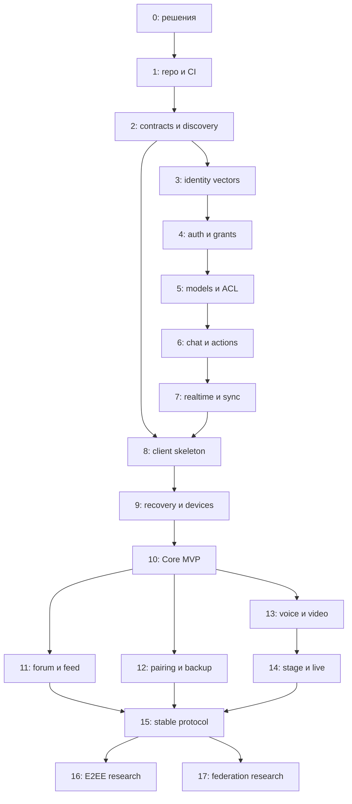

# План реализации Space Protocol

- [x] 14 октября: актуализированы документация и промосайт для v0.2.2, десять снимков текущих Flutter-виджетов с демонстрационными данными; добавлены прямые кнопки скачивания Windows/macOS/Linux через releases/latest/download и ссылка SHA-256. Установщики и сервер опубликованы, runtime закреплён; ручная приёмка остаётся открытой.

## Milestone релизов

Опубликована совместимая пара **приложение v0.7.1 + runtime v0.7.1**, схема 23: голосовые комнаты до восьми настольных участников и настройка STUN/TURN. Подготовлен следующий клиентский срез: восстановление соединения, выбор устройств, расширенные настройки звука, чувствительность и режим рации. Коммит приложения `a864525` отправлен, открыт [черновик PR #1](https://github.com/space-protocol-project/space-app/pull/1); выпуска ещё нет. Полная Windows-сборка и нативный стенд двух клиентов прошли после исправления остановки аудиотракта фильтром. Ручная акустическая приёмка и разговор между внешними сетями остаются открытыми. Приёмка оставшихся сценариев v0.6 продолжается. Номера milestone ниже задают целевые этапы: отдельные функции последующих этапов могут попасть в выпуск раньше их полной приёмки. Наличие функции в выпуске не закрывает оставшиеся ручные проверки milestone.

19 октября: [приложение v0.7.1](https://github.com/space-protocol-project/space-app/releases/tag/v0.7.1) и [runtime v0.7.1](https://github.com/space-protocol-project/space-server/releases/tag/v0.7.1) опубликованы со схемой 23 и голосовым профилем 3. [CI приложения](https://github.com/space-protocol-project/space-app/actions/runs/39168690761), [релизный CI runtime](https://github.com/space-protocol-project/space-server/actions/runs/39167268236), [установка опубликованного runtime на трёх ОС](https://github.com/space-protocol-project/space-app/actions/runs/39168696085) и [Linux-установщик](https://github.com/space-protocol-project/space-server/actions/runs/39168698337) успешны. Контрольные суммы обоих комплектов сверены с метаданными GitHub. Автоматический стенд восьми WebRTC-клиентов проверяет все 56 направлений, отдельные дорожки, mute/deafen, отказ девятому и замену вышедшего участника напрямую и через TURN UDP/TCP. Ручной разговор восьми людей через настоящий интернет остаётся открытым. Сначала обновите приложение, затем runtime; оба компонента нужны для нового профиля.

18 октября: [приложение v0.7.0](https://github.com/space-protocol-project/space-app/releases/tag/v0.7.0) и [runtime v0.7.0](https://github.com/space-protocol-project/space-server/releases/tag/v0.7.0) опубликованы со схемой 23. [Релизный CI приложения](https://github.com/space-protocol-project/space-app/actions/runs/39147760153), [CI runtime](https://github.com/space-protocol-project/space-server/actions/runs/39146749513), [установка опубликованного runtime на трёх ОС](https://github.com/space-protocol-project/space-app/actions/runs/39147762194) и [Linux-установщик](https://github.com/space-protocol-project/space-server/actions/runs/39147765649) успешны. Контрольные суммы обоих комплектов сверены с метаданными GitHub. Нативно проверены два Windows-клиента с принудительным TURN UDP и TCP в изолированном стенде; приёмка настоящего интернета и публичного TURN остаётся открытой. Голос не является MLS/E2EE; Android-устройства и эмулятор не использовались. Выпуск голосового среза не означает приёмку milestone «Сообщества».

18 октября: [приложение v0.6.0](https://github.com/space-protocol-project/space-app/releases/tag/v0.6.0) и [runtime v0.6.0](https://github.com/space-protocol-project/space-server/releases/tag/v0.6.0) опубликованы со схемой 22. [CI приложения](https://github.com/space-protocol-project/space-app/actions/runs/39136518112), [CI runtime](https://github.com/space-protocol-project/space-server/actions/runs/39135644334), [хранение на трёх ОС](https://github.com/space-protocol-project/space-app/actions/runs/39135626625) и [установка опубликованного runtime](https://github.com/space-protocol-project/space-app/actions/runs/39136518147) успешны. Контрольные суммы всех файлов обоих релизов сверены с метаданными GitHub. Расписание и автоматическая очистка включаются отдельно и по умолчанию выключены. Ручные проверки, отложенные пользователем, остаются открытыми.

18 октября: [CI приложения v0.5.0](https://github.com/space-protocol-project/space-app/actions/runs/39101619715) и [CI runtime v0.5.0](https://github.com/space-protocol-project/space-server/actions/runs/39100927683) успешны. Восстановление MLS на трёх устройствах проверено с настоящими PostgreSQL и Rust на Windows, macOS и Linux. [Установка публичного runtime на трёх ОС](https://github.com/space-protocol-project/space-app/actions/runs/39101620166) и [Linux-установщик](https://github.com/space-protocol-project/space-server/actions/runs/39101622778) также проверены. Контрольные суммы файлов обоих релизов сверены с GitHub. Сначала установите приложение v0.5.0, затем обновите runtime через «Эфир». Android-устройства и эмулятор не использовались.

План принят 15 октября 2026 года. Milestone описывает завершённый пользовательский сценарий; номера ниже — целевые версии приложения. Сервер/runtime выпускается из своего репозитория, а проверенная пара версий фиксируется в описании выпуска. Календарные сроки не назначены. Эти разделы не заменяют подробные архитектурные этапы и их критерии безопасности.

| Milestone | Содержание | Приёмка |
|---|---|---|
| **v0.3 — Вложения и профили** | Файлы, drag&drop, группировка по датам, квоты, необязательные имена | Два настоящих клиента обмениваются файлами; права, лимиты, повтор и удаление работают |
| **v0.4 — Надёжная переписка** | Очередь отправки на диске, восстановление после обрыва, синхронизация устройств | Отключение сети и перезапуск не теряют и не дублируют сообщения |
| **v0.5 — Удобный чат** | Ответы, реакции, уведомления, серверный поиск с ACL | Основные сценарии ежедневного общения проверены на компьютере и Android |
| **v0.6 — Самостоятельное пространство** | Обновление, резервные копии и перенос с файлами; контроль занятого места | Пространство восстановлено на другом компьютере без потери данных |
| **v0.7 — Сообщества** | Форум, лента, закрепления, модерация | Обсуждения и публикации работают с раздельными правами |
| **v1.0 — Стабильное ядро** | Проверка безопасности, нагрузка, документация протокола и миграций | Пройдены установка, обновление, сбой и восстановление; зафиксированы поддерживаемые версии |

Боты, голос/видео и трансляции получат самостоятельные milestone после проверки базового сценария. E2EE перенесено в активный план 15 октября по решению пользователя; первый сценарий — закрытый MLS-канал с сообщениями и вложениями. Федерация остаётся исследовательской программой.

### Активно: адреса пространства и доступность

План принят 16 октября 2026 года. Идентичность пространства и ключи устройств не зависят от сетевого адреса. Постоянный `identity_origin` существующих пространств сохраняется. Основание: [ADR-035](docs/adr/035-server-endpoints.md).

- [x] Этап 1 — модель адресов: до восьми HTTPS endpoint с IPv4/IPv6/доменом, портом и приоритетом; приглашение с server ID и TLS-отпечатком; подписанный канонический список с сохраняемой версией. Раздельные адрес прослушивания и внешние адреса. Проверка прежнего ключа сервера и TLS до авторизации; запрет отката версии и конфликтующих списков одной версии. Ограниченные параллельные попытки, сохранение рабочего адреса, без параллельной отправки изменяющих RPC.
- [x] Этап 2 — «Эфир»: редактирование нескольких адресов и внешних портов отдельно от порта прослушивания, автоопределение только как подсказка; QR/ссылки содержат запасные адреса. Изменение настроек сохраняет идентичность, устройства и MLS-историю.
Выпущена пара v0.3.2: [приложение и CI четырёх установщиков](https://github.com/space-protocol-project/space-app/actions/runs/38830667064), [runtime и CI трёх ОС](https://github.com/space-protocol-project/space-server/actions/runs/38829677996). [Установка опубликованных архивов](https://github.com/space-protocol-project/space-app/actions/runs/38830667192) также прошла на трёх ОС. Проверены домен и IPv6 через настоящий TLS, разные порты, отказ маршрута, прежнее устройство, очередь MLS и зашифрованный файл; перенос, обновление и восстановление пространства. Внешняя сеть и физические устройства остаются для ручной приёмки. Подробности: `space-app/docs/ENDPOINTS-CHECKS.md`.

- [ ] Приёмка этапов 1–2: домен, IPv6 и нестандартный порт; отказ первого адреса и подключение через следующий; подмена TLS/server ID/подписи и повтор старого объявления не меняют сохранённое доверие; переключение не дублирует сообщения. Проверить миграцию существующего пространства, перезапуск и восстановление конфигурации.
- [ ] Этап 3 — общая диагностика приложения и `space-server doctor`: локальное прослушивание, подтверждённая внешняя доступность, признаки CGNAT. Не считать любой отказ доказательством CGNAT; пробник ограничен и не сканирует произвольные сети.
  - [x] Общий движок runtime и блок диагностики в «Эфире»: локальный TLS, настроенные маршруты, проверка отпечатка/server ID/подписи, ограниченные время и размер ответов; WAN IP роутера без сохранения и осторожные подсказки о CGNAT. Команда для запуска из другой сети. Подробности: `space-app/docs/NETWORK-DOCTOR.md`. Требуется новый runtime; v0.3.2 ещё не поддерживает doctor.
  - [x] Автоматическое подтверждение недавнего внешнего HTTPS по входящему discovery из другой публичной сети (в том числе фоновой проверке Space). Общий результат с временем в «Эфире» и doctor, TTL 90 секунд, сброс при перезапуске/остановке и привязка к сертификату/адресам. Локальные адреса, собственная сеть и заголовки прокси исключены. Это наблюдение входящего соединения, а не независимая аттестация DNS или проброса порта.
  - [ ] Независимый активный внешний пробник DNS/NAT, включая первый запуск без внешнего клиента. Нужен внешний хостинг; сейчас без наблюдения показывается «Извне не проверено». Локальный успех и NAT loopback не считать доказательством внешней доступности.
- [ ] Этап 4 — автоматическая прямая доступность: UPnP/NAT-PMP/PCP с продлением аренды и снятием порта; IPv6 и файрвол Windows; подписанные обновления при смене IP. DDNS DuckDNS/Cloudflare — опционально, секреты отдельно от приглашений.
  - [x] Временные TCP-аренды PCP/NAT-PMP/UPnP, продление и адресное удаление; отдельные настройки в «Эфире» и CLI первого запуска, выключены по умолчанию.
  - [x] Подписанное обновление списка при смене IPv4/порта без смены идентичности; предыдущий маршрут, получение новых адресов клиентами по heartbeat, обновление ссылки. Статус аренды в doctor не считается внешним подтверждением. Требуется новый runtime; описание: `space-app/docs/AUTOMATIC-NETWORK.md`.
  - [ ] Ручная приёмка физических роутеров, смены WAN IP и аварийного истечения аренды; автоматические проверки используют локальные шлюзы.
  - [ ] Удобное управление файрволом Windows и расширенные подсказки прямой IPv6-доступности.
  - [ ] DDNS-обновляторы DuckDNS/Cloudflare (опционально).
- [ ] Этап 5 — самостоятельно разворачиваемый Go-relay: исходящее соединение сервера, подтверждение владения server ID, явная маршрутизация и непрозрачный внутренний TLS; бюджеты соединений/трафика. Сначала рецепты frp/rathole, публичный relay — после защиты от злоупотреблений.
- [x] Запуск Linux x64 с нуля одной командой: SHA-256 runtime, `space-server start`, первый владелец по одноразовой pinned TLS-ссылке с компьютера/Android и несколько администраторов (ADR-036). Сквозная проверка сохраняет роли после перезапуска; физическая приёмка Android отложена.
- [ ] Параллельно — лёгкий запуск: автозапуск, занятые порты, явное правило файрвола и подсказка о сне; VPS: GHCR/compose/systemd и `init` с приглашением. Домен/Let's Encrypt — опция с безопасной сменой TLS-ключа; HTTP-01 требует 80, TLS-ALPN-01 — 443.
  - [x] VPS/systemd: `install.sh --service`, пользовательская служба с linger, приватная одноразовая ссылка, сохранение данных и перезапуск при сбое. [CI Ubuntu 24.04](https://github.com/space-protocol-project/space-server/actions/runs/38856618483): настоящий systemd и опубликованный runtime v0.3.3, повторная установка, crash-restart, запуск после перезапуска user manager без SSH, сохранение server ID/TLS и записи БД, штатная остановка PostgreSQL и отключение автозапуска. Полная перезагрузка реального VPS остаётся ручной приёмкой; это не автозапуск домашнего сервера Windows.
- [ ] CI с Linux netns/NAT: смена IP, DNS, отказ адресов, relay. Проверки Windows-файрвола и сна отдельно. UDP/QUIC hole punching отложен до готовности relay.

Свежий список получают через ещё доступный адрес; если недоступны все адреса, нужны DDNS, relay либо новая ссылка/QR с проверкой прежней идентичности. Подпись не обеспечивает доставку. Полная защита от согласованного отката сервера/клиента требует независимого источника свежести. До автоматизации смены TLS-ключа несовпадение закреплённого сертификата блокирует подключение.

### Активно: E2EE на MLS

Основание: [ADR-034](docs/adr/034-mls-private-channels.md). Начинаем с отдельного закрытого канала; открытые каналы не объявляются зашифрованными. Выпуск E2EE назначается после приёмки, не автоматически по готовности прототипа.

- [x] Выбраны первый сценарий, модель угроз и направление MLS RFC 9420 / OpenMLS.
- [x] Ядро OpenMLS 0.9.1: до 256 устройств, сообщения, шифрование вложений, Add/Remove/Commit. Проверен обмен четырёх устройств.
- [x] Подписанная существующим ключом устройства привязка MLS signing key к server/principal/grant; сервер сверяет действующий grant, клиент требует независимую сверку кода устройства.
- [x] Защищённое локальное сохранение ключей, эпох, входящих сообщений и исходящей очереди; перезапуск до Welcome, с незавершённым Commit и после получения сообщения. При повторе отправляется сохранённый ciphertext.
- [x] Серверный контракт: неизменяемый режим канала, KeyPackage/Welcome/Commit, последовательность эпох, ACL, непрозрачные сообщения и файлы, запрет открытых методов.
- [x] Flutter через Rust FFI и события/BLoC: создание канала, проверка/добавление/исключение устройств, сообщения, вложения, локальная файловая панель с авторами и датами.
- [x] Сквозной тест трёх клиентов через ConnectRPC/PostgreSQL: Welcome, будущая история, файл, перезапуск, исключение. Тесты ядра проверяют четыре устройства.
- [ ] Полная клиентская проверка цепочки root/device/recovery/rotation proofs; сейчас независимое доверие задаётся явной сверкой кода.
- [x] Зашифрованная передача управления другому устройству канала; сервер и клиенты проверяют текущего управляющего. Прежний управляющий сохраняет переписку и файлы как участник.
- [x] Смена root на текущем устройстве сохраняет MLS-идентичность, локальную историю, очередь и доступ к вложениям. Новое разрешение входа связывается с прежним leaf атомарно с ротацией; старое разрешение отзывается. Проверены две последовательные ротации и повтор после сбоя локальной активации.
- [x] Сохранение остальных рабочих устройств этой идентичности при смене root по проверенному и подписанному списку. Они сохраняют MLS-ключи, сообщения и файлы без исключения из каналов.
- [x] Архив истории и ключей файлов без рабочего ratchet: зашифрованный экспорт, импорт только на новый grant/leaf и повторное приглашение. Локальный свидетель блокирует частичный откат и незавершённую запись; полный согласованный откат остаётся отдельным ограничением.
- [x] Автоматический Remove/Commit отозванных устройств в известных каналах при доступном управляющем; пока он недоступен, исключение незавершено и сервер запрещает новые сообщения.
- [x] Self-update раз в сутки при обслуживании, ручное обновление и код группы по epoch authenticator с номером эпохи.
- [x] Бюджеты байтов/кадров/переподключений и локального документа, отдельный CI job с мутациями недоверенного RPC, сохранением outbox и проверками отката.
- [x] Независимая MLS-совместимость: mls-rs 0.56.0, Welcome, двусторонние сообщения, Update обеих реализаций и Remove. Отдельный стенд Linux CI; не внешний криптоаудит.
- [x] Внутренняя проверка E2EE перед экспериментальным выпуском: недоверенные подтверждения/состав/порядок пакетов, лимиты RPC, запись защищённого состояния и обновление уязвимых Go-зависимостей. Отчёт: `space-app/docs/E2EE-SECURITY-REVIEW.md`. Внешний crypto review остаётся отдельным пунктом.
- [ ] Полная приёмка обрывов, конкурентных операций и отмены окончательно отклонённых Commit; возобновление загрузки файла до формирования сообщения. Есть обработка конфликта эпох и точный повтор очереди, но это не закрывает всю матрицу сбоев.
- [ ] Независимая защита от полного отката защищённого хранилища ОС; локальная revision без аппаратного счётчика не даёт такого обещания.
- [x] Поиск MLS в защищённой локальной истории и чтение сохранённого текста без сети выпущены в v0.4.2.
- [ ] Оставшийся паритет закрытых каналов: редактирование/удаление, расширенное форматирование, безопасная передача истории и полноценный офлайн-просмотр вложений.
- [ ] Полная ручная приёмка Windows/macOS/Linux/Android и внешний crypto review. Совместимость с mls-rs проверена отдельно; новые CI jobs требуют прогона после публикации изменений. Запуск на Android отложен пользователем.

Подробности и ограничения: `space-app/docs/MLS-CHECKS.md`. Это экспериментальный режим, без выпуска новой версии и без автоматического перевода открытых каналов в E2EE.

### v0.3 — опубликовано

Статус: 15 октября опубликованы [приложение v0.3.0](https://github.com/space-protocol-project/space-app/releases/tag/v0.3.0) и [runtime v0.3.0](https://github.com/space-protocol-project/space-server/releases/tag/v0.3.0). Ручная Android-приёмка отложена пользователем и остаётся отдельным открытым пунктом.

- [x] Загрузка частей с проверками размера/SHA256, отменой и повтором; до пяти файлов по 20 МиБ.
- [x] Вложения внутри сообщений, скачивание, история и удаление вместе с сообщением.
- [x] Выбор файлов и desktop drag&drop; список «Мои файлы» по датам.
- [x] Правая панель вложений на широком экране и диалог на узком: все участники, фильтр автора, даты, скачивание.
- [x] Логические группы хранения principal_id/YYYY/MM/DD по UTC в PostgreSQL.
- [x] Общая квота сервера, стандартная личная и индивидуальная квоты участников; серверная проверка незавершённых загрузок.
- [x] Необязательное имя при подключении и его смена в «Обзоре» пространства; сервер проверяет уникальность, карточки участников показывают имя.
- [x] Администратор разрешает или запрещает вложения для своего сервера. Политика доставляется участникам и независимо управляет файловыми функциями каждого выбранного пространства.
- [x] Локальные анализ/тесты, Windows и Android Release; рабочие функции приложения/сервера не выше COG 15.
- [x] Сквозной сценарий настоящих Dart-клиентов с Go-сервером и PostgreSQL: файл, подписка, переподключение, скачивание, удаление и имя. Проверен 15 октября; воспроизводимый запуск — `space-app/tools/check_attachments.ps1`, тест — `client/test/live/attachments_server_test.dart`. Исправлен лимит внутреннего gRPC-моста; для остальных методов сохранён предел 16 КиБ.
- [ ] Ручная приёмка выбора/сохранения файла на Android; системное перетаскивание на Windows. Проверка Android отложена по просьбе пользователя 15 октября.
- [x] Обновление существующего пространства: схема 12 → 14 сохраняет идентичность, участников, ACL, настройки, правки/удаления и курсоры. Проверен настоящий архив runtime v0.2.5 → кандидат: TLS, владелец, сообщения, новые файлы/имя, повреждённая копия и восстановление после прерывания. Исторический архив закреплён отдельной fixture с SHA256.
- [x] Зелёный CI целевой пары: [приложение 38677816246](https://github.com/space-protocol-project/space-app/actions/runs/38677816246), [runtime 38677044812](https://github.com/space-protocol-project/space-server/actions/runs/38677044812). Windows/macOS/Linux, подписанный Android APK, PostgreSQL/ConnectRPC и защищённое хранилище Windows прошли проверки.
- [x] Версии/changelog v0.3.0 опубликованы; runtime закреплён в приложении для трёх ОС. Доступны четыре установщика и три runtime-архива, контрольные суммы сверены. После обновления приложения существующий сервер обновляется через «Эфир → Обновить сервер».

Подробности реализации и локальных проверок: [space-app/docs/ATTACHMENTS-CHECKS.md](https://github.com/space-protocol-project/space-app/blob/main/docs/ATTACHMENTS-CHECKS.md), [ADR-033](docs/adr/033-chat-attachments.md). До v1.0 допустимы изменения API; сохранение данных при миграциях обязательно.

### v0.4 — постоянная очередь обычных сообщений

Выпущена в [приложении v0.4.0](https://github.com/space-protocol-project/space-app/releases/tag/v0.4.0) 16 октября. [Релизный CI](https://github.com/space-protocol-project/space-app/actions/runs/38886832405) и [проверка совместимой пары](https://github.com/space-protocol-project/space-server/actions/runs/38885347962) прошли; четыре установщика опубликованы, контрольные суммы сверены. Контракт CreateContent и схема runtime 18 не меняются, подходит runtime v0.3.6. Полное описание: `space-app/docs/OUTBOX.md`.

- [x] Защищённая постоянная очередь до первого RPC, прежний ключ запроса при повторе, границы server/principal/grant и ограничение 100 записей / 1 МиБ без вытеснения.
- [x] Восстановление после обрыва/перезапуска, порядок внутри канала, отправка независимо от выбранного экрана, проверка ответа и сохранение истории до очистки запроса.
- [x] Офлайн-ввод по сохранённым правам; список ожидающих сообщений, повтор и удаление с предупреждением; русский, китайский, английский.
- [x] Ошибки диска/прав/данных не стирают очередь; новый grant не получает автоматическую отправку старой очереди. Поздний результат старого пространства не меняет новое.
- [x] Сквозная проверка настоящих клиентов, ConnectRPC/PostgreSQL и потерянного ответа с вложением; повтор возвращает одно сообщение и прежний файл.
- [x] Проверка очереди в настоящем Windows secure storage в разных процессах, вместе с сохранностью ключей и избранного.
- [x] Автоматическая приёмка двух сопряжённых устройств одной личности с разными grant: одновременные одинаковые тексты остаются отдельными сообщениями; совпадают ID, порядок, текст и версии. Проверены потерянное подтверждение, правка со второго устройства, пропущенные события (105 сообщений, больше страницы истории), перезапуск при всё ещё отключённой сети и автоматическое восстановление. Явное отключение отменяет повторы. Выпущено в v0.4.1 и включено в v0.4.2; описание — `space-app/docs/OUTBOX.md`.
- [x] Двое суток обрыва с ускоренным временем и штатной задержкой повторов; более 5000 неудачных попыток не теряют очередь, после перезапуска три сообщения уходят с прежними ключами. Отдельно настоящее RPC/БД проверяет записи очереди с искусственным возрастом 45 дней. Исправлены повторный вход при отказе сессии, автоподключение после запуска без сети и ошибочная блокировка при оборванном HTTP-ответе.
- [ ] Приёмка физического Android и принудительного завершения мобильного процесса; по просьбе пользователя текущая проверка выполнялась без физического Android.
- [x] Рабочий срез после v0.4.0: зашифрованные копии локальных вложений до загрузки, возобновление ключа/смещения после перезапуска без исходника, сохранение ID до CreateContent и отсутствие дублей. Поддержаны офлайн-выбор по сохранённой политике, отмена и очистка аварийных копий под блокировкой между процессами; бюджет 200 МиБ на пространство и выдачу устройства. Описание — `space-app/docs/QUEUED-FILES.md`; выпущено в v0.4.1 и включено в v0.4.2.
- [x] Локальный рабочий срез: перенос ожидающих сообщений на новый grant той же личности с просмотром и отдельным подтверждением доверия. Перешифрование файлов, прежние ключи запросов, сохранение источника при сбоях. Настоящий сервер проверил сопряжение нового устройства и отзыв прежнего после потерянного ответа: одно сообщение и прежние байты вложения. Описание — `space-app/docs/OUTBOX-RECOVERY.md`; реализовано в приложении 39f9f5b, выпущено в v0.4.1 и включено в v0.4.2.
- [x] Рабочий локальный срез 17 октября: постоянная очередь правок, удалений и реакций обычных каналов, офлайн-проекция, зависимости и идемпотентные квитанции runtime. Конфликты версий сохраняют чужие изменения и локальный запрос. [ADR-038](docs/adr/038-durable-content-mutations.md); описание — `space-app/docs/OUTBOX-ACTIONS.md`. Выпущено в совместимой паре v0.4.1 со схемой 19; включено в v0.4.2 со схемой 22.

### v0.5 — ответы, уведомления и поиск

Функциональность этого этапа выпущена досрочно в совместимой паре **v0.4.2**, схема PostgreSQL **22**: [приложение](https://github.com/space-protocol-project/space-app/releases/tag/v0.4.2), [runtime](https://github.com/space-protocol-project/space-server/releases/tag/v0.4.2). [CI приложения 39017978687](https://github.com/space-protocol-project/space-app/actions/runs/39017978687) и [CI runtime 39017249253](https://github.com/space-protocol-project/space-server/actions/runs/39017249253) успешны; контрольные суммы опубликованных файлов сверены. Milestone v0.5 остаётся открытым до завершения платформенной приёмки. Сначала обновляйте runtime; откат схемы требует резервной копии до обновления.

- [x] Ответы обычных каналов: меню «Ответить», предпросмотр и переход к исходнику, отмена без потери черновика, очередь с файлами и сохранением цели при перезапуске/смене grant. Сервер проверяет ACL и идемпотентность; схема 20. [ADR-039](docs/adr/039-message-replies.md), `space-app/docs/MESSAGE-REPLIES.md`.
- [x] MLS-ответы внутри шифротекста: меню, предпросмотр, очередь и защищённый архив. Ссылка сохраняется при повторе и смене эпохи; сервер не получает открытой цели ответа. Всем получателям нужен обновлённый клиент.
- [x] Реакции обычных и MLS-каналов, участники реакций, время в общей нижней строке; единое оформление поля ввода. Реакции выпущены с v0.3.6, улучшения интерфейса — в v0.4.2.
- [x] Уведомления обычных и присоединённых MLS-каналов: три режима приватности, исключение повторов, ограниченная очередь, проверка личности/ACL/MLS перед показом и переходом. Описание: `space-app/docs/NOTIFICATIONS.md`.
- [x] Windows: защищённая одноразовая цель и запуск по ранее показанной карточке; ожидание готовности приложения и точечная загрузка старого сообщения.
- [x] macOS: UserNotifications и сохранённая цель. Linux: GNotification/GApplication, desktop/service и холодный запуск в совместимом окружении. В релизном CI выполнены нативные XCTest macOS и настоящий D-Bus запуск установленного приложения Linux.
- [x] Android без Firebase: встроенная в runtime очередь, capability только для push, AES-GCM, ack/TTL и повторная проверка доступа; схема 22. Автоматическая регистрация пространств, foreground service и переход к обычному/MLS-сообщению; в фоне только общий текст. [ADR-043](docs/adr/043-private-runtime-push.md), `space-app/docs/ANDROID-PUSH.md`. Сборка и общий Go/Kotlin конверт проверены CI, это не приёмка службы на Android.
- [x] Поиск выбранного канала и доступных каналов пространства, подписи и переход к результату. Обычные каналы — серверный поиск с ACL; MLS — только защищённая локальная история без отправки запроса серверу. Защищены смена сеанса, прав и устаревшие ответы. [ADR-040](docs/adr/040-message-search.md), `space-app/docs/MESSAGE-SEARCH.md`.
- [x] Офлайн-каталог сохранённых присоединённых MLS-каналов: поиск и чтение текста без сессии, без изменения ratchet; проверки устройства и отката. Новые серверные отзывы узнаются при подключении.
- [x] MLS-поиск выбирает максимум 51 совпадение без полной сортировки; устойчивый курсор проверен на 10 000 записях.
- [x] Обычная история свыше 1100 сообщений: GetHistoryPage, страницы по 100, согласованный курсор событий, восстановление и сохранение прокрутки.
- [x] Индекс SQL-поиска GIN биграмм/триграмм без расширений, Unicode, ACL и точная подстрока; схема 21. Проверены 100 000 записей, 1000 страниц RPC, миграция готовой истории и изменение индекса после правок/удалений. `space-server/docs/SEARCH-SCALE.md`.
- [x] Автоматическая сквозная проверка Windows после v0.4.2: настоящий runtime/PostgreSQL, обычные и MLS-клиенты, очереди/ответы/вложения/история, обрывы и восстановление. Три live-теста, 100 последовательных тестов интерфейса/контроллеров и восемь переходов по уведомлению прошли. В настоящем окне подтверждены отправка обычного сообщения пользователем и сохранение переписки при перезапуске. [Отчёт и границы](https://github.com/space-protocol-project/space-app/blob/main/docs/DESKTOP-CHAT-CHECKS.md).
- [x] Найдено и исправлено в исходниках после v0.4.2: MLS показывал Markdown-маркеры и время слева под реакциями. Подключены общие безопасный Markdown и нижняя строка; 25 профильных тестов прошли, включая ширины 390/1500. Исправление выпущено в v0.4.3.
- [x] Объединённый срез v0.5: единый тест ChatView/MlsChannelView → настоящий runtime/PostgreSQL → второй клиент. Ввод, меню по правой кнопке, ответ, реакция и восстановление MLS-сеанса; `space-app/client/test/live/desktop_chat_server_test.dart`, запуск `tools/check_attachments.ps1 -Scenario desktop`. Один объединённый сценарий прошёл на Windows; ключи/очередь тестовые в памяти, это не ручная приёмка установленного приложения. Реализация приложения: 90319f6.
- [x] Объединённый тест подключён к workflow установщиков отдельным обязательным заданием Windows с собственной PostgreSQL. Runtime закреплён на v0.4.2/c87ac2a, схема 22; комплект PostgreSQL сверяется с manifest по SHA-256 и размеру. Отсутствие адреса сервера в обязательном режиме вызывает ошибку вместо пропуска. Публикация ждёт успеха задания; сервер/БД останавливаются в finally, журналы сохраняются на семь дней. Задание успешно прошло в [CI 39022619530](https://github.com/space-protocol-project/space-app/actions/runs/39022619530/job/117367445650) для 90319f6; это автоматизированная проверка виджетов с настоящим сервером, без Android-устройства и эмулятора.
- [ ] Полная ручная приёмка установленного Windows-приложения: мышь/клавиатура, меню и реальные системные карточки. Автоматизация окна получала отказ активации; это не считается успешной ручной проверкой.
- [ ] Ручная приёмка системных карточек macOS/GNOME/KDE и установленного приложения на физических системах; успешная сборка не заменяет её.
- [ ] Android: foreground service, Doze, загрузка системы и реальное нажатие уведомления. Эмулятор и физическое устройство отложены пользователем и в текущей работе не используются.

### Голосовые комнаты — развитие выпущенного среза

По решению пользователя от 18 октября после выпуска v0.6.0 основной приоритет — голосовые комнаты по привычному сценарию Discord. [Первый срез и порядок реализации](docs/adr/044-voice-rooms.md). В совместимой паре v0.7.1 выпущены голосовые каналы схемы 23, авторизованная пересылка WebRTC/Opus для восьми настольных клиентов, список участников, микрофон, отключение входящего звука и выход. Выпуск v0.6.0 остаётся на схеме 22. Настраиваемые STUN/TURN и relay-only включены в v0.7.0; в v0.7.1 добавлены отдельные дорожки и групповой стенд. Проверка реального внешнего подключения, нагрузочная приёмка и ручная оценка разговора остаются следующими задачами; подробные границы — в ADR-044.

- [x] Клиентский срез автоматического восстановления голоса (после v0.7.1, ещё не выпущен): новое WebRTC-соединение и настройки TURN, микрофон выключен, выбранное отключение входящего звука сохраняется. Повторы 1/2/4/8/15 секунд, отмена при выходе и закрытии пространства, остановка при отзыве допуска и ошибках доверия. Совместим с runtime v0.7.1, профиль 3 и схема 23 без изменений. Тесты с управляемым временем проверяют длительный обрыв, lease, тайм-ауты, запоздалые ответы и отмену; тест интерфейса — статус и доступный выход. Реальный обрыв между настольными клиентами и публичный TURN требуют отдельной приёмки. Подробности: `space-app/docs/VOICE-ROOMS.md`.

- [x] Клиентский срез выбора аудиоустройств (после v0.7.1, ещё не выпущен): настройки «Голос» до входа и во время звонка, локальное сохранение входа/выхода, восстановление без захвата микрофона. Опрос устройств вместе с heartbeat выключает микрофон при потере входа и звук при потере выхода; после возвращения включение ручное. Исправлен сброс входа нативным WebRTC при повторном захвате. Автотесты проверяют сохранение, отключение и ошибки; физические гарнитуры требуют отдельной приёмки.  Runtime и схема 23 не меняются.

- [x] Клиентский срез расширенных настроек голоса (ещё не выпущен): громкость входа/вывода 0–200%, профили обработки, шумоподавление, эхоподавление и AGC. Локальная проверка с воспроизведением и реальным RMS останавливается по команде, закрытию окна, потере устройства, неактивности приложения и через 60 секунд; перед запуском выключается звук комнаты. Общий нативный обработчик усиления проверен на сэмплах; нативные изменённые C++-исходники скомпилированы для Windows. Физический микрофон и акустическая проверка ещё требуют приёмки. Серверные API и схема 23 не меняются.

- [x] Клиентский срез чувствительности и рации (19 октября, локально, ещё не выпущен): автоматическая оценка тихого фона и ручной порог −60…−10 dBFS; опрос RMS каждые 50 мс и задержка закрытия около 300 мс. В режиме рации после ручного включения микрофона нужно удерживать F8 в активном окне. Отпускание клавиши, потеря фокуса и уход в фон закрывают передачу, возврат требует нового нажатия. Настройки сохраняются локально; проверка микрофона воспроизводит звук непрерывно. Автотесты проверяют порог, ошибку измерения, поздний результат, потерю фокуса и сохранение настроек. Реальная передача звука с этим фильтром ещё не проверена.

#### Следующая сессия: приёмка и выпуск клиентских настроек голоса

**Продолжить после переустановки ОС — решение пользователя от 19 октября 2026 года.** До переустановки работа остановлена на диагностике выбора физического микрофона. Исправление ещё не внесено: после выбора `Mic In (Elgato Wave:3)` и повторного открытия диалога снова показывается системное устройство. Не считать эту проблему исправленной по прежним зелёным тестам/CI.

Порядок восстановления и продолжения:

1. Восстановить три репозитория. Для `space-app` и `space-protocol` использовать отправленную ветку `codex/voice-rooms`. Для `space-server` использовать **`main` с коммитом `6bfd9a4`**: серверная ветка `codex/voice-rooms` устарела; проверено, что текущий локальный серверный коммит уже сохранён в `origin/main`. Голосовой код приложения находится в коммите `a864525`, документы проверки дополнительно сохранены в `985e86d`; [PR приложения #1](https://github.com/space-protocol-project/space-app/pull/1) остаётся черновиком. Предыдущий итог проверки протокола — `8b2fd27`; актуальная точка продолжения — этот раздел из последней версии ветки. Runtime не менялся; новый релиз не опубликован.
2. Установить Flutter **3.47.7**, инструменты сборки Windows C++/Windows SDK, Python, Git и Rust согласно закреплённым версиям проекта/CI. Выполнить `flutter pub get` из `space-app/client`; локальный `client/vendor/flutter_webrtc` уже находится в Git и должен использоваться вместо чистой upstream-копии. Кэши `build`, `.dart_tool`, `.local/analysis-sdk`, `.local/mls` и прежние абсолютные пути не считать переносимым SDK. Восстановить Rust-окружение перед использованием `tools/mls_environment.ps1`; скрипт задаёт пути, но сам не устанавливает инструменты. Подготовка анализатора сложности описана в `space-app/docs/READABILITY.md`.
3. Сначала воспроизвести потерю выбора микрофона в обычном холодном приложении и проследить состояние `VoiceDevices.select`, вызов нативного `Helper.selectAudioInput`, ошибку переключения, сохранённый `VoiceDeviceChoice.input` и повторный `refresh`. Проверить также устаревшие объекты списка устройств после обновления: сейчас выбор отбрасывается через `state.devices.contains(device)`, то есть сравнение по идентичности. Это **гипотеза для проверки**, а не установленная причина. Краткое отображение пункта в `DropdownButtonFormField` не доказывает применение и сохранение выбора.
4. Добавить регрессионный тест на установленную причину и цикл выбор → закрытие/открытие → новый контроллер. После исправления выполнить `python tools/check_complexity.py`, `flutter analyze`, целевые тесты `voice_devices_test.dart`, `voice_device_call_test.dart`, `voice_audio_test.dart`, затем подходящую нативную проверку на физическом входе. Для проверки использовать отдельные настройки/пространство, не изменять пользовательскую идентичность.
5. Отдельно устранить или локализовать ошибки AXTree при холодном запуске; не объявлять их последствием hot reload. Завершить акустическую матрицу, F8 в реальном звонке, потерю/возврат гарнитуры и сетевой обрыв, перечисленные ниже. Только после приёмки снимать статус черновика и готовить выпуск/обновление сайта.

**Перед переустановкой:** Git сохраняет код и документацию, но не данные пространств, установленные runtime, резервные копии и защищённое состояние устройств/MLS. Их нужно сохранить отдельно штатными средствами приложения и проверить доступность копии вне переустанавливаемого диска. Секреты, PostgreSQL и весь профиль пользователя в репозитории не добавлять. Прежние диагностические журналы и временная оболочка настроек находились в игнорируемой `space-app/.local`; после переустановки их может не быть. Существенные результаты и ограничения сохранены текстом ниже. На последней проверке после очистки кэшей на C: было около **4,6 ГБ** свободно; это историческое измерение, перед сборкой перепроверить место.

Точка продолжения на 19 октября 2026 года: **79 целевых Flutter-тестов прошли**, `python tools/check_complexity.py` — 202 файла, 1917 функций, максимум COG 15, нарушений нет; нативный тест RMS/усиления/закрытия передачи успешен. Коммит приложения `a864525` отправлен в `codex/voice-rooms`; [PR #1](https://github.com/space-protocol-project/space-app/pull/1) оставлен черновиком до приёмки. [CI установщиков трёх ОС](https://github.com/space-protocol-project/space-app/actions/runs/39210775414) полностью успешен: Windows/macOS/Linux, упаковка и нативные проверки; отдельно пройден сценарий интерфейс → RPC → PostgreSQL → второй клиент. [CI сложности](https://github.com/space-protocol-project/space-app/actions/runs/39210774841) и [диска/резервных копий](https://github.com/space-protocol-project/space-app/actions/runs/39210774833) также успешны. Исходная копия `flutter_webrtc` включена в коммит; скачанные архивы и библиотеки исключены. Подробности и ограничения: `space-app/docs/VOICE-ROOMS.md`.

Нативный стенд сначала воспроизвёл блокирующую ошибку: отключение дорожки фильтром останавливало аудиотракт, оба клиента оставались с нулевыми счётчиками. Теперь RMS измеряется до обнуления сэмплов закрытой передачи, а дорожка остаётся включённой. После исправления два Windows-процесса передают и декодируют звук: A получил 6 пакетов/4800 сэмплов, B — 18/12480; mute/deafen и выход прошли. Отчёты: `space-app/.local/voice-check-c6e3c3b59597415a8861f3c8da860b33/{A,B}.json`. Проверка C++ отдельно подтверждает ненулевой RMS при нулевых выходных сэмплах и возвращение сигнала после открытия. Это не прослушивание речи и не проверка физической гарнитуры.

Общий локальный прогон приложения с `--concurrency=2`: **681 тест прошёл, 15 штатно пропущены**; `flutter analyze --no-pub` без замечаний. Первый общий прогон остановлен после зависания компилятора тестов и успешным не считается. Windows debug с отдельной точкой входа настроек и настройками только в памяти запущен, hot reload выполнен; обычная Windows Release-сборка после стендов восстановлена (`FLUTTER_TARGET=lib/main.dart`). Диалог визуально открыт, но полная ручная проверка регуляторов не завершена: после hot reload зарегистрирован сбой нативного дерева доступности AXTree, автоматизация теряла актуальность элементов и сообщала о постороннем вводе. Причина в обычном холодном запуске приложения не установлена; повторная проверка доступности интерфейса остаётся открытой.

По просьбе пользователя повторён холодный debug-запуск без hot reload. До управления окном пользователь остановил Computer Use физической клавишей Escape; повторная проверка регуляторов и AXTree не выполнена. Проверка остановлена, тестовый процесс завершён. Релизный тег не создан, PR остаётся черновиком. Временная очистка результатов debug-сборки отклонена автоматической проверкой, пользовательские данные не удалялись.

Последующая повторная проверка 19 октября по новой просьбе пользователя выполнена без hot reload и без прерывания. В изолированном окне с настройками только в памяти проверены регуляторы входа/вывода 0/100/200%, ручной порог −60 и −10 dBFS, включение рации со скрытием чувствительности, профиль «Студия» с выключением трёх обработок и переход к пользовательскому профилю при отдельном включении шумоподавления. Диалог закрывается и повторно открывается, значения громкости/режима/обработки сохраняются в памяти. Список реальных микрофонов получен; сохранение выбора физического входа не принято: после повторного открытия снова показано системное устройство. Требуется отдельно установить причину, а не считать краткое отображение выбранного пункта успешным применением.

AXTree воспроизводится также при холодном запуске: нативный журнал содержит 63 ошибки `Failed to update ui::AXTree`. Это подтверждённый дефект доступности, а не только последствие hot reload; управление по индексам элементов неустойчиво, проверка выполнена по снимкам окна. Локальная проверка микрофона запустила настоящий захват и затем остановила его (36 мс по нативному журналу); устойчивый измеритель и акустическая приёмка этим не подтверждены. Журналы: `space-app/.local/voice-preview-repeat.{stdout,stderr}.log`. Тестовый процесс завершён, сохранённые пользовательские настройки не изменялись, обычная Release-сборка не пересобиралась и не подменялась. Перед выпуском остаются исправление/приёмка AXTree, проверка применения выбранного физического входа и ранее перечисленная акустическая матрица.

1. [x] Проверен голосовой diff, исходники локального плагина сохранены в отдельном коммите приложения. Независимые правки README и `Space Economy.md` протокола, материалы проверки чата и диагностики политики runtime приложения не включены.
2. [ ] Завершить ручную проверку двух настольных клиентов: выбранные устройства, громкость 0/100/200%, обработка, проверка микрофона, тихий фон/речь и ручной порог. Полная Windows-сборка и нативный стенд двух процессов уже прошли. Повторить холодный запуск с проверкой AXTree. На C: осталось около 0,2–0,3 ГБ после сборок; перед следующей большой сборкой проверить место, не создавать лишние копии и не удалять пользовательские данные.
3. [ ] Проверить рацию в реальном звонке: удержание/отпускание F8, потерю фокуса с зажатой клавишей, возврат в окно, выключение микрофона, deafen, выход, отзыв права говорить и переподключение. Подтвердить, что измерение уровня продолжает работать при закрытой передаче и голос снова открывает её. F8 пока фиксированная клавиша только активного окна, системная горячая клавиша не реализована.
4. [ ] Проверить потерю/возврат гарнитуры и настоящий сетевой обрыв: повторное подключение не включает микрофон самостоятельно; закрытие настроек и остановка проверки освобождают захват. Не считать модельные тесты акустической приёмкой.
5. [x] Голосовой срез приложения закоммичен и отправлен отдельно; TODO протокола подготовлен отдельным коммитом без README и `Space Economy.md`. CI Windows/macOS/Linux успешен. Для анализа приложения предусмотрен SDK из `space-app/.local/analysis-sdk`; перед Flutter-тестами загружать `space-app/tools/mls_environment.ps1`. Релиз пока не опубликован.
6. [ ] Подготовить следующий выпуск приложения с фактическими границами проверки и обновить инструкцию сайта. Для текущего среза новые серверные API, схема БД и выпуск runtime не требуются: сохраняется совместимость с runtime v0.7.1, схема 23, голосовой профиль 3. Номер следующего выпуска ещё не назначен.
7. [ ] Когда появится внешний TURN/VPS, провести разговор между разными сетями и ручную групповую проверку. Пользователь сообщил, что VPS пока нет; локальный TURN-стенд не закрывает этот пункт.

Android, эмулятор и физическое Android-устройство не использовать. Оставшиеся проверки v0.5/v0.6 ниже сохраняются открытыми; выпуск голосового среза их не закрывает.

### v0.6 — резервные копии и самостоятельное пространство

- [x] Локальный срез управления диском в приложении: размеры данных/runtime/копий/восстановлений, свободное место, выбор устаревших каталогов и отдельное подтверждение. Сохраняются текущий и предыдущий runtime, три новые проверенные копии, копии моложе 30 дней и копия текущего восстановления. Проверяются SHA-256 копий, изменения списка и блокировка работающего сервера; ссылки, неизвестные каталоги, recoveries и внешние ZIP не удаляются. Дополнены проверки места перед экспортом и импортом. Документация: `space-app/docs/HOME-DISK.md`. Выпущено в v0.6.0.
- [x] Реализованы резервные копии по расписанию и настройки хранения; выпущено в v0.6.0, CI пройден. Расписание и очистка выключены по умолчанию, минимум три проверенные копии сохраняются, предел объёма мягкий. Документация: `space-app/docs/SCHEDULED-BACKUPS.md`.

По решению пользователя от 18 октября ручная проверка установленного Windows-чата и системных уведомлений временно отложена. Открытые пункты v0.5 остаются открытыми; переход к v0.6 не означает их успешной приёмки.

- [x] Первый локальный срез: `space-server -home-verify-export` проверяет переносимый ZIP без запуска PostgreSQL, распаковки секретов и изменения пространства. Проверяются состав, размеры, схема, CRC и SHA-256; отчёт содержит только метаданные. Добавлены тесты неизменности архива, отсутствия распаковки и отказа при повреждении, несовместимой схеме и конфликтующих операциях. Выпущено в runtime v0.4.3; одна предварительная проверка не подтверждает полноценное восстановление копии.
- [x] Подключить предварительную проверку архива к импорту в приложении и показать пользователю результат до начала восстановления. Выпущено в приложении и runtime v0.4.3: отдельное подтверждение, отказ при отсутствии поддержки runtime и защита от изменения архива; проверено автоматическими тестами.
- [x] Проверить восстановление пространства в отдельное окружение: сообщения, файлы, владелец, участники и прежняя идентичность сервера; отдельно документировать восстановление ключей клиента и ограничения MLS. На Windows 18 октября пройден настоящий цикл экспорт → проверка → импорт с новым IP → вход → повторный запуск: TLS, постоянный адрес, права, файл SHA-256, реакция и её автор, карточка владельца и отсутствие дублей. Непригодный дамп не публикует каталог и не оставляет временную базу. Сценарий расширен в `client/tool/home_transfer_drill.dart`; это проверка обычного чата, не приёмка MLS. Перед выпуском v0.4.3 расширенный сценарий успешно прошёл также в CI на Windows, macOS и Linux.
- [x] Проверить восстановление серверного архива с MLS-каналом и отдельно сохранённым состоянием устройств, включая случай, когда архив старше клиентского состояния. Защиту от отката не отключать.
  - 18.10.2026: локальный тест с настоящими PostgreSQL и Rust MLS подтвердил восстановление трёх устройств, чтение сообщения и зашифрованного файла 300 КБ с побайтовой сверкой, смену эпохи, отправку всеми участниками и повторный запуск без дублей. Runtime отклоняет курсор новее серверного архива без отката клиентского состояния. Сценарий включён в CI runtime трёх ОС для v0.5.0. Перенос защищённых хранилищ между ОС и восстановление потерянных ключей не проверялись.

### Новые направления: боты, языки и домашний сервер

- [x] Общая стартовая сводка Flutter по всем добавленным серверам: доступность, доступные каналы и непрочитанные. Отдельная иконка/сессия каждого сервера, независимые черновики, фоновые подключения только сохранённых профилей. Кнопки левой полосы 48×48 со скруглением 14 px. Статистика остальных ресурсов зависит от реализации их API.
  - Проверено: 102 теста Flutter, анализ, Windows release/hot restart; [CI 38158055938](https://github.com/space-protocol-project/space-app/actions/runs/38158055938) успешен на Windows/macOS/Linux.

- [x] Уведомления внутри работающего Space о переходах доступности сохранённых серверов и значок в списке пространств. Проверка каждые 20 секунд, два отказа перед отключением, сверка доверенных ключей без автоматического входа; первый результат не создаёт уведомление. Закрытое приложение и системные push-уведомления не входят в этот срез.
  - Проверено: 96 тестов Flutter, анализ, Windows release/hot restart; [CI 38106397091](https://github.com/space-protocol-project/space-app/actions/runs/38106397091) успешен на трёх ОС. Отслеживаются все сохранённые адреса, не больше четырёх одновременно.

- [x] Обновлён основной Flutter-интерфейс по согласованному концепту: кнопки пространств без фоновой панели, скругления списка каналов только слева, прямая граница чата, правая карточка и пузырьки сообщений. Существующие палитры, логотип и шрифты сохранены; 89 тестов, анализ, Windows release/hot restart и [CI трёх установщиков 38104455230](https://github.com/space-protocol-project/space-app/actions/runs/38104455230) успешны. Время и подтверждение отправки реализованы отдельным срезом ниже; подтверждения прочтения участниками остаются отдельной задачей.

- [x] Разделение репозиториев: `space-protocol` — контракт, архитектура и сайт; `space-server` — сервер/runtime; `space-app` — Flutter и общие пакеты. История сервера и клиента сохранена.
- [x] Публикация из CI по независимым тегам `vX.Y.Z`; описание из одноимённого раздела `Changelog.md` каждого репозитория, публикация после сборок и проверок.

- [ ] Боты: создание обычными участниками и администраторами, отдельный профиль, ограниченные разрешения, выдача/смена/отзыв токена и журнал действий. Проверки прав обязательны на сервере; токен бота не заменяет сессию владельца.
- [ ] Локализация общего Flutter-приложения: русский, упрощённый китайский (zh-Hans), английский; выбор и сохранение языка, перевод интерфейса и ошибок, проверка длинных строк и китайских символов.
  - [x] ARB и штатная генерация Flutter; выбор языка с сохранением; навигация, обзор, поиск и личные настройки на трёх языках.
  - [x] Основные элементы подключения и чата: доверие/TLS, приглашения, состояния доступа, непрочитанные сообщения и отправка; смена языка сохраняет черновик.
  - [x] Домашний запуск: кнопки, IP, ссылка и этапы загрузки/установки/запуска/остановки; смена языка сохраняет IP, прогресс и ссылку.
  - [x] Настройки пространства, назначение владельца и явная выдача устройству разрешения управления: ARB общего модуля, сохранение черновика при смене языка и подтверждение разрешения на трёх языках.
  - [x] Каналы и ACL: создание, архив, публичный предпросмотр, роли и индивидуальные правила на RU/中文/EN; смена языка сохраняет несохранённое название и разрешения.
    - Проверено: 67 тестов Flutter, анализ, Windows release/hot restart; [CI установщиков 38082375419](https://github.com/space-protocol-project/space-app/actions/runs/38082375419) успешен на Windows/macOS/Linux.
  - [x] Участники, поиск, роли и блокировка на RU/中文/EN; смена языка сохраняет поиск и черновик прав, диалог подтверждения обновляется без автоматического согласия.
    - Проверено: 68 тестов Flutter, анализ, Windows release/hot restart; [CI установщиков 38082958148](https://github.com/space-protocol-project/space-app/actions/runs/38082958148).
  - [x] Приглашения на RU/中文/EN: создание, срок, лимит использований, состояния, копирование и отзыв; смена языка сохраняет параметры и TLS-ссылку.
    - Проверено: 72 теста Flutter, анализ, Windows release/hot restart; [CI установщиков 38084221523](https://github.com/space-protocol-project/space-app/actions/runs/38084221523) успешен на трёх ОС.
  - [x] Устройства, разрешения и отзыв на RU/中文/EN: текущая сессия, recovery-карточка, отмена и повтор после ошибки; смена языка сохраняет цель и пароль открытого диалога без автоматического согласия.
    - Проверено: 77 тестов Flutter, анализ, Windows release/hot restart; [CI установщиков 38085377183](https://github.com/space-protocol-project/space-app/actions/runs/38085377183) успешен на трёх ОС.
  - [x] Общие формы восстановления, сопряжения, смены root и QR-камеры на RU/中文/EN; пароль и его проверка сохраняются при смене языка открытого диалога, повторное открытие не хранит секрет.
    - Проверено 11 октября: 86 тестов Flutter, анализ, Windows release/hot restart; [CI установщиков 38086856536](https://github.com/space-protocol-project/space-app/actions/runs/38086856536) успешен на трёх ОС. Физическая QR-камера остаётся ручной проверкой.
  - [x] Сообщения операций и дополнительные подтверждения восстановления, сопряжения и смены root на RU/中文/EN; смена языка подтверждения сохраняет адрес и не выдаёт согласие. Завершение смены root использует штатный TLS-канал, восстановление — отпечаток из карточки.
    - Проверено: 98 тестов Flutter, анализ, Windows release/hot restart; [CI 38107181674](https://github.com/space-protocol-project/space-app/actions/runs/38107181674) успешен на трёх ОС.
  - [x] Стабильные коды ошибок шифрованных карточек и установки домашнего runtime на RU/中文/EN: формат/пароль/размер, загрузка, SHA-256 и безопасная распаковка. Смена языка обновляет показанную ошибку; stderr запуска не подменяет пользовательское объяснение.
    - Проверено: 104 теста Flutter, три штатных пропуска, анализ, Windows release/hot restart; [CI 38163221516](https://github.com/space-protocol-project/space-app/actions/runs/38163221516) успешен на трёх ОС для c67b7ee.
  - [x] Ошибки соединения gRPC, TLS-отпечатков, проверки ключей/root-истории/сопряжения, сессий, отказа в доступе и лимитов сервера переведены по стабильным кодам RU/中文/EN. Смена языка отказа не выполняет повторный вход и не выводит внутренний текст сервера.
    - Проверено: 106 тестов Flutter, три штатных пропуска, анализ, Windows release/hot restart; [CI 38164496890](https://github.com/space-protocol-project/space-app/actions/runs/38164496890) успешен на трёх ОС для 9218654.
  - [x] Локальные сообщения состояния каналов/позиций чтения, отзыва устройства, валидации QR, камеры и журнала ключей на RU/中文/EN. Смена языка сохраняет сессию и канал; повреждённые данные журнала и UTF-8 карточки получают стабильный код.
    - Проверено: 109 тестов Flutter, три штатных пропуска, анализ, Windows release/hot restart; [CI 38165470502](https://github.com/space-protocol-project/space-app/actions/runs/38165470502) успешен на трёх ОС для 0e1c008.
  - [ ] Проверка китайских символов на физических системах.
- [x] Установщики GitHub CI: Windows Setup, macOS DMG, Linux RUN; сборки на трёх runner успешны (run 38003061090, коммит 6c9832a). Артефакты и SHA-256 доступны в Actions; установка на физических системах ещё не проверена.
- [ ] Проверка установленного приложения на Windows/macOS/Linux; подпись и notarization macOS, подпись Windows.
- [x] Первый срез «Выйти в эфир»: собственная PostgreSQL без Docker, проверка выпуска по SHA-256, запуск/остановка с сохранением данных, надпись «Отключиться» после запуска; повторный запуск использует тот же сервер.
- [x] HTTPS по статическому IPv4 без домена: сертификат создаётся автоматически и сохраняется; отпечаток в приглашении, локальное назначение владельца до внешнего входа, закрытая регистрация нового пространства по умолчанию.
- [x] Выпущены `space-server v0.2.0` и `space-app v0.2.0`: Windows Setup, macOS DMG, Linux RUN; новый runtime закреплён в приложении. CI выпуска приложения 38288968738 прошёл. Установка поверх личной копии и обновление физического домашнего сервера остаются ручной проверкой.
- [x] Публичные выпуски `space-server v0.1.0` и `space-app v0.1.0`; описание из Changelog, SHA-256 закреплена в приложении. CI установки run 38067026461 подтвердил загрузку публичного архива, распаковку, запуск и повторное включение прежнего сервера без скачивания на Windows/macOS/Linux.
- [ ] Обновление установленного приложения, домашнего runtime и отдельно размещённого сервера; резервное копирование и восстановление — см. [этап обновлений](#этап-обновление-установленного-приложения-и-сервера).
- [ ] Проверки домашнего сервера: повторный запуск, резервная копия/восстановление, недоступные порты, неверный сертификат, смена адреса и подключение приглашённого участника из внешней сети.
  - [x] Добавлены автоматические проверки отказа при недоступном порте, неверном TLS-отпечатке discovery/gRPC, просроченном/повреждённом сертификате и отсутствующем ключе; смена IP уже проверяется без автоматической замены сертификата.
  - [x] Сквозные TLS-проверки прошли на Windows/macOS/Linux: [CI 38079896724](https://github.com/space-protocol-project/space-server/actions/runs/38079896724). Локально: 61 тест Flutter, анализ без замечаний и тесты Go для сертификатов.
  - [x] Использованное/отозванное приглашение, блокировка чтения/записи, снятие блокировки и закрытие HTTPS после остановки: [CI 38080665773](https://github.com/space-protocol-project/space-server/actions/runs/38080665773) прошёл на трёх ОС. Прежний участник читает сохранённые сообщения после повторного запуска.
  - [ ] Пройти [ручной сценарий внешней сети](https://github.com/space-protocol-project/space-app/blob/main/docs/HOME-SERVER.md#ручная-проверка-приглашения-из-внешней-сети): друг через другой интернет-канал, приглашение, сообщение, остановка и повторный вход.

Разрешено устанавливать зависимости Linux только на одноразовом GitHub runner. Локальный Docker не используется. Ручная проверка восстановления через физическую QR-камеру остаётся открытой.

Публичному домашнему серверу нужны статический IPv4 и проброс TCP 8443; роутер и брандмауэр настраиваются владельцем. Сквозные проверки runner не заменяют проверку приглашённого участника из другого интернет-подключения. Актуальная инструкция находится в [space-app](https://github.com/space-protocol-project/space-app/blob/main/docs/HOME-SERVER.md).

**Обновлено 10 октября 2026 года. Статус: архитектурный план и реализованный экспериментальный прототип.**

[README.md](README.md) объясняет систему и проектные контракты. Этот документ задаёт порядок работы, зависимости, результаты и критерии проверки. Флажки больших этапов пока пустые: локальный прототип не удовлетворяет их полным критериям.

## Этап: обновление установленного приложения и сервера

### Перенос пространства, QR и Android — 14 октября 2026

- [x] Экспорт/импорт домашнего пространства через логическую копию PostgreSQL, проверку архива и новый каталог без перезаписи.
- [x] Безопасная смена публичного IPv4: постоянный origin подписей, подпись нового endpoint, сохранение TLS и карточек после ротации root. [ADR-026](docs/adr/026-portable-space-and-network-address.md).
- [x] Подключение по QR через камеру или PNG/JPEG; QR рядом со ссылкой домашнего сервера, обычное подтверждение доверия перед входом.
- [x] Android APK и сборка в CI; создание, запуск и перенос домашнего сервера отключены в интерфейсе и контроллере на мобильных платформах.
- [x] Локальные проверки: 249 Flutter-тестов, анализ, Windows Release/hot reload, подписанный APK и перенос через настоящий HTTPS на отдельной PostgreSQL.
- [x] Опубликованы [Space v0.2.5](https://github.com/space-protocol-project/space-app/releases/tag/v0.2.5) и [runtime v0.2.4](https://github.com/space-protocol-project/space-server/releases/tag/v0.2.4). CI прошёл; runtime закреплён по SHA-256. APK подписан постоянным ключом.
- [ ] Проверка камеры и установки APK на физическом Android-устройстве. Сборка APK и тесты интерфейса не заменяют эту проверку.

- [x] Исправлено отключение домашнего сервера: проценты видны с первого этапа, gRPC-подписки завершаются явно, ожидания ограничены и busy освобождается. Проверки зависшего закрытия клиента и повторного входа; сквозной сценарий с приостановленной подпиской добавлен в CI.
- [x] «Управление пространством» встроено в область выбранного сервера рядом с боковым меню, без перехода поверх интерфейса; проверены широкий/узкий экран и переключение сервера.
- [x] Добавлены описание Changelog и размер распаковки в метаданные runtime, показ перед подтверждением обновления, проверка свободного места до подготовки/миграций и восстановления. Старые выпуски используют консервативный предел; место не резервируется, неизвестный результат проверки блокирует операцию.

Первый срез: Windows-приложение обновляется через Inno Setup по образцу LoreDub; домашний сервер — до совместимого выпуска, закреплённого в приложении, с отдельным подтверждением владельца. Версии приложения и сервера выпускаются независимо, совместимость пары проверяется перед публикацией. Обновление не создаёт новое пространство и сохраняет данные, идентичность, права и доверие устройств.

### Установленное приложение

- Оба выпуска v0.2.1 опубликованы: [приложение](https://github.com/space-protocol-project/space-app/releases/tag/v0.2.1), [сервер](https://github.com/space-protocol-project/space-server/releases/tag/v0.2.1). CI прошёл на трёх ОС; домашний runtime закреплён в приложении. Проверка установки поверх личной копии остаётся отдельным пунктом.

- 14 октября опубликованы [приложение v0.2.2](https://github.com/space-protocol-project/space-app/releases/tag/v0.2.2) и [сервер v0.2.2](https://github.com/space-protocol-project/space-server/releases/tag/v0.2.2). Серверный [CI 38482588850](https://github.com/space-protocol-project/space-server/actions/runs/38482588850) проверил обновление/восстановление PostgreSQL на трёх ОС; клиентский [CI 38483265549](https://github.com/space-protocol-project/space-app/actions/runs/38483265549) проверил установщики, Windows vault и фактическое обновление поверх v0.2.1 с перезапуском. Архивы runtime v0.2.2 закреплены в приложении; выпуски публичные, содержат SHA256SUMS, ключи подписи не требуются. Ручная приёмка на физических системах остаётся открытой.
- [x] Проверка GitHub Releases при запуске и вручную: сравнение версий, описание изменений, выбор пакета по ОС/архитектуре, понятные состояния ошибок и повтор проверки.
- [x] Загрузка с прогрессом и продолжением после обрыва; обязательная проверка размера и SHA-256, повторное использование проверенного скачанного пакета.
- [x] По решению владельца 13 октября 2026 года обновление работает без ключей и подписанного манифеста: HTTPS GitHub Releases, фиксированный репозиторий и адрес пакета, проверка платформы, размера и SHA-256 перед использованием и установкой. Секрет подписи в CI не требуется.
- [ ] Windows: сохранить постоянный AppId и каталог существующей установки; запускать Inno Setup отдельным процессом, добавить /RELAUNCH и журнал установки. Для копии из каталога сборки показывать страницу выпуска вместо установки второй копии.
  - [x] Реализованы запуск Inno Setup отдельным процессом, /DIR существующей установки, /RELAUNCH, журнал updates/install.log и повторная проверка размера/SHA-256. В копии сборки кнопка установки скрыта. Реальная установка поверх v0.2.1 и перезапуск проверены на Windows runner; проверка на личной физической системе ещё не выполнена.
- [ ] Сценарий «Скачать → Установить и перезапустить»: дождаться завершения отправки сообщений, штатно остановить домашний сервер и PostgreSQL, затем закрыть приложение; при отказе остановки установку не начинать.
  - [x] Кнопка подключена: ожидание текущих операций, блокировка при неподтверждённых сообщениях, штатная остановка HomeController и проверка результата; закрытие только после успешного запуска установщика. Проверены отказы подготовки/запуска и подмена файла до/после подготовки без реальной установки.
- [ ] Сохранить профили, защищённое хранилище, настройки и домашние данные вне каталога установки; после перезапуска восстановить подключение и, если сервер работал, предложить его запуск.
  - [x] Существующие каталоги данных не меняются; после перезапуска используется восстановление сохранённых профилей, отдельная отметка предлагает запуск ранее работавшего домашнего сервера. [Сценарий и ограничения](https://github.com/space-protocol-project/space-app/blob/main/docs/APP-UPDATES.md).

Проверки простого обновления: 186 тестов Flutter, четыре штатных пропуска; дополнительно пять тестов установки и её кнопки, анализ без замечаний, Windows release-сборка и hot reload без ошибок исполнения. [CI установщиков 38454877846](https://github.com/space-protocol-project/space-app/actions/runs/38454877846) прошёл на Windows/macOS/Linux для d564535, включая Windows Setup с /RELAUNCH. Реальный установщик не запускался; v0.2.1 не изменялись и новый выпуск не создавался.

Следующая проверка: [CI 38456979114](https://github.com/space-protocol-project/space-app/actions/runs/38456979114) прошёл на трёх ОС для 6e7f8af. На отдельном Windows runner публичный v0.2.1 установлен в каталог с пробелами и обновлён настоящим установщиком main через AppUpdates: заменён бинарный файл, приложение перезапустилось, прежние AppId/каталог и журнал подтверждены, отдельные записи настроек/системного vault и контрольный файл home-server/data сохранились. Проверочный процесс собирается отдельно; установщик содержит основной main.dart. Домашняя PostgreSQL в этом сценарии не запускается; локальная установка пользователя и опубликованный v0.2.1 не менялись.

- [ ] macOS/Linux: отдельный механизм замены установленного приложения с проверкой пакета, сохранением пользовательских данных и восстановлением после прерванной установки; учесть подпись/notarization macOS и подпись Windows.

### Домашний сервер и база

- [x] Отделить активный выпуск runtime от выпуска, закреплённого в приложении: active-runtime.json сохраняет полный descriptor; новая версия приложения не переключает уже установленный сервер. Прежний единственный подтверждённый выпуск переносится автоматически; повреждённая/неоднозначная установка и база без известного runtime блокируют запуск вместо замены бинарных файлов.
- [ ] Добавить предыдущую версию и устойчивое состояние операции обновления/восстановления; переключать активный выпуск только после проверки нового сервера и резервной копии.
  - [x] Журнал операции в приложении: исходный/целевой descriptor и ID, последовательные этапы, отдельные результаты обновления/восстановления; незавершённый/повреждённый журнал блокирует обычный запуск. Отмена после начала миграций запрещена. Сообщение на RU/中文/EN; проверки перезапуска на каждом этапе и блокировки HomeController.
  - [ ] Исполнитель обновления и восстановления, предыдущая активная версия, проверка результатов перед окончательным переключением и экран продолжения прерванной операции.
    - [x] Базовый исполнитель подключён к панели домашнего сервера: подготовка до остановки, закрытая проверка/миграции, резервная копия, сравнение server ID/TLS/схемы, предыдущий descriptor, активация и восстановление с сохранением failed-data. Кнопка продолжения использует журнал; старые marker распознаются по legacy-манифесту v0.1.0. Runtime v0.2.0 опубликован и закреплён в приложении; CI выпуска 38286616549 прошёл на трёх ОС.
    - [x] Описание изменений выпуска и проверка свободного места реализованы и проверены в этапе обновлений.
    - [x] Диагностика повреждённого/недоступного журнала, отсутствующей или повреждённой копии и неверной контрольной записи; блокировка опасных действий, копирование сведений без секретов и [инструкция восстановления](https://github.com/space-protocol-project/space-app/blob/main/docs/HOME-RECOVERY.md). Перед переключением восстановленных данных проверяется исходная схема/идентичность; после исправления копии панель повторно проверяет её и снимает блокировку. Код 7c66c47; 213 тестов Flutter, четыре штатных пропуска; 39 профильных тестов, анализ и Windows release прошли. [PostgreSQL CI 38481271723](https://github.com/space-protocol-project/space-server/actions/runs/38481271723) прошёл на Windows/macOS/Linux для сервера 22f92b2 и приложения 37d298e: повреждение копии блокирует замену текущих данных, исправленная копия успешно восстанавливается. [CI установщика 38465088163](https://github.com/space-protocol-project/space-app/actions/runs/38465088163) также прошёл: Windows — фактическое обновление и перезапуск, macOS/Linux — сборка и упаковка.
    - [ ] Ручная проверка обновления на физических системах; новый выпуск закреплять только после успешного CI пары и согласования номера.
    - [x] [CI обновления и восстановления 38272974883](https://github.com/space-protocol-project/space-server/actions/runs/38272974883) прошёл на Windows/macOS/Linux: публичный v0.1.0 → локальный кандидат, сохранение сообщений, principal/owner, server ID/TLS, имитация прерывания и возврат копии/старого runtime. Публичный runtime v0.2.0 опубликован 12 октября и закреплён в приложении; CI выпуска 38286616549 повторил проверки на трёх ОС.
- [x] Проверять совместимость клиента, сервера, схемы базы и основной версии PostgreSQL до обновления; несовместимый комплект не запускать с существующей базой.
  - [x] Серверные средства проверки: `-runtime-info` и runtime-info.json в новых архивах; `-check-database` читает существующую схему, контрольные суммы миграций и server ID без миграций. StartDatabase проверяет бинарную PostgreSQL и PG_VERSION до записи/запуска. Новый домашний выпуск v0.2.0 доступен; существующая установка обновляется по подтверждению владельца.
  - [x] Подключены проверки протокола/платформы/PostgreSQL и текущей/целевой схемы. Под process.lock после резервной копии повторно проверяются runtime и база; изменение возможностей, схемы, server ID или TLS блокирует миграцию. До миграций журнал отмечает отмену подготовки, после миграций остаётся восстановление копии. Код c8e8dff; 190 тестов Flutter (четыре штатных пропуска), 24 профильных теста, анализ и Windows release/hot reload прошли. [CI домашнего runtime 38459721868](https://github.com/space-protocol-project/space-server/actions/runs/38459721868) прошёл на Windows/macOS/Linux с закреплённым коммитом приложения: обновление реальной PostgreSQL v0.1.0 → локальный кандидат, сохранение сообщений/владельца/server ID/TLS, имитация прерывания после миграций и восстановление резервной копии/прежнего runtime. На пользовательской системе установка и база не менялись; v0.2.1 остаются опубликованными без изменений.
- [ ] Скачать и проверить новый runtime в отдельном каталоге, пока старый сервер работает; сохранить прежний выпуск до завершения проверки обновления.
- [ ] Кнопка владельца «Обновить сервер»: показать версии, изменения и предупреждение о временном отключении участников; сериализовать обновление с запуском/остановкой через блокировку.
- [ ] Штатно остановить сервер и PostgreSQL; создать и проверить согласованную резервную копию базы, серверных ключей, TLS-сертификата и конфигурации. Не копировать работающий каталог PostgreSQL как обычные файлы.
  - [x] Серверные операции создания копии и восстановления в новый каталог: проверка чистой остановки pg_controldata, сохранение данных/секретов/конфигурации, SHA-256 и полнота файлов/каталогов. Текущие данные не заменяются; добавлена проверка восстановления реальной PostgreSQL в CI runtime.
  - [ ] Связать операции с блокировкой и штатной остановкой в приложении; проверить свободное место и ограничения платформы, добавить защищённое хранение копий на Windows и журнал переключения/восстановления после аварии.
    - [x] Новые каталоги копий и восстановления в серверном коде получают закрытые права до записи данных: Windows DACL для владельца процесса и SYSTEM с защищённым наследованием, Unix 0700. Локальный Windows-тест проверяет опубликованный каталог и дочерний файл; без новых зависимостей. Код 985ab0a, структурная проверка SID/ACL 22f92b2; CI на трёх ОС прошёл. В опубликованном runtime v0.2.1 и старых копиях права автоматически не меняются.
- [ ] Запустить новый runtime с прежними данными, применить транзакционные миграции; до завершения проверки держать внешнюю запись закрытой.
- [ ] Проверить готовность сервера, сохранение server_id, ключей/TLS-отпечатка, владельца, участников, приглашений и сообщений; только после успеха атомарно закрепить активную версию и открыть доступ.
- [ ] Восстановление после ошибки или аварийного завершения на каждом шаге: до изменения схемы вернуть совместимый старый runtime; после миграции при необходимости восстановить резервную копию. Не обещать откат одной заменой исполняемых файлов.
  - [x] Проверено продолжение подготовки, verified/activating, отказ восстановления и прерывания до/между/после переносов каталогов и записи restored. Повреждённая копия/контрольная запись и несовпадающая восстановленная схема не заменяют текущую базу. В PostgreSQL CI добавлено повреждение реальной копии и повтор после исправления; принудительное завершение процесса на каждой границе и физические системы остаются отдельной приёмкой.
- [ ] Смена основной версии PostgreSQL — отдельная подтверждаемая процедура через pg_upgrade либо выгрузку/восстановление с предварительной проверкой; не выполнять её незаметно вместе с обновлением сервера.
- [ ] Политика хранения и удаления старых runtime/резервных копий, проверка свободного места, журнал операций без секретов и инструкция ручного восстановления.

### Отдельно размещённый сервер

- [ ] Механизм обновления на хосте: новый бинарный файл или контейнер, проверка выпуска/совместимости, резервная копия, остановка, запуск и проверка готовности с сохранением постоянных данных и конфигурации.
- [ ] Если управление обновлением доступно из клиента, установку выполняет локальный управляющий процесс на серверном хосте; обязательны серверная проверка полномочий владельца, подтверждение и журнал операции.
- [ ] Описать порядок обновления и восстановления, ограничения отката после миграций и отдельную процедуру смены основной версии PostgreSQL.

### Критерии завершения

- [ ] Проверки обновления уже установленной версии приложения на Windows/macOS/Linux: прежний каталог, профили и данные; перезапуск, обрыв загрузки, повреждённый пакет, недостаток места и ошибка установщика.
  - [x] Автоматическая установка поверх публичного v0.2.1 на Windows runner: прежний каталог/AppId, замена файла и реальный перезапуск, сохранение тестовых настроек/vault/домашнего файла. Реальная база и физические системы остаются отдельной приёмкой.
- [ ] Сквозная проверка «старый выпуск → новый выпуск → повторный запуск»: прежние идентичность/сертификат, сообщения, права и приглашения; подключение прежнего участника после обновления.
- [ ] Проверки отказа несовместимого runtime/PostgreSQL, сбоя миграции, аварийного завершения на границах шагов и реального восстановления резервной копии после изменения схемы.
- [ ] Проверить совместимость выпускаемой пары клиента/сервера в CI; отдельно выполнить проверку установки и обновления на физических системах. Публикация нового выпуска не подменяет проверку обновления существующей установки.

### Первый технический прототип — выполнено

- [x] Экспериментальные `.proto`: GetManifest, CreateContent и ListContent с HTTP annotations.
- [x] Генерация Go bindings, grpc-gateway и OpenAPI с закреплёнными версиями.
- [x] Go-сервер: discovery, manifest, один chat channel, общий сервис gRPC и HTTP/JSON.
- [x] Ограниченное хранилище в памяти, идемпотентность, конфликт повторного ключа и пагинация.
- [x] Интеграционные проверки двух входов, параллельных повторов и ошибок; инструкция запуска.

### Постоянное хранение — выполнено

- [x] PostgreSQL: сообщения и ключи идемпотентности, транзакционный порядок записей.
- [x] Первая миграция с advisory lock, checksum и отказом при неизвестной новой схеме.
- [x] Устойчивые server ID и Ed25519-ключ; discovery отдаёт только публичный ключ.
- [x] Явный режим `-demo`; при отказе базы нет незаметной потери данных через fallback.
- [x] Тесты конкурентной инициализации/записи, перезапуска хранилища и сохранения identity.
- [x] Compose для локальной PostgreSQL и проверка PostgreSQL в CI.

### Durable events и локальная авторизация — выполнено

- [x] Миграция 2: principals, grants, challenges, token hashes и event log; upgrade/backfill с версии 1.
- [x] Сообщение и событие записываются одной транзакцией, idempotency key учитывает principal.
- [x] ListEvents с cursor, пагинацией и replay после reconnect.
- [x] Root-authorized регистрация и отзыв устройства, одноразовый device login, access token.
- [x] Один interceptor для HTTP/gRPC, actor из сессии; отказ от клиентских metadata для доверенных ролей.
- [x] Тестовый CLI register → login → message → retry → events → revoke и проверки в CI.

### Приглашения и права пространства — первый срез

- [x] Миграция 4: memberships, приглашения с хешами и идемпотентное принятие.
- [x] Owner/admin/member/reader; блокировка; отдельный device scope space.manage для управления.
- [x] Приглашения reader/member: срок до 7 дней, число вступлений, отзыв, лимит активных ссылок.
- [x] Атомарное вступление при закрытой регистрации с подтверждением root/device keys.
- [x] Серверные read/write проверки и завершение live Subscribe при блокировке.
- [x] Панель списков, изменение ролей владельцем, revision conflict, выдача и отзыв ссылок.
- [x] Flutter: предварительная проверка кода, подключение по приглашению, интерфейс читателя.
- [x] ACL отдельных чат-каналов: роли, индивидуальные правила и проверка контента/подписок (ADR-024).
- [ ] moderator, pending approvals, leave, QR приглашения.

### Зашифрованные карточки и устройства — первый срез

- [x] Миграция 5: root-authorized recovery grant, дочерние devices и цепочка проверки.
- [x] Один зашифрованный формат WebCrypto/Dart, AES-256-GCM и ограниченный PBKDF2 профиль.
- [x] Экспорт root-card Flutter и delegated-card панели; импорт в обоих клиентах.
- [x] Прежний principal, owner и membership; новый случайный рабочий device key.
- [x] Рабочее устройство из delegated-card не сохраняет управляющий секрет.
- [x] Собственный список devices, self revoke, подписанный отзыв других устройств и каскад recovery revoke.
- [x] Неверный пароль, AEAD, KDF bounds, scope escalation, block, stale challenge и interoperability проверки.
- [x] QR/PNG: локальная генерация и импорт изображения, ограничения размера и двусторонняя совместимость Flutter/WebCrypto.
- [x] Сканирование камерой Windows/web, root rotation и нативная проверка Windows secure storage.
- [ ] Master seed/HKDF.

### Сопряжение устройств — первый срез

- [x] Миграция 6: независимые code/poll hashes, неизменяемый target и пять минут.
- [x] Root proposal, независимая сверка кода до подписи и root-подписанный pairing_id.
- [x] Target проверяет root signature и сохраняет только рабочий ключ после claim.
- [x] Атомарный approval, target-only claim, cancel/expiry и fail-closed cleanup.
- [x] Flutter и /space: создание запроса и подтверждение исходным root/RootCard.
- [x] PostgreSQL race tests и двусторонняя совместимость WebCrypto/Dart/Go.
- [x] Delegated recovery proof chain: root → recovery key → device, ограничение scopes и каскадный отзыв.
- [ ] QR pairing и push.
- [x] Нативная проверка Windows secure storage.

### Flutter-клиент для Windows — первый срез

- [x] Dart-контракты и нативный gRPC endpoint в discovery.
- [x] Экран доверия, независимые ключи, системное хранилище и вход.
- [x] Чат, polling events, дедупликация, повтор отправки и отзыв устройства.
- [x] Анализ, тесты интерфейса/подписей и Windows release build.
- [x] Dart/Go interoperability проверка в CI.

Следующий срез: stable principal и ротация root, нативная проверка Windows secure storage, затем ACL отдельных разделов. Восстановление прежнего principal/owner через зашифрованный файл и новые device keys уже реализовано. Роли пространства и приглашения уже реализованы для general chat. Subscribe с replay реализован. ADR-013/014 остаются открытыми. Подписанный manifest, production key backend, backup/restore drill, refresh, outbox и полный Docker deployment ещё не выполнены.

> Roadmap не является календарным обещанием. Оценки времени появятся после технических прототипов и определения состава команды. Один этап может состоять из нескольких PR; каждый PR должен оставлять систему собираемой и проверяемой. Не начинаем федерацию или сложное медиа до проверки основного вертикального среза.

## Содержание

### Поток событий — локальный срез

- [x] Server-streaming Subscribe с durable cursor/replay и heartbeat.
- [x] Stream auth, session/grant expiry и остановка при revoke.
- [x] Ограничение подписок и времени отправки; gateway frame deadlines.
- [x] Flutter stream вместо клиентского polling, reconnect/backoff и cancellation guard.
- [x] Проверки Go/HTTP/Dart, replay/live/revoke и сохранения курсора.

Серверный log пока проверяется раз в 500 ms. Event-driven wakeup, jitter, snapshot watermark, browser/proxy profile, retention и ACL остаются отдельными этапами. См. ADR-018.

### UI/UX-прототип и оформление — выполнено отдельно от backend

- [x] Адаптивный HTML/JS-прототип: обзор, чат, форум, лента, voice/video/stage/live, identity/settings и панель владельца.
- [x] Gruvbox Dark по умолчанию, светлый вариант, альтернативные личные палитры.
- [x] Предложение цветов сервером: preview, per-server consent, отмена и отказ переносить согласие на новую версию.
- [x] Проверка контраста, области оформления и согласия; документация переноса в Flutter.
- [x] Базовая палитра Gruvbox перенесена в существующий Flutter-клиент; Windows build и текущие проверки.

### Адаптивная Flutter-оболочка — выполнено

- [x] Desktop rail/sidebar/context и compact bottom navigation/Drawer.
- [x] Обзор, подключение в отдельном dialog/sheet, live chat и экран идентичности с реальным отзывом.
- [x] Поиск разделов/загруженных сообщений, Gruvbox Light/Dark и личные акценты.
- [x] Несекретные настройки и недавние адреса сохраняются отдельно от vault.
- [x] Черновики сохраняются при навигации и разделены по origin в памяти процесса.
- [x] Widget checks широкого/узкого окна, текста 200%, смены темы, черновиков и поиска.

Theme manifest extension, пользовательский color editor и consent store в Flutter ещё предстоят. HTML-форум, медиа и административные действия демонстрационные и не отмечают серверные этапы готовыми. Flutter отображает эти типы как пока недоступные, а не копирует mock content.

- [Как работать с планом](#как-работать-с-планом)
- [Карта зависимостей](#карта-зависимостей)
- [Контрольные версии](#контрольные-версии)
- [Этап 0. Решения и границы](#этап-0-решения-и-границы)
- [Этап 1. Репозиторий и инфраструктура разработки](#этап-1-репозиторий-и-инфраструктура-разработки)
- [Этап 2. Protocol contracts и discovery](#этап-2-protocol-contracts-и-discovery)
- [Этап 3. Identity и криптографические вектора](#этап-3-identity-и-криптографические-вектора)
- [Этап 4. Auth, device grants и отзыв](#этап-4-auth-device-grants-и-отзыв)
- [Этап 5. Серверные модели и права](#этап-5-серверные-модели-и-права)
- [Этап 6. Чат, actions и файлы](#этап-6-чат-actions-и-файлы)
- [Этап 7. Durable realtime и sync](#этап-7-durable-realtime-и-sync)
- [Этап 8. Универсальный клиент: первый срез](#этап-8-универсальный-клиент-первый-срез)
- [Этап 9. Recovery card и управление устройствами](#этап-9-recovery-card-и-управление-устройствами)
- [Этап 10. Core MVP и эксплуатация](#этап-10-core-mvp-и-эксплуатация)
- [Этап 11. Forum, feed и personas](#этап-11-forum-feed-и-personas)
- [Этап 12. Pairing и encrypted backup](#этап-12-pairing-и-encrypted-backup)
- [Этап 13. Voice и video](#этап-13-voice-и-video)
- [Этап 14. Stage и live stream](#этап-14-stage-и-live-stream)
- [Этап 15. Укрепление и стабильный протокол](#этап-15-укрепление-и-стабильный-протокол)
- [Этап 16. E2EE: отдельная программа](#этап-16-e2ee-отдельная-программа)
- [Этап 17. Федерация: отдельная программа](#этап-17-федерация-отдельная-программа)
- [Матрица испытаний](#матрица-испытаний)
- [Риски и нерешённые вопросы](#риски-и-нерешённые-вопросы)
- [Первые задачи для начала работы](#первые-задачи-для-начала-работы)

## Как работать с планом

### Приоритеты

| Метка | Значение |
|---|---|
| P0 | Без этого нельзя безопасно выполнить следующий сценарий |
| P1 | Нужно для выбранного milestone |
| P2 | Улучшение после рабочего milestone |
| Research | Решение не определено; сначала прототип и ADR |

В задачах этапов приоритет по умолчанию P1, если не указан иной. Crypto format, trust model, ACL и revocation — P0. Сроки, memory limits и token TTL из README стартовые: их корректируем по измерениям и фиксируем как явно версионированную policy.

### Формат рабочей задачи

```text
Название: короткое наблюдаемое изменение
Цель: какой пользовательский сценарий появится
Зависимости: этапы / ADR / схемы
Входит: конкретные изменения
Не входит: только существенные границы задачи
Результаты: code / schema / fixture / docs / migration
Проверка: позитивный, негативный и сбойный сценарии
Готово: измеримое условие, ссылка на PR и результаты checks
```

Не переносим весь roadmap в один огромный PR. Сначала контракт и fixture, затем небольшая серверная реализация, SDK и экран, затем интеграционная проверка. Если контракт меняется, обновляем schema, docs, fixtures и обе стороны в одном согласованном наборе изменений.

### Общие правила разработки

- [ ] Каждому security-sensitive решению назначить ADR и ответственного за review.
- [ ] Для каждого этапа оставить reproducible demo и инструкцию проверки.
- [ ] Не смешивать placeholder и production credential.
- [ ] Не использовать настоящие recovery seeds в fixtures, screenshots или issue logs.
- [ ] Строить простые модули с явными границами, без преждевременной общей plugin framework.
- [ ] Проверять поведение, а не только то, что mock вызвал тот же метод.
- [ ] Не принимать milestone по одним unit tests: нужен целевой пользовательский сценарий.
- [ ] Обновлять roadmap по фактической архитектуре; не сохранять устаревший план ради исходной нумерации.

## Карта зависимостей



Клиентский UI skeleton можно проектировать раньше полного backend, используя fixtures и явные mock states. Приёмка реального клиента зависит от этапов 4–7. Research media и secure storage допустимо начинать раньше как ограниченный эксперимент, но он не считается production feature.

## Контрольные версии

| Версия продукта | Входящие этапы | Наблюдаемый результат |
|---|---|---|
| M0: foundation | 0–3 | Проверенные контракты и одинаковая derivation в двух языках |
| M1: технический alpha | 4–8 | Два клиента общаются на одном локальном сервере |
| M2: Core MVP | 9–10 | Recovery, revoke, runnable Docker и проверенный restore |
| M3: социальные представления | 11–12 | Forum/feed, pairing, backup и personas |
| M4: media beta | 13–14 | Голос, видео, stage и эфир с проверенной авторизацией |
| M5: stable 1.0 | 15 | Conformance, review, совместимость и документация |
| Активно / после 1.0 | 16–17 | Закрытые MLS-каналы — активно; федерация — после 1.0 |

Версия продукта не равна версии протокола: приложение 0.x может реализовать draft protocol 1.0. Пока контракты не закреплены, release notes должны прямо предупреждать об экспериментальной совместимости и способах миграции.

## Этап 0. Решения и границы

**Цель:** согласовать минимальную систему до начала кода. **Зависимости:** нет. **Приоритет:** P0.

### Задачи

- [ ] Утвердить рабочее имя, namespace `space`, definition channel/view/content/session/action.
- [ ] Зафиксировать отсутствие обязательного центрального сервиса.
- [ ] Зафиксировать одно HTTPS origin на instance для версии 1.
- [ ] Определить обязательные платформы первого клиента; предложенный старт — Windows и Android, затем расширение по результатам SDK spike.
- [ ] Выбрать server/client stack после маленьких compatibility experiments.
- [ ] Выбрать лицензии спецификации, SDK, сервера и клиента; оформить ADR-001.
- [ ] Зафиксировать, что plaintext server content в MVP доступен администратору.
- [ ] Описать first release scope: chat, identity, recovery, devices, ACL, uploads, sync, Docker.
- [ ] Развести server-local identity и persona; не отправлять общий master ID всем серверам.
- [ ] Описать ownership, registration modes и bootstrap администратора.
- [ ] Создать начальную threat model с assets, adversaries и trust boundaries.
- [ ] Определить поддерживаемый small-server load profile для будущих performance tests.

### P0: Prior art и выбор основы — ADR-013

- [ ] Прочитать [Prior art в README](README.md#prior-art-и-отличия-почему-не-matrix-xmpp-или-nostr); отделить обязательные требования от предпочтений UI/JSON/языка.
- [ ] Сделать ограниченные прототипы Matrix, XMPP и Nostr на одинаковых сценариях и записать версии компонентов.
- [ ] Matrix: custom events для views, account/device/recovery, auth extension и deployment без обязательной federation.
- [ ] XMPP: MUC/pubsub/discovery profile, auth options и поддерживаемый набор XEP.
- [ ] Nostr: NIP-01/42/29/53, private membership, moderation, revisions и scoped identities.
- [ ] Сравнить готовые clients/SDK, свой код, эксплуатацию и долгосрочную поддержку.
- [ ] Для MLS записать отдельно: стандарт, proposal, implementation и проверенная interoperability; не приравнивать исследования к готовой универсальной поддержке.
- [ ] Рассмотреть четыре варианта: существующий профиль, adapters клиента, hybrid и новый Space.
- [ ] В отчёте различать unsupported, требует extension и не проверено.
- [ ] Принять ADR-013 до production identity formats этапа 3; при выборе существующей основы переписать contracts и roadmap.

**Gate:** выбирать собственный Space только при показанном существенном несовместимом требовании либо доказанном преимуществе совокупной стоимости с учётом собственной security/interoperability ответственности. Без доказательств предпочесть существующую основу. Новые экраны сами по себе не требуют нового wire protocol.

### Результаты

`docs/adr/001-project-scope.md`, `docs/threat-model.md`, release scope, решение о лицензиях. Прототипы secure storage/crypto/media должны иметь отдельный краткий отчёт: что работает на выбранных платформах, что не проверено.

### Приёмка

Команда может однозначно ответить: кто хранит secret, кто видит сообщения, как устроен первый вход, что восстановит QR и кто управляет правами. Любое обещание E2EE, анонимности или неограниченной federation удалено из MVP marketing.

## Этап 1. Репозиторий и инфраструктура разработки

**Цель:** каждый участник воспроизводимо собирает проект. **Зависимости:** этап 0.

### Задачи

- [ ] Создать monorepo со структурой из README.
- [ ] Добавить выбранные LICENSE, CONTRIBUTING, SECURITY и policy protocol changes.
- [ ] Настроить formatter/linter, lockfiles, минимальные CI jobs.
- [ ] Закрепить toolchain versions; documented update process.
- [ ] Поднять local PostgreSQL без публикации DB в интернет.
- [ ] Создать server entry point, configuration loader, graceful shutdown.
- [ ] Добавить structured logs с redaction и request IDs.
- [ ] Разделить `/health/live` и `/health/ready`.
- [ ] Создать migration runner; протестировать empty DB → current schema.
- [ ] Создать fixture server или fixture runner для клиентской разработки.
- [ ] Добавить secret scanning и dependency/license checks.
- [ ] Установить правило: production secrets не коммитятся; example config содержит только dummy values.

### Приёмка

Чистое окружение по инструкции запускает app и DB; readiness не становится зелёным без DB. Завершение процесса не оставляет повреждённое состояние. CI собирает server и выбранные client targets. Отсутствие media containers не ломает текстовый сервер.

## Этап 2. Protocol contracts и discovery

### API transport — ADR-015

- [ ] Следовать [ADR-015](docs/adr/015-api-transport.md): `.proto` как источник application/space contracts, gRPC для native, grpc-gateway HTTP/JSON для web.
- [ ] Добавить proto packages, google.api.http mappings и reproducible code generation.
- [ ] Генерировать SDK/server bindings и OpenAPI; проверять breaking changes и reserve removed field numbers.
- [ ] Зафиксировать ProtoJSON правила и отличия от иллюстративных моделей README.
- [ ] Верифицировать signed JCS envelopes после обоих transport round trips.
- [ ] Реализовать prototype CreateContent, admin method и Subscribe с Flutter/browser через Docker HTTPS proxy.
- [ ] Проверить shared auth/ACL, metadata mapping, statuses/error details, deadlines/cancellation и idempotency.
- [ ] Проверить gateway stream framing, terminal errors, flush, proxy buffering, reconnect/replay и revocation.
- [ ] Выбрать browser streaming profile; WS-задачи этапа 7 применять только при подтверждённом fallback, а не создавать второй транспорт автоматически.
- [ ] Убедиться, что direct in-process gateway registration не обходит auth interceptors.

**Цель:** клиент безопасно распознаёт сервер и его возможности. **Зависимости:** 1, ADR-002.

### Контракты

- [ ] JSON Schema для well-known, manifest, common IDs, errors и timestamps.
- [ ] OpenAPI skeleton с auth, channels, actions и sync.
- [ ] Capability registry с major/minor semantics.
- [ ] Правила unknown fields, required capabilities, extension namespaces.
- [ ] Ограничения размеров, depth, enum и batch list.
- [ ] Fixtures valid/invalid; отдельные non-production placeholders.
- [ ] Описать trust pinning и migration statement schema.
- [ ] Определить различие публичного и авторизованного manifest cache.

### Сервер и SDK

- [ ] Persistent `server_id` и signing key; restart не создаёт новую identity сервера.
- [ ] Well-known endpoint и публичный manifest.
- [ ] Manifest renderer из текущей конфигурации, без ручного рассогласования enabled capabilities.
- [ ] `ETag`, conditional GET и версия manifest.
- [ ] Discovery SDK: URL parser, HTTPS checks, timeouts, redirect limits.
- [ ] Запрет переноса credentials на другой origin.
- [ ] Trust store с server_id, key fingerprint и canonical origin.
- [ ] UI error data для unsupported version, invalid schema и trust conflict.

### Приёмка

Fixtures с несовместимой required capability отклоняются. Неизвестный необязательный view безопасно виден как неподдерживаемый. Смена server key вызывает trust conflict. `http://` не принимается в production mode. Приватный channel не появляется в guest manifest. Redirect на другой origin не получает токены и не подтверждает миграцию сам по себе.

## Этап 3. Identity и криптографические вектора

**Цель:** две реализации получают одинаковые ключи и ID, не используя самодельную криптографию. **Зависимости:** 2, ADR-003 и ADR-006. **Приоритет:** P0.

Дополнительные gates: ADR-013 выбирает протокольную основу до production identity format; ADR-014 выбирает credential profiles до фиксации grants. Контракты Space ниже условны до этих решений.

### Задачи

- [ ] Выбрать проверенные Ed25519/HKDF/JCS libraries для Go и Dart.
- [ ] Реализовать `identity-kdf-v1` с точными byte encodings и domain separation.
- [ ] Проверить стандартные RFC vectors библиотек либо обеспечить их покрытие независимой проверкой.
- [ ] Опубликовать project vectors: seed → master public → server roots → principal IDs.
- [ ] Добавить vectors для разных server_id и `identity_slot`.
- [ ] Reject неправильную длину seed/public key/signature, duplicate JSON keys и malformed base64url.
- [ ] Создать vault interface, платформенные storage adapters и fake adapter только для tests.
- [ ] Проверить CSPRNG на целевых системах; отсутствие secure randomness вызывает отказ создания identity.
- [ ] Определить vault lock/unlock, export access и minimum secret lifetime.
- [ ] Документировать аппаратную и программную защиту на каждой платформе.
- [ ] Исключить secrets из debug `toString`, exceptions, logs и telemetry.

### Приёмка

Go и Dart на одних fixtures выдают byte-identical public keys, IDs и canonical payload. Изменение server_id меняет server root; изменение hostname при том же доверенном server_id — нет. Рабочие ключи создаются независимо и не выводятся из S. На locked vault нельзя получить root operation. Review фиксирует, что profile composition — собственный protocol design и не подменяется ссылкой на RFC.

### P0: Passkeys/WebAuthn и hardware profile — ADR-014

- [ ] Разделить recovery root, login credential, physical device и API session.
- [ ] Сравнить software Ed25519, hardware-backed native signing, device-bound WebAuthn и synced passkeys.
- [ ] Проверить native APIs на целевых ОС и поддержку произвольных self-hosted RP; наличие Flutter plugin недостаточно.
- [ ] Проверить browser-assisted flow: state, одноразовый код, защита callback от перехвата и отсутствие token в deep link.
- [ ] Исследовать RP/origin binding и domain migration при неизменном server_id.
- [ ] Выбрать verifier, допустимые COSE algorithms, UV policy и attestation/privacy policy.
- [ ] Спроектировать typed credential binding и root-authorized registration; assertion не является Ed25519-подписью JCS.
- [ ] Проверить challenge, authenticator data/clientDataJSON и signCount policy, включая допустимый zero counter.
- [ ] Проверить synced credential на двух аппаратах: credential revoke отключает все копии, не один device.
- [ ] Восстановить root по QR на чистом устройстве и зарегистрировать новый credential без старого authenticator.
- [ ] Проверить потерю provider account; обязательного единственного облачного provider быть не должно.
- [ ] Зафиксировать software root recovery как alternate authorization path: hardware-only гарантии не распространяются на всю систему автоматически.
- [ ] Решить, включать ли optional WebAuthn profile в MVP; иначе записать blockers и software protection baseline.

**Результат:** platform matrix, prototype registration/login/revoke/recovery, threat analysis и ADR-014 до фиксации credential contract. Выбор протокольной основы ADR-013 должен предшествовать production identity format; при выборе существующего протокола этот этап адаптируется к его модели.

## Этап 4. Auth, device grants и отзыв

**Цель:** вход без централизованного логина и управляемые устройства. **Зависимости:** 3, ADR-004. **Приоритет:** P0.

### Backend

- [ ] Если выбран WebAuthn profile: отдельные creation/assertion options, pending credential, root binding, COSE record и полноценная ceremony verification.
- [ ] Credential type согласуется capability; assertion не передаётся в Ed25519 signature field.
- [ ] Для synced credentials определить отзыв всех копий и отдельные границы session/device revoke.

- [ ] Таблицы principals, grants, auth epochs, challenges, sessions и revoked grants.
- [ ] Grant verification: root hash, signature, server_id, epoch, expiry, scopes.
- [ ] Registration modes open/invite/approval; separate grant proof и admission policy.
- [ ] Challenge transcript и prefix; TTL и atomic consumption.
- [ ] Challenge rate limit, bounded storage и cleanup.
- [ ] Login endpoint и hashed opaque tokens.
- [ ] Refresh family rotation, reuse detection и logout.
- [ ] Root challenge/action flow с action payload hash и current state version.
- [ ] Отзыв отдельного grant; сброс всех устройств повышением epoch.
- [ ] Device list и приватность labels.
- [ ] Middleware проверяет текущий revoke status на каждом запросе.
- [ ] Event/notification hooks для закрытия WS и media при revoke.
- [ ] Зафиксировать максимальную задержку cache invalidation.

### SDK

- [ ] Проверять transcript локально до подписи.
- [ ] Не подписывать arbitrary bytes server request.
- [ ] Привязывать token storage к identity и origin.
- [ ] Single-flight refresh; не запускать параллельную ротацию из нескольких HTTP requests.
- [ ] Определить retry после потерянного refresh response: либо безопасный bounded recovery, либо повторный login.
- [ ] Различать expired token, revoked device, closed registration и permission denial.

### Приёмка

Один challenge, отправленный параллельно дважды, создаёт не более одной успешной auth session. Подпись для A не работает на B; login signature не работает как root-action proof. Просроченный, отозванный и старый epoch grant отклоняются. После revoke старый refresh не выдаёт доступ, активный WS закрыт. В логах и DB dump нет исходных bearer tokens или private keys.

## Этап 5. Серверные модели и права

**Цель:** понятная модель сообществ и защита каждого объекта. **Зависимости:** 4.

### Задачи

- [ ] Channels, collections, views, session templates и их FK constraints.
- [ ] Membership states: invited/pending/active/left/banned.
- [ ] Roles и ACL evaluator с default deny.
- [ ] Profile/persona model и server-local handle validation.
- [ ] Batch profile lookup с visibility limits.
- [ ] Получение effective permissions для UI.
- [ ] Bootstrap admin CLI с одноразовым hashed invitation.
- [ ] Owner transfer и защита последнего owner.
- [ ] Audit log для membership, roles и moderation changes.
- [ ] Фильтрация list/get/manifest по одному policy layer.
- [ ] Cache invalidation ACL и versioning.

### Приёмка

Один member не читает приватный channel другого по угадываемому ID. Guest не узнаёт его title из manifest, events или profile lookup. Channel owner не получает server admin права. Имя `admin` не делает пользователя администратором. Смена display name не меняет identity и не требует правки всей истории. Invite race не допускает второго использования одноразового credential.

## Этап 6. Чат, actions и файлы

**Цель:** первый сохраняемый пользовательский контент. **Зависимости:** 5.

### Чат и команды

- [ ] Common content schema и plain text message type.
- [ ] `content.create/update/delete`, replies, revisions и tombstones.
- [ ] Server-assigned author_id, created_at и revision.
- [ ] Idempotency table с principal scope, request hash и retention.
- [ ] Action и event commit в одной транзакции.
- [ ] Stable cursor pagination по collection.
- [ ] Optimistic concurrency для edits.
- [ ] Edit window, delete policy и moderation hide.
- [ ] User-facing request IDs и structured errors.
- [ ] Message byte limits, quotas и rate limits.

### Assets

- [x] Upload init/chunk/complete/cancel lifecycle (ConnectRPC, схема PostgreSQL 13).
- [x] Ограничение размера до и во время загрузки: 20 МиБ/файл, 5 файлов/сообщение; настраиваемые общий, стандартный личный и индивидуальный лимиты.
- [ ] Hash/size verification, scan status и MIME sniffing.
- [x] Asset ownership и разрешение attachment references в транзакции создания сообщения.
- [x] ACL-aware downloads через действующую ConnectRPC-сессию; повторная проверка прав на каждой части.
- [x] Cleanup incomplete uploads и unreferenced assets старше суток при новой загрузке; удаление файлов вместе с сообщением.
- [ ] Отдельный ограниченный preview worker; external previews пока выключены.
- [ ] Tests path traversal, decompression limits и private file leakage.

### Приёмка

Повтор action после потерянного HTTP response не дублирует сообщение. Тот же action ID с другим текстом даёт conflict. Edit устаревшей revision не стирает чужую правку. Клиент не может подменить author_id. Deleted content не возвращается обычным list endpoint. Asset другого private channel не скачивается по известному URL без доступа.

## Этап 7. Durable realtime и sync

**Цель:** reconnect и сбои без потерянных сообщений. **Зависимости:** 6, ADR-005. **Приоритет:** P0 для приёмки M1.

### Задачи

- [ ] Зафиксировать ordered cursor strategy и concurrency proof через tests.
- [ ] Transactional outbox и retry worker.
- [ ] Event schema, durable log и retention cleanup.
- [ ] WS auth: headers native; одноразовый ticket для web-compatible profile.
- [ ] Subscription ACL, bounded queues, heartbeat и disconnect cleanup.
- [ ] Replay после cursor с повторной проверкой доступа.
- [ ] Snapshot session/watermark и согласованная pagination.
- [ ] `cursor_expired`, `resync_required` и recovery path.
- [ ] Ephemeral typing/presence с TTL и отдельным rate limit.
- [ ] SDK reconnect/backoff/jitter.
- [ ] Local apply event + cursor одной транзакцией.
- [ ] Dedup event IDs, monotonic object revisions и delete tombstones.
- [ ] Reconciliation optimistic message по action ID.
- [ ] Metrics outbox lag, buffer overflow и replay duration.

### Приёмка

Принудительно остановить process после DB commit до WS publish: после restart событие доставляется. Медленная клиентская сеть не увеличивает server memory без ограничения. События во время paginated snapshot не теряются. Поздний commit с ранее выделенным ID не пропускается. После 8 дней offline при retention 7 дней client выполняет snapshot, а не остаётся навсегда рассинхронизированным. Revoke access прекращает replay и новую доставку.

## Этап 8. Универсальный клиент: первый срез

**Цель:** реальное приложение вместо API demo. **Зависимости:** 2 для skeleton; 4–7 для M1.

### Задачи

- [ ] Native app scaffold и Protocol SDK boundary.
- [ ] Identity creation, vault unlock и локальный identity switch.
- [ ] Add server by URL с trust confirmation.
- [ ] Servers/channels/views navigation и responsive layout.
- [ ] Native view registry; unsupported view placeholder.
- [ ] Server-local profile create/update и avatars.
- [ ] Chat timeline, paging, replies, draft и pending messages.
- [ ] Reconnect/offline/auth/permission error states.
- [ ] Upload progress и cancel, доступные media previews.
- [ ] Permissions-aware controls и server denial handling.
- [ ] Local cache partition по identity и server trust context.
- [ ] Logout с выбором удаления cache.
- [ ] Keyboard navigation, screen reader и большие шрифты.
- [ ] Integration harness: два клиента, один сервер.

### Приёмка M1

Новый пользователь создаёт identity, добавляет URL, входит и отправляет сообщение. Второй client видит его realtime. Потеря сети и restart приложения не создают дублей. После identity switch приватная история предыдущего пользователя не появляется. Сервер с неизвестным view не ломает остальные экраны. Нет автоматически открытого microphone/camera.

## Этап 9. Recovery card и управление устройствами

**Цель:** identity переживает потерю устройства. **Зависимости:** 3–4, 8, ADR-008. **Приоритет:** P0 для Core MVP.

### Формат и криптография

- [ ] Зафиксировать plain/encrypted QR envelope и protocol prefix.
- [ ] Зафиксировать checksum, base64url, JCS и secret lengths.
- [ ] Зафиксировать passphrase Unicode normalization без неявного trim.
- [ ] Выбрать Argon2id bounds; измерить профиль на слабейшей поддерживаемой платформе.
- [ ] Реализовать AEAD envelope с metadata в associated data.
- [ ] Cross-language encrypted recovery vectors, включая Unicode.
- [ ] Limits payload size, JSON depth и KDF parameters до выделения памяти.
- [ ] Не поддерживать future format через «попробуем как v1».

### Интерфейс

- [ ] Экран create card с явным выбором режима.
- [ ] PNG generation локальной QR-библиотекой, quiet zone и human-readable metadata.
- [ ] Без seed в filename, logs, thumbnails приложения и analytics.
- [ ] Save dialog и понятные предупреждения о cloud-synced locations.
- [ ] Import через camera и image file; оба пути используют один parser.
- [ ] Test restore mode без замены текущего vault.
- [ ] Список devices и отзыв с локальным подтверждением root access.
- [ ] Восстановление создаёт новый device key и grant.
- [ ] Экран выбора: восстановить directory backup либо добавить servers вручную.
- [ ] Предложение отозвать потерянные устройства на известных серверах.
- [ ] Видимый статус отзыва каждого server, включая offline failures.

### Приёмка

На чистой установке с удалённым cache сканировать сохранённую PNG и войти на прежний сервер с тем же principal. Старые device private keys не требуются. Encrypted card с неправильной passphrase не изменяет vault. Тестировать печать, масштабирование и несколько cameras. Повреждённая или oversized карта не вызывает crash/OOM. Текст интерфейса не обещает восстановление всех сообщений только из QR.

Plain card должна быть проверена также как threat scenario: её копия действительно даёт те же root права. Это свойство режима надо показать пользователю, а не объявлять ошибкой реализации.

## Этап 10. Core MVP и эксплуатация

**Цель:** другой человек может самостоятельно установить и безопасно использовать первый сервер. **Зависимости:** 1–9.

### P0: Управление сервером внутри общего Flutter-приложения

Первый срез встроен по /space: названия, включение чата, open/closed регистрация, revision, audit, logout. [Инструкция](docs/ADMIN-GUIDE.md). Полная панель и готовый app container ещё предстоят.


- [ ] Поставлять admin frontend вместе с app container; маршрут `/space`, без обязательного внешнего сервиса.
- [x] Первый setup wizard: локальный одноразовый код (15 минут), browser owner enrollment и атомарное закрытие bootstrap.
- [x] Первый AdminService: отдельное root-signed разрешение space.manage и проверка owner на каждом запросе.
- [ ] Dashboard: health, storage, подключения, ошибки и статус optional media services.
- [ ] CRUD channels, collections и views с типами контента, порядком, видимостью и join policy.
- [ ] Настройки публикации, replies, reactions, uploads, quotas и retention.
- [ ] Membership, invitations, approval, roles и moderation UI.
- [ ] Capability states: не установлено / не настроено / выключено / недоступно; запрет включения без prerequisites.
- [ ] Draft → validate → impact preview → apply с expected revision и audit.
- [ ] Единый источник manifest/runtime config; уведомления клиентам при смене доступности и ACL.
- [ ] Отключение view не удаляет content; изменение collection type требует миграции или новой collection.
- [ ] Пометки read-only environment overrides и настроек, требующих restart.
- [ ] Secrets write-only, masked UI, без исходных значений в export и logs.
- [ ] Admin auth, CSRF/Origin при cookies, CSP, защита renderer и подтверждение чувствительных действий.
- [ ] Никакого Docker socket, arbitrary shell или backend-получения recovery seed.
- [ ] Responsive UX, keyboard navigation, validation messages, pending/error states.
- [ ] Настройки backup jobs и отчёты; disaster restore через recovery tooling отдельно.
- [ ] Расширять панель forum/feed/media controls одновременно с этапами 11/13/14.

**Приёмка панели:** владелец проходит setup, создаёт публичный чат и приватный канал, ограничивает публикацию/файлы, выдаёт роль и приглашение из того же приложения Space, которым пользуются участники, без ручной правки конфигурации. Участник видит актуальные views/permissions. Не-администратор получает отказ через прямой API; два конкурентных сохранения не затирают настройки. Выключение view сохраняет историю, unsupported capability не включается, невалидный draft не ломает рабочий сервер.

### Deployment

- [ ] Runnable Compose с app, DB, proxy и persistent storage.
- [ ] Реальные published images, pinned versions/digests, supported architectures.
- [ ] HTTPS guide, local-only development mode и firewall instructions.
- [ ] DB readiness/retry; migration command и bootstrap procedure.
- [ ] Container least privilege, non-root где возможно, resource limits.
- [ ] Config reference и `.env.example` без реальных credentials.
- [ ] Volume layout, ownership permissions и storage quotas.
- [ ] Upgrade/migration/rollback instructions.
- [ ] Home hosting guide: CGNAT/VPN/tunnel tradeoffs без обещания универсального доступа.

### Operations и security

- [ ] Consistent DB/assets/key backup procedure.
- [ ] Restore drill на чистой машине с сохранением server_id и trust key.
- [ ] Policy для актуального revocation state после restore.
- [ ] Invalidate tokens после disaster restore.
- [ ] Monitoring/alerts: disk full, DB failure, outbox lag, backup age.
- [ ] Retention docs для content, events, action results, audit и backups.
- [ ] Security review auth, ACL, recovery и uploads.
- [ ] Release notes, known limitations и support boundaries.
- [ ] Contribution instructions и reproducible sample community.

### Приёмка M2

Сторонний проверяющий по инструкции поднимает сервер без помощи автора. Два клиента работают с ним. Recovery на чистом устройстве подтверждён. Потерянное устройство отзывается. Backup восстанавливает DB, assets и server identity. Старый backup не возвращает доступ отозванному устройству через незаметный rollback. Обновление одного release на следующий проходит migration smoke test. Critical findings закрыты либо feature выключена до исправления.

## Этап 11. Forum, feed и personas

**Цель:** единый протокол обслуживает разные социальные сценарии. **Зависимости:** 10.

### Задачи

- [ ] Forum thread/reply schemas и `core.forum.v1` capability.
- [ ] Titles, closed/pinned states, pagination replies и unread state.
- [ ] Feed post/comment schemas, chronological ordering и publish policy.
- [ ] Safe Markdown subset, только после renderer security review; plain text остаётся baseline.
- [ ] Native forum/feed views через существующий SDK и auth.
- [ ] Shared reactions/bookmarks без смешивания collection semantics.
- [ ] Server persona и channel overrides display name/avatar.
- [ ] Current profile display и optional audit snapshot.
- [ ] Deleted author fallback и duplicate display-name disambiguation.
- [ ] Moderator queue и hide/restore/ban audit.
- [ ] User export content в документированном формате.
- [ ] Server-local search с соблюдением ACL; encrypted search пока не заявляется.

### Приёмка

Один channel содержит chat/forum/feed с раздельными collections и правами. Смена persona влияет на отображение, но не даёт обход ban. Forum close блокирует новые replies и через API. Search не возвращает приватные объекты постороннему. Неизвестный content subtype отображается безопасно и не теряется при cache sync.

## Этап 12. Pairing и encrypted backup

**Цель:** удобное добавление устройств и восстановление списка серверов/настроек. **Зависимости:** 9–10, ADR-007 и ADR-011.

### Pairing

- [ ] Выбрать audited handshake implementation и фиксированный profile.
- [ ] Pairing request с ephemeral key, ID, expiry и one-time state.
- [ ] Короткий код проверки на двух экранах и обязательное подтверждение доверия.
- [ ] Encrypted relay либо local transport; relay не видит vault.
- [ ] Full-management и limited-device modes.
- [ ] Новое устройство генерирует свои device keys; tokens не копируются.
- [ ] Limited mode получает только выбранные server grants.
- [ ] Ограниченное устройство не предлагает самостоятельное управление roots.
- [ ] Timeout, cancel, replay protection и очистка temporary secrets.

### Backup

- [ ] Versioned server directory с trust pins, subscriptions и settings.
- [ ] Random data keys, AEAD chunks и authenticated manifest.
- [ ] Wrapping ключа backup отдельно от signing keys.
- [ ] Export/import файл; затем optional remote storage adapter.
- [ ] Locator storage: что нужно записать дополнительно к recovery card.
- [ ] Conflict policy для multi-device settings; explicit revision.
- [ ] Rollback detection при наличии last-known version; честное ограничение после полной потери state.
- [ ] Restore dry run, размер и доступность backup до удаления старых копий.
- [ ] Backup retention и garbage collection.

### Приёмка M3

Limited device может писать по выданному grant, но не подключать новые servers от имени root. Relay packet capture не содержит secret. Подмена peer вызывает несовпадение verification code или отказ handshake. Импорт directory backup сохраняет trust context. Старый валидный backup не выдаётся за гарантированно последний, если нет внешнего якоря версии.

## Этап 13. Voice и video

**Цель:** работающие комнаты через отдельный media adapter. **Зависимости:** 10, ADR-009; participant/ACL contracts этапа 5.

### Backend и инфраструктура

- [ ] Проверить self-hosted SFU candidate на целевых SDK/platforms.
- [ ] Зафиксировать `media.webrtc.v1` и конкретный adapter profile.
- [ ] Media session states, session templates и participant connection model.
- [ ] Join permissions и короткоживущие room-scoped credentials.
- [ ] SFU API secrets остаются backend-only.
- [ ] SFU events/webhooks: verify authenticity, dedup, reconcile delayed/out-of-order events.
- [x] Временные TURN credentials без идентификаторов пользователя и документированные порты/межсетевой экран: v0.7.0, `space-server/deploy/turn/README.md`. Внешняя приёмка остаётся открытой.
- [ ] Server-side remove participant и revoke publish permissions.
- [ ] Cleanup abandoned sessions и reconciliation после restart.
- [ ] Graceful media degradation при недоступном SFU.

### Клиент

- [ ] Voice room roster, join/leave, mute и speaking indicators.
- [ ] Device selection, permissions prompts и denied permission UI.
- [ ] Video tiles, camera toggle и screen share.
- [ ] Отдельные audio/video/screen publication permissions.
- [ ] Call bar при переключении server/view.
- [ ] Reconnect и restore tracks после сети без скрытой активации камеры.
- [ ] Mobile background/interruption behavior по ограничениям ОС.
- [ ] Basic network-quality indication и адаптация качества.
- [ ] Recording/E2EE status явно отображается.

### Приёмка

Два и несколько участников общаются в реальных сетях. Проверить NAT, UDP blocked → TURN/TLS fallback, VPN и mobile network switching. Audience без permission не публикует audio прямым SFU API. Revoke device прекращает уже установленный media connection. Недоступность media не ломает chat. Документация прямо указывает, что обычный SFU mode не даёт participant-to-participant E2EE.

## Этап 14. Stage и live stream

**Цель:** выступления и трансляции с масштабируемым просмотром. **Зависимости:** 13.

### Stage

- [ ] Host/speaker/audience/moderator roles.
- [ ] Raise hand queue, accept/reject, promote/demote actions.
- [ ] Update SFU permissions как результат server-authorized action.
- [ ] Обработка нескольких hosts и конкурентных role changes.
- [ ] Session audience quotas и measured scaling.
- [ ] Moderation removal, server mute и аудит.

### Live stream

- [ ] WebRTC либо RTMP ingest profile; OBS integration demo.
- [ ] Stream-key lifecycle, rotation и secret redaction.
- [ ] Egress/transcoding pipeline, HLS origin и adapter contract.
- [ ] Public/private playback policies.
- [ ] Authorize playlists, segments и encryption keys; CDN cache policy.
- [ ] Expired playback credentials и seamless refresh.
- [ ] Streaming player и live state/reconnect.
- [ ] Chat/reactions связаны с session, но остаются обычными protocol objects.
- [ ] Opt-in recording, visible status, policy acceptance и retention.
- [ ] Recording asset pipeline и доступ после ended session.
- [ ] Cost/bandwidth metrics, quality variants и viewer quotas.

### Приёмка M4

В stage слушатель не публикует до повышения роли; demote блокирует publish на SFU. Private HLS segment не доступен без playback permission даже при известном URL и через CDN cache. Stream key не попадает в manifest. Ending stream завершает ingest и выдачу новых credentials. Запись объявлена участникам и доступна только согласно ACL. Измерен выбранный audience load profile; цифры публикуются с условиями, а не как универсальная ёмкость.

## Этап 15. Укрепление и стабильный протокол

**Цель:** документация и реализации готовы для внешнего использования. **Зависимости:** выбранные capabilities 10–14; не обязательно включать все экспериментальные features в 1.0.

### Compatibility

- [ ] Normative spec отделена от tutorials и проектных предложений.
- [ ] JSON Schema/OpenAPI/SDK находятся в одной опубликованной версии.
- [ ] Независимый conformance runner проверяет discovery, auth, actions и sync.
- [ ] Минимальная вторая реализация клиента или сервера проходит tests.
- [ ] Golden fixtures для signatures, KDF, QR, errors, events и capability negotiation.
- [ ] Backward compatibility matrix: current и предыдущий поддерживаемый release.
- [ ] Deprecation policy и migration guide.
- [ ] Registry extensions и media adapter profiles.

### Security и resilience

- [ ] Независимый review identity, grants, recovery, pairing и key storage.
- [ ] Fuzz tests JSON/QR/manifest/action parsers.
- [ ] Concurrent tests auth challenge, token rotation, ACL changes и cursor order.
- [ ] Chaos tests DB outage, process kill, disk full, packet loss и outbox retry.
- [ ] Load profile и measured p50/p95/p99 latency, error rate, memory, CPU и DB locks.
- [ ] Root migration design и compromise response procedure.
- [ ] Vulnerability disclosure process, signed releases/SBOM и reproducible artifacts где возможно.
- [ ] Security-sensitive logs/telemetry audit.
- [ ] Final deployment/upgrade/restore drill.

### Приёмка M5

Внешний разработчик реализует хотя бы один client flow по spec и проходит conformance без чтения server internals. Release не содержит незакрытых critical/high findings в включённых сценариях. Unsupported features выключены manifest, а не скрыты только UI. Известные ограничения, поддерживаемые платформы и миграции опубликованы. Тестовый backup drill выполнен на release candidate.

## Этап 16. E2EE: отдельная программа

**Цель:** добавить сквозное шифрование там, где оно действительно нужно. **Зависимости:** устойчивые identity, device membership и sync. **Статус:** активная реализация по решению пользователя 15 октября; [ADR-034](docs/adr/034-mls-private-channels.md). Защищённое хранение и sync входят в обязательные этапы до включения E2EE в приложение.

### Исследование

- [x] Первый сценарий: отдельный закрытый MLS-канал с сообщениями и вложениями.
- [ ] Исследовать MLS implementations и platform support.
- [ ] Определить crypto group membership и связь с server memberships.
- [ ] Определить forward secrecy, post-compromise security и multi-device epochs.
- [ ] Определить history sharing для нового устройства и recovery policy.
- [ ] Решить, нужны ли encrypted backups старых message keys и какие гарантии они ослабляют.
- [ ] Описать attachments encryption, search, notifications, moderation и abuse reporting.
- [ ] Отдельно исследовать media E2EE, key distribution и несовместимость с server-side recording/transcoding.
- [ ] Threat model untrusted server, malicious participant и rollback/reordering.

### Критерии включения E2EE в приложение

Опубликованный ADR, работающий изолированный прототип, проверки на разных устройствах, анализ лицензий и crypto review. Нельзя переносить название E2EE на plaintext channel или обычный SFU session. QR recovery без E2EE state не объявляется восстановлением encrypted истории.

## Этап 17. Федерация: отдельная программа

**Цель:** серверы могут обмениваться выбранными объектами, сохраняя понятное доверие и moderation. **Зависимости:** стабильные contracts и локальная эксплуатация; ADR-012. **Статус:** Research.

### Исследование и проект

- [ ] Выбрать первый federation flow: например публичные feed posts, не произвольные chat/media сразу.
- [ ] Сравнить ActivityPub interoperability с собственным ограниченным profile.
- [ ] Определить global object addressing, authority и ownership.
- [ ] Server-to-server authentication, key discovery, rotation и replay protection.
- [ ] Delivery queue, retries, idempotency и poison-message handling.
- [ ] Remote edits/deletes/tombstones и retention conflicts.
- [ ] Remote moderation, blocklists, spam и rate limits.
- [ ] Определить opt-in link server-local identities без автоматического master ID disclosure.
- [ ] Разобрать private federation ACL и leakage через fan-out.
- [ ] Описать split-brain, unavailable server и identity migration.
- [ ] Создать два независимых federation nodes и interoperability suite.

### Gate

Отдельная normative spec и threat model. Серверы не включают federation по умолчанию до тестов и operator controls. Наличие двух URL в одном универсальном клиенте не считается реализацией federation.

## Матрица испытаний

### Обязательные end-to-end сценарии

| ID | Сценарий | Ожидаемый результат | Milestone |
|---|---|---|---|
| E01 | Создать identity и добавить URL | Валидный server-local principal | M1 |
| E02 | Подключить другой сервер | Другой public root, master ID не раскрыт | M1 |
| E03 | Повторить подписанный challenge | Replay отклонён | M1 |
| E04 | Потерять HTTP response на send | Одна message, прежний result | M1 |
| E05 | Два edits одной revision | Один commit, второй conflict | M1 |
| E06 | Kill после commit до publish | Outbox доставляет event после restart | M1 |
| E07 | Writes во время snapshot pages | Нет пропусков/отката revisions | M1 |
| E08 | Unauthorized private GET/WS/upload | Нет утечки content и metadata | M2 |
| E09 | Clean install + plain QR | Тот же principal, новый device key | M2 |
| E10 | Wrong passphrase / tampered QR | Vault не изменён, безопасный отказ | M2 |
| E11 | Device revoke | HTTP/refresh/WS/media недоступны | M2/M4 |
| E12 | Restore server backup | Сохранены server identity и revoke safety | M2 |
| E13 | Cursor за пределами retention | Snapshot и восстановленная синхронизация | M2 |
| E14 | Server key/origin changed | Trust warning, нет тихого reuse identity | M2 |
| E15 | Limited pairing device | Нет root management полномочий | M3 |
| E16 | Переключить local identity | Нет чужого cache/tokens | M2 |
| E17 | UDP закрыт | TURN fallback либо ясная ошибка | M4 |
| E18 | Audience пытается publish | SFU permission отказ | M4 |
| E19 | Private HLS segment URL | Без credentials не читается | M4 |
| E20 | Unknown view/capability | Безопасная деградация | M1/M5 |
| E21 | WebAuthn wrong origin/RP/challenge/UV | Отказ без выдачи auth session | До включения profile |
| E22 | Synced passkey на двух аппаратах, revoke | Обе копии credential теряют доступ | До включения profile |
| E23 | Clean install + QR + новый authenticator | Тот же principal, новый credential | До включения profile |
| E24 | Смена domain при том же server_id | Явная credential migration, не тихий reuse | До включения profile |

### Performance profiles

Сначала определяем сценарий, затем порог. Пример стартового стенда: 2 vCPU/4 GiB, 100 concurrent текстовых клиентов, 10 message actions/с на протяжении 30 минут, размер сообщения до 1 KiB, без media на том же хосте. Это **входные условия будущего теста**, не заявленная производительность.

- [ ] Измерить latency API и commit→event, p95/p99 и error rate.
- [ ] Выбрать принятие, например p95 commit→event до 500 мс на локальном стенде, после baseline и обсуждения.
- [ ] Проверить memory не растёт монотонно после отключения клиентов.
- [ ] Измерить cursor allocator contention и outbox lag.
- [ ] Проверить историю 100 000 объектов и pagination без full table scans.
- [ ] Media benchmark отдельно: room size, codec, bitrate, simulcast и network topology.
- [ ] Argon2 benchmark отдельно: time, peak memory и UX слабого аппарата.
- [ ] Публиковать hardware, versions, load generator и raw summary, чтобы результаты можно было повторить.

### Security regression suite

- [ ] Challenge replay/cross-origin/cross-purpose.
- [ ] Grant scope, expiry, auth_epoch, signature canonicalization.
- [ ] Refresh reuse и потерянный ответ.
- [ ] IDOR для channels/content/assets/profiles/sessions.
- [ ] ACL change в процессе replay/upload/download/media join.
- [ ] Malformed JSON/base64/QR, oversized inputs и KDF cost bounds.
- [ ] Manifest endpoint injection, redirects и auth leakage.
- [ ] Upload traversal, archive bombs и preview isolation.
- [ ] Redaction token/seed/stream key во всех logs.
- [ ] Backup rollback и восстановление устаревшего revocation state.

## Риски и нерешённые вопросы

| Риск | Признак | Что делаем | Когда закрыть |
|---|---|---|---|
| Разные canonical bytes в Go/Dart | Signature mismatch | Fixtures и cross-language vectors | Этап 3 |
| Identity format меняется после выпуска карт | Старые карты перестают работать | Versioned immutable profile и importer compatibility | До этапа 9 |
| Vault protection слабее ожидаемой | Platform SDK не умеет нужный key operation | Platform spike и честные protection tiers | Этап 3/8 |
| Device отзыв не прекращает звонок | SFU сохраняет connection | Explicit remove participant и deny rejoin | Этап 13 |
| Cursor пропускает late commit | Пропущенные events под concurrency | Ordered allocation/publisher ADR | Этап 7 |
| Backup не включает server identity | Восстановленный server выглядит новым | Backup manifest и restore drill | Этап 10 |
| Украденный S нельзя отозвать локально | Атакующий выдаёт новые grants | Root migration/compromise policy | До обещания rotation |
| Per-server persona воспринимается как анонимность | Пользователь связывает разные nick с отдельными identities | UI wording и отдельная модель slots позже | Этап 11 |
| SFU SDK не работает на выбранной платформе | Build/runtime failure | Spike до фиксации adapter | Этап 0/13 |
| Private HLS cache раскрывает segments | Незащищённый direct URL | End-to-end origin/CDN auth tests | Этап 14 |
| Проект превращается в десятки подсистем сразу | Нет рабочего chat slice | Milestone gates и ограниченный MVP | Постоянно |

### Вопросы для обсуждения перед coding

1. Какие две платформы действительно нужны первыми?
2. Открытая регистрация по умолчанию или invitation-only?
3. Управляющий vault на каждом аппарате допустим для первой версии или limited mode обязателен сразу?
4. Обязательны ли файлы для Core MVP либо их можно включить во второй alpha?
5. Каковы реальные размеры сообществ и ограничения hosting budget?
6. Какая модель лицензирования соответствует цели проекта?

До ответов используем предложения README как baseline для прототипа, но не считаем их утверждёнными условиями публичного release.

## Первые задачи для начала работы

Эти задачи можно оформить как первые issues. Порядок соответствует зависимостям; полного production клиента здесь ещё нет.

1. [ ] **ADR о scope и trust model.** Зафиксировать origin, server_id, отсутствие общего master ID в server API и plaintext content MVP.
   - [ ] **ADR-013:** сравнить Matrix/XMPP/Nostr и обосновать выбор основы до production formats.
2. [ ] **Toolchain/platform spike.** Минимальный Go/Dart Ed25519/HKDF/JCS round trip и проверка secure storage на двух целевых платформах.
   - [ ] **ADR-014:** проверить WebAuthn/hardware credentials, self-hosted RP и recovery flow до фиксации grants.
3. [ ] **Repo/CI scaffold.** Сборка сервера, SDK и клиента, formatter, fixtures validation.
4. [ ] **Well-known/manifest schema.** Один channel с chat view, unsupported view fixture и trust conflict case.
5. [ ] **Identity vectors.** Два server_id, один S, независимые device keys, byte-identical outputs в Go/Dart.
6. [ ] **Persistent server state.** Restart/restore сохраняют server_id и signing key; lost volume явно означает новый server.
7. [ ] **Auth vertical slice.** Grant → challenge → signature → session; replay test и device revoke.
8. [ ] **Chat vertical slice.** Create action → DB+outbox → list content → second client; retry без дубля.
9. [ ] **Sync proof.** Concurrent writes, kill between commit/publish, reconnect и согласованный snapshot.
10. [ ] **Recovery proof.** Export настоящей тестовой QR PNG и import на чистой установке; verify same principal/new device key.

**Первый законченный результат:** небольшой сервер и два клиента, которые подключаются по URL, общаются, восстанавливают identity из проверенной карты и корректно отзывают потерянное устройство. После этого расширяем систему, опираясь на работающий фундамент.


### Перезапуск и чистое восстановление — автоматическая проверка

- [x] Новый процесс Dart: прежние principal, owner и grant после чтения тестовой device-only записи.
- [x] Полный перезапуск Chromium с настоящим IndexedDB и повторным входом.
- [x] Пустой браузерный профиль + recovery PNG; неверный пароль без изменения vault; повторный перезапуск восстановленного профиля.
- [x] Нативный Windows integration runner для системного защищённого хранилища.
- [x] Root rotation с постоянным principal, двойной подписью и crash-safe журналом. [ADR-023](docs/adr/023-restart-and-root-rotation.md) — реализованный экспериментальный профиль.

[Инструкция ручной проверки](docs/RECOVERY-DRILL.md).


### Ротация root — серверный срез

- [x] История root и неизменяемый principal; запрет повторной регистрации retired root.
- [x] Двойная подпись, атомарный epoch switch и выдача нового working grant.
- [x] Отзыв старых grants/sessions/recovery; отмена pending/approved pairing.
- [x] Идемпотентный receipt для повторного commit после потери ответа.
- [x] Проверка root-history клиентами и recovery envelope v2.
- [x] Crash-safe pending journal в защищённом хранилище.
- [x] UI ротации в Flutter и /space, новые карточки.
- [x] Полная Go/WebCrypto/Dart interoperability и нативная Windows проверка.

- [x] Нативный Windows secure storage: отдельная release-сборка, три процесса write/reopen/cleanup и изолированный случайный test slot. Добавлен Windows CI-job. Проверка другого Windows-профиля/компьютера остаётся ручной.

### Ротация root — Flutter и восстановление в панели

- [x] Vault v3 и полная проверка root history в Dart/WebCrypto; прежний verified principal и новая эпоха.
- [x] Отдельный protected journal до commit, проверка записи чтением обратно и повтор receipt.
- [x] Возобновление после ошибки записи/частичного active slot/ошибки cleanup.
- [x] Flutter UI начала, завершения и обновления истёкшего запроса.
- [x] Recovery payload v2, восстановление новой карточки в Flutter и /space.
- [x] Собственный journal и UI ротации в /space.
- [x] Root history в pairing proof, сопряжение после ротации.
- [x] Native Windows crash-injection с реальным прерыванием посреди записи зашифрованного временного файла; отдельный журнал и atomic replace.

### QR-камера — экспериментальный срез

- [x] Flutter Windows: явное включение, выбор устройства, локальное чтение JPEG-кадров без аудио, остановка при закрытии/уходе в фон.
- [x] /space: getUserMedia, локальный jsQR, пароль после чтения, остановка tracks и обработка ошибок.
- [x] Windows camera_windows 0.3.0 с BSD-3-Clause и небольшим патчем пути: Temp вместо Pictures/OneDrive.
- [x] Native JPEG/PNG тесты QR с полями и поворотом; браузерный CI использует синтетическую видеокамеру и настоящее восстановление.
- [ ] Проверка физической камеры пользователя и печатных карточек при разном освещении.

### Закрытие этапа — оставшиеся пункты 1–4

- [x] UI/journal ротации в /space, atomic IndexedDB activation, потерянный ответ и restart/resume.
- [x] Root history в pairing response, проверка Dart/WebCrypto и прежний principal после ротации.
- [x] Сквозные сценарии ротация → restart → recovery v2 → pairing → self revoke и каскад recovery revoke.
- [x] Windows process termination посреди encrypted temp write в настоящем DPAPI backend; отдельный journal и atomic replace.

Каналы, ACL и управление разделами реализованы следующими срезами; текущие задачи приведены ниже.

## Каналы и права — серверный срез, 8 октября 2026

- [x] Миграция 8, сохранение general, названия, порядка, архива и общей revision.
- [x] Создание, список и изменение каналов через gRPC/grpc-gateway; рабочий тип chat.
- [x] ACL ролей member/reader и индивидуальные overrides, полный replace с revision.
- [x] Серверные visible/read/write/manage; ограничения ролей, блокировки и scopes.
- [x] Фильтрация manifest и отдельный public preview без анонимного чтения.
- [x] Проверка истории/журнала/записи и каждого кадра открытой подписки.
- [x] Тесты изоляции, архива, миграции, reopen, HTTP/gRPC, конфликта revision и отзыва доступа.
- [x] /space: формы каналов и ACL, архив, ошибки revision.
- [x] Flutter: авторизованный список, переключение, отдельные курсоры и отметки чтения.
- [x] Авторизованная подписка WatchChannels обновляет каталог, метаданные и права в основном приложении (ADR-026); PostgreSQL CI проверяется отдельно.

Описание: [ADR-024](docs/adr/024-channels-and-access.md). Новый UI поддерживает несколько каналов; старые сборки остаются привязанными к general.

- [x] Сквозная проверка UI каналов в Chromium и приватного канала в Dart на PostgreSQL CI.
- [ ] Forum/feed: модели, действия, серверные проверки и интерфейсы.

## Управление из основного приложения — текущее состояние

Основной продукт — Flutter client/: одно приложение для общения, владения сервером и управления доступом. Отдельные административные web-клиенты и HTML /space полностью удалены. Независимые HTTP API и gRPC сохранены. Промостраница публикуется отдельно из gh-pages и не является панелью сервера.

### Реализовано

- [x] Общий модуль настроек, native gRPC-адаптер, проверки роли/scope и revision conflicts.
- [x] Каналы: создание, порядок, архив, публичный предпросмотр, ролевые и индивидуальные ACL.
- [x] Участники: пагинация, поиск по загруженным записям, изменение ролей и блокировка.
- [x] Приглашения: роль, срок, число использований, копирование и отзыв; код только в памяти формы.
- [x] Устройства: сроки/scopes, root-подписанный отзыв, каскад recovery revoke и отключение при self revoke.
- [x] Общие экраны recovery, pairing, QR-камеры и rotation с прежними native криптографическими операциями.
- [x] Автоматический первый owner и ручной setup-код в основном приложении.
- [x] Явное согласие на выдачу space.manage текущему устройству; root-подпись, проверка записи vault до отзыва старого grant. Recovery не расширяет свои права.
- [x] Приглашения origin#invite=… открываются через поле адреса приложения без веб-панели.
- [x] Новый логотип, локальные Nunito / Nunito Sans / JetBrains Mono с OFL, отступы кнопок, composer 20 px и центровка отправки.
- [x] Удалены server/internal/spaceweb, admin-web, apps/space_admin, web-only пакеты, legacy-флаг и Playwright UI-сценарии.
- [x] Независимые WebCrypto/Dart/Go векторы перенесены в server/tools/crypto_reference; DOM-кода там нет.

### Контроль закрытия этапа

- [x] flutter analyze и 40 Flutter-тестов прошли локально; генератор промоснимков выполняется отдельно и не обращается к серверу.
- [x] Windows release-сборка с новым оформлением прошла локально.
- [x] Go-тесты и проверка запущенного demo-сервера: панель/assets 404 при доступных health, discovery и API.
- [x] Исправлено устаревшее ожидание 200 от /space в Node/WebCrypto проверке; последние изменения отправлены в main (b59a9f7).
- [x] GitHub CI прошёл: PostgreSQL race tests, QR/PNG, WebCrypto/Dart/Go, автоматический owner/native управление и ручной setup.
- [x] Windows CI прошёл: реальное защищённое хранилище, перезапуск и аварийное завершение записи.
- [ ] Проверить физическую камеру и печатную карточку на устройстве пользователя. Пользователь подтвердил, что пока не проверял; пункт остаётся открытым и не подменяется CI.

Локальный Docker не запускался. Сквозные PostgreSQL и PNG-проверки выполняются в CI; новые сторонние пакеты в локальное окружение не устанавливаются. Программная часть текущего этапа закрыта. Ручная камера учитывается отдельно.

### Следующий этап

1. События обновления каналов, метаданных и прав в основном приложении.
2. Непрочитанные сообщения и отметки чтения.
3. Вложения с серверными проверками доступа, размерами и квотами.
4. Forum/feed, затем voice/video, stage/live и практическое развёртывание.
5. E2EE перенесено в активную реализацию по ADR-034; федерация остаётся отдельной поздней программой.

ConnectRPC выбран пользователем 11 октября 2026 года: [ADR-030](docs/adr/030-connectrpc-adoption.md). Перенос Go/Dart с входом, подпиской событий и TLS-отпечатками реализован и принят в CI; перед вложениями остаётся выпуск совместимой пары приложения/runtime (см. раздел перехода ниже).

Подтверждение приёмки: [GitHub Actions 37988312805](https://github.com/space-protocol-project/space-protocol/actions/runs/37988312805), оба задания success, проверенный коммит b59a9f7fa45a4baa0e48334d6f6217530941fdeb. Локально Docker не запускался.

## Автоматическое обновление каналов и прав

- [x] Независимый WatchChannels для gRPC/HTTP; начальный снимок и обновления без курсора сообщений.
- [x] Отфильтрованные снимки не сообщают изменения невидимых каналов; права и token проверяются при отправке.
- [x] Каталог работает без читаемого канала, обновляет роль, имя, порядок, архив и разрешения.
- [x] Flutter очищает недоступную историю, восстанавливает чтение и отменяет поток/retry при отключении.
- [x] Контракты Go/Dart/OpenAPI перегенерированы установленными инструментами; buf lint прошёл.
- [x] Проверены UI/controller, Go-тесты, анализ, buf lint и Windows release-сборка; CI подтвердил 42 Flutter-теста.
- [x] Новые PostgreSQL и native Dart/Go проверки прошли в GitHub CI 37997529136.

[ADR-026](docs/adr/026-channel-catalog-stream.md). Временно используется серверная проверка снимков каждые 500 ms; event-driven wakeup остаётся оптимизацией, durable журнал сообщений не меняется.

Подтверждение WatchChannels: [CI 37997529136](https://github.com/space-protocol-project/space-protocol/actions/runs/37997529136), server и Windows vault — success для 2c68aa8126eac0d7f6a45e9cbff4144a6b1666d6. Физическая камера по-прежнему не проверена; локальный Docker не запускался.

## Непрочитанные сообщения и отметки чтения

- [x] Content.sequence и авторизованный Channel.latest_message_sequence в proto/Go/Dart; новые миграции не нужны.
- [x] Счётчики неоткрытых каналов обновляются через WatchChannels, без раскрытия приватной истории.
- [x] Локальные readSequence/readThrough изолированы по серверу, пользователю и каналу, сохраняются после перезапуска.
- [x] Badge, разделитель и переход к первым новым сообщениям; фон и скрытый чат не отмечают чтение.
- [x] Проверки монотонности и видимости, перехода по длинной истории, восстановления старых позиций и отзыва доступа.
- [x] PostgreSQL, native Dart/Go, HTTP ProtoJSON и общий CI 38001201968 прошли; 46 Flutter-тестов успешны.

[ADR-027](docs/adr/027-local-unread-positions.md). Серверные read receipts и синхронизация позиций между устройствами пока не реализуются. Следующий пункт — вложения с ограничениями доступа и размера.

Приёмка непрочитанных: [CI 38001201968](https://github.com/space-protocol-project/space-protocol/actions/runs/38001201968), оба задания success для dea923ba7b0a91d6269b3b9b6be8f2099397258a. Исправлен старый HTTP-тест: int64 в ProtoJSON разбирается штатным protojson, а не encoding/json напрямую в protobuf-структуру. Windows release-сборка прошла; локальный Docker не запускался.

## Время сообщений и подтверждение отправки

- [x] Content.created_at_unix_ms: серверное время в миллисекундах UTC; одинаковое в ответе, истории и событиях, стабильное при идемпотентном повторе. Миграция 010 оставляет старым сообщениям неизвестное время (0).
- [x] Время в часовом поясе устройства и полная дата в подсказке; одна отметка «Принято сервером» у собственного сообщения. Статусы запроса и отсутствия подтверждения; черновик и ключ повтора сохраняются. Поздний ответ другой сессии/канала не добавляется в текущую историю.
- [ ] Подтверждения прочтения участниками и очередь отправки после перезапуска — отдельные задачи.

[ADR-029](docs/adr/029-message-time-and-send-confirmation.md). Следующий функциональный пункт — вложения с проверками доступа, размерами и квотами. Домашний выпуск v0.2.0 опубликован и закреплён в приложении, новый контракт доступен после обновления сервера.

Приёмка: 111 тестов Flutter (три штатных пропуска), анализ, Windows release/hot restart; [CI приложения 38166797187](https://github.com/space-protocol-project/space-app/actions/runs/38166797187) успешен на трёх ОС. [CI сервера 38167063307](https://github.com/space-protocol-project/space-server/actions/runs/38167063307) подтвердил PostgreSQL race/migration/replay/history/events, нативную совместимость Dart/Go и хранилище Windows для 55a6a53. Локальный Docker не запускался.

## Переход на ConnectRPC

- [x] Принято архитектурное решение Connect-Go + Connect-Dart с существующими Protobuf и Buf ([ADR-030](docs/adr/030-connectrpc-adoption.md)).
- [x] Закреплены Go/генератор 1.19.2 и Dart/генератор 2.0.0; сгенерированы bindings. Connect-мост обслуживает все 37 RPC; Connect обязателен для клиента, переключатель прежнего транспорта удалён.
- [x] Приёмка loopback Dart/Go Protobuf/JSON: подписанный вход, heartbeat/событие, отмена, отсутствие token и отзыв активного потока.
- [x] Домашний HTTPS/TLS pinning в Connect-Dart: точный отпечаток и срок проверяются при установлении сокета, до отправки RPC; проверены системно доверенный неверный pin и истёкший сертификат.
- [x] Аутентификация до HTTP-декодирования и общая gRPC-проверка; streaming ACL/отзыв, deadlines, ограничения тела и коды ошибок в новом транспорте.
- [x] TLS pinning домашнего сервера, отмена и восстановление потоков через Connect. Домашний сценарий проверяет блокировку уже открытого потока и сохранение сообщений после перезапуска.
- [x] Перенос основного приложения, управления, recovery и pairing; сквозные проверки кандидата домашнего runtime на Windows/macOS/Linux.
- [x] Выпустить новый runtime и закрепить его опубликованные архивы в приложении; выпустить совместимое приложение. Установленный v0.2.2 не поддерживает новый клиент и требует обновления до Connect-runtime.

Приёмка 14 октября: [сервер/PostgreSQL/Flutter/vault](https://github.com/space-protocol-project/space-server/actions/runs/38494346887) и [домашний runtime на трёх ОС](https://github.com/space-protocol-project/space-server/actions/runs/38494342578) успешны после снятия обратной совместимости. Новый клиент требует поддержку Connect в discovery; старый сервер и неизвестный endpoint отклоняются. По решению пользователя обратная совместимость не поддерживается; упрощённая редакция принята повторным CI на трёх ОС. [Установщики приложения 38494332260](https://github.com/space-protocol-project/space-app/actions/runs/38494332260) также успешны на Windows/macOS/Linux; Windows проверил установку и перезапуск.

Сложность новых адаптеров по treesitter_cyclomatic_complexity, inline: Dart CC ≤ 5 / COG ≤ 4; Connect-мост Go CC ≤ 3 / COG ≤ 2, общая авторизация CC 4 / COG 3. [Описание проверок и воспроизведение](https://github.com/space-protocol-project/space-app/blob/main/docs/CONNECTRPC.md). Ошибка AXTree при вложенных подсказках устранена; регрессионный тест дерева доступности и локальная проверка Windows описаны в [READABILITY.md](https://github.com/space-protocol-project/space-app/blob/main/docs/READABILITY.md). Полная ручная платформенная приёмка всех экранов отдельно не заявляется.

Совместимая пара опубликована 14 октября: [приложение v0.2.4](https://github.com/space-protocol-project/space-app/releases/tag/v0.2.4) и [runtime v0.2.3](https://github.com/space-protocol-project/space-server/releases/tag/v0.2.3). В приложении закреплены дескрипторы всех трёх ОС с размерами и SHA-256 опубликованных архивов. [Release CI приложения](https://github.com/space-protocol-project/space-app/actions/runs/38543970928) и [runtime](https://github.com/space-protocol-project/space-server/actions/runs/38542385203) завершились успешно; Windows runtime прошёл после повторного запуска задания, где первоначально оборвалось TLS-скачивание PostgreSQL. В измеренном собственном рабочем коде приложения и сервера нет COG > 15; [сводный отчёт](https://github.com/space-protocol-project/space-app/blob/main/docs/COMPLEXITY_AUDIT.md).

gRPC остаётся внутренним мостом к бизнес-логике; во Flutter удалены gRPC-транспорт и bindings. Существующие REST-маршруты обслуживают текущие браузерные инструменты. После выпуска совместимой пары — вложения с правами и квотами.

Приёмка первого Connect-среза: 111 тестов Flutter (три штатных пропуска), анализ, Windows release/hot restart; [CI приложения 38174638446](https://github.com/space-protocol-project/space-app/actions/runs/38174638446) успешен на трёх ОС для 1e0fdef. [CI сервера 38174641293](https://github.com/space-protocol-project/space-server/actions/runs/38174641293) подтвердил PostgreSQL, Connect Dart/Go Protobuf/JSON (manifest, подпись login, события, отмена/отзыв), старый gRPC и нативное хранилище Windows для 6e59209. Локальный Docker не запускался.


### E2EE: сохранение устройств при смене root

- [x] Подписанный профиль root-rotation-v2 с проверкой исходной выдачи устройств клиентом и коротким Merkle-обязательством.
- [x] Повторная проверка ключей/прав/сроков и отзыва перед атомарной сменой auth epoch; старые сеансы и recovery отзываются.
- [x] Вход остальных устройств по прежним ключам с проверкой публичной истории и собственного доказательства включения.
- [x] Две смены root с тремя устройствами одной личности, в том числе автономным устройством; сохранены MLS-отпечатки, сообщения и вложения.
- [ ] Независимый криптографический аудит профиля и межплатформенная ручная приёмка.

### Эмодзи и реакции — реализация v0.5

Базовая реализация выпущена досрочно в согласованной паре [приложение v0.3.6](https://github.com/space-protocol-project/space-app/releases/tag/v0.3.6) / [runtime v0.3.6](https://github.com/space-protocol-project/space-server/releases/tag/v0.3.6), схема PostgreSQL 18. Ответы, системные уведомления и поиск выпущены в v0.4.2; milestone v0.5 остаётся открытым для платформенной приёмки.

- [x] Мини-галерея изображений в сообщениях обычных и закрытых каналов, просмотр и скачивание.
- [x] Проверка обновления исторического пространства на Windows/macOS/Linux: реакция на старое сообщение сохраняется после миграции и перезапуска; повреждённая копия и восстановление проверены отдельно.
- [x] [CI приложения и пары](https://github.com/space-protocol-project/space-app/actions/runs/38876953450), [CI runtime](https://github.com/space-protocol-project/space-server/actions/runs/38875430798), [установка публичных архивов на трёх ОС](https://github.com/space-protocol-project/space-app/actions/runs/38876955292).
- [x] Обязательный CI-предел COG 15 во всём рукописном Dart клиента и собственных пакетов; отчёт и девять проверок профиля. Рабочий код упрощён без изменения визуальных эталонов в ходе рефакторинга.

- [x] Общий локальный каталог Unicode, поиск ru/zh/en, категории, недавние и вставка в позицию курсора.
- [x] Меню сообщения: удержание на телефоне и правый клик на компьютере, быстрые реакции и полный выбор.
- [x] Плашки, счётчики, подсветка своей реакции и список участников; один principal — один голос для каждого эмодзи.
- [x] Обычные каналы: постоянное хранение, ACL, версии, идемпотентные Set/Remove, подписка и локальная история.
- [x] Закрытые каналы: зашифрованные MLS application-события, привязка к автору и сообщению, защищённый журнал/outbox, восстановление и синхронизация.
- [ ] Ручная приёмка жестов и клавиатуры на физическом Android.
- [ ] Пользовательские наборы эмодзи и стикеры — следующий отдельный этап.
