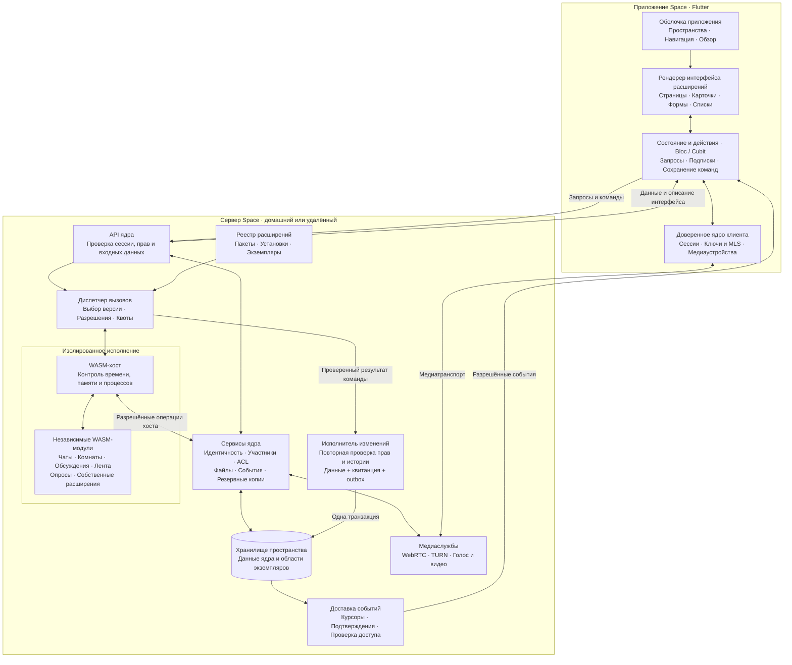
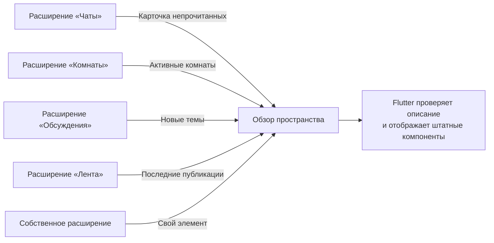
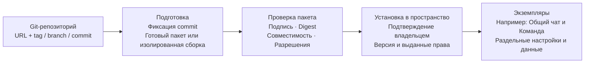

# Архитектура расширений: приложение и сервер

Состояние сверено 1 ноября 2026 года с [критериями P1](SPACE-PLUGINS-P1-EXIT.md) и [отчётом о защите истории](SPACE-PLUGINS-P1-HISTORY.md). Схемы показывают **целевую архитектуру**, а не состав уже выпущенной системы. Проверенные прототипы и оставшаяся работа разделены ниже. Полные контракты и этапы описаны в [спецификации](SPACE-PLUGINS.md), выполнение — в [TODO](../TODO.md).

## Приложение и сервер

Ядро предоставляет пространство, идентичность, участников, права и управление. Прикладные разделы подключаются как расширения. WASM выполняется на сервере; Flutter отображает проверенное декларативное описание через поддерживаемые компоненты.

Стрелки обозначают логические связи, а не обязательное разделение на сетевые сервисы. Области экземпляров не означают отдельную PostgreSQL для каждого расширения. Подробности маршрута медиатрафика зависят от режима WebRTC; схема не помещает его внутрь WASM.

Расширение определяет прикладные правила, но не выдаёт себе полномочия. Ядро проверяет текущие права пользователя, scope устройства, ACL и разрешения установки. У WASM нет прямого SQL-доступа, ключей или произвольной сети. Изменения применяет доверенный исполнитель после проверки результата; операции хоста не обходят эту границу. Для MLS-чатов расшифрование остаётся в клиенте, серверное расширение получает только разрешённые метаданные и зашифрованные конверты.

В текущем прототипе после штатного restore меняется `history_id`. Исходная команда сохраняет прежнее значение и отклоняется до WASM и повторно перед commit. Сверка сохранённой квитанции не исполняет команду; отсутствие квитанции означает неизвестный результат. Автоматически перепривязывать старый запрос к новой истории нельзя. Подмена файлов БД в обход штатного восстановления этим механизмом не покрывается.

## Состав страницы «Обзор»

Это примеры будущих contributions, а не уже подключённые карточки. Расширение объявляет элементы, ядро проверяет доступ к их данным, оболочка учитывает настройки размещения. Неизвестные компоненты и несовместимые версии обрабатываются по контракту UI. Произвольный Dart, JavaScript, HTML и клиентский WASM не входят в первый профиль. Новый интерфейс без обновления приложения возможен в пределах поддерживаемого набора компонентов.

При нуле прикладных расширений остаются управление пространством, участниками, установками, резервными копиями и диагностикой. Сбой расширения не должен мешать владельцу отключить его.

## Установка из Git и экземпляры

Установка выполняется на сервере выбранного пространства. Готовый пакет — обязательный первый способ; сборка исходников требует отдельной изоляции и не включается автоматически. Изменяемый ref разрешается в конкретный commit, установленные байты закрепляются digest. Обновление готовится и применяется отдельно: работающая установка не выполняет `git pull`. Подробности доверия, приватных источников и ограничений загрузки — в [контракте установки из Git](SPACE-PLUGINS.md#установка-из-git-репозитория).

Package — неизменяемый пакет; Installation — разрешённая установка версии в пространстве; Instance — экземпляр с собственными настройками и данными. Один пакет может обслуживать несколько экземпляров. Четыре официальных расширения планируются в отдельных репозиториях `space-extension-chat`, `space-extension-rooms`, `space-extension-discussions`, `space-extension-feed`. Они используют общие прикладные API; ключи и медиатранспорт остаются в ядре.

## Что уже реализовано и что предстоит

«Проверен прототип» означает ограниченный экспериментальный путь с доказательствами CI, а не включённую функцию рабочего продукта. P1 целиком остаётся открытым.

| Блок схемы | Уже реализовано и проверено в P1 | Ещё предстоит |
| --- | --- | --- |
| WASM-хост и диспетчер | [Сквозной стенд WASM → Flutter](SPACE-PLUGINS-P1-DEMO.md), изоляция компилятора и ресурсные ограничения [Linux](SPACE-PLUGINS-P1-ISOLATION.md) и [Windows](SPACE-PLUGINS-P1-WINDOWS.md), проверки аварий | Полная приёмка E03, рабочая упаковка и интеграция. Общий принудительный бюджет виртуализации macOS и ARM64-приёмка не доказаны; Windows Job Objects не заменяют изоляцию прав |
| Сессии, ACL и API | [Экспериментальный dispatcher](SPACE-PLUGINS-P1-CORE.md) с настоящими сессиями/ACL; protobuf и генерация Go/Dart/Connect/OpenAPI | Полный кандидат контрактов E01; публичный lifecycle и интеграция рабочего транспорта |
| Запись данных и повторы | [Атомарные мутации](SPACE-PLUGINS-P1-MUTATIONS.md), квитанции, [сверка](SPACE-PLUGINS-P1-RECONCILE.md), [tombstone](SPACE-PLUGINS-P1-RETENTION.md), общий алгоритм решений Go/Dart | Доверенное окно повторов и клиентский исполнитель с устойчивым снимком команды, отменой и восстановлением сессии; границы E02 остаются открытыми |
| Резервные копии и история | [Согласованный backup/restore](SPACE-PLUGINS-P1-BACKUP.md), [барьер старой истории](SPACE-PLUGINS-P1-HISTORY.md), физические и переносимые копии на трёх ОС | Включение в рабочую систему расширений и восстановление будущего реестра пакетов |
| Доставка событий | [Внутренний outbox](SPACE-PLUGINS-P1-OUTBOX.md), аренды, курсор и подтверждения доверенного обработчика | Рабочая рассылка клиентам с ACL, несколькими получателями и правилами очистки; стрелка к Flutter пока целевая |
| Интерфейс и Обзор | Декларативный рендерер и демонстрационный путь, widget-тесты и нативный горячий перезапуск Linux | Полная приёмка E06, contributions и платформенная матрица; рабочая навигация через реестр — P2 |
| Реестр и установка из Git | Спецификация пакетов, установок, экземпляров и Git-установки | Полный контракт и проверка доверия E01/E04; реестр/адаптеры — P2; Git resolver, установщик и управление обновлениями — P3 |
| Официальные расширения | Карта P0 и каталог исходников четырёх функций | Каркасы четырёх репозиториев, SDK и воспроизводимый пример — E05; перенос Обсуждений/Ленты — P4, Чатов/Комнат — P5 |
| Итоговая приёмка | Частные CI-прогоны с ревизиями и исходными журналами в связанных отчётах | Ограниченная смешанная нагрузка E07 и итоговая проверка всех E01–E07 |

Криптография, медиаслужбы и управление пространством уже существуют в ядре; их наличие не означает, что расширения подключены к ним через готовый публичный API. Переход начинается с адаптеров существующих функций и сохранения API/данных. Выделение репозиториев не переносит пользовательские данные автоматически.
