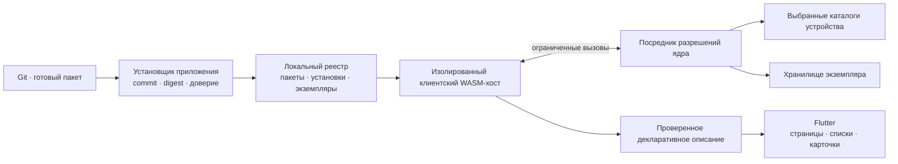

# Расширения приложения: клиентский WASM и библиотека игр

Решение от 3 ноября 2026 года. Клиентский WASM входит в целевую архитектуру расширений Space. Статус: проектирование; работающий клиентский хост, установка и платформенная изоляция ещё не реализованы и не приняты в CI. Серверные результаты P1 не подтверждают клиентское исполнение.

## Профили и владение

Экспериментальный кандидат контракта: [package-profile.schema.json](extensions/p1/package-profile.schema.json), примеры [client «Игры»](extensions/p1/package-profile-client.json), [server](extensions/p1/package-profile-server.json) и [hybrid](extensions/p1/package-profile-hybrid.json). Это отдельный профиль `space.package-profile.p1`, не замена уже используемого серверными прототипами `manifest.schema.json`.

Кандидат задаёт точный состав `modules`, отдельные `host_api` / `wasm_abi`, версию схемы данных, платформы и разрешения каждой части. Имена `space.client.p1` и `space_client_p1` зарезервированы для проектируемого ABI; работающего исполнителя этих импортов пока нет. Клиентский список платформ обозначает требования пакета, а не проверенные возможности приложения. Загрузчик должен отдельно сопоставить их с реально поддерживаемой платформой и ABI.

Для клиентской части разрешены только `storage.instance`, `device.catalog.read`, `ui.contribute`; для серверной — `storage.own`, `events.own`. Сеть и запуск процессов в этот первый кандидат не включены. Contributions клиента ограничены `app.navigation` / `app.home`, сервера — `space.navigation` / `space.overview`. Идентификаторы contributions уникальны во всём пакете; клиентское отображение требует `ui.contribute`. Последние два условия проверяет семантический валидатор в `tools/check_extension_profiles.py` дополнительно к JSON Schema. Ни декларация capability, ни успешная проверка схемы не выдаёт разрешение пользователя.

В `hybrid` обязательна пара `exchange_api` / `revision`; в одиночных профилях поле `compatibility` запрещено. Это точная версия контракта обмена двух частей пакета, а не диапазон совместимых версий. Согласование с уже установленной частью, доверие издателю, действительность локальных разрешений, проверка содержимого WASM и защищённое исполнение остаются последующими проверками хоста. Пути entry point пока фиксированы как `client.wasm` / `server.wasm`.

| Профиль | Исполнение | Установка и данные |
| --- | --- | --- |
| `server` | На сервере пространства | Управляет владелец пространства; права ядра пространства |
| `client` | На устройстве с приложением | Управляет пользователь устройства; локальные разрешения и хранилище |
| `hybrid` | Отдельные серверный и клиентский модули | Две установки, независимые разрешения; согласованные версии API обмена |

Клиентское расширение можно установить без подключения к пространству. Его установка привязана к локальному профилю приложения и устройству. Один пакет может иметь несколько экземпляров с отдельными настройками и данными. Права администратора пространства не дают доступа к файлам устройства и не разрешают автоматически устанавливать клиентский модуль.

При установке выбирается назначение: «В приложение на этом устройстве» или «В пространство». Для комбинированного пакета явно показываются обе части. Ни серверные полномочия, ни доступ к устройству не наследуются между ними. Установка одной части не считается успешной установкой второй; несовместимая пара не активирует совместные функции.

## Сценарий «Игры»

1. Пользователь открывает расширения приложения, вставляет HTTPS URL Git-репозитория и выбирает версию.
2. Установщик разрешает ссылку в точный commit, получает готовый пакет, проверяет digest, доверие издателю, совместимость клиентского ABI и перечень разрешений.
3. Пользователь разрешает чтение выбранных каталогов библиотек. В первой реализации выбор выполняется системным диалогом; поиск по всему диску без отдельного разрешения не производится.
4. Пакет активируется в работающем приложении. В навигации появляется «Игры», при желании — карточка библиотеки на домашней странице приложения.
5. Модуль обходит разрешённые каталоги через API хоста, распознаёт поддерживаемые форматы библиотек, нормализует записи и сохраняет индекс своего экземпляра. Поиск по этому индексу, фильтры и список игр работают локально.
6. Повторное сканирование отменяемо, ограничено бюджетом и сохраняет курсор. Отзыв доступа останавливает обращения и скрывает недоступные сведения; расширение предлагает выбрать каталог заново.

Список содержит название, источник, локальный идентификатор, состояние обнаружения и доступную обложку. Каталог с исполняемым файлом сам по себе не доказывает, что это установленная игра: ручные находки помечаются отдельно, поддерживаемые источники определяются адаптерами и тестовыми примерами. Ошибки одного источника не прерывают просмотр остальной библиотеки. Стабильные идентификаторы позволяют объединять повторы и обновлять индекс без дублирования.

Первая версия расширения ищет и отображает игры. Запуск игр — отдельное разрешение и последующий контракт: нельзя превращать поиск в произвольное исполнение команд. Обложки из сети также требуют отдельного разрешения. Пути, список игр и содержимое файлов не отправляются на сервер автоматически.

## Хост приложения

Модуль WASM содержит логику поиска и обработки данных; Flutter отображает поддерживаемые компоненты. Загружаемые Dart-библиотеки, произвольные нативные библиотеки и собственные виджеты плагина в этот профиль не входят. Визуальная игра с собственным графическим движком потребовала бы другого профиля; каталог игр использует обычные списки и карточки.

Хост клиента имеет собственный версионированный ABI и отдельную модель полномочий. Конкретные runtime, ABI и численные бюджеты выбираются прототипом до стабилизации SDK. Компиляция и исполнение должны иметь принудительные пределы памяти, CPU, времени, числа задач и размера сообщений; падение гостя не должно завершать приложение. Изоляция компилятора проверяется отдельно. Нельзя считать обычный Dart isolate достаточным доказательством этих гарантий.

## Доступ к устройству

Предлагаемые capability-имена предварительные, до принятия схемы manifest:

| Возможность | Контракт |
| --- | --- |
| `device.catalog.read` | Перечисление и ограниченное чтение только явно выбранных корней |
| `storage.instance` | Транзакционное хранилище, индекс и настройки своего экземпляра с квотой |
| `ui.contribute` | Декларативные разделы и карточки в разрешённых местах приложения |
| `network.fetch` | Необязательные запросы к явно разрешённым адресатам через посредника |

Вместо произвольного абсолютного пути гость получает непрозрачный дескриптор разрешённого каталога. Каждое чтение проверяет актуальность разрешения, размер, тип файла и принадлежность выбранному корню. Обход через `..`, ссылки, junction, смену объекта между проверкой и открытием и повторное использование отозванного дескриптора должен быть исключён платформенным адаптером. Простого сравнения строк путей недостаточно. Пагинация ограничивает размер перечисления; сетевые диски и дополнительные корни требуют явного решения пользователя.

Первая версия предоставляет чтение, без изменения и удаления файлов игр, shell, произвольного запуска процессов, доступа к ключам, токенам приложения и домашнему каталогу целиком. Секрет Git-загрузчика не передаётся модулю. Разрешение локального чтения не означает разрешение отправить прочитанное в сеть.

Локальные разрешения хранятся отдельно от пакета. Импорт настроек на другое устройство не переносит доступ к прежним каталогам. При смене пользователя приложения ресурсы, кеши и задачи разделяются. После отзыва доступа очищаются связанные кеши и индекс согласно явно заданной политике; для нового сканирования нужно новое разрешение.

## Установка и обновление без перезапуска

Повторно используются общие правила [Git-установки](SPACE-PLUGINS.md#установка-из-git-репозитория): закреплённый commit и digest пакета, проверка архива, запрет выполнения Git hooks и сборочных сценариев в приложении. Первый клиентский установщик принимает готовый WASM-пакет; отсутствие артефакта даёт понятную ошибку. Сборка разработчиком выполняется заранее или в отдельном доверенном CI.

Manifest должен различать профиль, entry point клиента, версии host/UI API, поддерживаемые платформы, capabilities и contributions. Точные поля предстоит включить в машиночитаемую схему E01. Для `hybrid` дополнительно задаётся совместимость API двух частей.

Проверка, подготовка и миграция локальных данных проходят до активации. При переключении версии хост закрывает приём новых действий, отменяет или дожидается текущих вызовов, сохраняет согласованную точку восстановления и атомарно меняет пакет/данные/поколение. Ответы прежнего поколения не применяются к новому интерфейсу. Отказ или закрытие приложения на любом этапе оставляет восстанавливаемую установку. Новые разрешения требуют отдельного согласия пользователя; обновление не расширяет их молча.

После активации реестр уведомляет оболочку, навигация и карточки обновляются без перезапуска Space. Удаление расширения отменяет задачи и отзывает дескрипторы; удаление его индекса и настроек предлагается отдельно. Файлы игр не являются данными расширения и не удаляются вместе с ним.

## Этапы и приёмка

Дополнение увеличивает объём подготовки 0.9.0: клиентский профиль входит в целевой P3, но готовность выпуска зависит от его самостоятельной приёмки. Уже опубликованные версии и серверные результаты не переименовываются. Первой целью прототипа выбирается настольное приложение Windows; переносимость на Linux/macOS проверяется отдельной матрицей. Поддержка мобильных платформ, браузера и конкретных каналов распространения не обещается без проверки доступных API, изоляции и действующих правил поставки загружаемого кода.

- P1: расширить E01 профилями и локальным владением; E03 — клиентской изоляцией и квотами; E04 — установщиком устройства; E06 — локальными contributions и действиями.
- P2: добавить реестр клиента, места отображения, управление разрешениями и адаптеры файловой системы. Сохранить независимость локальных расширений от соединения с пространством.
- P3: установка готового пакета из Git в работающий клиент и пример «Игры»; обновление, отключение и удаление без пересборки приложения.

В GitHub CI нужны установка без перезапуска, работа без сервера, поиск по контролируемым библиотекам, разные локальные профили, отказ доступа вне корня, ссылки и гонки смены файлов, отзыв разрешения во время обхода, ограничение большого каталога, отмена, trap/зацикливание/исчерпание памяти, падение компилятора, восстановление после завершения приложения и сбоя обновления, отклонение ответов старого поколения, доступность интерфейса и неподдерживаемая платформа. Результаты по каждой заявленной платформе фиксируются отдельно. До этих проверок возможность считается спроектированной, а не реализованной.

## Приёмка кандидата профилей — 3 ноября 2026

[GitHub CI 41538799442](https://github.com/space-protocol-project/space-protocol/actions/runs/41538799442) завершился успешно на коммите протокола `503da07d9b8e792bf40719ab254007bc27a93ce9`. Проверены 143 варианта: четыре допустимых приняты, 139 некорректных отклонены. Прежние контракты P1 также прошли свой набор проверок. Сборки клиентского хоста и проверки реального устройства в этом запуске не выполнялись.

Сохранены [результаты новых проверок](p1-results/2026-11-03-client-profiles/p1-profiles.txt), [прежних контрактов](p1-results/2026-11-03-client-profiles/p1-contracts.txt), [метаданные CI](p1-results/2026-11-03-client-profiles/run.json) и [контрольные суммы](p1-results/2026-11-03-client-profiles/SHA256SUMS). Локально выполнялось только редактирование и обработка результатов; проверки схем выполнены в GitHub CI.

Приёмка выше относится только к кандидату формата профилей. Продолжение — [локальные установки, выдача/отзыв разрешений и запросы каталогов](SPACE-PLUGINS-P1-CLIENT-LOCAL.md), с отдельными схемами, моделью и результатами CI. [Ответы и события каталога](SPACE-PLUGINS-P1-CATALOG-EVENTS.md) приняты отдельным контрактным срезом. [Полный жизненный цикл локального экземпляра](SPACE-PLUGINS-P1-CLIENT-LIFECYCLE.md) принят как отдельный кандидат контракта. Добавлен [прототип постоянного локального реестра](SPACE-PLUGINS-P1-CLIENT-REGISTRY.md). E01 в целом остаётся открытым: адаптер полного жизненного цикла и рабочая интеграция ещё предстоят; клиентский хост и платформенная изоляция проверяются отдельно в E03.
