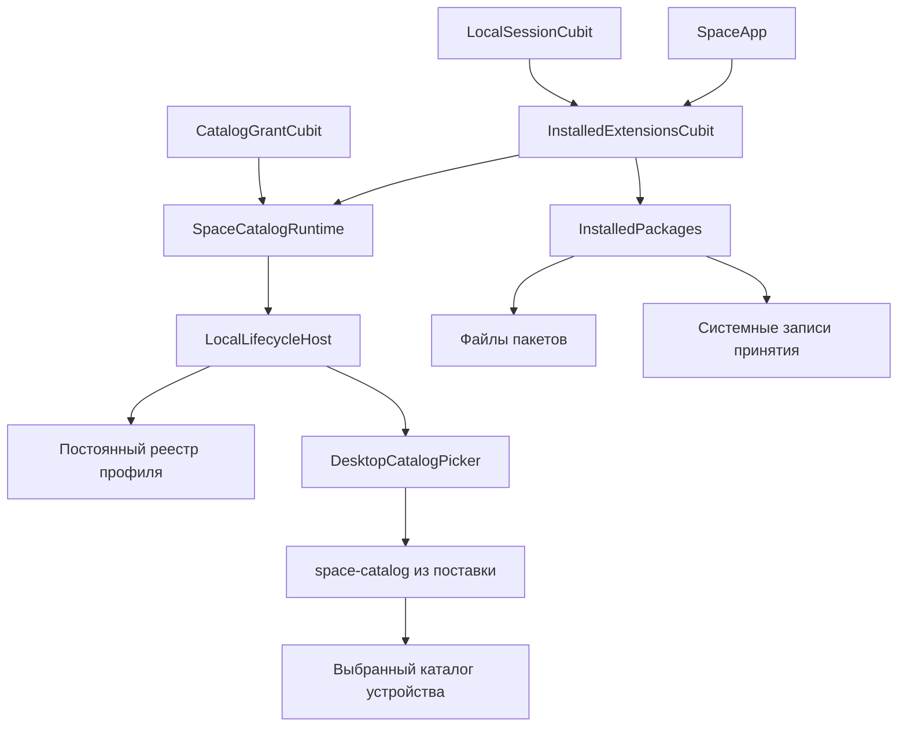

# P1. Установленные клиентские хосты и файловый процесс в поставке

Продолжение [экранов выдачи доступа](SPACE-PLUGINS-P1-CATALOG-GRANT-UI.md). Раньше `SpaceCatalogRuntime` получал хост только из тестового стенда. Теперь настольный `SpaceApp` создаёт `InstalledExtensionsCubit`, который после разблокировки открывает постоянный реестр текущего профиля и подключает проверенный хост к экрану каталогов.

## Владение и сессии

В приложении одновременно действует один хост профиля. Его каталог расположен в `ApplicationSupport/extensions-p1/<device>/<profile>`. Имена проверяются правилами локальных сессий. Подготовка каталога, разрешение пути файлового процесса, чтение защищённой записи и проверка пакетов сопровождаются повторной проверкой непрозрачной сессии и поколения операции. Поздний результат после блокировки или остановки не подключает хост.

Обычная блокировка сохраняет объект хоста, но сам хост отзывает разрешения, закрывает файловые корни и отменяет чтения. Это необходимо для ранее принятого сценария выбора папки: системное окно может пережить ровно одну блокировку, после чего нужны новая сессия того же профиля и явное согласие. Смена профиля отсоединяет и закрывает прежний хост. Завершение приложения сначала запрещает новые операции, закрывает хост, затем ожидает завершения файловых процессов; ошибка или таймаут не считаются успешным выходом.

Экран получает изменения списка установок через `SpaceCatalogRuntime`. Асинхронные подготовка и установка принадлежат Cubit; виджет лишь предоставляет владельца через `BlocProvider`. Внешний runtime, переданный тестовым стендом, остаётся во владении вызывающего кода.

## Приём пакета

`installAccepted` — внутренний порт доверенного установщика, недоступный гостевому WASM. Он принимает уже проверенный `LocalVerifiedPackage` и байты; загрузку из Git, проверку издателя и получение согласия на установку должен выполнить вызывающий доверенный компонент. Сам порт не принимает URL и не заменяет политику доверия.

Байты ограничены 16 МиБ и сверяются по SHA-256. Файл записывается через промежуточное имя с flush и переименованием. В системном защищённом хранилище сохраняется привязанная к профилю запись принятия: версия формата, область, digest, схема и запрошенные возможности. Запись перечитывается перед публикацией установки в транзакционном реестре. Для одного digest нельзя незаметно заменить принятую метаинформацию.

Файл без защищённой записи не принимается. При открытии проверяются пакет и метаинформация всех записей реестра; ошибка оставляет runtime без подключённого хоста. Прерванная установка может оставить файл или запись принятия без записи реестра: такие остатки не импортируются автоматически и не дают доступа. Их сборка мусора и общая дисковая квота ещё не реализованы. Это не единая транзакция файловой системы и системного хранилища и не гарантия при потере питания.

Новое расширение устанавливается отключённым. Согласие на каталог создаёт отдельный объект полномочий для конкретных экземпляра, пакета и выбранного корня. Включение и grant по-прежнему фиксируются одной транзакцией хоста; общей изменяемой переменной «согласие получено» нет. Прямое включение через этот адаптер без соответствующего согласия запрещено. Миграции, checkpoints и восстановление через новый адаптер пока отклоняются, а не подменяются фиктивным успехом.

## Поставка файлового процесса

Windows и Linux собирают Go-процесс через CMake; macOS — фазой сборки Xcode для архитектур приложения. Нужен Go из `native/space_catalog/go.mod`. Процесс и файл `.sha256` входят в обычные Inno Setup, Linux `.run` и macOS DMG. На macOS вспомогательный Mach-O подписывается перед вычислением хеша.

Путь вычисляется относительно `Platform.resolvedExecutable`: рядом с EXE/ELF, на macOS процесс находится в `Space.app/Contents/MacOS`, а хеш — в `Contents/Resources/space-catalog.sha256`. Такое разделение кода и данных соответствует [правилам подписи Apple](https://developer.apple.com/library/archive/technotes/tn2206/). Поиска через `PATH` или переменные окружения нет. Проверка ограничивает размер процесса 32 МиБ, отклоняет символическую ссылку на конечный файл и сверяет SHA-256 при разрешении пути и перед каждым запуском. Хеш защищает от повреждения в рамках доверенной установки приложения; замена злоумышленником одновременно процесса и файла хеша не предотвращается. Подпись и доверенная доставка всей поставки остаются отдельной обязанностью выпуска.

Выбранный путь каталога передаётся только файловому посреднику. Гость получает непрозрачные идентификаторы и ограниченные страницы/порции. Ранее принятые проверки верхнего уровня каталога, запрета подмены объектов и отзыва доступа сохраняются. Настоящая изоляция гостевого WASM не заменяется этим файловым процессом.

## Приёмка GitHub CI

Workflow `plugin-p1-installed-catalog.yml` проверяет Linux, Windows и macOS. Он запускает анализ Flutter, регрессионные тесты, Go-тесты, проверку когнитивной сложности и собирает release-приложение с отдельной точкой входа стенда. Файловый процесс собирается штатными правилами приложения.

Windows устанавливается через штатный Inno Setup в изолированный каталог; при существующей регистрации Space стенд отказывается продолжать. macOS-приложение копируется из смонтированного DMG. После готовности первого кадра драйвер сверяет PID и активирует уже запущенный пакет через `open`, как это делает `flutter_tools` при подключении к настольному процессу. На Linux используется штатное извлечение `.run`; регистрация меню и полный интерактивный Linux-установщик этим сценарием не проверяются.

Три независимых процесса проверяют приём установки и чтение, повторное открытие с отключёнными разрешениями и новой выдачей доступа, затем отказ после повреждения пакета. В положительных фазах проверяются перечисление файла, байты, отмена активного чтения и отсоединение runtime при выходе. Защищённое хранилище и файловый процесс настоящие; проверка личности и выбор каталога в этом стенде заменены фикстурами. Настоящие пароли и системные диалоги покрыты предыдущими отдельными отчётами. Связь владельца с обычным `SpaceApp` дополнительно проверяется widget-тестом.

Итоговый [GitHub CI 41990818157](https://github.com/space-protocol-project/space-app/actions/runs/41990818157) завершён со статусом `success` на коммите приложения `e3adae54864b3ccbec7342971a21ab3383c6d39c`. Все четыре задания успешны.

| Проверка | Windows 2025 | Linux Ubuntu 24.04 | macOS 15 |
| --- | --- | --- | --- |
| Анализ Flutter | Без замечаний | Без замечаний | Без замечаний |
| Регрессионные тесты | 49 успешных | 49 успешных | 49 успешных |
| `go test ./...` | Успех | Успех | Успех |
| Поставка | Штатная установка Inno Setup | Штатное извлечение `.run` | Копирование приложения из DMG |
| Первая установка и чтение | Успех | Успех | Успех |
| Новый процесс, отключённые grants, повторное согласие и чтение | Успех | Успех | Успех |
| Повреждённый пакет не подключается | Успех | Успех | Успех |
| Защищённая запись принятия | Windows DPAPI | GNOME Keyring | macOS Keychain |

На каждой ОС проверены три разных PID; в каждой положительной фазе выход отменяет активный допуск чтения, отсоединяет хост и ожидает файловый процесс. На macOS дополнительно прошла проверка подписи поставленного посредника. Общий максимум когнитивной сложности — 14 при пределе 15; максимум трёх новых компонентов владельца, пакетов и поиска посредника — 5. Глобальные проверки и их отчёт не измеряют Python, CMake или shell-код.

[Сохранённые результаты](p1-results/2026-11-05-installed-catalog/) содержат журналы тестов и нативных фаз, PID и SHA-256 посредника для каждой ОС, метаданные полного запуска и отчёт сложности. [SHA256SUMS](p1-results/2026-11-05-installed-catalog/SHA256SUMS) фиксирует байты материалов. Пароли, записи системного хранилища и каталоги профилей в эти материалы не включены. Последующие документационные коммиты не изменяют проверенный код.

Предварительные проверки выявили ошибку типизации поставщика согласия, сравнение канонического пути с алиасами `/var` и `RUNNER~1`, а также неверное размещение файла хеша в каталоге кода macOS. Последнее остановило CodeSign в [CI 41987676903](https://github.com/space-protocol-project/space-app/actions/runs/41987676903), хотя Windows/Linux и тесты трёх ОС уже прошли. Исправления не ослабляют проверки: применены типизированный Dart pattern, сравнение канонических путей и размещение данных в `Contents/Resources`. При просмотре Windows-адаптера также учтён предел длины ключа защищённого хранилища: имя записи содержит один SHA-256 составной привязки профиля и пакета. Неуспешные и отменённые прогоны не считаются итоговой приёмкой. Дублирующие автоматические сборки установщиков от промежуточных коммитов остановлены; целевой workflow сам собирает и проверяет три настольные поставки.

## Что остаётся

На момент этой приёмки установщик из Git оставался открытым. Продолжение — [готовые подписанные пакеты из публичного GitHub, проверка манифеста, доверие издателю и согласие пользователя](SPACE-PLUGINS-P1-GIT-INSTALL.md). Другие Git-транспорты, стабильный SDK, запуск клиентского гостя WASM, миграции через рабочий адаптер, общие квоты, удаление пакетов и очистка остатков остаются открытыми. Этот срез подключает сохранённые установки к существующему локальному хосту и поставляет файловый посредник; он не закрывает P1 или выпуск 0.9.0 целиком.
